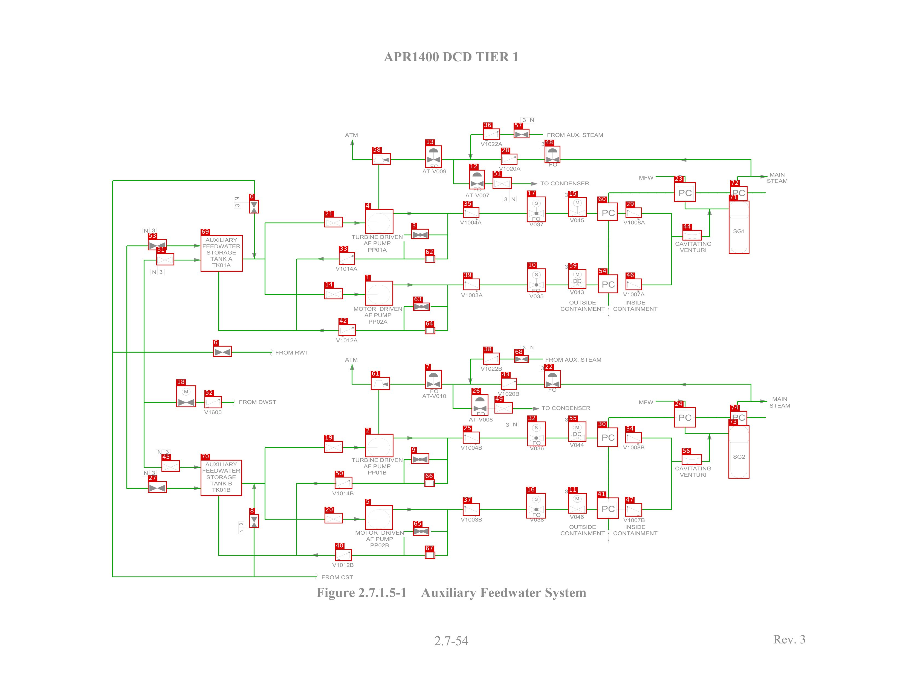
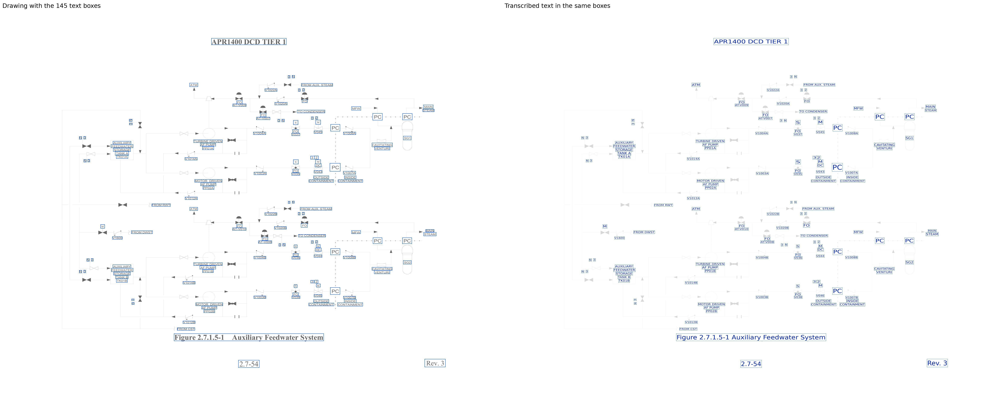

# AFW_APR1400

[All pages](README.md) · page 25 of 65

| Symbols | Pipe lines | Text lines | Size (px) | Connectivity |
|---|---|---|---|---|
| 75 | 150 | 145 | 3300 × 2550 | unverified |

Label files: [symbols](../labels/pseudo_AFW_APR1400.txt) · [pipe lines](../lines/pseudo_AFW_APR1400.json) · [text](../text/pseudo_AFW_APR1400.json) · [connectivity](../topology/pseudo_AFW_APR1400.json)

Symbol detection on this page (F1): original method (soup5) **0.909** → new method **0.897** (test half; see [symbol_detection](../symbol_detection/README.md)).

## Symbols and pipe lines

Red box = symbol; the number is its id (its line number in the symbol file, counting from 0). Green = pipe line. Click the image to open it at full size.

Symbol list (75 symbols, with connections)

Connectivity on this page: unverified (built automatically from the verified symbols and pipe lines, not yet fully checked by a human).

| Id | Box (x0, y0, x1, y1) | Connected to |
|---|---|---|
| 0 | 910, 731, 945, 780 | 6, 8, 14, 21, 69 |
| 1 | 1334, 1027, 1436, 1117 | 14, 39, 63, 64 |
| 2 | 1334, 1587, 1437, 1672 | 9, 19, 25, 66 |
| 3 | 1503, 837, 1567, 874 | 4, 33, 35, 62 |
| 4 | 1334, 765, 1437, 854 | 3, 21, 35, 62 |
| 5 | 1334, 1848, 1435, 1937 | 20, 37, 65, 67 |
| 6 | 778, 1265, 846, 1305 | 0, 8 |
| 7 | 1553, 1353, 1614, 1423 | 26, 38, 43, 61 |
| 8 | 911, 1880, 946, 1931 | 0, 6, 19, 20, 70 |
| 9 | 1502, 1658, 1568, 1697 | 2, 25, 50, 66 |
| 10 | 1927, 982, 1994, 1068 | 39, 59 |
| 11 | 2076, 1804, 2143, 1878 | 16, 41 |
| 12 | 1714, 621, 1771, 692 | 13, 28, 36, 51 |
| 13 | 1554, 532, 1614, 613 | 12, 28, 36, 58 |
| 14 | 1185, 1053, 1252, 1094 | 0, 1, 21, 69 |
| 15 | 2076, 721, 2143, 793 | 17, 60 |
| 16 | 1923, 1803, 1995, 1896 | 11, 37 |
| 17 | 1925, 719, 1995, 812 | 15, 35 |
| 18 | 644, 1410, 716, 1489 | 31, 45, 52 |
| 19 | 1184, 1613, 1253, 1655 | 2, 8, 20, 70 |
| 20 | 1186, 1876, 1252, 1914 | 5, 8, 19, 70 |
| 21 | 1185, 793, 1252, 831 | 0, 4, 14, 69 |
| 22 | 1989, 1354, 2048, 1419 | 43, 74 |
| 23 | 2463, 666, 2543, 738 | 44, 71 |
| 24 | 2463, 1489, 2543, 1563 | 56, 73 |
| 25 | 1691, 1579, 1752, 1622 | 2, 9, 32, 66 |
| 26 | 1723, 1442, 1784, 1520 | 7, 38, 43, 49 |
| 27 | 540, 1761, 609, 1802 | 53, 70 |
| 28 | 1830, 562, 1890, 603 | 12, 13, 36, 48 |
| 29 | 2286, 759, 2344, 796 | 44, 46, 60 |
| 30 | 2183, 1564, 2258, 1635 | 34, 55 |
| 31 | 571, 926, 636, 970 | 18, 45, 69 |
| 32 | 1927, 1542, 1994, 1632 | 25, 55 |
| 33 | 1238, 922, 1297, 968 | 3, 42, 62, 69 |
| 34 | 2285, 1580, 2345, 1621 | 30, 47, 56 |
| 35 | 1692, 758, 1751, 797 | 3, 4, 17, 62 |
| 36 | 1765, 470, 1827, 511 | 12, 13, 28, 57 |
| 37 | 1691, 1841, 1753, 1887 | 5, 16, 65, 67 |
| 38 | 1766, 1290, 1825, 1333 | 7, 26, 43, 68 |
| 39 | 1692, 1019, 1752, 1061 | 1, 10, 63, 64 |
| 40 | 1224, 2008, 1285, 2052 | 50, 65, 67, 70 |
| 41 | 2181, 1820, 2260, 1897 | 11, 47 |
| 42 | 1237, 1186, 1299, 1228 | 33, 63, 64, 69 |
| 43 | 1831, 1382, 1889, 1425 | 7, 22, 26, 38 |
| 44 | 2494, 841, 2564, 879 | 23, 29, 46, 71 |
| 45 | 590, 1684, 657, 1725 | 18, 31, 70 |
| 46 | 2286, 1019, 2345, 1061 | 29, 44, 54 |
| 47 | 2284, 1840, 2346, 1889 | 34, 41, 56 |
| 48 | 1990, 533, 2047, 596 | 28, 72 |
| 49 | 1807, 1471, 1873, 1512 | 26 |
| 50 | 1223, 1744, 1287, 1788 | 9, 40, 66, 70 |
| 51 | 1800, 647, 1869, 691 | 12 |
| 52 | 747, 1449, 809, 1493 | 18 |
| 53 | 540, 875, 608, 915 | 27, 69 |
| 54 | 2185, 1004, 2258, 1072 | 46, 59 |
| 55 | 2077, 1542, 2142, 1615 | 30, 32 |
| 56 | 2491, 1662, 2565, 1700 | 24, 34, 47, 73 |
| 57 | 1877, 471, 1934, 505 | 36 |
| 58 | 1360, 560, 1427, 602 | 13 |
| 59 | 2077, 984, 2142, 1056 | 10, 54 |
| 60 | 2183, 741, 2257, 807 | 15, 29 |
| 61 | 1355, 1379, 1425, 1426 | 7 |
| 62 | 1552, 934, 1590, 960 | 3, 4, 33, 35 |
| 63 | 1510, 1107, 1570, 1137 | 1, 39, 42, 64 |
| 64 | 1552, 1196, 1590, 1222 | 1, 39, 42, 63 |
| 65 | 1509, 1928, 1568, 1959 | 5, 37, 40, 67 |
| 66 | 1551, 1754, 1589, 1780 | 2, 9, 25, 50 |
| 67 | 1552, 2018, 1590, 2044 | 5, 37, 40, 65 |
| 68 | 1879, 1300, 1932, 1326 | 38 |
| 69 | 733, 860, 886, 993 | 0, 14, 21, 31, 33, 42, 53 |
| 70 | 733, 1682, 884, 1814 | 8, 19, 20, 27, 40, 45, 50 |
| 71 | 2663, 734, 2738, 928 | 23, 44, 72 |
| 72 | 2668, 681, 2731, 735 | 48, 71 |
| 73 | 2662, 1556, 2738, 1750 | 24, 56, 74 |
| 74 | 2668, 1503, 2730, 1557 | 22, 73 |

## Text

Left: the drawing with the text boxes. Right: the transcribed text placed in the same boxes and in the same direction, so the two sides can be compared word by word. Click the image to open it at full size.

Text list (145 lines)

| Id | Text | Reading direction | Box (x0, y0, x1, y1) |
|---|---|---|---|
| 0 | APR1400 DCD TIER 1 | normal | 1401, 183, 1898, 227 |
| 1 | N | normal | 1936, 429, 1953, 447 |
| 2 | 3 | normal | 1909, 430, 1923, 448 |
| 3 | ATM | normal | 1256, 480, 1312, 505 |
| 4 | FROM AUX. STEAM | normal | 1997, 482, 2206, 502 |
| 5 | 2 | normal | 2005, 517, 2019, 535 |
| 6 | V1022A | normal | 1755, 518, 1837, 536 |
| 7 | 3 | normal | 1977, 518, 1991, 536 |
| 8 | FO | normal | 2001, 591, 2038, 611 |
| 9 | FO | normal | 1568, 596, 1607, 620 |
| 10 | V1020A | normal | 1821, 608, 1904, 626 |
| 11 | AT-V009 | normal | 1542, 618, 1632, 636 |
| 12 | MAIN | normal | 2806, 625, 2872, 650 |
| 13 | MFW | normal | 2330, 636, 2392, 661 |
| 14 | STEAM | normal | 2802, 653, 2879, 671 |
| 15 | TO CONDENSER | normal | 1969, 659, 2154, 679 |
| 16 | FO | normal | 1725, 679, 1764, 705 |
| 17 | PC | normal | 2470, 681, 2535, 727 |
| 18 | PC | normal | 2668, 682, 2733, 725 |
| 19 | 2 | normal | 2091, 703, 2106, 721 |
| 20 | 3 | normal | 2063, 704, 2078, 722 |
| 21 | AT-V007 | normal | 1699, 706, 1790, 724 |
| 22 | N | bottom to top | 856, 720, 876, 735 |
| 23 | 3 | normal | 1841, 720, 1856, 738 |
| 24 | N | normal | 1868, 720, 1885, 738 |
| 25 | M | normal | 2092, 725, 2126, 755 |
| 26 | S | normal | 1944, 727, 1976, 757 |
| 27 | 3 | bottom to top | 857, 745, 877, 758 |
| 28 | PC | normal | 2191, 754, 2254, 800 |
| 29 | FO | normal | 1939, 788, 1978, 812 |
| 30 | V045 | normal | 2081, 797, 2136, 815 |
| 31 | V1004A | normal | 1679, 805, 1762, 823 |
| 32 | V1008A | normal | 2276, 805, 2359, 823 |
| 33 | V037 | normal | 1933, 812, 1988, 830 |
| 34 | SG1 | normal | 2673, 832, 2726, 858 |
| 35 | 3 | normal | 554, 834, 568, 852 |
| 36 | N | normal | 525, 835, 542, 853 |
| 37 | TURBINE DRIVEN | normal | 1283, 856, 1474, 876 |
| 38 | AUXILIARY | normal | 748, 866, 868, 887 |
| 39 | CAVITATING | normal | 2465, 877, 2602, 904 |
| 40 | AF PUMP | normal | 1327, 879, 1430, 899 |
| 41 | FEEDWATER | normal | 735, 887, 882, 910 |
| 42 | PP01A | normal | 1341, 900, 1417, 923 |
| 43 | VENTURI | normal | 2482, 901, 2585, 925 |
| 44 | STORAGE | normal | 750, 911, 865, 935 |
| 45 | TANK A | normal | 763, 931, 853, 960 |
| 46 | TK01A | normal | 770, 956, 848, 981 |
| 47 | 2 | normal | 2084, 963, 2111, 986 |
| 48 | 3 | normal | 2058, 964, 2085, 986 |
| 49 | V1014A | normal | 1225, 974, 1308, 992 |
| 50 | 3 | normal | 581, 986, 595, 1004 |
| 51 | N | normal | 555, 987, 572, 1005 |
| 52 | S | normal | 1944, 988, 1978, 1018 |
| 53 | M | normal | 2091, 988, 2126, 1016 |
| 54 | PC | normal | 2186, 1012, 2256, 1066 |
| 55 | DC | normal | 2088, 1015, 2130, 1038 |
| 56 | FO | normal | 1940, 1051, 1978, 1074 |
| 57 | V043 | normal | 2081, 1060, 2136, 1078 |
| 58 | V1007A | normal | 2275, 1065, 2358, 1086 |
| 59 | V1003A | normal | 1683, 1071, 1766, 1089 |
| 60 | V035 | normal | 1933, 1075, 1988, 1093 |
| 61 | OUTSIDE | normal | 2078, 1095, 2180, 1116 |
| 62 | INSIDE | normal | 2282, 1095, 2361, 1116 |
| 63 | MOTOR DRIVEN | normal | 1290, 1119, 1472, 1139 |
| 64 | CONTAINMENT | normal | 2047, 1121, 2212, 1139 |
| 65 | CONTAINMENT | normal | 2240, 1121, 2405, 1139 |
| 66 | AF PUMP | normal | 1329, 1142, 1432, 1162 |
| 67 | PP02A | normal | 1344, 1164, 1419, 1186 |
| 68 | V1012A | normal | 1226, 1236, 1309, 1254 |
| 69 | N | normal | 1937, 1263, 1951, 1278 |
| 70 | 3 | normal | 1910, 1264, 1923, 1279 |
| 71 | FROM RWT | normal | 1006, 1281, 1130, 1299 |
| 72 | ATM | normal | 1257, 1304, 1311, 1326 |
| 73 | FROM AUX. STEAM | normal | 1989, 1304, 2200, 1324 |
| 74 | 2 | normal | 2003, 1337, 2018, 1355 |
| 75 | 3 | normal | 1976, 1338, 1990, 1356 |
| 76 | V1022B | normal | 1755, 1340, 1836, 1358 |
| 77 | FO | normal | 1995, 1411, 2038, 1438 |
| 78 | FO | normal | 1568, 1417, 1606, 1440 |
| 79 | M | normal | 666, 1418, 694, 1444 |
| 80 | V1020B | normal | 1818, 1432, 1899, 1450 |
| 81 | AT-V010 | normal | 1541, 1440, 1632, 1458 |
| 82 | MAIN | normal | 2822, 1451, 2878, 1469 |
| 83 | MFW | normal | 2330, 1458, 2391, 1480 |
| 84 | FROM DWST | normal | 870, 1459, 1011, 1480 |
| 85 | STEAM | normal | 2808, 1470, 2892, 1495 |
| 86 | TO CONDENSER | normal | 1978, 1484, 2159, 1502 |
| 87 | V1600 | normal | 744, 1499, 811, 1517 |
| 88 | FO | normal | 1737, 1502, 1776, 1525 |
| 89 | PC | normal | 2472, 1506, 2533, 1546 |
| 90 | PC | normal | 2667, 1506, 2730, 1546 |
| 91 | 2 | normal | 2091, 1525, 2106, 1543 |
| 92 | AT-V008 | normal | 1712, 1526, 1802, 1544 |
| 93 | 3 | normal | 2063, 1526, 2078, 1544 |
| 94 | N | normal | 1874, 1544, 1891, 1562 |
| 95 | 3 | normal | 1848, 1545, 1862, 1563 |
| 96 | M | normal | 2096, 1551, 2123, 1573 |
| 97 | S | normal | 1949, 1553, 1970, 1574 |
| 98 | DC | normal | 2089, 1574, 2130, 1597 |
| 99 | PC | normal | 2191, 1578, 2254, 1620 |
| 100 | FO | normal | 1942, 1610, 1978, 1630 |
| 101 | V044 | normal | 2081, 1619, 2135, 1637 |
| 102 | V1008B | normal | 2275, 1628, 2357, 1646 |
| 103 | V1004B | normal | 1682, 1629, 1763, 1647 |
| 104 | V036 | normal | 1934, 1631, 1989, 1649 |
| 105 | 3 | normal | 604, 1644, 618, 1662 |
| 106 | N | normal | 575, 1645, 592, 1663 |
| 107 | SG2 | normal | 2673, 1657, 2727, 1682 |
| 108 | TURBINE DRIVEN | normal | 1283, 1671, 1474, 1691 |
| 109 | AUXILIARY | normal | 747, 1685, 868, 1708 |
| 110 | AF PUMP | normal | 1324, 1692, 1430, 1715 |
| 111 | CAVITATING | normal | 2465, 1702, 2600, 1723 |
| 112 | FEEDWATER | normal | 737, 1708, 882, 1732 |
| 113 | PP01B | normal | 1342, 1716, 1415, 1738 |
| 114 | 3 | normal | 554, 1721, 568, 1739 |
| 115 | N | normal | 525, 1722, 542, 1740 |
| 116 | VENTURI | normal | 2480, 1723, 2585, 1746 |
| 117 | STORAGE | normal | 752, 1734, 864, 1755 |
| 118 | TANK B | normal | 765, 1757, 850, 1778 |
| 119 | TK01B | normal | 770, 1778, 845, 1803 |
| 120 | 2 | normal | 2085, 1787, 2109, 1808 |
| 121 | 3 | normal | 2059, 1788, 2081, 1807 |
| 122 | V1014B | normal | 1212, 1796, 1294, 1814 |
| 123 | M | normal | 2096, 1812, 2124, 1834 |
| 124 | S | normal | 1949, 1817, 1970, 1838 |
| 125 | PC | normal | 2189, 1836, 2254, 1883 |
| 126 | FO | normal | 1940, 1871, 1979, 1894 |
| 127 | V046 | normal | 2081, 1882, 2135, 1900 |
| 128 | V1003B | normal | 1682, 1892, 1763, 1910 |
| 129 | V038 | normal | 1934, 1892, 1989, 1910 |
| 130 | V1007B | normal | 2276, 1894, 2358, 1912 |
| 131 | 3 | bottom to top | 872, 1912, 889, 1924 |
| 132 | INSIDE | normal | 2281, 1914, 2362, 1938 |
| 133 | OUTSIDE | normal | 2078, 1915, 2180, 1936 |
| 134 | N | bottom to top | 873, 1936, 890, 1949 |
| 135 | MOTOR DRIVEN | normal | 1297, 1937, 1477, 1958 |
| 136 | CONTAINMENT | normal | 2237, 1937, 2405, 1961 |
| 137 | CONTAINMENT | normal | 2046, 1939, 2214, 1959 |
| 138 | AF PUMP | normal | 1336, 1960, 1438, 1980 |
| 139 | PP02B | normal | 1350, 1983, 1424, 2004 |
| 140 | V1012B | normal | 1212, 2058, 1294, 2076 |
| 141 | FROM CST | normal | 1174, 2103, 1292, 2121 |
| 142 | Figure 2.7.1.5-1 Auxiliary Feedwater System | normal | 1153, 2142, 2146, 2191 |
| 143 | Rev. 3 | normal | 2815, 2311, 2953, 2364 |
| 144 | 2.7-54 | normal | 1580, 2318, 1719, 2368 |

