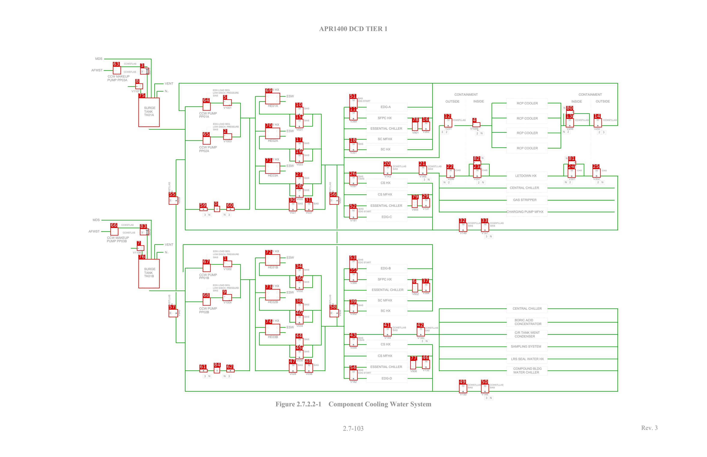
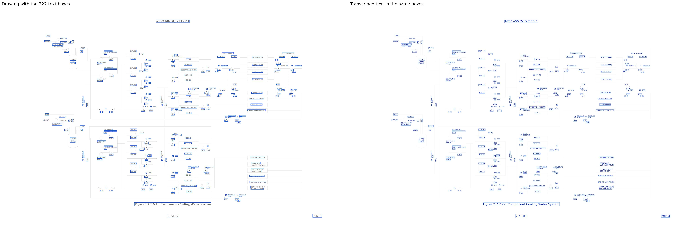

# CCWS_APR1400

[All pages](README.md) · page 37 of 65

| Symbols | Pipe lines | Text lines | Size (px) | Connectivity |
|---|---|---|---|---|
| 85 | 272 | 322 | 5100 × 3300 | unverified |

Label files: [symbols](../labels/pseudo_CCWS_APR1400.txt) · [pipe lines](../lines/pseudo_CCWS_APR1400.json) · [text](../text/pseudo_CCWS_APR1400.json) · [connectivity](../topology/pseudo_CCWS_APR1400.json)

Symbol detection on this page (F1): original method (soup5) **0.667** → new method **0.855** (test half; see [symbol_detection](../symbol_detection/README.md)).

## Symbols and pipe lines

Red box = symbol; the number is its id (its line number in the symbol file, counting from 0). Green = pipe line. Click the image to open it at full size.

Symbol list (85 symbols, with connections)

Connectivity on this page: unverified (built automatically from the verified symbols and pipe lines, not yet fully checked by a human).

| Id | Box (x0, y0, x1, y1) | Connected to |
|---|---|---|
| 0 | 1544, 1487, 1586, 1530 | 59, 60 |
| 1 | 1610, 1882, 1673, 1928 | 9, 47, 62, 67, 72, 73, 74 |
| 2 | 1610, 963, 1673, 1008 | 5, 30, 60, 65, 69, 70, 71 |
| 3 | 1011, 489, 1074, 537 | 63, 75 |
| 4 | 3408, 883, 3464, 917 | 12 |
| 5 | 1609, 717, 1671, 763 | 2, 30, 60, 64, 69, 70, 71 |
| 6 | 2973, 2046, 3015, 2110 | 37 |
| 7 | 987, 1771, 1040, 1810 | 76 |
| 8 | 976, 602, 1031, 643 | 75 |
| 9 | 1605, 2124, 1672, 2172 | 1, 47, 62, 68, 72, 73, 74 |
| 10 | 2130, 772, 2188, 837 | 11, 12, 15, 17, 18, 19, 20, 26, 27, 28, 31, 51, 52, 56, 69 |
| 11 | 2520, 803, 2578, 868 | 10, 12, 15, 17, 18, 19, 20, 26, 27, 28, 31, 51, 52, 56 |
| 12 | 3204, 854, 3261, 919 | 4, 10, 11, 15, 17, 18, 19, 20, 26, 27, 28, 31, 51, 52, 56 |
| 13 | 4081, 854, 4139, 919 | 14, 80 |
| 14 | 4283, 854, 4341, 919 | 13, 16, 29, 32, 55, 59, 64, 65, 75, 80 |
| 15 | 2130, 859, 2188, 924 | 10, 11, 12, 17, 18, 19, 20, 26, 27, 28, 31, 51, 52, 56, 69 |
| 16 | 3044, 878, 3101, 943 | 14, 29, 32, 55, 59, 64, 65, 75, 78 |
| 17 | 2131, 1023, 2188, 1088 | 10, 11, 12, 15, 18, 19, 20, 26, 27, 28, 31, 51, 52, 56, 70 |
| 18 | 2520, 1028, 2578, 1093 | 10, 11, 12, 15, 17, 19, 20, 26, 27, 28, 31, 51, 52, 56 |
| 19 | 2130, 1110, 2188, 1175 | 10, 11, 12, 15, 17, 18, 20, 26, 27, 28, 31, 51, 52, 56, 70 |
| 20 | 2767, 1197, 2824, 1262 | 10, 11, 12, 15, 17, 18, 19, 21, 26, 27, 28, 31, 51, 52, 56 |
| 21 | 3021, 1197, 3079, 1262 | 20, 22 |
| 22 | 3220, 1218, 3278, 1283 | 21, 23, 82 |
| 23 | 3413, 1218, 3471, 1283 | 22, 82 |
| 24 | 4095, 1218, 4152, 1283 | 25, 81 |
| 25 | 4274, 1217, 4332, 1282 | 24, 33, 81 |
| 26 | 2520, 1270, 2578, 1335 | 10, 11, 12, 15, 17, 18, 19, 20, 27, 28, 31, 51, 52, 56 |
| 27 | 2131, 1274, 2188, 1339 | 10, 11, 12, 15, 17, 18, 19, 20, 26, 28, 31, 51, 52, 56, 71 |
| 28 | 2131, 1361, 2188, 1426 | 10, 11, 12, 15, 17, 18, 19, 20, 26, 27, 31, 51, 52, 56, 71 |
| 29 | 3044, 1432, 3101, 1497 | 14, 16, 32, 55, 59, 64, 65, 75, 79 |
| 30 | 2084, 1459, 2142, 1524 | 2, 5, 31, 60, 69, 70, 71 |
| 31 | 2199, 1459, 2257, 1524 | 10, 11, 12, 15, 17, 18, 19, 20, 26, 27, 28, 30, 51, 52, 56 |
| 32 | 3311, 1608, 3369, 1673 | 14, 16, 29, 33, 55, 59, 64, 65, 75 |
| 33 | 3470, 1608, 3527, 1673 | 25, 32 |
| 34 | 2131, 1937, 2188, 2002 | 35, 36, 38, 39, 40, 41, 43, 44, 45, 48, 53, 54, 58, 72 |
| 35 | 2520, 1968, 2578, 2033 | 34, 36, 38, 39, 40, 41, 43, 44, 45, 48, 53, 54, 58 |
| 36 | 2131, 2025, 2188, 2090 | 34, 35, 38, 39, 40, 41, 43, 44, 45, 48, 53, 54, 58, 72 |
| 37 | 3044, 2043, 3101, 2108 | 6, 46, 49, 57, 61, 67, 68, 76 |
| 38 | 2131, 2188, 2188, 2253 | 34, 35, 36, 39, 40, 41, 43, 44, 45, 48, 53, 54, 58, 73 |
| 39 | 2521, 2194, 2579, 2259 | 34, 35, 36, 38, 40, 41, 43, 44, 45, 48, 53, 54, 58 |
| 40 | 2131, 2276, 2188, 2341 | 34, 35, 36, 38, 39, 41, 43, 44, 45, 48, 53, 54, 58, 73 |
| 41 | 2766, 2363, 2824, 2428 | 34, 35, 36, 38, 39, 40, 42, 43, 44, 45, 48, 53, 54, 58 |
| 42 | 3006, 2363, 3064, 2428 | 41 |
| 43 | 2521, 2436, 2579, 2501 | 34, 35, 36, 38, 39, 40, 41, 44, 45, 48, 53, 54, 58 |
| 44 | 2131, 2440, 2188, 2505 | 34, 35, 36, 38, 39, 40, 41, 43, 45, 48, 53, 54, 58, 74 |
| 45 | 2131, 2527, 2188, 2592 | 34, 35, 36, 38, 39, 40, 41, 43, 44, 48, 53, 54, 58, 74 |
| 46 | 3044, 2598, 3101, 2663 | 37, 49, 57, 61, 67, 68, 76, 77 |
| 47 | 2084, 2625, 2142, 2690 | 1, 9, 48, 62, 72, 73, 74 |
| 48 | 2199, 2625, 2257, 2690 | 34, 35, 36, 38, 39, 40, 41, 43, 44, 45, 47, 53, 54, 58 |
| 49 | 3311, 2773, 3369, 2838 | 37, 46, 50, 57, 61, 67, 68, 76 |
| 50 | 3470, 2773, 3527, 2838 | 49 |
| 51 | 2520, 710, 2578, 786 | 10, 11, 12, 15, 17, 18, 19, 20, 26, 27, 28, 31, 52, 56 |
| 52 | 2520, 1504, 2578, 1580 | 10, 11, 12, 15, 17, 18, 19, 20, 26, 27, 28, 31, 51, 56 |
| 53 | 2520, 1876, 2578, 1952 | 34, 35, 36, 38, 39, 40, 41, 43, 44, 45, 48, 54, 58 |
| 54 | 2521, 2670, 2579, 2746 | 34, 35, 36, 38, 39, 40, 41, 43, 44, 45, 48, 53, 58 |
| 55 | 1217, 1419, 1284, 1477 | 14, 16, 29, 32, 57, 59, 64, 65, 75 |
| 56 | 2377, 1419, 2444, 1477 | 10, 11, 12, 15, 17, 18, 19, 20, 26, 27, 28, 31, 51, 52, 58 |
| 57 | 1216, 2232, 1283, 2290 | 37, 46, 49, 55, 61, 67, 68, 76 |
| 58 | 2377, 2232, 2444, 2290 | 34, 35, 36, 38, 39, 40, 41, 43, 44, 45, 48, 53, 54, 56 |
| 59 | 1439, 1498, 1496, 1523 | 0, 14, 16, 29, 32, 55, 64, 65, 75 |
| 60 | 1633, 1498, 1691, 1522 | 0, 2, 5, 30, 69, 70, 71 |
| 61 | 1439, 2664, 1496, 2688 | 37, 46, 49, 57, 67, 68, 76, 84 |
| 62 | 1633, 2664, 1691, 2688 | 1, 9, 47, 72, 73, 74, 84 |
| 63 | 814, 478, 872, 536 | 3 |
| 64 | 1462, 740, 1519, 798 | 5, 14, 16, 29, 32, 55, 59, 65, 75 |
| 65 | 1462, 985, 1519, 1043 | 2, 14, 16, 29, 32, 55, 59, 64, 75 |
| 66 | 796, 1642, 853, 1700 | 83 |
| 67 | 1462, 1905, 1519, 1963 | 1, 37, 46, 49, 57, 61, 68, 76 |
| 68 | 1462, 2148, 1519, 2206 | 9, 37, 46, 49, 57, 61, 67, 76 |
| 69 | 1913, 670, 2020, 752 | 2, 5, 10, 15, 30, 60, 70, 71 |
| 70 | 1913, 922, 2020, 1003 | 2, 5, 17, 19, 30, 60, 69, 71 |
| 71 | 1913, 1173, 2020, 1254 | 2, 5, 27, 28, 30, 60, 69, 70 |
| 72 | 1913, 1836, 2020, 1917 | 1, 9, 34, 36, 47, 62, 73, 74 |
| 73 | 1913, 2087, 2020, 2168 | 1, 9, 38, 40, 47, 62, 72, 74 |
| 74 | 1913, 2338, 2020, 2419 | 1, 9, 44, 45, 47, 62, 72, 73 |
| 75 | 998, 705, 1151, 916 | 3, 8, 14, 16, 29, 32, 55, 59, 64, 65 |
| 76 | 998, 1870, 1151, 2081 | 7, 37, 46, 49, 57, 61, 67, 68, 83 |
| 77 | 2959, 2602, 3000, 2666 | 46 |
| 78 | 2972, 880, 3015, 944 | 16 |
| 79 | 2970, 1437, 3012, 1500 | 29 |
| 80 | 4084, 796, 4139, 830 | 13, 14 |
| 81 | 4099, 1160, 4154, 1194 | 24, 25 |
| 82 | 3414, 1160, 3470, 1194 | 22, 23 |
| 83 | 1009, 1650, 1074, 1698 | 66, 76 |
| 84 | 1542, 2651, 1586, 2695 | 61, 62 |

## Text

Left: the drawing with the text boxes. Right: the transcribed text placed in the same boxes and in the same direction, so the two sides can be compared word by word. Click the image to open it at full size.

Text list (322 lines)

| Id | Text | Reading direction | Box (x0, y0, x1, y1) |
|---|---|---|---|
| 0 | APR1400 DCD TIER 1 | normal | 2301, 183, 2797, 227 |
| 1 | MDS | normal | 681, 407, 743, 436 |
| 2 | CCWSTLAS | normal | 892, 449, 985, 467 |
| 3 | AFWST | normal | 655, 490, 743, 518 |
| 4 | V011 | bottom to top | 1066, 490, 1094, 541 |
| 5 | M | bottom to top | 1005, 497, 1041, 535 |
| 6 | CCWSTLAS | normal | 890, 505, 986, 528 |
| 7 | CCW MAKEUP | normal | 775, 536, 936, 563 |
| 8 | PUMP PP03A | normal | 771, 564, 922, 589 |
| 9 | VENT | normal | 1180, 585, 1252, 614 |
| 10 | CCW HX | normal | 1918, 632, 2018, 660 |
| 11 | N2 | normal | 1182, 640, 1220, 672 |
| 12 | EDG LOAD SEQ. | normal | 1534, 640, 1660, 657 |
| 13 | V1107 | normal | 943, 643, 1011, 670 |
| 14 | LOW DISCH. PRESSURE | normal | 1532, 657, 1725, 675 |
| 15 | CONTAINMENT | normal | 4172, 666, 4345, 691 |
| 16 | CONTAINMENT | normal | 3275, 667, 3449, 694 |
| 17 | SIAS | normal | 1531, 677, 1576, 700 |
| 18 | ESW | normal | 2057, 679, 2124, 707 |
| 19 | SIAS | normal | 2576, 696, 2621, 719 |
| 20 | M | normal | 2536, 707, 2565, 735 |
| 21 | INSIDE | normal | 3410, 714, 3495, 745 |
| 22 | OUTSIDE | normal | 3210, 717, 3318, 744 |
| 23 | INSIDE | normal | 4120, 717, 4202, 744 |
| 24 | OUTSIDE | normal | 4295, 717, 4403, 744 |
| 25 | EDG START | normal | 2577, 718, 2674, 736 |
| 26 | RCP COOLER | normal | 3724, 731, 3882, 756 |
| 27 | HE01A | normal | 1928, 749, 2009, 775 |
| 28 | EDG-A | normal | 2743, 755, 2823, 783 |
| 29 | V1001 | normal | 1607, 761, 1672, 788 |
| 30 | SURGE | normal | 1035, 763, 1125, 789 |
| 31 | N | normal | 4064, 770, 4079, 788 |
| 32 | 2 | normal | 4096, 770, 4109, 788 |
| 33 | M | normal | 2152, 772, 2172, 792 |
| 34 | SIAS | normal | 2193, 775, 2232, 791 |
| 35 | V191 | normal | 2522, 779, 2576, 803 |
| 36 | TANK | normal | 1035, 789, 1105, 817 |
| 37 | M | normal | 2536, 801, 2563, 825 |
| 38 | CCW PUMP | normal | 1436, 806, 1564, 828 |
| 39 | TK01A | normal | 1034, 812, 1115, 843 |
| 40 | V1100 | normal | 4077, 826, 4142, 849 |
| 41 | PP01A | normal | 1434, 829, 1510, 852 |
| 42 | V021 | normal | 2134, 830, 2188, 861 |
| 43 | SFPC HX | normal | 2720, 835, 2830, 864 |
| 44 | RCP COOLER | normal | 3724, 839, 3882, 864 |
| 45 | M | normal | 4095, 853, 4122, 875 |
| 46 | M | normal | 3224, 854, 3244, 874 |
| 47 | M | normal | 4301, 855, 4320, 874 |
| 48 | CCWSTLLAS | normal | 4146, 856, 4248, 873 |
| 49 | M | normal | 2151, 859, 2170, 879 |
| 50 | CCWSTLLAS | normal | 3260, 859, 3360, 875 |
| 51 | CCWSTLLAS | normal | 4351, 859, 4451, 875 |
| 52 | SIAS | normal | 2193, 862, 2232, 878 |
| 53 | V389 | normal | 2522, 862, 2577, 886 |
| 54 | M | normal | 3054, 871, 3090, 902 |
| 55 | CCW HX | normal | 1916, 882, 2017, 912 |
| 56 | EDG LOAD SEQ. | normal | 1535, 885, 1663, 901 |
| 57 | LOW DISCH. PRESSURE | normal | 1533, 904, 1724, 922 |
| 58 | ESSENTIAL CHILLER | normal | 2666, 908, 2905, 941 |
| 59 | V1099 | normal | 3388, 913, 3455, 940 |
| 60 | V231 | normal | 3208, 914, 3259, 938 |
| 61 | V249 | normal | 4085, 917, 4139, 940 |
| 62 | V250 | normal | 4280, 917, 4334, 940 |
| 63 | V031 | normal | 2131, 918, 2187, 949 |
| 64 | SIAS | normal | 1532, 923, 1576, 944 |
| 65 | ESW | normal | 2060, 931, 2122, 955 |
| 66 | V383 | normal | 3045, 937, 3098, 960 |
| 67 | 2 | normal | 4086, 937, 4109, 961 |
| 68 | 2 | normal | 3209, 938, 3231, 962 |
| 69 | N | normal | 4054, 938, 4080, 960 |
| 70 | 3 | normal | 3179, 940, 3200, 962 |
| 71 | RCP COOLER | normal | 3722, 941, 3879, 967 |
| 72 | 2 | normal | 4312, 941, 4335, 966 |
| 73 | 3 | normal | 4343, 941, 4366, 966 |
| 74 | V901 | normal | 2968, 943, 3023, 968 |
| 75 | N | normal | 3466, 953, 3482, 971 |
| 76 | 2 | normal | 3436, 954, 3450, 972 |
| 77 | SC MFHX | normal | 2720, 987, 2833, 1016 |
| 78 | HE02A | normal | 1927, 1001, 2008, 1027 |
| 79 | V1003 | normal | 1608, 1005, 1674, 1031 |
| 80 | M | normal | 2153, 1026, 2170, 1043 |
| 81 | SIAS | normal | 2193, 1026, 2232, 1042 |
| 82 | M | normal | 2541, 1029, 2560, 1048 |
| 83 | SIAS | normal | 2583, 1031, 2622, 1047 |
| 84 | CCW PUMP | normal | 1434, 1047, 1565, 1075 |
| 85 | RCP COOLER | normal | 3725, 1052, 3884, 1080 |
| 86 | SC HX | normal | 2741, 1062, 2820, 1089 |
| 87 | PP02A | normal | 1434, 1072, 1514, 1101 |
| 88 | V023 | normal | 2133, 1081, 2187, 1105 |
| 89 | V351 | normal | 2522, 1089, 2576, 1111 |
| 90 | M | normal | 2153, 1111, 2171, 1130 |
| 91 | SIAS | normal | 2193, 1113, 2232, 1129 |
| 92 | N | normal | 3473, 1132, 3489, 1150 |
| 93 | 2 | normal | 3443, 1133, 3456, 1151 |
| 94 | N | normal | 4080, 1134, 4095, 1152 |
| 95 | 2 | normal | 4112, 1134, 4125, 1152 |
| 96 | CCW HX | normal | 1918, 1136, 2017, 1162 |
| 97 | V033 | normal | 2131, 1171, 2188, 1199 |
| 98 | ESW | normal | 2062, 1178, 2126, 1209 |
| 99 | CCWSTLLAS | normal | 2830, 1190, 2931, 1208 |
| 100 | CCWSTLLAS | normal | 3084, 1190, 3185, 1207 |
| 101 | V1686 | normal | 4094, 1192, 4158, 1215 |
| 102 | V1685 | normal | 3413, 1193, 3476, 1212 |
| 103 | M | normal | 2781, 1194, 2811, 1221 |
| 104 | M | normal | 3037, 1195, 3064, 1218 |
| 105 | SIAS | normal | 2828, 1207, 2873, 1230 |
| 106 | SIAS | normal | 3083, 1208, 3126, 1227 |
| 107 | M | normal | 4108, 1215, 4139, 1243 |
| 108 | M | normal | 3428, 1217, 3458, 1238 |
| 109 | CIAS | normal | 4156, 1217, 4200, 1240 |
| 110 | M | normal | 4290, 1217, 4317, 1241 |
| 111 | CIAS | normal | 4335, 1218, 4381, 1241 |
| 112 | M | normal | 3243, 1220, 3262, 1239 |
| 113 | CIAS | normal | 3284, 1221, 3324, 1237 |
| 114 | CIAS | normal | 3477, 1221, 3517, 1237 |
| 115 | LETDOWN HX | normal | 3712, 1250, 3874, 1279 |
| 116 | HE03A | normal | 1928, 1252, 2009, 1278 |
| 117 | V145 | normal | 3019, 1257, 3076, 1285 |
| 118 | SIAS | normal | 2578, 1260, 2626, 1283 |
| 119 | M | normal | 2529, 1263, 2571, 1297 |
| 120 | V143 | normal | 2772, 1265, 2822, 1283 |
| 121 | M | normal | 2151, 1275, 2170, 1294 |
| 122 | V297 | normal | 3414, 1276, 3464, 1300 |
| 123 | V302 | normal | 4274, 1276, 4330, 1304 |
| 124 | SIAS | normal | 2193, 1277, 2232, 1293 |
| 125 | V296 | normal | 3226, 1277, 3278, 1301 |
| 126 | CSAS | normal | 2581, 1278, 2630, 1297 |
| 127 | V301 | normal | 4099, 1278, 4151, 1301 |
| 128 | 3 | normal | 3049, 1282, 3071, 1306 |
| 129 | N | normal | 3079, 1282, 3103, 1306 |
| 130 | 2 | normal | 3224, 1302, 3249, 1327 |
| 131 | CS HX | normal | 2743, 1304, 2820, 1332 |
| 132 | N | normal | 4074, 1307, 4089, 1325 |
| 133 | 2 | normal | 4105, 1307, 4119, 1325 |
| 134 | 2 | normal | 4308, 1307, 4321, 1325 |
| 135 | N | normal | 4338, 1307, 4353, 1325 |
| 136 | N | normal | 3199, 1308, 3216, 1327 |
| 137 | N | normal | 3476, 1308, 3492, 1326 |
| 138 | 2 | normal | 3446, 1309, 3460, 1327 |
| 139 | CCWSTLLAS | bottom to top | 2371, 1311, 2392, 1416 |
| 140 | CCWSTLLAS | bottom to top | 1213, 1313, 1231, 1414 |
| 141 | V097 | normal | 2522, 1330, 2576, 1353 |
| 142 | V025 | normal | 2133, 1333, 2187, 1357 |
| 143 | CENTRAL CHILLER | normal | 3677, 1342, 3889, 1364 |
| 144 | SIAS | normal | 2189, 1360, 2235, 1384 |
| 145 | M | normal | 2152, 1365, 2170, 1384 |
| 146 | SIAS | bottom to top | 1227, 1371, 1250, 1417 |
| 147 | SIAS | bottom to top | 2387, 1371, 2410, 1417 |
| 148 | CS MFHX | normal | 2725, 1393, 2830, 1414 |
| 149 | V939 | bottom to top | 1275, 1419, 1304, 1477 |
| 150 | V937 | bottom to top | 2437, 1420, 2465, 1477 |
| 151 | V035 | normal | 2132, 1421, 2189, 1449 |
| 152 | GAS STRIPPER | normal | 3699, 1426, 3874, 1454 |
| 153 | M | normal | 3060, 1430, 3086, 1454 |
| 154 | M | bottom to top | 2377, 1434, 2401, 1461 |
| 155 | M | bottom to top | 1218, 1435, 1242, 1462 |
| 156 | M | normal | 2220, 1460, 2238, 1479 |
| 157 | M | normal | 2107, 1462, 2124, 1479 |
| 158 | SIAS | normal | 2147, 1462, 2186, 1478 |
| 159 | SIAS | normal | 2261, 1462, 2300, 1478 |
| 160 | ESSENTIAL CHILLER | normal | 2666, 1462, 2905, 1498 |
| 161 | V131 | normal | 3043, 1493, 3097, 1518 |
| 162 | R | normal | 1552, 1495, 1581, 1524 |
| 163 | SIAS | normal | 2583, 1496, 2625, 1515 |
| 164 | M | normal | 2529, 1500, 2573, 1534 |
| 165 | V905 | normal | 2966, 1500, 3020, 1524 |
| 166 | CHARGING PUMP MFHX | normal | 3652, 1514, 3922, 1537 |
| 167 | V037 | normal | 2198, 1516, 2257, 1547 |
| 168 | EDG START | normal | 2583, 1516, 2679, 1534 |
| 169 | V027 | normal | 2083, 1520, 2138, 1544 |
| 170 | N | normal | 1613, 1541, 1628, 1559 |
| 171 | 3 | normal | 1472, 1542, 1486, 1560 |
| 172 | N | normal | 1502, 1542, 1518, 1560 |
| 173 | 3 | normal | 1646, 1542, 1660, 1560 |
| 174 | EDG-C | normal | 2749, 1549, 2830, 1577 |
| 175 | MDS | normal | 663, 1572, 724, 1602 |
| 176 | V181 | normal | 2522, 1577, 2576, 1602 |
| 177 | CCWSTLLAS | normal | 3374, 1600, 3476, 1618 |
| 178 | CCWSTLLAS | normal | 3533, 1600, 3634, 1617 |
| 179 | M | normal | 3326, 1605, 3357, 1632 |
| 180 | M | normal | 3486, 1607, 3513, 1630 |
| 181 | CCWSTLAS | normal | 871, 1611, 965, 1632 |
| 182 | SIAS | normal | 3530, 1617, 3576, 1640 |
| 183 | SIAS | normal | 3372, 1618, 3416, 1637 |
| 184 | V012 | bottom to top | 1067, 1650, 1092, 1703 |
| 185 | AFWST | normal | 635, 1655, 724, 1683 |
| 186 | V147 | normal | 3465, 1663, 3524, 1694 |
| 187 | M | bottom to top | 1010, 1665, 1036, 1691 |
| 188 | CCWSTLAS | normal | 882, 1668, 978, 1689 |
| 189 | V149 | normal | 3314, 1669, 3369, 1693 |
| 190 | 3 | normal | 3500, 1692, 3522, 1716 |
| 191 | N | normal | 3528, 1692, 3555, 1719 |
| 192 | CCW MAKEUP | normal | 769, 1701, 932, 1726 |
| 193 | PUMP PP03B | normal | 769, 1725, 918, 1751 |
| 194 | VENT | normal | 1179, 1749, 1253, 1777 |
| 195 | CCW HX | normal | 1918, 1797, 2020, 1825 |
| 196 | EDG LOAD SEQ. | normal | 1534, 1803, 1663, 1821 |
| 197 | V1108 | normal | 951, 1805, 1023, 1836 |
| 198 | N2 | normal | 1183, 1807, 1220, 1833 |
| 199 | LOW DISCH. PRESSURE | normal | 1531, 1824, 1724, 1842 |
| 200 | SIAS | normal | 1529, 1841, 1578, 1869 |
| 201 | ESW | normal | 2062, 1843, 2123, 1874 |
| 202 | SIAS | normal | 2576, 1859, 2627, 1887 |
| 203 | M | normal | 2536, 1873, 2563, 1897 |
| 204 | EDG START | normal | 2578, 1879, 2679, 1905 |
| 205 | HE01B | normal | 1925, 1910, 2013, 1946 |
| 206 | EDG-B | normal | 2740, 1919, 2822, 1947 |
| 207 | SURGE | normal | 1037, 1926, 1125, 1954 |
| 208 | V1002 | normal | 1606, 1928, 1674, 1954 |
| 209 | M | normal | 2153, 1940, 2170, 1957 |
| 210 | SIAS | normal | 2193, 1940, 2232, 1956 |
| 211 | V192 | normal | 2521, 1942, 2577, 1970 |
| 212 | TANK | normal | 1035, 1954, 1105, 1981 |
| 213 | M | normal | 2535, 1966, 2565, 1992 |
| 214 | CCW PUMP | normal | 1436, 1971, 1566, 1992 |
| 215 | TK01B | normal | 1035, 1978, 1113, 2005 |
| 216 | PP01B | normal | 1434, 1994, 1510, 2015 |
| 217 | V022 | normal | 2134, 1996, 2192, 2024 |
| 218 | SFPC HX | normal | 2723, 2003, 2828, 2026 |
| 219 | M | normal | 2153, 2026, 2173, 2044 |
| 220 | SIAS | normal | 2193, 2028, 2232, 2044 |
| 221 | V390 | normal | 2522, 2028, 2577, 2052 |
| 222 | M | normal | 3060, 2041, 3087, 2065 |
| 223 | CCW HX | normal | 1918, 2047, 2018, 2075 |
| 224 | EDG LOAD SEQ. | normal | 1534, 2048, 1661, 2065 |
| 225 | LOW DISCH. PRESSURE | normal | 1530, 2066, 1724, 2085 |
| 226 | ESSENTIAL CHILLER | normal | 2680, 2079, 2911, 2101 |
| 227 | SIAS | normal | 1531, 2084, 1577, 2107 |
| 228 | V032 | normal | 2131, 2085, 2189, 2113 |
| 229 | ESW | normal | 2060, 2094, 2124, 2122 |
| 230 | V384 | normal | 3042, 2096, 3100, 2128 |
| 231 | V902 | normal | 2968, 2108, 3024, 2133 |
| 232 | CCWSTLLAS | bottom to top | 2371, 2125, 2392, 2228 |
| 233 | CCWSTLLAS | bottom to top | 1213, 2126, 1231, 2227 |
| 234 | SC MFHX | normal | 2722, 2153, 2832, 2180 |
| 235 | HE02B | normal | 1928, 2166, 2008, 2192 |
| 236 | V1004 | normal | 1608, 2168, 1674, 2195 |
| 237 | SIAS | normal | 2182, 2181, 2236, 2212 |
| 238 | M | normal | 2141, 2183, 2177, 2219 |
| 239 | SIAS | bottom to top | 1229, 2185, 1252, 2229 |
| 240 | SIAS | bottom to top | 2387, 2185, 2410, 2231 |
| 241 | M | normal | 2543, 2195, 2562, 2215 |
| 242 | SIAS | normal | 2583, 2196, 2622, 2212 |
| 243 | CCW PUMP | normal | 1434, 2212, 1565, 2238 |
| 244 | CENTRAL CHILLER | normal | 3694, 2212, 3912, 2238 |
| 245 | SC HX | normal | 2741, 2228, 2820, 2255 |
| 246 | V940 | bottom to top | 1272, 2232, 1303, 2288 |
| 247 | V938 | bottom to top | 2444, 2236, 2462, 2285 |
| 248 | PP02B | normal | 1434, 2239, 1511, 2268 |
| 249 | M | bottom to top | 1218, 2247, 1242, 2274 |
| 250 | M | bottom to top | 2381, 2247, 2404, 2271 |
| 251 | V352 | normal | 2521, 2250, 2578, 2278 |
| 252 | V024 | normal | 2137, 2253, 2186, 2271 |
| 253 | M | normal | 2153, 2278, 2172, 2297 |
| 254 | SIAS | normal | 2193, 2279, 2232, 2295 |
| 255 | BORIC ACID | normal | 3709, 2295, 3848, 2323 |
| 256 | CCW HX | normal | 1918, 2301, 2017, 2327 |
| 257 | CONCENTRATOR | normal | 3707, 2318, 3912, 2351 |
| 258 | ESW | normal | 2055, 2335, 2130, 2381 |
| 259 | V034 | normal | 2131, 2338, 2189, 2366 |
| 260 | CCWSTLLAS | normal | 3054, 2351, 3164, 2380 |
| 261 | CCWSTLLAS | normal | 2828, 2354, 2930, 2372 |
| 262 | M | normal | 2776, 2356, 2820, 2387 |
| 263 | M | normal | 3022, 2362, 3049, 2385 |
| 264 | SIAS | normal | 2827, 2371, 2871, 2394 |
| 265 | SIAS | normal | 3059, 2374, 3101, 2394 |
| 266 | C/R TANK WENT | normal | 3709, 2385, 3894, 2413 |
| 267 | CONDENSER | normal | 3709, 2411, 3864, 2439 |
| 268 | HE03B | normal | 1925, 2413, 2010, 2449 |
| 269 | V144 | normal | 2768, 2424, 2823, 2448 |
| 270 | SIAS | normal | 2578, 2425, 2626, 2449 |
| 271 | V146 | normal | 3006, 2425, 3060, 2450 |
| 272 | M | normal | 2539, 2436, 2563, 2460 |
| 273 | SIAS | normal | 2184, 2437, 2234, 2460 |
| 274 | M | normal | 2150, 2439, 2173, 2464 |
| 275 | CSAS | normal | 2582, 2443, 2630, 2462 |
| 276 | 3 | normal | 3034, 2448, 3057, 2472 |
| 277 | N | normal | 3064, 2448, 3089, 2471 |
| 278 | CS HX | normal | 2743, 2470, 2820, 2497 |
| 279 | SAMPLING SYSTEM | normal | 3683, 2488, 3904, 2509 |
| 280 | V098 | normal | 2519, 2490, 2578, 2521 |
| 281 | V026 | normal | 2132, 2495, 2188, 2523 |
| 282 | M | normal | 2151, 2528, 2170, 2547 |
| 283 | SIAS | normal | 2193, 2530, 2232, 2546 |
| 284 | CS MFHX | normal | 2725, 2555, 2830, 2578 |
| 285 | LRS SEAL WATER HX | normal | 3684, 2576, 3928, 2601 |
| 286 | V036 | normal | 2131, 2583, 2190, 2614 |
| 287 | M | normal | 3054, 2591, 3090, 2622 |
| 288 | M | normal | 2222, 2625, 2240, 2647 |
| 289 | M | normal | 2107, 2626, 2124, 2645 |
| 290 | SIAS | normal | 2147, 2628, 2186, 2644 |
| 291 | SIAS | normal | 2262, 2628, 2300, 2644 |
| 292 | ESSENTIAL CHILLER | normal | 2671, 2635, 2901, 2657 |
| 293 | COMPOUND BLDG | normal | 3696, 2643, 3912, 2676 |
| 294 | SIAS | normal | 2579, 2658, 2625, 2681 |
| 295 | V132 | normal | 3043, 2658, 3100, 2683 |
| 296 | R | normal | 1552, 2660, 1582, 2691 |
| 297 | V906 | normal | 2955, 2666, 3010, 2690 |
| 298 | M | normal | 2543, 2674, 2559, 2693 |
| 299 | WATER CHILLER | normal | 3699, 2674, 3892, 2699 |
| 300 | EDG START | normal | 2576, 2676, 2679, 2704 |
| 301 | V028 | normal | 2082, 2681, 2141, 2712 |
| 302 | V038 | normal | 2202, 2686, 2255, 2711 |
| 303 | 3 | normal | 1472, 2707, 1486, 2725 |
| 304 | N | normal | 1502, 2707, 1518, 2725 |
| 305 | N | normal | 1613, 2707, 1628, 2725 |
| 306 | 3 | normal | 1646, 2707, 1660, 2725 |
| 307 | EDG-D | normal | 2749, 2716, 2830, 2742 |
| 308 | V182 | normal | 2522, 2742, 2576, 2767 |
| 309 | CCWSTLLAS | normal | 3371, 2768, 3473, 2786 |
| 310 | CCWSTLLAS | normal | 3532, 2768, 3632, 2786 |
| 311 | M | normal | 3481, 2769, 3517, 2800 |
| 312 | M | normal | 3328, 2772, 3355, 2798 |
| 313 | SIAS | normal | 3369, 2784, 3414, 2807 |
| 314 | SIAS | normal | 3529, 2784, 3574, 2807 |
| 315 | V148 | normal | 3466, 2830, 3526, 2861 |
| 316 | V150 | normal | 3312, 2834, 3369, 2858 |
| 317 | 3 | normal | 3500, 2858, 3523, 2884 |
| 318 | N | normal | 3528, 2858, 3555, 2885 |
| 319 | Figure 2.7.2.2-1 Component Cooling Water System | normal | 1983, 2891, 3115, 2942 |
| 320 | Rev. 3 | normal | 4614, 3060, 4750, 3114 |
| 321 | 2.7-103 | normal | 2465, 3063, 2630, 3120 |

