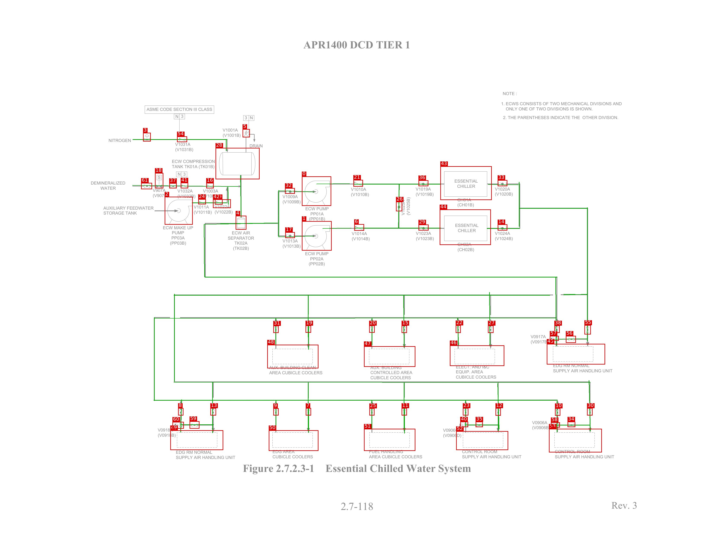
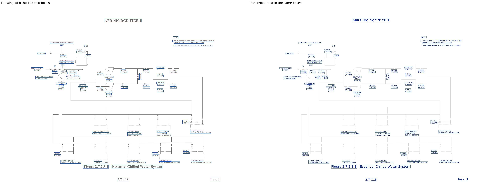

# ECWS_APR1400

[All pages](README.md) · page 45 of 65

| Symbols | Pipe lines | Text lines | Size (px) | Connectivity |
|---|---|---|---|---|
| 62 | 56 | 107 | 3300 × 2550 | unverified |

Label files: [symbols](../labels/pseudo_ECWS_APR1400.txt) · [pipe lines](../lines/pseudo_ECWS_APR1400.json) · [text](../text/pseudo_ECWS_APR1400.json) · [connectivity](../topology/pseudo_ECWS_APR1400.json)

Symbol detection on this page (F1): original method (soup5) **0.733** → new method **0.788** (test half; see [symbol_detection](../symbol_detection/README.md)).

## Symbols and pipe lines

Red box = symbol; the number is its id (its line number in the symbol file, counting from 0). Green = pipe line. Click the image to open it at full size.

Symbol list (62 symbols, with connections)

Connectivity on this page: unverified (built automatically from the verified symbols and pipe lines, not yet fully checked by a human).

| Id | Box (x0, y0, x1, y1) | Connected to |
|---|---|---|
| 0 | 1395, 816, 1530, 952 | 21, 32 |
| 1 | 1395, 1023, 1532, 1159 | 4, 6, 17, 32 |
| 2 | 761, 910, 890, 1039 | 24, 39 |
| 3 | 661, 614, 696, 654 | 54 |
| 4 | 1089, 998, 1138, 1062 | 1, 8, 9, 10, 16, 17, 20, 22, 23, 25, 28, 31, 32, 38, 42 |
| 5 | 1121, 597, 1154, 635 | 28 |
| 6 | 1637, 1037, 1682, 1067 | 1, 26, 29 |
| 7 | 1413, 1888, 1437, 1922 | 11, 12, 13, 14, 15, 19, 27, 30, 33, 43, 50, 55 |
| 8 | 823, 1888, 847, 1922 | 4, 9, 10, 20, 22, 23, 25, 31, 38, 59, 60 |
| 9 | 1263, 1889, 1287, 1922 | 4, 8, 10, 20, 22, 23, 25, 31, 38, 50 |
| 10 | 2565, 1889, 2589, 1923 | 4, 8, 9, 20, 22, 23, 25, 31, 38, 58 |
| 11 | 1856, 1888, 1880, 1922 | 7, 12, 13, 14, 15, 19, 27, 30, 33, 43, 51, 55 |
| 12 | 2290, 1888, 2314, 1923 | 7, 11, 13, 14, 15, 19, 27, 30, 33, 35, 43, 52, 55 |
| 13 | 972, 1888, 998, 1922 | 7, 11, 12, 14, 15, 19, 27, 30, 33, 43, 49, 55, 59 |
| 14 | 2300, 1038, 2344, 1066 | 7, 11, 12, 13, 15, 19, 27, 30, 33, 43, 44, 55 |
| 15 | 1856, 1506, 1880, 1540 | 7, 11, 12, 13, 14, 19, 27, 30, 33, 43, 47, 55 |
| 16 | 953, 846, 987, 871 | 4, 28, 41, 42 |
| 17 | 1318, 1074, 1362, 1101 | 1, 4, 32 |
| 18 | 716, 800, 754, 871 | 37, 61 |
| 19 | 1412, 1506, 1437, 1539 | 7, 11, 12, 13, 14, 15, 27, 30, 33, 43, 48, 55 |
| 20 | 1706, 1506, 1731, 1539 | 4, 8, 9, 10, 22, 23, 25, 31, 38, 47 |
| 21 | 1633, 832, 1677, 863 | 0, 26, 36 |
| 22 | 2106, 1505, 2129, 1540 | 4, 8, 9, 10, 20, 23, 25, 31, 38, 46 |
| 23 | 2139, 1888, 2164, 1922 | 4, 8, 9, 10, 20, 22, 25, 31, 38, 40 |
| 24 | 916, 921, 951, 945 | 2, 39 |
| 25 | 1707, 1889, 1730, 1922 | 4, 8, 9, 10, 20, 22, 23, 31, 38, 51 |
| 26 | 1830, 933, 1858, 977 | 6, 21, 29, 36 |
| 27 | 2255, 1506, 2280, 1540 | 7, 11, 12, 13, 14, 15, 19, 30, 33, 43, 46, 55 |
| 28 | 996, 684, 1199, 829 | 4, 5, 16, 42, 54 |
| 29 | 1934, 1039, 1980, 1066 | 6, 26, 44 |
| 30 | 2713, 1888, 2738, 1922 | 7, 11, 12, 13, 14, 15, 19, 27, 33, 34, 43, 53, 55 |
| 31 | 1263, 1507, 1287, 1540 | 4, 8, 9, 10, 20, 22, 23, 25, 38, 48 |
| 32 | 1317, 870, 1362, 896 | 0, 1, 4, 17 |
| 33 | 2300, 833, 2344, 861 | 7, 11, 12, 13, 14, 15, 19, 27, 30, 43, 55 |
| 34 | 2623, 1951, 2658, 1976 | 30, 53, 58 |
| 35 | 2198, 1951, 2231, 1976 | 12, 40, 52 |
| 36 | 1934, 834, 1979, 861 | 21, 26, 43 |
| 37 | 782, 847, 816, 871 | 18, 41 |
| 38 | 2562, 1506, 2586, 1540 | 4, 8, 9, 10, 20, 22, 23, 25, 31, 57 |
| 39 | 993, 922, 1028, 946 | 2, 24, 42 |
| 40 | 2127, 1951, 2163, 1976 | 23, 35 |
| 41 | 835, 845, 869, 871 | 16, 37 |
| 42 | 984, 922, 1066, 962 | 4, 16, 28, 39 |
| 43 | 2035, 769, 2272, 925 | 7, 11, 12, 13, 14, 15, 19, 27, 30, 33, 36, 55 |
| 44 | 2032, 969, 2268, 1133 | 14, 29 |
| 45 | 2527, 1591, 2796, 1686 | 57 |
| 46 | 2079, 1598, 2330, 1693 | 22, 27 |
| 47 | 1682, 1602, 1919, 1697 | 15, 20 |
| 48 | 1235, 1595, 1471, 1704 | 19, 31 |
| 49 | 787, 1991, 1031, 2082 | 13, 59, 60 |
| 50 | 1242, 1991, 1471, 2086 | 7, 9 |
| 51 | 1682, 1984, 1919, 2086 | 11, 25 |
| 52 | 2108, 1995, 2348, 2082 | 12, 35 |
| 53 | 2537, 1984, 2781, 2093 | 30, 34, 58 |
| 54 | 818, 631, 864, 657 | 3, 28 |
| 55 | 2701, 1504, 2730, 1547 | 7, 11, 12, 13, 14, 15, 19, 27, 30, 33, 43, 56 |
| 56 | 2615, 1554, 2661, 1586 | 55, 57 |
| 57 | 2541, 1554, 2582, 1576 | 38, 45, 56 |
| 58 | 2546, 1954, 2587, 1978 | 10, 34, 53 |
| 59 | 876, 1949, 921, 1983 | 8, 13, 49, 60 |
| 60 | 797, 1952, 849, 1983 | 8, 49, 59 |
| 61 | 652, 846, 702, 875 | 18 |

## Text

Left: the drawing with the text boxes. Right: the transcribed text placed in the same boxes and in the same direction, so the two sides can be compared word by word. Click the image to open it at full size.

Text list (107 lines)

| Id | Text | Reading direction | Box (x0, y0, x1, y1) |
|---|---|---|---|
| 0 | APR1400 DCD TIER 1 | normal | 1399, 181, 1900, 227 |
| 1 | NOTE : | normal | 2321, 419, 2394, 445 |
| 2 | 1. ECWS CONSISTS OF TWO MECHANICAL DIVISIONS AND | normal | 2314, 465, 2873, 490 |
| 3 | ONLY ONE OF TWO DIVISIONS IS SHOWN. | normal | 2334, 492, 2739, 515 |
| 4 | ASME CODE SECTION III CLASS | normal | 675, 493, 983, 516 |
| 5 | 3 | normal | 836, 529, 849, 547 |
| 6 | N | normal | 810, 530, 825, 548 |
| 7 | 2. THE PARENTHESES INDICATE THE OTHER DIVISION. | normal | 2322, 531, 2858, 553 |
| 8 | 3 | normal | 1130, 536, 1143, 554 |
| 9 | N | normal | 1154, 536, 1169, 554 |
| 10 | V1001A | normal | 1023, 587, 1101, 612 |
| 11 | (V1001B) | normal | 1025, 611, 1118, 639 |
| 12 | NITROGEN | normal | 499, 637, 611, 660 |
| 13 | V1031A | normal | 806, 655, 882, 677 |
| 14 | DRAIN | normal | 1149, 661, 1218, 686 |
| 15 | (V1031B) | normal | 805, 677, 897, 706 |
| 16 | ECW COMPRESSION | normal | 793, 734, 994, 755 |
| 17 | TANK TK01A (TK01B) | normal | 791, 759, 993, 783 |
| 18 | N | normal | 821, 797, 836, 815 |
| 19 | 3 | normal | 846, 797, 859, 815 |
| 20 | S | normal | 728, 812, 743, 830 |
| 21 | ESSENTIAL | normal | 2098, 825, 2211, 849 |
| 22 | DEMINERALIZED | normal | 418, 836, 581, 857 |
| 23 | CHILLER | normal | 2110, 849, 2200, 873 |
| 24 | WATER | normal | 461, 860, 538, 881 |
| 25 | V1020A | normal | 2282, 860, 2360, 885 |
| 26 | V1019A | normal | 1917, 863, 1995, 886 |
| 27 | V1010A | normal | 1618, 864, 1694, 886 |
| 28 | V907A | normal | 703, 869, 768, 891 |
| 29 | V1032A | normal | 817, 872, 892, 893 |
| 30 | V1003A | normal | 935, 872, 1010, 893 |
| 31 | (V1020B) | normal | 2282, 883, 2375, 911 |
| 32 | (V1019B) | normal | 1916, 885, 2008, 912 |
| 33 | (V1010B) | normal | 1618, 886, 1709, 913 |
| 34 | (V907B) | normal | 702, 891, 782, 918 |
| 35 | (V1003B) | normal | 934, 892, 1025, 920 |
| 36 | (V1032B) | normal | 815, 893, 907, 921 |
| 37 | V1009A | normal | 1301, 896, 1379, 920 |
| 38 | (V1025B) | bottom to top | 1871, 907, 1901, 1000 |
| 39 | CH01A | normal | 2110, 911, 2182, 936 |
| 40 | (V1009B) | normal | 1301, 920, 1392, 948 |
| 41 | V1025A | bottom to top | 1852, 922, 1874, 998 |
| 42 | (CH01B) | normal | 2110, 934, 2195, 962 |
| 43 | V1022A | normal | 988, 945, 1064, 966 |
| 44 | V1011A | normal | 892, 946, 967, 967 |
| 45 | AUXILIARY FEEDWATER | normal | 476, 952, 711, 972 |
| 46 | ECW PUMP | normal | 1407, 953, 1522, 976 |
| 47 | (V1011B) | normal | 895, 961, 980, 995 |
| 48 | (V1022B) | normal | 991, 961, 1077, 994 |
| 49 | STORAGE TANK | normal | 476, 975, 634, 996 |
| 50 | PP01A | normal | 1430, 977, 1498, 999 |
| 51 | (PP01B) | normal | 1424, 998, 1507, 1028 |
| 52 | ESSENTIAL | normal | 2100, 1030, 2214, 1054 |
| 53 | ECW MAKE UP | normal | 750, 1041, 893, 1064 |
| 54 | CHILLER | normal | 2112, 1054, 2203, 1078 |
| 55 | V1024A | normal | 2282, 1062, 2364, 1092 |
| 56 | PUMP | normal | 790, 1065, 853, 1087 |
| 57 | ECW AIR | normal | 1067, 1065, 1158, 1089 |
| 58 | V1023A | normal | 1918, 1066, 1996, 1091 |
| 59 | V1014A | normal | 1622, 1067, 1700, 1092 |
| 60 | PP03A | normal | 789, 1089, 855, 1111 |
| 61 | (V1023B) | normal | 1917, 1090, 2009, 1118 |
| 62 | (V1024B) | normal | 2283, 1090, 2374, 1118 |
| 63 | SEPARATOR | normal | 1050, 1091, 1176, 1111 |
| 64 | (V1014B) | normal | 1621, 1091, 1712, 1119 |
| 65 | V1013A | normal | 1303, 1103, 1379, 1125 |
| 66 | (PP03B) | normal | 783, 1112, 862, 1137 |
| 67 | TK02A | normal | 1079, 1113, 1146, 1135 |
| 68 | CH02A | normal | 2112, 1119, 2182, 1141 |
| 69 | (V1013B) | normal | 1301, 1124, 1392, 1154 |
| 70 | (TK02B) | normal | 1073, 1134, 1154, 1164 |
| 71 | (CH02B) | normal | 2109, 1141, 2194, 1170 |
| 72 | ECW PUMP | normal | 1407, 1161, 1519, 1182 |
| 73 | PP02A | normal | 1429, 1184, 1497, 1206 |
| 74 | (PP02B) | normal | 1424, 1209, 1504, 1233 |
| 75 | V0917A | normal | 2448, 1544, 2526, 1569 |
| 76 | (V0917B) | normal | 2448, 1567, 2540, 1595 |
| 77 | EDG RM NORMAL | normal | 2554, 1680, 2725, 1701 |
| 78 | ELECT. AND I&C | normal | 2102, 1685, 2262, 1707 |
| 79 | AUX. BUILDING | normal | 1708, 1688, 1858, 1710 |
| 80 | AUX. BUILDING CLEAN | normal | 1242, 1689, 1461, 1710 |
| 81 | SUPPLY AIR HANDLING UNIT | normal | 2553, 1703, 2831, 1725 |
| 82 | EQUIP. AREA | normal | 2104, 1708, 2235, 1730 |
| 83 | AREA CUBICLE COOLERS | normal | 1241, 1712, 1492, 1735 |
| 84 | CONTROLLED AREA | normal | 1710, 1712, 1907, 1732 |
| 85 | CUBICLE COOLERS | normal | 2104, 1732, 2295, 1755 |
| 86 | CUBICLE COOLERS | normal | 1710, 1735, 1901, 1758 |
| 87 | V0906A | normal | 2456, 1943, 2532, 1965 |
| 88 | (V0906B) | normal | 2459, 1970, 2544, 1992 |
| 89 | V0918A | normal | 726, 1978, 802, 2000 |
| 90 | V0906C | normal | 2044, 1978, 2123, 2001 |
| 91 | (V0918B) | normal | 728, 2005, 814, 2027 |
| 92 | (V0906D) | normal | 2047, 2006, 2133, 2028 |
| 93 | EDG AREA | normal | 1256, 2077, 1364, 2100 |
| 94 | CONTROL ROOM | normal | 2561, 2077, 2729, 2098 |
| 95 | CONTROL ROOM | normal | 2134, 2078, 2300, 2099 |
| 96 | FUEL HANDLING | normal | 1703, 2079, 1864, 2099 |
| 97 | EDG RM NORMAL | normal | 810, 2080, 983, 2104 |
| 98 | SUPPLY AIR HANDLING UNIT | normal | 2132, 2100, 2410, 2123 |
| 99 | SUPPLY AIR HANDLING UNIT | normal | 810, 2103, 1089, 2127 |
| 100 | CUBICLE COOLERS | normal | 1258, 2103, 1448, 2124 |
| 101 | AREA CUBICLE COOLERS | normal | 1703, 2103, 1952, 2123 |
| 102 | SUPPLY AIR HANDLING UNIT | normal | 2562, 2103, 2840, 2123 |
| 103 | Figure 2.7.2.3-1 | normal | 1118, 2142, 1457, 2193 |
| 104 | Essential Chilled Water System | normal | 1498, 2142, 2179, 2192 |
| 105 | Rev. 3 | normal | 2816, 2311, 2952, 2364 |
| 106 | 2.7-118 | normal | 1570, 2319, 1729, 2365 |

