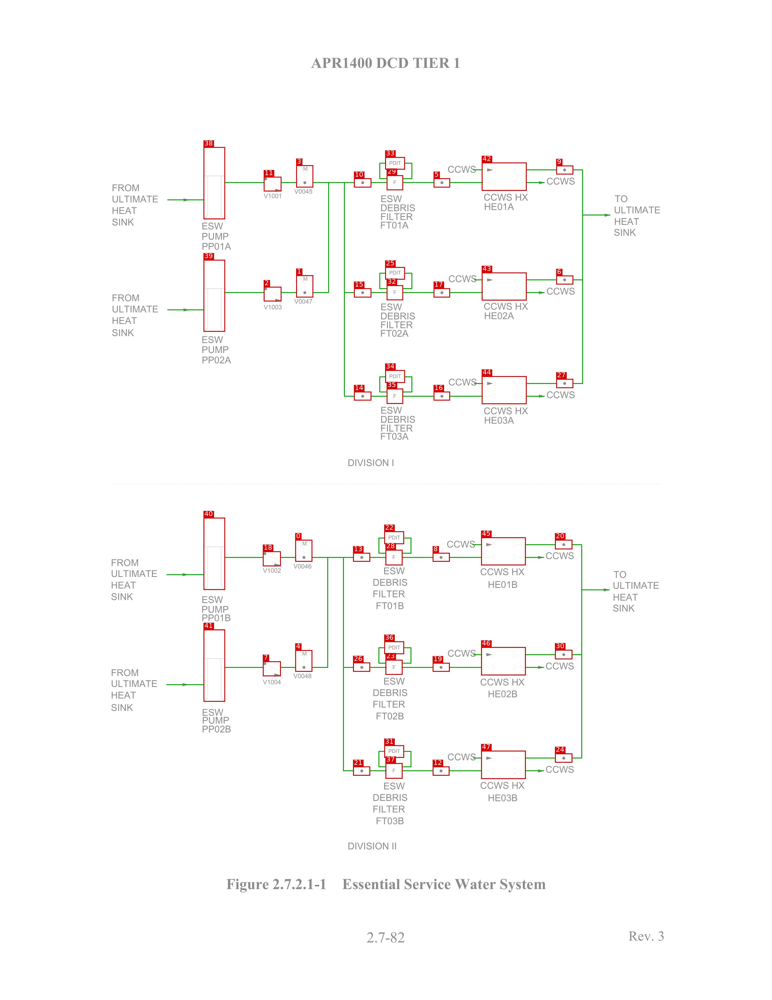
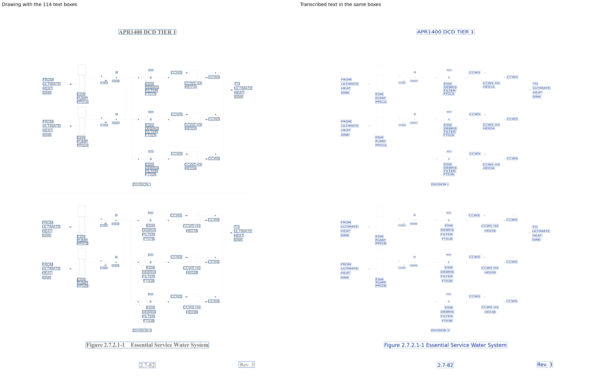

# ESW_APR1400

[All pages](README.md) · page 48 of 65

| Symbols | Pipe lines | Text lines | Size (px) | Connectivity |
|---|---|---|---|---|
| 48 | 106 | 114 | 2550 × 3300 | unverified |

Label files: [symbols](../labels/pseudo_ESW_APR1400.txt) · [pipe lines](../lines/pseudo_ESW_APR1400.json) · [text](../text/pseudo_ESW_APR1400.json) · [connectivity](../topology/pseudo_ESW_APR1400.json)

Symbol detection on this page (F1): original method (soup5) **0.791** → new method **0.633** (test half; see [symbol_detection](../symbol_detection/README.md)).

## Symbols and pipe lines

Red box = symbol; the number is its id (its line number in the symbol file, counting from 0). Green = pipe line. Click the image to open it at full size.

Symbol list (48 symbols, with connections)

Connectivity on this page: unverified (built automatically from the verified symbols and pipe lines, not yet fully checked by a human).

| Id | Box (x0, y0, x1, y1) | Connected to |
|---|---|---|
| 0 | 975, 1781, 1031, 1853 | 4, 13, 18, 21, 26 |
| 1 | 978, 908, 1034, 981 | 2, 3, 10, 14, 15 |
| 2 | 871, 946, 929, 994 | 1, 39 |
| 3 | 978, 545, 1034, 618 | 1, 10, 11, 14, 15 |
| 4 | 975, 2145, 1031, 2216 | 0, 7, 13, 21, 26 |
| 5 | 1432, 588, 1486, 618 | 29, 42 |
| 6 | 1837, 909, 1893, 938 | 9, 27, 43 |
| 7 | 868, 2182, 927, 2231 | 4, 41 |
| 8 | 1429, 1824, 1485, 1853 | 28, 45 |
| 9 | 1837, 546, 1893, 575 | 6, 27, 42 |
| 10 | 1169, 588, 1226, 618 | 1, 3, 14, 15, 29 |
| 11 | 871, 583, 929, 631 | 3, 38 |
| 12 | 1429, 2529, 1484, 2559 | 37, 47 |
| 13 | 1166, 1824, 1222, 1853 | 0, 4, 21, 26, 28 |
| 14 | 1169, 1292, 1226, 1321 | 1, 3, 10, 15, 35 |
| 15 | 1169, 951, 1226, 981 | 1, 3, 10, 14, 32 |
| 16 | 1432, 1292, 1486, 1321 | 35, 44 |
| 17 | 1432, 951, 1486, 981 | 32, 43 |
| 18 | 868, 1819, 927, 1868 | 0, 40 |
| 19 | 1429, 2187, 1485, 2216 | 23, 46 |
| 20 | 1833, 1781, 1890, 1812 | 24, 30, 45 |
| 21 | 1166, 2529, 1222, 2559 | 0, 4, 13, 26, 37 |
| 22 | 1269, 1753, 1334, 1795 | 28 |
| 23 | 1273, 2177, 1329, 2226 | 19, 26, 36 |
| 24 | 1833, 2486, 1890, 2516 | 20, 30, 47 |
| 25 | 1272, 881, 1337, 922 | 32 |
| 26 | 1166, 2186, 1222, 2216 | 0, 4, 13, 21, 23 |
| 27 | 1837, 1250, 1893, 1280 | 6, 9, 44 |
| 28 | 1273, 1814, 1329, 1865 | 8, 13, 22 |
| 29 | 1277, 578, 1331, 627 | 5, 10, 33 |
| 30 | 1833, 2144, 1890, 2175 | 20, 24, 46 |
| 31 | 1269, 2459, 1334, 2500 | 37 |
| 32 | 1277, 941, 1331, 990 | 15, 17, 25 |
| 33 | 1272, 518, 1337, 559 | 29 |
| 34 | 1272, 1221, 1337, 1263 | 35 |
| 35 | 1277, 1282, 1331, 1332 | 14, 16, 34 |
| 36 | 1269, 2116, 1334, 2158 | 23 |
| 37 | 1273, 2518, 1329, 2569 | 12, 21, 31 |
| 38 | 672, 485, 743, 723 | 11 |
| 39 | 672, 857, 743, 1094 | 2 |
| 40 | 672, 1708, 743, 1946 | 18 |
| 41 | 672, 2077, 743, 2315 | 7 |
| 42 | 1591, 536, 1739, 629 | 5, 9 |
| 43 | 1591, 899, 1739, 991 | 6, 17 |
| 44 | 1591, 1241, 1739, 1333 | 16, 27 |
| 45 | 1589, 1773, 1736, 1865 | 8, 20 |
| 46 | 1589, 2135, 1736, 2228 | 19, 30 |
| 47 | 1589, 2477, 1736, 2570 | 12, 24 |

## Text

Left: the drawing with the text boxes. Right: the transcribed text placed in the same boxes and in the same direction, so the two sides can be compared word by word. Click the image to open it at full size.

Text list (114 lines)

| Id | Text | Reading direction | Box (x0, y0, x1, y1) |
|---|---|---|---|
| 0 | APR1400 DCD TIER 1 | normal | 1026, 183, 1524, 228 |
| 1 | PDIT | normal | 1285, 530, 1326, 545 |
| 2 | CCWS | normal | 1478, 545, 1574, 571 |
| 3 | M | normal | 1001, 548, 1016, 564 |
| 4 | CCWS | normal | 1804, 584, 1899, 610 |
| 5 | F | normal | 1298, 594, 1310, 609 |
| 6 | FROM | normal | 370, 606, 461, 632 |
| 7 | V0045 | normal | 970, 622, 1032, 640 |
| 8 | V1001 | normal | 869, 637, 929, 656 |
| 9 | CCWS HX | normal | 1597, 637, 1745, 663 |
| 10 | ESW | normal | 1257, 642, 1329, 668 |
| 11 | TO | normal | 2029, 642, 2073, 668 |
| 12 | ULTIMATE | normal | 370, 644, 523, 669 |
| 13 | HE01A | normal | 1599, 669, 1700, 695 |
| 14 | DEBRIS | normal | 1257, 672, 1372, 698 |
| 15 | ULTIMATE | normal | 2028, 680, 2181, 705 |
| 16 | HEAT | normal | 370, 682, 454, 707 |
| 17 | FILTER | normal | 1257, 702, 1364, 728 |
| 18 | HEAT | normal | 2029, 718, 2112, 743 |
| 19 | SINK | normal | 369, 719, 443, 746 |
| 20 | FT01A | normal | 1256, 730, 1350, 756 |
| 21 | ESW | normal | 666, 732, 737, 759 |
| 22 | SINK | normal | 2027, 753, 2101, 780 |
| 23 | PUMP | normal | 666, 767, 756, 793 |
| 24 | PP01A | normal | 667, 800, 764, 826 |
| 25 | PDIT | normal | 1285, 892, 1326, 907 |
| 26 | CCWS | normal | 1480, 906, 1576, 932 |
| 27 | M | normal | 1001, 911, 1016, 927 |
| 28 | CCWS | normal | 1804, 947, 1899, 973 |
| 29 | F | normal | 1298, 957, 1310, 972 |
| 30 | FROM | normal | 370, 969, 461, 995 |
| 31 | V0047 | normal | 970, 985, 1032, 1003 |
| 32 | CCWS HX | normal | 1597, 997, 1745, 1024 |
| 33 | ESW | normal | 1257, 999, 1329, 1025 |
| 34 | V1003 | normal | 869, 1004, 931, 1023 |
| 35 | ULTIMATE | normal | 370, 1007, 523, 1032 |
| 36 | DEBRIS | normal | 1257, 1029, 1372, 1056 |
| 37 | HE02A | normal | 1599, 1029, 1700, 1055 |
| 38 | HEAT | normal | 370, 1045, 454, 1070 |
| 39 | FILTER | normal | 1257, 1059, 1364, 1085 |
| 40 | SINK | normal | 369, 1084, 443, 1111 |
| 41 | FT02A | normal | 1256, 1087, 1350, 1113 |
| 42 | ESW | normal | 666, 1107, 737, 1133 |
| 43 | PUMP | normal | 666, 1141, 756, 1166 |
| 44 | PP02A | normal | 667, 1175, 764, 1200 |
| 45 | PDIT | normal | 1285, 1234, 1326, 1250 |
| 46 | CCWS | normal | 1480, 1247, 1576, 1274 |
| 47 | CCWS | normal | 1804, 1289, 1899, 1316 |
| 48 | F | normal | 1298, 1299, 1310, 1315 |
| 49 | ESW | normal | 1257, 1340, 1329, 1366 |
| 50 | CCWS HX | normal | 1597, 1342, 1745, 1368 |
| 51 | DEBRIS | normal | 1257, 1370, 1372, 1396 |
| 52 | HE03A | normal | 1599, 1374, 1699, 1399 |
| 53 | FILTER | normal | 1257, 1400, 1364, 1425 |
| 54 | FT03A | normal | 1256, 1427, 1350, 1453 |
| 55 | DIVISION I | normal | 1149, 1513, 1300, 1540 |
| 56 | PDIT | normal | 1282, 1766, 1323, 1782 |
| 57 | CCWS | normal | 1475, 1782, 1571, 1809 |
| 58 | M | normal | 998, 1785, 1014, 1802 |
| 59 | CCWS | normal | 1801, 1820, 1896, 1847 |
| 60 | F | normal | 1296, 1831, 1308, 1847 |
| 61 | FROM | normal | 367, 1843, 457, 1870 |
| 62 | V0046 | normal | 967, 1859, 1029, 1878 |
| 63 | ESW | normal | 1267, 1870, 1338, 1896 |
| 64 | V1002 | normal | 867, 1873, 928, 1891 |
| 65 | CCWS HX | normal | 1585, 1873, 1733, 1900 |
| 66 | ULTIMATE | normal | 367, 1880, 520, 1906 |
| 67 | TO | normal | 2025, 1882, 2070, 1909 |
| 68 | DEBRIS | normal | 1231, 1908, 1347, 1935 |
| 69 | HE01B | normal | 1612, 1916, 1709, 1942 |
| 70 | HEAT | normal | 367, 1918, 451, 1944 |
| 71 | ULTIMATE | normal | 2024, 1919, 2177, 1945 |
| 72 | FILTER | normal | 1231, 1947, 1338, 1973 |
| 73 | SINK | normal | 366, 1955, 441, 1982 |
| 74 | HEAT | normal | 2025, 1958, 2109, 1983 |
| 75 | ESW | normal | 666, 1965, 737, 1991 |
| 76 | FT01B | normal | 1242, 1986, 1334, 2012 |
| 77 | SINK | normal | 2023, 1993, 2097, 2019 |
| 78 | PUMP | normal | 666, 1998, 756, 2023 |
| 79 | PP01B | normal | 666, 2026, 762, 2051 |
| 80 | PDIT | normal | 1282, 2129, 1323, 2145 |
| 81 | CCWS | normal | 1477, 2142, 1574, 2169 |
| 82 | M | normal | 998, 2148, 1014, 2165 |
| 83 | CCWS | normal | 1801, 2184, 1896, 2211 |
| 84 | F | normal | 1296, 2194, 1308, 2210 |
| 85 | FROM | normal | 367, 2206, 457, 2233 |
| 86 | V0048 | normal | 967, 2221, 1029, 2240 |
| 87 | ESW | normal | 1267, 2234, 1338, 2260 |
| 88 | CCWS HX | normal | 1585, 2237, 1733, 2264 |
| 89 | V1004 | normal | 867, 2241, 928, 2259 |
| 90 | ULTIMATE | normal | 367, 2243, 520, 2269 |
| 91 | DEBRIS | normal | 1231, 2272, 1347, 2299 |
| 92 | HE02B | normal | 1612, 2277, 1709, 2303 |
| 93 | HEAT | normal | 367, 2281, 451, 2307 |
| 94 | FILTER | normal | 1231, 2311, 1338, 2337 |
| 95 | SINK | normal | 366, 2321, 440, 2347 |
| 96 | ESW | normal | 667, 2337, 738, 2364 |
| 97 | FT02B | normal | 1242, 2350, 1334, 2376 |
| 98 | PUMP | normal | 668, 2364, 758, 2389 |
| 99 | PP02B | normal | 667, 2393, 763, 2418 |
| 100 | PDIT | normal | 1282, 2471, 1323, 2486 |
| 101 | CCWS | normal | 1477, 2484, 1574, 2510 |
| 102 | CCWS | normal | 1801, 2525, 1896, 2551 |
| 103 | F | normal | 1296, 2535, 1308, 2550 |
| 104 | CCWS HX | normal | 1585, 2578, 1733, 2605 |
| 105 | ESW | normal | 1267, 2580, 1338, 2607 |
| 106 | DEBRIS | normal | 1231, 2618, 1347, 2644 |
| 107 | HE03B | normal | 1612, 2620, 1709, 2645 |
| 108 | FILTER | normal | 1231, 2657, 1338, 2682 |
| 109 | FT03B | normal | 1242, 2696, 1334, 2721 |
| 110 | DIVISION II | normal | 1149, 2778, 1309, 2805 |
| 111 | Figure 2.7.2.1-1 Essential Service Water System | normal | 742, 2891, 1806, 2946 |
| 112 | Rev. 3 | normal | 2065, 3060, 2201, 3114 |
| 113 | 2.7-82 | normal | 1203, 3067, 1343, 3117 |

