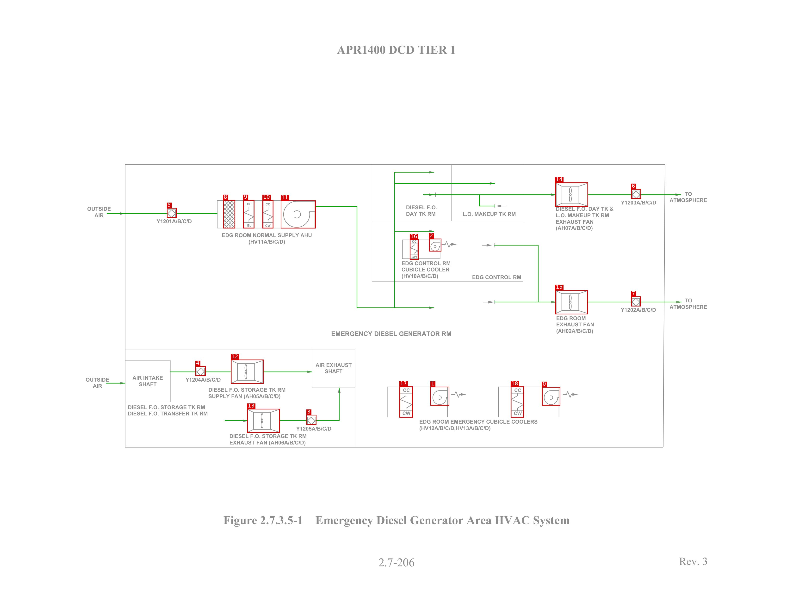
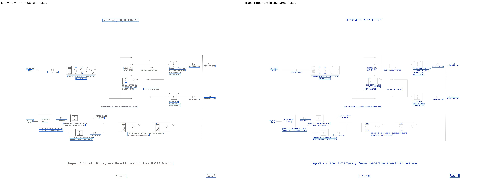

# HVAC_APR1400_p1

[All pages](README.md) · page 50 of 65

| Symbols | Pipe lines | Text lines | Size (px) | Connectivity |
|---|---|---|---|---|
| 19 | 27 | 56 | 3300 × 2550 | unverified |

Label files: [symbols](../labels/pseudo_HVAC_APR1400_p1.txt) · [pipe lines](../lines/pseudo_HVAC_APR1400_p1.json) · [text](../text/pseudo_HVAC_APR1400_p1.json) · [connectivity](../topology/pseudo_HVAC_APR1400_p1.json)

Symbol detection on this page (F1): original method (soup5) **0.811** → new method **0.914** (training half, predicted by a model that did not see this page; see [symbol_detection](../symbol_detection/README.md)).

## Symbols and pipe lines

Red box = symbol; the number is its id (its line number in the symbol file, counting from 0). Green = pipe line. Click the image to open it at full size.

Symbol list (19 symbols, with connections)

Connectivity on this page: unverified (built automatically from the verified symbols and pipe lines, not yet fully checked by a human).

| Id | Box (x0, y0, x1, y1) | Connected to |
|---|---|---|
| 0 | 2255, 1612, 2331, 1689 | - |
| 1 | 1791, 1611, 1869, 1689 | - |
| 2 | 1785, 994, 1836, 1047 | - |
| 3 | 1275, 1728, 1316, 1770 | 13 |
| 4 | 813, 1525, 855, 1566 | 12 |
| 5 | 694, 866, 735, 907 | 8 |
| 6 | 2626, 787, 2667, 827 | 14 |
| 7 | 2626, 1235, 2666, 1276 | 15 |
| 8 | 928, 833, 978, 951 | 5, 9 |
| 9 | 1012, 833, 1058, 951 | 8, 10 |
| 10 | 1092, 833, 1137, 951 | 9, 11 |
| 11 | 1168, 835, 1313, 951 | 10 |
| 12 | 960, 1498, 1096, 1599 | 4 |
| 13 | 1028, 1703, 1164, 1803 | 3 |
| 14 | 2310, 760, 2447, 861 | 6 |
| 15 | 2310, 1208, 2446, 1309 | 7 |
| 16 | 1705, 997, 1741, 1082 | - |
| 17 | 1662, 1610, 1717, 1739 | - |
| 18 | 2125, 1610, 2180, 1739 | - |

## Text

Left: the drawing with the text boxes. Right: the transcribed text placed in the same boxes and in the same direction, so the two sides can be compared word by word. Click the image to open it at full size.

Text list (56 lines)

| Id | Text | Reading direction | Box (x0, y0, x1, y1) |
|---|---|---|---|
| 0 | APR1400 DCD TIER 1 | normal | 1401, 185, 1897, 226 |
| 1 | TO | normal | 2843, 792, 2883, 820 |
| 2 | ATMOSPHERE | normal | 2783, 821, 2945, 845 |
| 3 | Y1203A/B/C/D | normal | 2581, 831, 2732, 855 |
| 4 | HC | normal | 1027, 843, 1048, 857 |
| 5 | CC | normal | 1104, 844, 1126, 858 |
| 6 | DIESEL F.O. | normal | 1686, 850, 1821, 877 |
| 7 | OUTSIDE | normal | 360, 857, 465, 882 |
| 8 | DIESEL F.O. DAY TK & | normal | 2311, 857, 2555, 881 |
| 9 | DAY TK RM | normal | 1685, 875, 1818, 903 |
| 10 | L.O. MAKEUP TK RM | normal | 1922, 879, 2149, 902 |
| 11 | AIR | normal | 388, 882, 436, 908 |
| 12 | L.O. MAKEUP TK RM | normal | 2310, 883, 2535, 906 |
| 13 | Y1201A/B/C/D | normal | 649, 908, 799, 932 |
| 14 | EXHAUST FAN | normal | 2311, 912, 2471, 933 |
| 15 | EL | normal | 1028, 932, 1048, 946 |
| 16 | CW | normal | 1102, 933, 1128, 947 |
| 17 | (AH07A/B/C/D) | normal | 2310, 936, 2469, 964 |
| 18 | EDG ROOM NORMAL SUPPLY AHU | normal | 921, 966, 1299, 989 |
| 19 | (HV11A/B/C/D) | normal | 1032, 993, 1188, 1021 |
| 20 | CC | normal | 1708, 996, 1738, 1014 |
| 21 | CW | normal | 1710, 1060, 1738, 1077 |
| 22 | EDG CONTROL RM | normal | 1668, 1084, 1876, 1108 |
| 23 | CUBICLE COOLER | normal | 1668, 1109, 1871, 1132 |
| 24 | (HV10A/B/C/D) | normal | 1667, 1136, 1826, 1164 |
| 25 | EDG CONTROL RM | normal | 1961, 1141, 2169, 1164 |
| 26 | TO | normal | 2839, 1235, 2884, 1265 |
| 27 | ATMOSPHERE | normal | 2783, 1266, 2945, 1290 |
| 28 | Y1202A/B/C/D | normal | 2579, 1277, 2730, 1301 |
| 29 | EDG ROOM | normal | 2312, 1313, 2440, 1337 |
| 30 | EXHAUST FAN | normal | 2313, 1341, 2473, 1362 |
| 31 | (AH02A/B/C/D) | normal | 2313, 1366, 2470, 1394 |
| 32 | EMERGENCY DIESEL GENERATOR RM | normal | 1378, 1378, 1878, 1402 |
| 33 | AIR EXHAUST | normal | 1309, 1507, 1465, 1531 |
| 34 | SHAFT | normal | 1348, 1534, 1429, 1558 |
| 35 | AIR INTAKE | normal | 548, 1561, 680, 1585 |
| 36 | OUTSIDE | normal | 352, 1567, 459, 1595 |
| 37 | Y1204A/B/C/D | normal | 769, 1569, 920, 1593 |
| 38 | SHAFT | normal | 574, 1587, 655, 1612 |
| 39 | AIR | normal | 381, 1594, 429, 1621 |
| 40 | DIESEL F.O. STORAGE TK RM | normal | 866, 1612, 1189, 1635 |
| 41 | CC | normal | 1676, 1616, 1706, 1635 |
| 42 | CC | normal | 2139, 1616, 2170, 1635 |
| 43 | SUPPLY FAN (AH05A/B/C/D) | normal | 863, 1635, 1169, 1663 |
| 44 | DIESEL F.O. STORAGE TK RM | normal | 531, 1683, 853, 1707 |
| 45 | CW | normal | 1671, 1709, 1711, 1731 |
| 46 | CW | normal | 2135, 1709, 2174, 1731 |
| 47 | DIESEL F.O. TRANSFER TK RM | normal | 530, 1710, 866, 1733 |
| 48 | EDG ROOM EMERGENCY CUBICLE COOLERS | normal | 1743, 1743, 2237, 1766 |
| 49 | (HV12A/B/C/D,HV13A/B/C/D) | normal | 1743, 1770, 2043, 1798 |
| 50 | Y1205A/B/C/D | normal | 1229, 1773, 1381, 1796 |
| 51 | DIESEL F.O. STORAGE TK RM | normal | 953, 1805, 1278, 1828 |
| 52 | EXHAUST FAN (AH06A/B/C/D) | normal | 951, 1830, 1274, 1858 |
| 53 | Figure 2.7.3.5-1 Emergency Diesel Generator Area HVAC System | normal | 925, 2140, 2374, 2195 |
| 54 | Rev. 3 | normal | 2816, 2311, 2951, 2364 |
| 55 | 2.7-206 | normal | 1568, 2317, 1732, 2367 |

