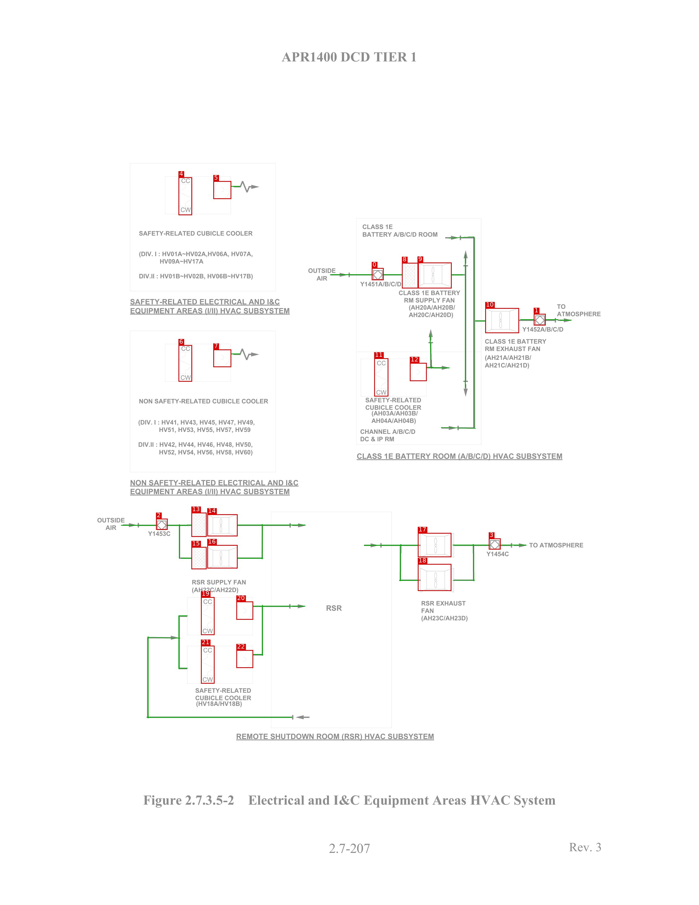
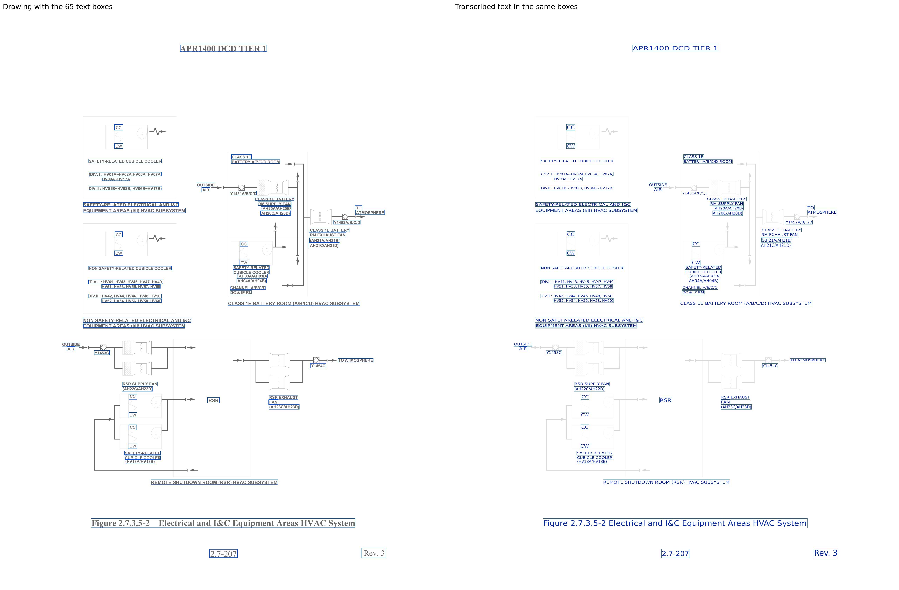

# HVAC_APR1400_p2

[All pages](README.md) · page 51 of 65

| Symbols | Pipe lines | Text lines | Size (px) | Connectivity |
|---|---|---|---|---|
| 23 | 40 | 65 | 2550 × 3300 | unverified |

Label files: [symbols](../labels/pseudo_HVAC_APR1400_p2.txt) · [pipe lines](../lines/pseudo_HVAC_APR1400_p2.json) · [text](../text/pseudo_HVAC_APR1400_p2.json) · [connectivity](../topology/pseudo_HVAC_APR1400_p2.json)

Symbol detection on this page (F1): original method (soup5) **0.651** → new method **0.955** (training half, predicted by a model that did not see this page; see [symbol_detection](../symbol_detection/README.md)).

## Symbols and pipe lines

Red box = symbol; the number is its id (its line number in the symbol file, counting from 0). Green = pipe line. Click the image to open it at full size.

Symbol list (23 symbols, with connections)

Connectivity on this page: unverified (built automatically from the verified symbols and pipe lines, not yet fully checked by a human).

| Id | Box (x0, y0, x1, y1) | Connected to |
|---|---|---|
| 0 | 1356, 977, 1399, 1021 | 8 |
| 1 | 1947, 1144, 1990, 1186 | 10 |
| 2 | 569, 1891, 611, 1931 | 13, 15 |
| 3 | 1783, 1963, 1826, 2003 | 17, 18 |
| 4 | 651, 646, 700, 784 | - |
| 5 | 778, 660, 843, 725 | - |
| 6 | 651, 1258, 700, 1391 | - |
| 7 | 778, 1274, 843, 1338 | - |
| 8 | 1466, 958, 1527, 1051 | 0, 9 |
| 9 | 1523, 957, 1647, 1051 | 8 |
| 10 | 1770, 1123, 1893, 1214 | 1 |
| 11 | 1365, 1306, 1416, 1445 | - |
| 12 | 1495, 1323, 1556, 1389 | - |
| 13 | 698, 1869, 753, 1957 | 2, 14, 15 |
| 14 | 756, 1875, 866, 1955 | 13, 16 |
| 15 | 698, 1994, 753, 2075 | 2, 13, 16 |
| 16 | 756, 1987, 866, 2072 | 14, 15 |
| 17 | 1524, 1943, 1646, 2031 | 3, 18 |
| 18 | 1524, 2056, 1646, 2154 | 3, 17 |
| 19 | 733, 2177, 782, 2315 | - |
| 20 | 862, 2193, 923, 2259 | 22 |
| 21 | 733, 2354, 782, 2492 | - |
| 22 | 862, 2370, 923, 2435 | 20 |

## Text

Left: the drawing with the text boxes. Right: the transcribed text placed in the same boxes and in the same direction, so the two sides can be compared word by word. Click the image to open it at full size.

Text list (65 lines)

| Id | Text | Reading direction | Box (x0, y0, x1, y1) |
|---|---|---|---|
| 0 | APR1400 DCD TIER 1 | normal | 1028, 185, 1522, 225 |
| 1 | CC | normal | 652, 640, 701, 674 |
| 2 | CW | normal | 652, 749, 702, 778 |
| 3 | CLASS 1E | normal | 1320, 812, 1435, 837 |
| 4 | SAFETY-RELATED CUBICLE COOLER | normal | 505, 838, 922, 861 |
| 5 | BATTERY A/B/C/D ROOM | normal | 1319, 841, 1599, 864 |
| 6 | (DIV. I : HV01A\~HV02A,HV06A, HV07A, | normal | 506, 913, 921, 936 |
| 7 | HV09A\~HV17A | normal | 581, 941, 743, 962 |
| 8 | OUTSIDE | normal | 1122, 973, 1227, 997 |
| 9 | DIV.II : HV01B\~HV02B, HV06B\~HV17B) | normal | 506, 993, 923, 1016 |
| 10 | AIR | normal | 1150, 1000, 1198, 1026 |
| 11 | Y1451A/B/C/D | normal | 1312, 1021, 1464, 1045 |
| 12 | CLASS 1E BATTERY | normal | 1453, 1055, 1679, 1076 |
| 13 | RM SUPPLY FAN | normal | 1471, 1081, 1662, 1104 |
| 14 | SAFETY-RELATED ELECTRICAL AND I&C | normal | 475, 1086, 1019, 1109 |
| 15 | TO | normal | 2026, 1102, 2067, 1130 |
| 16 | (AH20A/AH20B/ | normal | 1489, 1108, 1662, 1131 |
| 17 | EQUIPMENT AREAS (I/II) HVAC SUBSYSTEM | normal | 473, 1118, 1058, 1145 |
| 18 | ATMOSPHERE | normal | 2027, 1128, 2195, 1156 |
| 19 | AH20C/AH20D) | normal | 1486, 1133, 1657, 1161 |
| 20 | Y1452A/B/C/D | normal | 1903, 1187, 2056, 1211 |
| 21 | CLASS 1E BATTERY | normal | 1768, 1232, 1993, 1254 |
| 22 | CC | normal | 654, 1252, 699, 1284 |
| 23 | RM EXHAUST FAN | normal | 1763, 1256, 1974, 1284 |
| 24 | (AH21A/AH21B/ | normal | 1765, 1287, 1939, 1316 |
| 25 | CC | normal | 1370, 1307, 1414, 1337 |
| 26 | AH21C/AH21D) | normal | 1761, 1314, 1934, 1347 |
| 27 | CW | normal | 653, 1361, 701, 1389 |
| 28 | CW | normal | 1367, 1414, 1416, 1445 |
| 29 | SAFETY-RELATED | normal | 1330, 1445, 1537, 1469 |
| 30 | NON SAFETY-RELATED CUBICLE COOLER | normal | 505, 1450, 979, 1473 |
| 31 | CUBICLE COOLER | normal | 1330, 1472, 1537, 1495 |
| 32 | (AH03A/AH03B/ | normal | 1353, 1494, 1527, 1517 |
| 33 | AH04A/AH04B) | normal | 1350, 1519, 1521, 1547 |
| 34 | (DIV. I : HV41, HV43, HV45, HV47, HV49, | normal | 504, 1527, 929, 1551 |
| 35 | HV51, HV53, HV55, HV57, HV59 | normal | 579, 1554, 915, 1577 |
| 36 | CHANNEL A/B/C/D | normal | 1313, 1562, 1516, 1583 |
| 37 | DC & IP RM | normal | 1312, 1589, 1439, 1610 |
| 38 | DIV.II : HV42, HV44, HV46, HV48, HV50, | normal | 503, 1608, 922, 1632 |
| 39 | HV52, HV54, HV56, HV58, HV60) | normal | 579, 1635, 921, 1658 |
| 40 | CLASS 1E BATTERY ROOM (A/B/C/D) HVAC SUBSYSTEM | normal | 1300, 1649, 2053, 1676 |
| 41 | NON SAFETY-RELATED ELECTRICAL AND I&C | normal | 473, 1745, 1090, 1772 |
| 42 | EQUIPMENT AREAS (I/II) HVAC SUBSYSTEM | normal | 476, 1778, 1056, 1801 |
| 43 | OUTSIDE | normal | 352, 1883, 457, 1908 |
| 44 | AIR | normal | 381, 1909, 428, 1935 |
| 45 | Y1453C | normal | 537, 1931, 625, 1956 |
| 46 | TO ATMOSPHERE | normal | 1929, 1977, 2130, 1998 |
| 47 | Y1454C | normal | 1770, 2006, 1859, 2031 |
| 48 | RSR SUPPLY FAN | normal | 697, 2110, 898, 2134 |
| 49 | (AH22C/AH22D) | normal | 696, 2137, 871, 2165 |
| 50 | CC | normal | 736, 2181, 781, 2211 |
| 51 | RSR EXHAUST | normal | 1534, 2187, 1701, 2211 |
| 52 | RSR | normal | 1183, 2199, 1253, 2233 |
| 53 | FAN | normal | 1532, 2212, 1587, 2240 |
| 54 | (AH23C/AH23D) | normal | 1533, 2240, 1708, 2268 |
| 55 | CW | normal | 734, 2285, 781, 2313 |
| 56 | CC | normal | 735, 2355, 780, 2385 |
| 57 | CW | normal | 730, 2460, 782, 2493 |
| 58 | SAFETY-RELATED | normal | 710, 2506, 916, 2527 |
| 59 | CUBICLE COOLER | normal | 711, 2532, 916, 2555 |
| 60 | (HV18A/HV18B) | normal | 712, 2552, 885, 2579 |
| 61 | REMOTE SHUTDOWN ROOM (RSR) HVAC SUBSYSTEM | normal | 860, 2669, 1585, 2699 |
| 62 | Figure 2.7.3.5-2 Electrical and I&C Equipment Areas HVAC System | normal | 518, 2891, 2027, 2944 |
| 63 | Rev. 3 | normal | 2063, 3058, 2202, 3116 |
| 64 | 2.7-207 | normal | 1194, 3067, 1355, 3115 |

