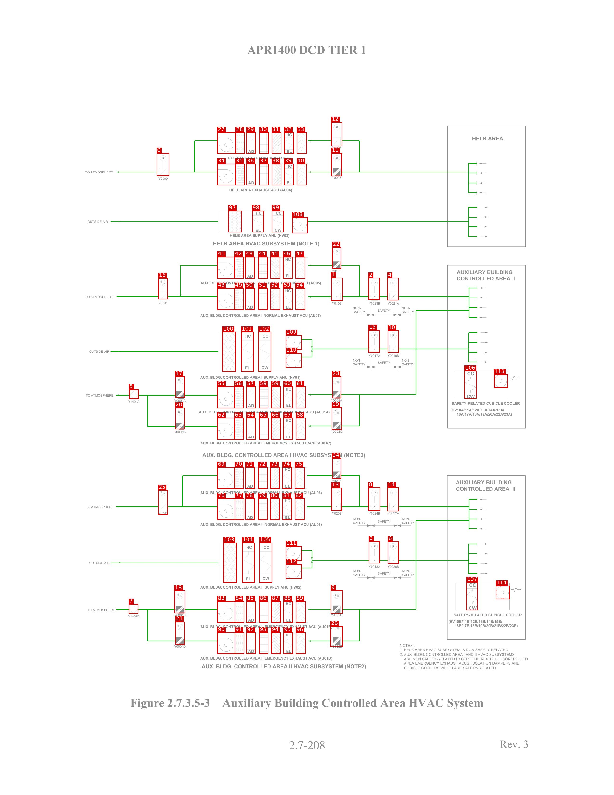
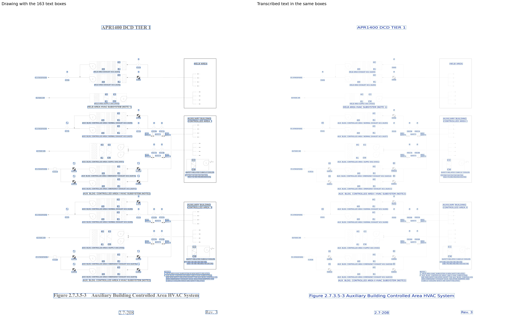

# HVAC_APR1400_p3

[All pages](README.md) · page 52 of 65

| Symbols | Pipe lines | Text lines | Size (px) | Connectivity |
|---|---|---|---|---|
| 115 | 103 | 163 | 2550 × 3300 | unverified |

Label files: [symbols](../labels/pseudo_HVAC_APR1400_p3.txt) · [pipe lines](../lines/pseudo_HVAC_APR1400_p3.json) · [text](../text/pseudo_HVAC_APR1400_p3.json) · [connectivity](../topology/pseudo_HVAC_APR1400_p3.json)

Symbol detection on this page (F1): original method (soup5) **0.531** → new method **0.654** (training half, predicted by a model that did not see this page; see [symbol_detection](../symbol_detection/README.md)).

## Symbols and pipe lines

Red box = symbol; the number is its id (its line number in the symbol file, counting from 0). Green = pipe line. Click the image to open it at full size.

Symbol list (115 symbols, with connections)

Connectivity on this page: unverified (built automatically from the verified symbols and pipe lines, not yet fully checked by a human).

| Id | Box (x0, y0, x1, y1) | Connected to |
|---|---|---|
| 0 | 650, 635, 702, 730 | 27, 34 |
| 1 | 1374, 1152, 1422, 1248 | 2, 22, 54 |
| 2 | 1530, 1153, 1577, 1244 | 1, 4, 22 |
| 3 | 1531, 2246, 1578, 2338 | 6, 111, 112 |
| 4 | 1609, 1153, 1657, 1246 | 2, 19, 23 |
| 5 | 535, 1616, 575, 1656 | 17, 20 |
| 6 | 1610, 2247, 1656, 2339 | 3 |
| 7 | 534, 2507, 574, 2546 | 18, 21 |
| 8 | 1529, 2023, 1579, 2120 | 13, 14, 24 |
| 9 | 1373, 2450, 1422, 2546 | 14, 26, 89 |
| 10 | 1610, 1371, 1657, 1465 | 15 |
| 11 | 1375, 635, 1419, 731 | 12, 40 |
| 12 | 1375, 506, 1421, 606 | 11, 33 |
| 13 | 1376, 2024, 1419, 2121 | 8, 24, 82 |
| 14 | 1609, 2023, 1657, 2122 | 8, 9, 26 |
| 15 | 1530, 1369, 1576, 1463 | 10, 109, 110 |
| 16 | 657, 1154, 697, 1242 | 41, 48 |
| 17 | 726, 1562, 767, 1650 | 5, 20, 55 |
| 18 | 724, 2451, 769, 2545 | 7, 21, 83 |
| 19 | 1377, 1690, 1418, 1784 | 4, 23, 68 |
| 20 | 726, 1692, 766, 1781 | 5, 17, 62 |
| 21 | 728, 2580, 766, 2675 | 7, 18, 90 |
| 22 | 1379, 1025, 1417, 1115 | 1, 2, 47 |
| 23 | 1378, 1562, 1417, 1653 | 4, 19, 61 |
| 24 | 1378, 1901, 1417, 1988 | 8, 13, 75 |
| 25 | 656, 2034, 697, 2136 | 69, 76 |
| 26 | 1372, 2599, 1423, 2685 | 9, 14, 96 |
| 27 | 902, 549, 979, 639 | 0, 28, 34 |
| 28 | 978, 549, 1017, 639 | 27, 29 |
| 29 | 1023, 549, 1061, 639 | 28 |
| 30 | 1077, 549, 1116, 639 | - |
| 31 | 1128, 549, 1168, 639 | - |
| 32 | 1180, 549, 1219, 639 | - |
| 33 | 1232, 549, 1272, 639 | 12 |
| 34 | 902, 679, 978, 769 | 0, 27, 35 |
| 35 | 977, 679, 1016, 769 | 34, 36 |
| 36 | 1023, 679, 1061, 769 | 35 |
| 37 | 1077, 679, 1116, 769 | - |
| 38 | 1128, 679, 1168, 769 | - |
| 39 | 1180, 679, 1219, 769 | - |
| 40 | 1232, 679, 1272, 769 | 11 |
| 41 | 902, 1065, 974, 1156 | 16, 42, 48 |
| 42 | 973, 1065, 1012, 1156 | 41, 43 |
| 43 | 1018, 1065, 1057, 1156 | 42 |
| 44 | 1072, 1065, 1111, 1156 | - |
| 45 | 1123, 1065, 1163, 1156 | - |
| 46 | 1175, 1065, 1214, 1156 | - |
| 47 | 1227, 1065, 1267, 1156 | 22 |
| 48 | 902, 1195, 975, 1286 | 16, 41, 49 |
| 49 | 974, 1195, 1013, 1286 | 48, 50 |
| 50 | 1018, 1195, 1057, 1286 | 49 |
| 51 | 1072, 1195, 1111, 1286 | - |
| 52 | 1123, 1195, 1163, 1286 | - |
| 53 | 1175, 1195, 1214, 1286 | - |
| 54 | 1227, 1195, 1267, 1286 | 1 |
| 55 | 902, 1604, 974, 1694 | 17, 56 |
| 56 | 973, 1604, 1012, 1694 | 55, 57 |
| 57 | 1023, 1604, 1061, 1694 | 56 |
| 58 | 1076, 1604, 1114, 1694 | 59 |
| 59 | 1126, 1604, 1166, 1694 | 58, 60 |
| 60 | 1177, 1604, 1216, 1694 | 59, 61 |
| 61 | 1228, 1604, 1268, 1694 | 23, 60 |
| 62 | 902, 1734, 974, 1824 | 20, 63 |
| 63 | 973, 1734, 1012, 1824 | 62, 64 |
| 64 | 1023, 1734, 1061, 1824 | 63 |
| 65 | 1076, 1734, 1115, 1824 | 66 |
| 66 | 1126, 1734, 1166, 1824 | 65, 67 |
| 67 | 1177, 1734, 1216, 1824 | 66, 68 |
| 68 | 1228, 1734, 1268, 1824 | 19, 67 |
| 69 | 902, 1938, 975, 2028 | 25, 70, 76 |
| 70 | 974, 1938, 1013, 2028 | 69, 71 |
| 71 | 1019, 1938, 1057, 2028 | 70 |
| 72 | 1072, 1938, 1110, 2028 | 73 |
| 73 | 1122, 1938, 1161, 2028 | 72, 74 |
| 74 | 1173, 1938, 1212, 2028 | 73, 75 |
| 75 | 1224, 1938, 1264, 2028 | 24, 74 |
| 76 | 902, 2068, 976, 2158 | 25, 69, 77 |
| 77 | 975, 2068, 1014, 2158 | 76, 78 |
| 78 | 1019, 2068, 1057, 2158 | 77 |
| 79 | 1072, 2068, 1110, 2158 | 80 |
| 80 | 1122, 2068, 1161, 2158 | 79, 81 |
| 81 | 1173, 2068, 1212, 2158 | 80, 82 |
| 82 | 1224, 2068, 1264, 2158 | 13, 81 |
| 83 | 902, 2495, 976, 2584 | 18, 84 |
| 84 | 975, 2495, 1014, 2584 | 83, 85 |
| 85 | 1023, 2495, 1061, 2584 | 84 |
| 86 | 1076, 2495, 1114, 2584 | 87 |
| 87 | 1126, 2495, 1165, 2584 | 86, 88 |
| 88 | 1177, 2495, 1216, 2584 | 87, 89 |
| 89 | 1228, 2495, 1268, 2584 | 9, 88 |
| 90 | 902, 2625, 976, 2714 | 21, 91 |
| 91 | 975, 2625, 1014, 2714 | 90, 92 |
| 92 | 1023, 2625, 1061, 2714 | 91 |
| 93 | 1076, 2625, 1114, 2714 | 94 |
| 94 | 1126, 2625, 1166, 2714 | 93, 95 |
| 95 | 1177, 2625, 1216, 2714 | 94, 96 |
| 96 | 1228, 2625, 1268, 2714 | 26, 95 |
| 97 | 948, 874, 1002, 964 | - |
| 98 | 1046, 874, 1096, 964 | - |
| 99 | 1128, 874, 1178, 964 | - |
| 100 | 924, 1377, 979, 1542 | - |
| 101 | 1001, 1377, 1053, 1542 | - |
| 102 | 1073, 1377, 1126, 1542 | - |
| 103 | 928, 2252, 983, 2418 | - |
| 104 | 1005, 2252, 1057, 2418 | - |
| 105 | 1077, 2252, 1130, 2418 | - |
| 106 | 1929, 1539, 1978, 1654 | - |
| 107 | 1937, 2416, 1985, 2533 | - |
| 108 | 1212, 902, 1278, 968 | - |
| 109 | 1186, 1390, 1252, 1452 | 15, 110 |
| 110 | 1186, 1465, 1252, 1527 | 15, 109 |
| 111 | 1186, 2267, 1252, 2328 | 3, 112 |
| 112 | 1186, 2342, 1252, 2403 | 3, 111 |
| 113 | 2051, 1554, 2109, 1609 | - |
| 114 | 2059, 2431, 2117, 2487 | - |

## Text

Left: the drawing with the text boxes. Right: the transcribed text placed in the same boxes and in the same direction, so the two sides can be compared word by word. Click the image to open it at full size.

Text list (163 lines)

| Id | Text | Reading direction | Box (x0, y0, x1, y1) |
|---|---|---|---|
| 0 | APR1400 DCD TIER 1 | normal | 1025, 188, 1520, 227 |
| 1 | P | normal | 1394, 522, 1405, 536 |
| 2 | HC | normal | 1188, 552, 1214, 568 |
| 3 | HELB AREA | normal | 1960, 565, 2092, 585 |
| 4 | Y0005 | normal | 1378, 606, 1419, 620 |
| 5 | AD | normal | 1029, 621, 1056, 637 |
| 6 | EL | normal | 1190, 621, 1214, 637 |
| 7 | HELB AREA EXHAUST ACU (AU03) | normal | 946, 649, 1209, 667 |
| 8 | P | normal | 673, 650, 684, 664 |
| 9 | P | normal | 1394, 650, 1405, 664 |
| 10 | HC | normal | 1188, 682, 1214, 698 |
| 11 | TO ATMOSPHERE | normal | 353, 708, 471, 722 |
| 12 | Y0006 | normal | 1377, 730, 1419, 744 |
| 13 | Y0009 | normal | 657, 734, 698, 748 |
| 14 | EL | normal | 1190, 750, 1214, 766 |
| 15 | AD | normal | 1029, 751, 1056, 767 |
| 16 | HELB AREA EXHAUST ACU (AU04) | normal | 952, 781, 1214, 799 |
| 17 | HC | normal | 1061, 877, 1087, 893 |
| 18 | CC | normal | 1144, 877, 1170, 893 |
| 19 | OUTSIDE AIR | normal | 362, 913, 449, 926 |
| 20 | CW | normal | 1140, 947, 1171, 963 |
| 21 | EL | normal | 1060, 948, 1084, 964 |
| 22 | HELB AREA SUPPLY AHU (HV03) | normal | 953, 970, 1203, 988 |
| 23 | HELB AREA HVAC SUBSYSTEM (NOTE 1) | normal | 884, 1001, 1328, 1026 |
| 24 | P | normal | 1394, 1037, 1405, 1051 |
| 25 | HC | normal | 1184, 1069, 1209, 1085 |
| 26 | Y0102 | normal | 1377, 1117, 1419, 1131 |
| 27 | AUXILIARY BUILDING | normal | 1895, 1120, 2130, 1140 |
| 28 | EL | normal | 1185, 1137, 1209, 1153 |
| 29 | AD | normal | 1025, 1138, 1052, 1154 |
| 30 | CONTROLLED AREA I | normal | 1896, 1146, 2139, 1166 |
| 31 | EH | normal | 668, 1164, 688, 1183 |
| 32 | AUX. BLDG. CONTROLLED AREA I NORMAL EXHAUST ACU (AU05) | normal | 831, 1167, 1335, 1183 |
| 33 | P | normal | 1394, 1168, 1405, 1182 |
| 34 | P | normal | 1550, 1168, 1562, 1181 |
| 35 | P | normal | 1629, 1168, 1640, 1182 |
| 36 | HC | normal | 1184, 1199, 1209, 1215 |
| 37 | TO ATMOSPHERE | normal | 353, 1225, 471, 1239 |
| 38 | Y0101 | normal | 656, 1250, 696, 1264 |
| 39 | Y0103 | normal | 1378, 1252, 1419, 1266 |
| 40 | Y0023B | normal | 1530, 1252, 1580, 1266 |
| 41 | Y0021A | normal | 1608, 1252, 1659, 1266 |
| 42 | EL | normal | 1185, 1267, 1209, 1283 |
| 43 | AD | normal | 1025, 1268, 1052, 1284 |
| 44 | NON- | normal | 1464, 1272, 1500, 1286 |
| 45 | NON- | normal | 1667, 1272, 1704, 1286 |
| 46 | SAFETY | normal | 1566, 1282, 1621, 1296 |
| 47 | SAFETY | normal | 1463, 1288, 1518, 1302 |
| 48 | SAFETY | normal | 1667, 1288, 1721, 1302 |
| 49 | AUX. BLDG. CONTROLLED AREA I NORMAL EXHAUST ACU (AU07) | normal | 830, 1302, 1334, 1319 |
| 50 | P | normal | 1550, 1385, 1562, 1399 |
| 51 | P | normal | 1629, 1385, 1640, 1399 |
| 52 | HC | normal | 1018, 1387, 1044, 1403 |
| 53 | CC | normal | 1089, 1387, 1115, 1403 |
| 54 | OUTSIDE AIR | normal | 368, 1452, 456, 1466 |
| 55 | Y0017A | normal | 1530, 1469, 1581, 1483 |
| 56 | Y0019B | normal | 1608, 1469, 1658, 1483 |
| 57 | NON- | normal | 1465, 1489, 1502, 1503 |
| 58 | NON- | normal | 1668, 1489, 1705, 1503 |
| 59 | SAFETY | normal | 1567, 1498, 1622, 1512 |
| 60 | SAFETY | normal | 1465, 1505, 1519, 1519 |
| 61 | SAFETY | normal | 1668, 1505, 1722, 1519 |
| 62 | CW | normal | 1085, 1518, 1116, 1534 |
| 63 | EL | normal | 1017, 1519, 1040, 1535 |
| 64 | CC | normal | 1937, 1539, 1971, 1560 |
| 65 | AUX. BLDG. CONTROLLED AREA I SUPPLY AHU (HV01) | normal | 830, 1559, 1249, 1576 |
| 66 | EH | normal | 1389, 1572, 1409, 1591 |
| 67 | EH | normal | 738, 1573, 758, 1592 |
| 68 | HC | normal | 1185, 1607, 1211, 1623 |
| 69 | TO ATMOSPHERE | normal | 355, 1634, 473, 1648 |
| 70 | CW | normal | 1937, 1636, 1973, 1654 |
| 71 | Y0002A | normal | 1373, 1648, 1424, 1669 |
| 72 | Y0001A | normal | 722, 1656, 773, 1670 |
| 73 | Y1401A | normal | 531, 1660, 582, 1674 |
| 74 | SAFETY-RELATED CUBICLE COOLER | normal | 1875, 1667, 2161, 1682 |
| 75 | EL | normal | 1187, 1675, 1211, 1691 |
| 76 | AD | normal | 1029, 1676, 1056, 1692 |
| 77 | (HV10A/11A/12A/13A/14A/15A/ | normal | 1870, 1694, 2096, 1712 |
| 78 | EH | normal | 1389, 1701, 1409, 1720 |
| 79 | EH | normal | 738, 1703, 758, 1722 |
| 80 | AUX. BLDG. CONTROLLED AREA I EMERGENCY EXHAUST ACU (AU01A) | normal | 824, 1703, 1371, 1720 |
| 81 | 16A/17A/18A/19A/20A/22A/23A) | normal | 1896, 1712, 2128, 1729 |
| 82 | HC | normal | 1185, 1737, 1211, 1753 |
| 83 | Y0002C | normal | 1372, 1784, 1423, 1798 |
| 84 | Y0001C | normal | 722, 1786, 773, 1800 |
| 85 | AD | normal | 1029, 1806, 1056, 1822 |
| 86 | EL | normal | 1187, 1806, 1211, 1822 |
| 87 | AUX. BLDG. CONTROLLED AREA I EMERGENCY EXHAUST ACU (AU01C) | normal | 830, 1832, 1377, 1849 |
| 88 | AUX. BLDG. CONTROLLED AREA I HVAC SUBSYSTEM (NOTE2) | normal | 839, 1879, 1518, 1902 |
| 89 | P | normal | 1394, 1910, 1405, 1924 |
| 90 | HC | normal | 1181, 1941, 1207, 1957 |
| 91 | Y0203 | normal | 1377, 1980, 1419, 2003 |
| 92 | AUXILIARY BUILDING | normal | 1891, 1992, 2126, 2012 |
| 93 | AD | normal | 1025, 2010, 1052, 2026 |
| 94 | EL | normal | 1183, 2010, 1207, 2026 |
| 95 | CONTROLLED AREA II | normal | 1892, 2019, 2141, 2039 |
| 96 | EH | normal | 668, 2036, 688, 2055 |
| 97 | AUX. BLDG. CONTROLLED AREA II NORMAL EXHAUST ACU (AU06) | normal | 830, 2038, 1338, 2054 |
| 98 | P | normal | 1394, 2039, 1405, 2053 |
| 99 | P | normal | 1550, 2039, 1562, 2053 |
| 100 | P | normal | 1629, 2039, 1640, 2053 |
| 101 | HC | normal | 1181, 2071, 1207, 2087 |
| 102 | TO ATMOSPHERE | normal | 355, 2097, 473, 2111 |
| 103 | Y0201 | normal | 656, 2122, 696, 2136 |
| 104 | Y0022A | normal | 1608, 2123, 1659, 2137 |
| 105 | Y0202 | normal | 1378, 2124, 1419, 2138 |
| 106 | Y0024B | normal | 1530, 2124, 1580, 2138 |
| 107 | AD | normal | 1025, 2140, 1052, 2156 |
| 108 | EL | normal | 1183, 2140, 1207, 2156 |
| 109 | NON- | normal | 1465, 2147, 1502, 2161 |
| 110 | NON- | normal | 1668, 2147, 1705, 2161 |
| 111 | SAFETY | normal | 1567, 2157, 1622, 2171 |
| 112 | SAFETY | normal | 1465, 2163, 1519, 2177 |
| 113 | SAFETY | normal | 1668, 2163, 1722, 2177 |
| 114 | AUX. BLDG. CONTROLLED AREA II NORMAL EXHAUST ACU (AU08) | normal | 830, 2170, 1338, 2187 |
| 115 | P | normal | 1550, 2261, 1562, 2275 |
| 116 | P | normal | 1629, 2261, 1640, 2275 |
| 117 | HC | normal | 1022, 2264, 1048, 2280 |
| 118 | CC | normal | 1093, 2264, 1119, 2280 |
| 119 | OUTSIDE AIR | normal | 369, 2329, 457, 2343 |
| 120 | Y0018A | normal | 1530, 2345, 1581, 2359 |
| 121 | Y0020B | normal | 1608, 2345, 1658, 2359 |
| 122 | NON- | normal | 1465, 2363, 1502, 2377 |
| 123 | NON- | normal | 1668, 2363, 1705, 2377 |
| 124 | SAFETY | normal | 1567, 2373, 1622, 2387 |
| 125 | SAFETY | normal | 1465, 2379, 1519, 2393 |
| 126 | SAFETY | normal | 1668, 2379, 1722, 2393 |
| 127 | CW | normal | 1089, 2394, 1120, 2410 |
| 128 | EL | normal | 1021, 2395, 1044, 2411 |
| 129 | CC | normal | 1945, 2417, 1978, 2438 |
| 130 | AUX. BLDG. CONTROLLED AREA II SUPPLY AHU (HV02) | normal | 830, 2430, 1253, 2448 |
| 131 | EH | normal | 1389, 2462, 1409, 2481 |
| 132 | EH | normal | 738, 2463, 758, 2482 |
| 133 | HC | normal | 1185, 2498, 1211, 2514 |
| 134 | CW | normal | 1945, 2514, 1981, 2533 |
| 135 | TO ATMOSPHERE | normal | 361, 2525, 479, 2539 |
| 136 | Y0002B | normal | 1373, 2545, 1423, 2559 |
| 137 | SAFETY-RELATED CUBICLE COOLER | normal | 1883, 2545, 2169, 2560 |
| 138 | Y0001B | normal | 722, 2546, 772, 2560 |
| 139 | Y1402B | normal | 531, 2551, 581, 2565 |
| 140 | AD | normal | 1029, 2566, 1056, 2582 |
| 141 | EL | normal | 1187, 2566, 1211, 2582 |
| 142 | (HV10B/11B/12B/13B/14B/15B/ | normal | 1861, 2572, 2087, 2589 |
| 143 | 16B/17B/18B/19B/20B/21B/22B/23B) | normal | 1887, 2590, 2152, 2607 |
| 144 | EH | normal | 1389, 2591, 1409, 2612 |
| 145 | EH | normal | 738, 2593, 758, 2612 |
| 146 | AUX. BLDG. CONTROLLED AREA II EMERGENCY EXHAUST ACU (AU01B) | normal | 830, 2594, 1381, 2612 |
| 147 | HC | normal | 1185, 2628, 1211, 2644 |
| 148 | NOTES : | normal | 1660, 2672, 1723, 2687 |
| 149 | Y0001D | normal | 722, 2674, 773, 2690 |
| 150 | Y0002D | normal | 1372, 2674, 1423, 2690 |
| 151 | 1. HELB AREA HVAC SUBSYSTEM IS NON SAFETY-RELATED. | normal | 1660, 2690, 2116, 2705 |
| 152 | AD | normal | 1029, 2696, 1056, 2712 |
| 153 | EL | normal | 1187, 2696, 1211, 2712 |
| 154 | 2. AUX. BLDG. CONTROLLED AREA I AND II HVAC SUBSYSTEMS | normal | 1659, 2709, 2139, 2724 |
| 155 | AUX. BLDG. CONTROLLED AREA II EMERGENCY EXHAUST ACU (AU01D) | normal | 830, 2725, 1381, 2743 |
| 156 | ARE NON SAFETY-RELATED EXCEPT THE AUX. BLDG. CONTROLLED | normal | 1676, 2728, 2193, 2743 |
| 157 | AREA EMERGENCY EXHAUST ACUS, ISOLATION DAMPERS AND | normal | 1676, 2746, 2159, 2761 |
| 158 | AUX. BLDG. CONTROLLED AREA II HVAC SUBSYSTEM (NOTE2) | normal | 836, 2756, 1521, 2780 |
| 159 | CUBICLE COOLERS WHICH ARE SAFETY-RELATED. | normal | 1676, 2765, 2064, 2779 |
| 160 | Figure 2.7.3.5-3 Auxiliary Building Controlled Area HVAC System | normal | 540, 2898, 2009, 2946 |
| 161 | Rev. 3 | normal | 2075, 3071, 2194, 3107 |
| 162 | 2.7-208 | normal | 1199, 3074, 1350, 3113 |

