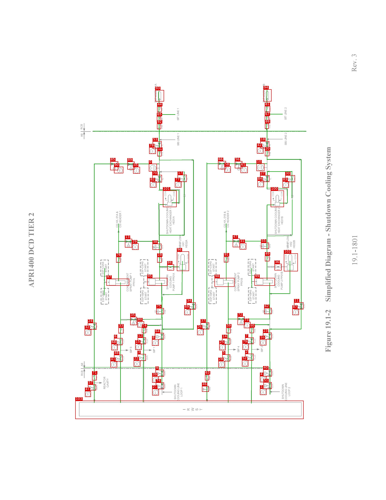
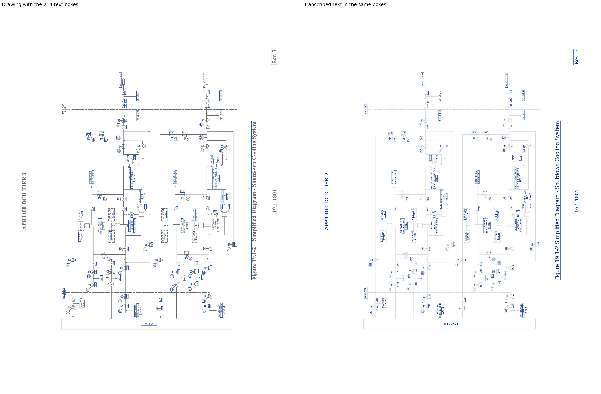

# SCS2_APR1400

[All pages](README.md) · page 60 of 65

| Symbols | Pipe lines | Text lines | Size (px) | Connectivity |
|---|---|---|---|---|
| 104 | 62 | 214 | 2550 × 3300 | unverified |

Label files: [symbols](../labels/pseudo_SCS2_APR1400.txt) · [pipe lines](../lines/pseudo_SCS2_APR1400.json) · [text](../text/pseudo_SCS2_APR1400.json) · [connectivity](../topology/pseudo_SCS2_APR1400.json)

Symbol detection on this page (F1): original method (soup5) **0.846** → new method **0.471** (training half, predicted by a model that did not see this page; see [symbol_detection](../symbol_detection/README.md)).

## Symbols and pipe lines

Red box = symbol; the number is its id (its line number in the symbol file, counting from 0). Green = pipe line. Click the image to open it at full size.

Symbol list (104 symbols, with connections)

Connectivity on this page: unverified (built automatically from the verified symbols and pipe lines, not yet fully checked by a human).

| Id | Box (x0, y0, x1, y1) | Connected to |
|---|---|---|
| 0 | 983, 1080, 1036, 1131 | 17, 34, 50, 70, 89 |
| 1 | 1717, 2564, 1760, 2606 | - |
| 2 | 1619, 2334, 1674, 2379 | 7, 103 |
| 3 | 908, 2336, 963, 2381 | 12, 103 |
| 4 | 1717, 2481, 1760, 2522 | - |
| 5 | 1468, 2339, 1520, 2384 | 14, 103 |
| 6 | 753, 2231, 809, 2277 | 33, 48 |
| 7 | 1619, 2227, 1675, 2270 | 2, 60 |
| 8 | 1004, 2239, 1048, 2281 | - |
| 9 | 1027, 2440, 1083, 2485 | 64, 74 |
| 10 | 1694, 1078, 1746, 1128 | 11, 20, 27, 30, 56 |
| 11 | 1942, 1995, 2004, 2041 | 10, 20, 23, 27, 30, 56, 60, 62, 72 |
| 12 | 909, 2227, 963, 2271 | 3, 54 |
| 13 | 825, 1576, 872, 1633 | 17, 38, 76, 101 |
| 14 | 1467, 2231, 1520, 2274 | 5, 59 |
| 15 | 893, 2267, 935, 2308 | - |
| 16 | 1716, 2238, 1759, 2279 | - |
| 17 | 1173, 1153, 1233, 1200 | 0, 13, 34, 38, 50, 70, 89, 101 |
| 18 | 1719, 931, 1778, 978 | 20, 88 |
| 19 | 1038, 1694, 1067, 1733 | 38, 86, 95 |
| 20 | 1750, 992, 1778, 1030 | 10, 11, 18, 27, 30, 56 |
| 21 | 1005, 2565, 1049, 2609 | - |
| 22 | 883, 2378, 927, 2419 | - |
| 23 | 1737, 2195, 1794, 2240 | 11, 40, 60, 62, 72 |
| 24 | 580, 2130, 637, 2175 | 71, 85 |
| 25 | 1448, 2269, 1490, 2311 | - |
| 26 | 1302, 2168, 1345, 2211 | - |
| 27 | 1718, 1156, 1779, 1200 | 10, 11, 20, 30, 56, 100 |
| 28 | 1442, 2382, 1486, 2425 | - |
| 29 | 872, 1606, 915, 1648 | - |
| 30 | 1884, 1156, 1948, 1201 | 10, 11, 20, 27, 47, 55, 56, 100 |
| 31 | 1583, 1603, 1626, 1646 | - |
| 32 | 559, 2171, 602, 2213 | - |
| 33 | 782, 2161, 815, 2200 | 6, 35, 97 |
| 34 | 1232, 1996, 1292, 2042 | 0, 17, 35, 50, 54, 64, 70, 75, 89 |
| 35 | 860, 2091, 904, 2145 | 33, 34, 54, 64, 75, 97 |
| 36 | 1813, 1741, 1860, 1784 | 49, 62, 99, 102 |
| 37 | 1325, 2128, 1381, 2173 | 63, 66 |
| 38 | 1007, 1608, 1066, 1648 | 13, 17, 19, 101 |
| 39 | 1005, 2483, 1048, 2525 | - |
| 40 | 1738, 2438, 1795, 2484 | 23, 51 |
| 41 | 561, 2580, 600, 2619 | - |
| 42 | 1697, 969, 1740, 1013 | - |
| 43 | 729, 2382, 773, 2425 | - |
| 44 | 1038, 701, 1066, 740 | 65, 93 |
| 45 | 879, 1101, 924, 1145 | - |
| 46 | 1334, 2547, 1379, 2585 | 63, 103 |
| 47 | 1537, 1574, 1584, 1631 | 30, 55, 91, 100 |
| 48 | 753, 2341, 809, 2387 | 6, 103 |
| 49 | 1750, 1686, 1779, 1724 | 36, 55, 99 |
| 50 | 1039, 995, 1066, 1031 | 0, 17, 34, 53, 70, 89 |
| 51 | 1740, 2522, 1794, 2567 | 40 |
| 52 | 1598, 2376, 1640, 2418 | - |
| 53 | 1008, 932, 1067, 981 | 50, 92 |
| 54 | 937, 2161, 964, 2198 | 12, 34, 35, 64, 75 |
| 55 | 1724, 1601, 1776, 1642 | 30, 47, 49, 100 |
| 56 | 1551, 1063, 1600, 1110 | 10, 11, 20, 27, 30, 66 |
| 57 | 581, 2537, 634, 2576 | 71, 103 |
| 58 | 1482, 1097, 1524, 1139 | - |
| 59 | 1494, 2161, 1522, 2199 | 14, 72, 98 |
| 60 | 1649, 2160, 1676, 2198 | 7, 11, 23, 62, 72 |
| 61 | 1589, 1098, 1636, 1141 | - |
| 62 | 1745, 2032, 1794, 2072 | 11, 23, 36, 60, 72, 99, 102 |
| 63 | 1354, 2471, 1380, 2510 | 37, 46 |
| 64 | 1023, 2197, 1082, 2241 | 9, 34, 35, 54, 75 |
| 65 | 1036, 766, 1063, 803 | 44, 92 |
| 66 | 1440, 1062, 1492, 1116 | 37, 56 |
| 67 | 1749, 764, 1776, 801 | 81, 88 |
| 68 | 735, 2269, 777, 2311 | - |
| 69 | 1217, 2036, 1259, 2079 | - |
| 70 | 1006, 1154, 1069, 1203 | 0, 17, 34, 50, 89, 101 |
| 71 | 608, 2471, 637, 2510 | 24, 57 |
| 72 | 1569, 2088, 1616, 2144 | 11, 23, 59, 60, 62, 98 |
| 73 | 1611, 2124, 1654, 2165 | - |
| 74 | 1029, 2524, 1083, 2568 | 9 |
| 75 | 1032, 2033, 1082, 2073 | 34, 35, 54, 64, 95, 96 |
| 76 | 767, 1694, 794, 1733 | 13, 97 |
| 77 | 1155, 1196, 1198, 1237 | - |
| 78 | 985, 971, 1029, 1015 | - |
| 79 | 1601, 2266, 1643, 2308 | - |
| 80 | 907, 2120, 951, 2160 | - |
| 81 | 1749, 699, 1784, 738 | 67, 94 |
| 82 | 990, 1196, 1033, 1237 | - |
| 83 | 1866, 1196, 1908, 1239 | - |
| 84 | 1700, 1191, 1743, 1234 | - |
| 85 | 728, 1064, 780, 1123 | 24, 89 |
| 86 | 1104, 1745, 1149, 1784 | 19, 95, 96 |
| 87 | 1931, 2037, 1974, 2079 | - |
| 88 | 1750, 813, 1775, 850 | 18, 67 |
| 89 | 841, 1066, 888, 1118 | 0, 17, 34, 50, 70, 85 |
| 90 | 753, 1100, 814, 1143 | - |
| 91 | 1479, 1692, 1506, 1731 | 47, 98 |
| 92 | 1037, 815, 1063, 852 | 53, 65 |
| 93 | 1025, 594, 1083, 669 | 44 |
| 94 | 1740, 589, 1793, 669 | 81 |
| 95 | 972, 1834, 1105, 1885 | 19, 75, 86, 96 |
| 96 | 1168, 1659, 1248, 1788 | 75, 86, 95 |
| 97 | 703, 1839, 853, 1885 | 33, 35, 76 |
| 98 | 1417, 1834, 1548, 1892 | 59, 72, 91 |
| 99 | 1681, 1834, 1815, 1885 | 36, 49, 62, 102 |
| 100 | 1788, 1257, 1875, 1366 | 27, 30, 47, 55 |
| 101 | 1076, 1257, 1166, 1366 | 13, 17, 38, 70 |
| 102 | 1875, 1672, 1967, 1790 | 36, 62, 99 |
| 103 | 497, 2644, 2005, 2765 | 2, 3, 5, 46, 48, 57 |

## Text

Left: the drawing with the text boxes. Right: the transcribed text placed in the same boxes and in the same direction, so the two sides can be compared word by word. Click the image to open it at full size.

Text list (214 lines)

| Id | Text | Reading direction | Box (x0, y0, x1, y1) |
|---|---|---|---|
| 0 | Rev. 3 | bottom to top | 2315, 348, 2365, 483 |
| 1 | DVI NOZZLE 1A | bottom to top | 1014, 550, 1038, 679 |
| 2 | DVI NOZZLE 2B | bottom to top | 1731, 551, 1752, 678 |
| 3 | V227 | bottom to top | 1774, 704, 1789, 736 |
| 4 | SIT LINE 2 | bottom to top | 1873, 704, 1896, 794 |
| 5 | V247 | bottom to top | 1061, 707, 1077, 738 |
| 6 | SIT LINE 1 | bottom to top | 1164, 710, 1185, 796 |
| 7 | V541 | bottom to top | 1773, 770, 1790, 803 |
| 8 | V543 | bottom to top | 1062, 773, 1079, 806 |
| 9 | RCB | bottom to top | 530, 818, 547, 855 |
| 10 | V123 | bottom to top | 1774, 819, 1790, 850 |
| 11 | V143 | bottom to top | 1062, 820, 1079, 853 |
| 12 | SIS LINE 2 | bottom to top | 1878, 873, 1896, 959 |
| 13 | SIS LINE 1 | bottom to top | 1163, 875, 1187, 964 |
| 14 | AB | bottom to top | 532, 879, 549, 905 |
| 15 | FL | bottom to top | 1061, 947, 1081, 970 |
| 16 | FL | bottom to top | 1775, 947, 1791, 965 |
| 17 | M | bottom to top | 1011, 951, 1025, 968 |
| 18 | M | bottom to top | 1725, 952, 1733, 961 |
| 19 | Figure 19.1-2 Simplified Diagram - Shutdown Cooling System | bottom to top | 2146, 963, 2204, 2327 |
| 20 | 600 | bottom to top | 1710, 983, 1727, 1007 |
| 21 | 601 | bottom to top | 999, 985, 1016, 1009 |
| 22 | V168 | bottom to top | 1775, 997, 1792, 1030 |
| 23 | V178 | bottom to top | 1064, 1001, 1080, 1032 |
| 24 | FL.LC | upside down | 1556, 1051, 1595, 1069 |
| 25 | FL.LC | upside down | 845, 1055, 883, 1070 |
| 26 | FL.LC | upside down | 1446, 1055, 1483, 1070 |
| 27 | FL.LC | upside down | 735, 1057, 772, 1072 |
| 28 | 305B | bottom to top | 1717, 1090, 1735, 1118 |
| 29 | 302A | bottom to top | 1009, 1093, 1025, 1124 |
| 30 | FT | bottom to top | 1706, 1096, 1719, 1114 |
| 31 | FT | bottom to top | 994, 1098, 1010, 1120 |
| 32 | M | upside down | 744, 1104, 769, 1124 |
| 33 | M | upside down | 1459, 1105, 1474, 1120 |
| 34 | M | upside down | 857, 1108, 872, 1126 |
| 35 | 693 | bottom to top | 1493, 1108, 1510, 1133 |
| 36 | M | upside down | 1571, 1110, 1584, 1118 |
| 37 | 315 | bottom to top | 1604, 1110, 1620, 1135 |
| 38 | 688 | bottom to top | 782, 1112, 798, 1137 |
| 39 | 314 | bottom to top | 891, 1112, 911, 1140 |
| 40 | FL | bottom to top | 1227, 1168, 1243, 1188 |
| 41 | FL | bottom to top | 1067, 1170, 1082, 1188 |
| 42 | FL | bottom to top | 1778, 1170, 1795, 1188 |
| 43 | M | bottom to top | 1174, 1171, 1190, 1186 |
| 44 | M | bottom to top | 1720, 1171, 1738, 1188 |
| 45 | FL | bottom to top | 1938, 1171, 1952, 1188 |
| 46 | M | bottom to top | 1888, 1173, 1902, 1191 |
| 47 | M | bottom to top | 1014, 1177, 1023, 1187 |
| 48 | 311 | bottom to top | 1713, 1204, 1730, 1229 |
| 49 | 310 | bottom to top | 1003, 1206, 1021, 1233 |
| 50 | 312 | bottom to top | 1169, 1206, 1185, 1231 |
| 51 | 313 | bottom to top | 1881, 1208, 1897, 1233 |
| 52 | CCW | bottom to top | 1794, 1258, 1815, 1301 |
| 53 | CCW | bottom to top | 1085, 1259, 1103, 1302 |
| 54 | CCW | bottom to top | 1139, 1259, 1157, 1300 |
| 55 | CCW | bottom to top | 1852, 1261, 1871, 1302 |
| 56 | SHUTDOWN COOLING | bottom to top | 1092, 1361, 1114, 1548 |
| 57 | SHUTDOWN COOLING | bottom to top | 1812, 1363, 1829, 1546 |
| 58 | HEAT EXCHANGER 1 | bottom to top | 1116, 1366, 1138, 1542 |
| 59 | HEAT EXCHANGER 2 | bottom to top | 1833, 1367, 1850, 1541 |
| 60 | CS HEADER 1 | bottom to top | 785, 1388, 805, 1503 |
| 61 | CS HEADER 2 | bottom to top | 1496, 1388, 1512, 1503 |
| 62 | CS HX. 01B & | bottom to top | 1474, 1393, 1492, 1503 |
| 63 | CS HX. 01A & | bottom to top | 762, 1395, 780, 1503 |
| 64 | APR1400 DCD TIER 2 | bottom to top | 185, 1401, 229, 1900 |
| 65 | HE01B | bottom to top | 1849, 1424, 1873, 1486 |
| 66 | HE01A | bottom to top | 1137, 1425, 1154, 1483 |
| 67 | 19.1-1801 | bottom to top | 2320, 1548, 2365, 1753 |
| 68 | SC MINIFLOW | bottom to top | 1179, 1551, 1200, 1668 |
| 69 | SC MINIFLOW | bottom to top | 1891, 1553, 1909, 1669 |
| 70 | FL.LC | upside down | 1539, 1557, 1577, 1577 |
| 71 | FL.LC | upside down | 827, 1560, 865, 1578 |
| 72 | HE02A | bottom to top | 1219, 1579, 1240, 1639 |
| 73 | HE02B | bottom to top | 1932, 1582, 1953, 1641 |
| 74 | HX2 | bottom to top | 1908, 1591, 1932, 1632 |
| 75 | HX1 | bottom to top | 1199, 1592, 1219, 1628 |
| 76 | V579 | bottom to top | 1774, 1608, 1789, 1641 |
| 77 | M | upside down | 1549, 1614, 1570, 1630 |
| 78 | V578 | bottom to top | 1064, 1615, 1081, 1648 |
| 79 | 343 | bottom to top | 1595, 1616, 1612, 1641 |
| 80 | LO | bottom to top | 1713, 1616, 1726, 1633 |
| 81 | M | upside down | 841, 1618, 857, 1630 |
| 82 | 341 | bottom to top | 883, 1619, 899, 1643 |
| 83 | LO | bottom to top | 1002, 1622, 1013, 1640 |
| 84 | CCW | bottom to top | 1169, 1673, 1188, 1717 |
| 85 | CCW | bottom to top | 1232, 1674, 1250, 1718 |
| 86 | CCW | bottom to top | 1880, 1676, 1899, 1719 |
| 87 | CCW | bottom to top | 1944, 1677, 1959, 1715 |
| 88 | V569 | bottom to top | 1776, 1691, 1791, 1723 |
| 89 | V1002 | bottom to top | 1504, 1695, 1519, 1732 |
| 90 | V1001 | bottom to top | 791, 1698, 806, 1734 |
| 91 | V568 | bottom to top | 1063, 1700, 1080, 1733 |
| 92 | ESF-CSAS | bottom to top | 1639, 1716, 1668, 1810 |
| 93 | ESF-CSAS | bottom to top | 1380, 1721, 1401, 1811 |
| 94 | ESF-CSAS | bottom to top | 929, 1722, 950, 1811 |
| 95 | ESF-CSAS | bottom to top | 666, 1723, 690, 1813 |
| 96 | V269 | upside down | 1822, 1730, 1855, 1745 |
| 97 | V265 | upside down | 1107, 1733, 1142, 1753 |
| 98 | START | bottom to top | 1661, 1733, 1682, 1794 |
| 99 | START | bottom to top | 949, 1734, 970, 1796 |
| 100 | START | bottom to top | 1398, 1734, 1421, 1797 |
| 101 | START | bottom to top | 691, 1738, 710, 1796 |
| 102 | LO | upside down | 1827, 1769, 1849, 1787 |
| 103 | LO | upside down | 1114, 1773, 1136, 1790 |
| 104 | PUMP 2 PP01B | bottom to top | 1852, 1791, 1870, 1913 |
| 105 | SPRAY PUMP 2 | bottom to top | 1560, 1795, 1586, 1925 |
| 106 | CONTAINMENT | bottom to top | 833, 1798, 853, 1925 |
| 107 | SPRAY PUMP 1 | bottom to top | 853, 1798, 873, 1926 |
| 108 | PUMP 1 PP01A | bottom to top | 1139, 1798, 1158, 1922 |
| 109 | CONTAINMENT | bottom to top | 1546, 1798, 1565, 1923 |
| 110 | SHUTDOWN | bottom to top | 1810, 1800, 1828, 1903 |
| 111 | SHUTDOWN | bottom to top | 1096, 1810, 1115, 1911 |
| 112 | COOLING | bottom to top | 1832, 1811, 1850, 1891 |
| 113 | COOLING | bottom to top | 1118, 1820, 1136, 1899 |
| 114 | PP01A | bottom to top | 873, 1831, 898, 1892 |
| 115 | PP01B | bottom to top | 1585, 1831, 1606, 1889 |
| 116 | ESF-SIAS | bottom to top | 928, 1909, 954, 1994 |
| 117 | ESF-SIAS | bottom to top | 1646, 1909, 1664, 1989 |
| 118 | ESF-SIAS | bottom to top | 1382, 1911, 1402, 1992 |
| 119 | ESF-SIAS | bottom to top | 669, 1913, 690, 1995 |
| 120 | START | bottom to top | 1665, 1920, 1683, 1978 |
| 121 | START | bottom to top | 950, 1921, 972, 1983 |
| 122 | START | bottom to top | 1402, 1921, 1424, 1981 |
| 123 | START | bottom to top | 693, 1924, 711, 1983 |
| 124 | LC.FL | bottom to top | 2001, 1999, 2021, 2039 |
| 125 | LC.FL | bottom to top | 1291, 2003, 1306, 2039 |
| 126 | M | bottom to top | 1950, 2011, 1965, 2033 |
| 127 | M | bottom to top | 1236, 2016, 1250, 2030 |
| 128 | V107 | bottom to top | 1792, 2039, 1807, 2073 |
| 129 | V106 | bottom to top | 1082, 2041, 1097, 2074 |
| 130 | LO | bottom to top | 1730, 2046, 1743, 2064 |
| 131 | LO | bottom to top | 1019, 2047, 1031, 2064 |
| 132 | 691 | bottom to top | 1230, 2048, 1246, 2074 |
| 133 | 690 | bottom to top | 1944, 2049, 1961, 2075 |
| 134 | FL.LC | upside down | 1573, 2079, 1610, 2094 |
| 135 | FL.LC | upside down | 861, 2082, 897, 2097 |
| 136 | M | upside down | 1582, 2127, 1602, 2143 |
| 137 | M | upside down | 870, 2128, 893, 2147 |
| 138 | 340 | bottom to top | 918, 2130, 936, 2157 |
| 139 | 342 | bottom to top | 1624, 2136, 1641, 2161 |
| 140 | FL | bottom to top | 1379, 2142, 1393, 2159 |
| 141 | M | bottom to top | 1328, 2145, 1345, 2159 |
| 142 | M | bottom to top | 583, 2146, 599, 2159 |
| 143 | FL | bottom to top | 632, 2146, 645, 2163 |
| 144 | V159 | bottom to top | 961, 2165, 978, 2198 |
| 145 | V160 | bottom to top | 1674, 2165, 1691, 2198 |
| 146 | V158 | bottom to top | 1520, 2168, 1535, 2200 |
| 147 | V157 | bottom to top | 808, 2169, 824, 2200 |
| 148 | 301 | bottom to top | 1315, 2182, 1332, 2207 |
| 149 | 300 | bottom to top | 573, 2183, 590, 2208 |
| 150 | LC.FL | bottom to top | 1789, 2200, 1807, 2237 |
| 151 | LC.FL | bottom to top | 1078, 2201, 1097, 2239 |
| 152 | M | bottom to top | 1028, 2212, 1044, 2229 |
| 153 | M | bottom to top | 1742, 2212, 1755, 2228 |
| 154 | FL.LC | bottom to top | 1674, 2230, 1694, 2267 |
| 155 | FL.LC | bottom to top | 961, 2231, 980, 2270 |
| 156 | FL.LO | bottom to top | 1515, 2234, 1535, 2275 |
| 157 | FL.LO | bottom to top | 806, 2236, 824, 2274 |
| 158 | M | bottom to top | 1623, 2242, 1640, 2261 |
| 159 | M | bottom to top | 911, 2243, 927, 2263 |
| 160 | M | bottom to top | 755, 2247, 772, 2265 |
| 161 | M | bottom to top | 1471, 2249, 1479, 2261 |
| 162 | 656 | bottom to top | 1728, 2249, 1745, 2274 |
| 163 | 655 | bottom to top | 1017, 2250, 1035, 2277 |
| 164 | 346 | bottom to top | 1614, 2276, 1632, 2303 |
| 165 | 344 | bottom to top | 906, 2278, 922, 2303 |
| 166 | SIP 2 | bottom to top | 1719, 2278, 1741, 2326 |
| 167 | 348 | bottom to top | 1460, 2279, 1480, 2307 |
| 168 | SIP 4 | bottom to top | 1563, 2279, 1588, 2330 |
| 169 | 347 | bottom to top | 746, 2281, 763, 2306 |
| 170 | SIP 1 | bottom to top | 1004, 2284, 1029, 2333 |
| 171 | SIP 3 | bottom to top | 854, 2285, 876, 2332 |
| 172 | FL.LO | bottom to top | 1671, 2337, 1693, 2377 |
| 173 | LO.FL | bottom to top | 961, 2341, 981, 2378 |
| 174 | FL.LO | bottom to top | 1516, 2344, 1534, 2383 |
| 175 | FL.LO | bottom to top | 805, 2346, 823, 2384 |
| 176 | M | bottom to top | 1627, 2353, 1636, 2364 |
| 177 | M | bottom to top | 914, 2357, 923, 2366 |
| 178 | M | bottom to top | 1470, 2358, 1483, 2373 |
| 179 | M | bottom to top | 758, 2359, 772, 2375 |
| 180 | 305 | bottom to top | 1610, 2388, 1628, 2415 |
| 181 | AB | bottom to top | 531, 2391, 550, 2424 |
| 182 | 304 | bottom to top | 897, 2392, 912, 2412 |
| 183 | 309 | bottom to top | 1455, 2393, 1473, 2420 |
| 184 | 308 | bottom to top | 742, 2394, 758, 2420 |
| 185 | RCB | bottom to top | 530, 2439, 550, 2482 |
| 186 | LC.FL | bottom to top | 1792, 2443, 1810, 2482 |
| 187 | LC.FL | bottom to top | 1079, 2444, 1098, 2482 |
| 188 | M | bottom to top | 1030, 2455, 1047, 2474 |
| 189 | M | bottom to top | 1742, 2455, 1755, 2470 |
| 190 | V101 | bottom to top | 1377, 2479, 1393, 2510 |
| 191 | V100 | bottom to top | 630, 2480, 646, 2513 |
| 192 | REACTOR | bottom to top | 679, 2483, 700, 2570 |
| 193 | 654 | bottom to top | 1730, 2492, 1746, 2517 |
| 194 | 653 | bottom to top | 1016, 2493, 1036, 2521 |
| 195 | CAVITY | bottom to top | 700, 2494, 722, 2559 |
| 196 | COOLING LINE | bottom to top | 1880, 2522, 1900, 2646 |
| 197 | COOLING LINE | bottom to top | 1165, 2525, 1186, 2649 |
| 198 | LC.FL | bottom to top | 1787, 2527, 1808, 2567 |
| 199 | LC.FL | bottom to top | 1077, 2529, 1097, 2567 |
| 200 | SHUTDOWN | bottom to top | 1858, 2532, 1879, 2636 |
| 201 | SHUTDOWN | bottom to top | 1147, 2535, 1166, 2638 |
| 202 | LO.FL | bottom to top | 631, 2538, 648, 2576 |
| 203 | M | bottom to top | 1030, 2539, 1047, 2557 |
| 204 | M | bottom to top | 1744, 2541, 1754, 2552 |
| 205 | M | bottom to top | 581, 2547, 600, 2567 |
| 206 | V959 | bottom to top | 1377, 2550, 1394, 2583 |
| 207 | LOOP 2 | bottom to top | 1900, 2550, 1921, 2618 |
| 208 | LOOP 1 | bottom to top | 1188, 2553, 1211, 2621 |
| 209 | LO | bottom to top | 1331, 2558, 1347, 2579 |
| 210 | 652 | bottom to top | 1729, 2574, 1749, 2601 |
| 211 | 651 | bottom to top | 1018, 2579, 1035, 2603 |
| 212 | 395 | bottom to top | 571, 2589, 591, 2616 |
| 213 | IRWST | normal | 1204, 2685, 1340, 2715 |

