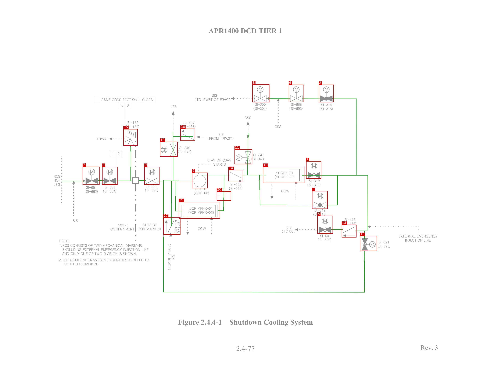
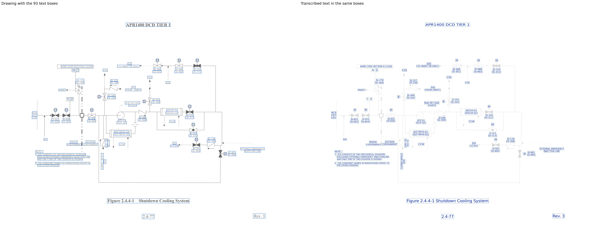

# SCS_APR1400

[All pages](README.md) · page 61 of 65

| Symbols | Pipe lines | Text lines | Size (px) | Connectivity |
|---|---|---|---|---|
| 21 | 36 | 93 | 3300 × 2550 | unverified |

Label files: [symbols](../labels/pseudo_SCS_APR1400.txt) · [pipe lines](../lines/pseudo_SCS_APR1400.json) · [text](../text/pseudo_SCS_APR1400.json) · [connectivity](../topology/pseudo_SCS_APR1400.json)

Symbol detection on this page (F1): original method (soup5) **0.791** → new method **0.955** (training half, predicted by a model that did not see this page; see [symbol_detection](../symbol_detection/README.md)).

## Symbols and pipe lines

Red box = symbol; the number is its id (its line number in the symbol file, counting from 0). Green = pipe line. Click the image to open it at full size.

Symbol list (21 symbols, with connections)

Connectivity on this page: unverified (built automatically from the verified symbols and pipe lines, not yet fully checked by a human).

| Id | Box (x0, y0, x1, y1) | Connected to |
|---|---|---|
| 0 | 969, 1122, 1071, 1241 | 4, 9, 10, 12, 15, 17, 19 |
| 1 | 2057, 1084, 2159, 1202 | 2, 3, 10, 13, 18 |
| 2 | 2142, 569, 2243, 688 | 1, 3, 6, 10, 13, 18 |
| 3 | 2097, 1285, 2201, 1405 | 1, 2, 10, 11, 13, 14, 18 |
| 4 | 686, 1122, 789, 1242 | 0, 7, 15 |
| 5 | 2133, 1451, 2237, 1572 | 13 |
| 6 | 1940, 569, 2042, 687 | 2, 8 |
| 7 | 555, 1121, 668, 1243 | 4 |
| 8 | 1696, 568, 1810, 688 | 6 |
| 9 | 1290, 1161, 1396, 1266 | 0, 10, 12, 14, 17, 19, 20 |
| 10 | 2419, 1587, 2533, 1688 | 0, 1, 2, 3, 9, 12, 13, 17, 18, 19 |
| 11 | 1576, 1005, 1695, 1105 | 3, 14, 18 |
| 12 | 1075, 953, 1194, 1054 | 0, 9, 10, 16, 17, 19 |
| 13 | 2296, 1511, 2395, 1597 | 1, 2, 3, 5, 10, 18 |
| 14 | 1535, 1143, 1633, 1219 | 3, 9, 11, 18, 20 |
| 15 | 829, 868, 925, 979 | 0, 4 |
| 16 | 1212, 865, 1310, 947 | 12 |
| 17 | 1097, 1463, 1212, 1578 | 0, 9, 10, 12, 19 |
| 18 | 1767, 1122, 2049, 1231 | 1, 2, 3, 10, 11, 13, 14 |
| 19 | 1201, 1358, 1478, 1470 | 0, 9, 10, 12, 17, 20 |
| 20 | 1456, 1287, 1553, 1349 | 9, 14, 19 |

## Text

Left: the drawing with the text boxes. Right: the transcribed text placed in the same boxes and in the same direction, so the two sides can be compared word by word. Click the image to open it at full size.

Text list (93 lines)

| Id | Text | Reading direction | Box (x0, y0, x1, y1) |
|---|---|---|---|
| 0 | APR1400 DCD TIER 1 | normal | 1400, 183, 1897, 226 |
| 1 | M | normal | 1738, 588, 1764, 616 |
| 2 | M | normal | 1981, 588, 2006, 618 |
| 3 | M | normal | 2182, 588, 2208, 618 |
| 4 | SIS | normal | 1418, 625, 1465, 656 |
| 5 | (TO IRWST OR ERVC) | normal | 1303, 652, 1553, 682 |
| 6 | ASME CODE SECTION III CLASS | normal | 677, 656, 1030, 684 |
| 7 | SI-300 | normal | 1707, 686, 1790, 716 |
| 8 | SI-688 | normal | 1949, 686, 2032, 715 |
| 9 | SI-314 | normal | 2153, 689, 2236, 717 |
| 10 | 2 | normal | 848, 695, 873, 726 |
| 11 | CSS | normal | 1143, 697, 1196, 728 |
| 12 | N | normal | 808, 700, 830, 723 |
| 13 | (SI-301) | normal | 1697, 712, 1795, 742 |
| 14 | (SI-693) | normal | 1940, 714, 2037, 743 |
| 15 | (SI-315) | normal | 2142, 715, 2241, 747 |
| 16 | CSS | normal | 1639, 776, 1693, 806 |
| 17 | SI-179 | normal | 852, 808, 935, 838 |
| 18 | SI-157 | normal | 1229, 813, 1309, 838 |
| 19 | (SI-189) | normal | 841, 837, 938, 866 |
| 20 | CSS | normal | 1843, 837, 1893, 864 |
| 21 | (SI-158) | normal | 1225, 839, 1315, 865 |
| 22 | SIS | normal | 1463, 890, 1508, 920 |
| 23 | (FROM IRWST) | normal | 1394, 919, 1571, 945 |
| 24 | IRWST | normal | 650, 921, 732, 945 |
| 25 | SI-340 | normal | 1199, 977, 1282, 1007 |
| 26 | M | bottom to top | 1089, 996, 1119, 1022 |
| 27 | (SI-342) | normal | 1193, 1004, 1287, 1034 |
| 28 | 2 | normal | 787, 1019, 808, 1046 |
| 29 | 1 | normal | 749, 1020, 766, 1044 |
| 30 | SI-341 | normal | 1698, 1028, 1776, 1053 |
| 31 | M | bottom to top | 1591, 1048, 1618, 1074 |
| 32 | (SI-343) | normal | 1685, 1053, 1780, 1082 |
| 33 | SIAS OR CSAS | normal | 1389, 1059, 1555, 1093 |
| 34 | STARTS | normal | 1429, 1092, 1520, 1117 |
| 35 | M | normal | 2098, 1102, 2123, 1132 |
| 36 | M | normal | 726, 1139, 753, 1170 |
| 37 | M | normal | 605, 1141, 630, 1170 |
| 38 | M | normal | 1008, 1141, 1034, 1171 |
| 39 | SDCHX-01 | normal | 1850, 1148, 1974, 1175 |
| 40 | RCS | normal | 356, 1172, 411, 1200 |
| 41 | (SDCHX-02) | normal | 1841, 1174, 1981, 1204 |
| 42 | HOT | normal | 356, 1199, 411, 1227 |
| 43 | SI-310 | normal | 2072, 1202, 2152, 1227 |
| 44 | (SI-311) | normal | 2059, 1225, 2157, 1255 |
| 45 | LEG | normal | 354, 1227, 409, 1255 |
| 46 | SI-568 | normal | 1549, 1231, 1624, 1252 |
| 47 | SI-655 | normal | 984, 1241, 1058, 1263 |
| 48 | SI-651 | normal | 572, 1245, 654, 1275 |
| 49 | SI-653 | normal | 700, 1245, 778, 1270 |
| 50 | (SI-569) | normal | 1534, 1253, 1632, 1281 |
| 51 | SCP-01 | normal | 1312, 1261, 1395, 1283 |
| 52 | (SI-656) | normal | 970, 1264, 1066, 1292 |
| 53 | CCW | normal | 1885, 1268, 1949, 1298 |
| 54 | (SI-654) | normal | 687, 1270, 785, 1300 |
| 55 | (SI-652) | normal | 564, 1273, 661, 1302 |
| 56 | (SCP-02) | normal | 1297, 1282, 1407, 1312 |
| 57 | M | normal | 2136, 1302, 2164, 1333 |
| 58 | SCP MFHX-01 | normal | 1269, 1386, 1430, 1414 |
| 59 | SI-312 | normal | 2114, 1404, 2188, 1426 |
| 60 | (SCP MFHX-02) | normal | 1261, 1411, 1439, 1445 |
| 61 | (SI-313) | normal | 2101, 1426, 2197, 1456 |
| 62 | SI-178 | normal | 2312, 1464, 2392, 1489 |
| 63 | M | normal | 2172, 1470, 2197, 1500 |
| 64 | SIS | normal | 486, 1471, 527, 1497 |
| 65 | (SI-160) | top to bottom | 1168, 1477, 1196, 1573 |
| 66 | SI-159 | top to bottom | 1196, 1488, 1218, 1563 |
| 67 | (SI-168) | normal | 2301, 1490, 2398, 1519 |
| 68 | OUTSIDE | normal | 953, 1497, 1058, 1526 |
| 69 | INSIDE | normal | 777, 1499, 862, 1527 |
| 70 | SIS | normal | 1921, 1512, 1963, 1541 |
| 71 | CCW | normal | 1324, 1522, 1389, 1552 |
| 72 | CONTAINMENT | normal | 921, 1524, 1088, 1552 |
| 73 | CONTAINMENT | normal | 741, 1531, 906, 1553 |
| 74 | (TO DVI) | normal | 1894, 1544, 1985, 1569 |
| 75 | SI-601 | normal | 2148, 1573, 2226, 1598 |
| 76 | EXTERNAL EMERGENCY | normal | 2674, 1574, 2943, 1603 |
| 77 | (SI-600) | normal | 2131, 1597, 2227, 1627 |
| 78 | INJECTION LINE | normal | 2718, 1600, 2897, 1629 |
| 79 | NOTE : | normal | 394, 1605, 478, 1633 |
| 80 | SI-691 | normal | 2539, 1614, 2619, 1643 |
| 81 | M | top to bottom | 2491, 1632, 2520, 1657 |
| 82 | (FROM IRWST) | top to bottom | 1123, 1637, 1152, 1818 |
| 83 | 1. SCS CONSISTS OF TWO MECHANICAL DIVISIONS | normal | 396, 1639, 953, 1662 |
| 84 | (SI-690) | normal | 2534, 1641, 2625, 1669 |
| 85 | EXCLUDING EXTERNAL EMERGENCY INJECTIONLINE | normal | 417, 1667, 998, 1690 |
| 86 | AND ONLY ONE OF TWO DIVISION IS SHOWN. | normal | 418, 1694, 918, 1717 |
| 87 | SIS | top to bottom | 1149, 1707, 1180, 1755 |
| 88 | 2. THE COMPONET NAMES IN PARENTHESES REFER TO | normal | 394, 1737, 1001, 1760 |
| 89 | THE OTHER DIVISION. | normal | 416, 1763, 659, 1786 |
| 90 | Figure 2.4.4-1 Shutdown Cooling System | normal | 1191, 2141, 2106, 2195 |
| 91 | Rev. 3 | normal | 2815, 2311, 2953, 2364 |
| 92 | 2.4-77 | normal | 1580, 2316, 1718, 2371 |

