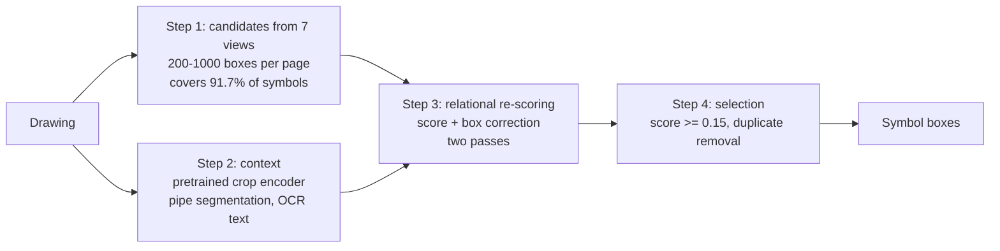

# Symbol detection: original method (soup5) vs new method

This folder compares two ways of detecting P&ID symbols on the 65 human-verified pages:

- **Original method: soup5.** A YOLO11x detector (weight average of 5 models) applied to the whole page. It is unchanged here.
- **New method: cascade relational re-scoring.** Detectors propose candidate boxes generously. A relational model then decides, box by box, whether each one matches the annotation conventions of the verified labels, and corrects its position.

Real4 (the 4 standard test drawings) is not included in this folder.

## Results

All numbers use the same metric. A prediction counts as correct when IoU ≥ 0.5 with a verified box, and each verified box can be matched once. F1 is computed per page and then averaged over pages (macro F1).

| Data | Method | Macro F1 | TP | FP | FN |
|---|---|---|---|---|---|
| **B half, 25 test pages** (never used for training) | soup5 (original) | 0.728 | 1253 | 344 | 510 |
| | soup5 fine-tuned on the A half | 0.742 | – | – | – |
| | **new method** | **0.863** | 1393 | 97 | 370 |
| A half, 40 pages (5-fold out-of-fold) | soup5 (original) | 0.646 | 1319 | 711 | 440 |
| | **new method** | **0.826** | 1382 | 223 | 377 |
| All 65 pages | soup5 (original) | 0.678 | 2572 | 1055 | 950 |
| | **new method** | **0.840** | 2775 | 320 | 747 |

- On all 65 pages, false positives fall by 70% (1055 → 320) and misses by 21% (950 → 747).
- 58 of the 65 pages improve and 6 get worse. The pages that get worse are mostly APR1400 simplified block diagrams.
- Per-page numbers are in [`results/per_page_65.csv`](results/per_page_65.csv), and totals in [`results/summary.json`](results/summary.json).
- A second training run with a different random seed gives 0.861 on the B half.

### Test set (B half)

- [`results/split.json`](results/split.json): which pages are in A (training) and which are in B (test). The split is by document, so all pages of one document are on the same side.
- [`results/test_predictions_soup5.json`](results/test_predictions_soup5.json) and [`results/test_predictions_new_method.json`](results/test_predictions_new_method.json): predicted boxes for the 25 test pages, as pixel coordinates `[x0, y0, x1, y1, score]`. Scoring these files against `../labels/` reproduces 0.7275 and 0.8629 exactly.
- [`test_set_overlays/`](test_set_overlays/): one image per test page, with soup5 on the left and the new method on the right. Green = correct, red = false positive, dashed orange = missed.

## How leakage is prevented

- **B half:** never used for training. Every model applied to B was trained on A-half labels only.
- **A half:** split by document into 5 folds. Each A page is predicted by the model trained on the other 4 folds, so no page is predicted by a model that saw its labels.
- **Detectors used as inputs:** their predictions on A pages also come from cross-fitted models (4 folds), so no model's input carries information from the labels of the page it is scoring.
- **Threshold:** the selection threshold was chosen on A only.

Caveats:
- soup5 itself was originally trained with machine-generated pseudo labels that include these 65 pages (not the human labels). This applies equally to both methods.
- The B results were looked at several times during development, so the cleanest number is the A-half out-of-fold result (0.646 → 0.826).

## Method

### Why not simply fine-tune the detector?

The first thing we tried was fine-tuning soup5 on the 40 verified A-half pages. On the B half it only went from 0.728 to 0.742. There are three reasons:

- the detector has to find and judge every symbol on a whole page at once, which is a hard task to learn from 40 pages;
- it sees the page shrunk to about 0.39 of its size, so small symbols are only 10-20 pixels wide;
- 40 pages are a small addition to the data it was originally trained on, so its habits barely change.

The new method uses the same 40 pages differently. Detectors propose candidate boxes generously, and a separate model, trained on the verified labels, answers one simpler question for each candidate: **is this box correct under our labeling conventions, and where exactly should it be?** Every A-half page yields hundreds of such yes/no examples (20,429 candidates on the 40 pages, 1,715 of them correct), the model looks at each candidate at full resolution, and it sees the rest of the page while deciding.

### Overview



Step 1 is only responsible for not missing symbols; step 3 is only responsible for deciding which candidates are right. Separating the two makes each of them easier.

### Step 1: candidates (recall)

Seven views each propose boxes:

| View | What it is | Trained on |
|---|---|---|
| 1-5 | soup5 on the original page, scaled ×1.25, scaled ×0.8, flipped left-right, flipped up-down | original pseudo labels (not retrained) |
| 6. Tile detector | the page cut into 640×640 tiles at native resolution (stride 480), so small symbols keep their real pixel size; initialized from soup5 | A-half verified symbols |
| 7. Large-equipment detector | YOLO11s on the page resized to 1280, trained only on symbols of 150 px or larger (pumps, heat exchangers, tanks) | A-half verified symbols |

All boxes are sorted by score, and boxes with IoU ≥ 0.8 are merged into one candidate. Each candidate keeps the highest score each view gave it, which gives a 7-number score vector. soup5 alone covers 81% of the B-half symbols; the 7 views together cover 91.7%. The extra false candidates are left for step 3 to remove.

**Cross-fitting.** On A pages, the outputs of the tile and large-equipment detectors come from models that did not see that page (4 folds by document). Otherwise these detectors would look unrealistically good on A pages, and the re-scoring model would learn to trust them more than it should on new pages.

### Step 2: context

**(a) Crop encoder with large-scale pretraining** (the largest single gain).

- For each candidate, a square with side 1.5 × the longer box side + 8 px is cut around the box centre from the full-resolution page and resized to 64×64. The three channels are [ink, box mask, ink]. The mask tells the network which part of the crop is boxed, so it can judge both "is this a symbol?" and "is the box tight?".
- Encoder: ResNet18, giving a 512-number feature per candidate.
- Pretraining uses no human labels. Source: the 5 datasets soup5 was trained on, with their automatic pseudo labels. 228,985 crops (89,353 positive).
  - Positives: symbol boxes and slightly shifted copies (IoU ≥ 0.7).
  - Negatives: shifted boxes with IoU 0.1-0.45 ("box is off") and random boxes of the same size far from any symbol but containing ink: text, lines, frames ("not a symbol").
  - 6 epochs.
- Effect: the encoder first learns what symbols and tight boxes look like in general; the 40 verified pages are then only needed to learn our specific conventions. On the B half this moves the model from 0.777 to 0.834.

**(b) Pipe segmentation.** A U-Net with a ResNet18 encoder, trained on the A-half verified pipe lines (loss only on ink pixels, 512 px tiles, full-page sliding window at test time). Pipe-pixel F1 is 0.762, against 0.591 for rule-based line extraction. Horizontal and vertical segments are extracted from the predicted mask. A pages are predicted by the model trained on the other half of A (2 folds).

**(c) OCR text.** PP-OCRv5 text boxes with confidence ≥ 0.5, with the number of characters and the share of digits.

### Step 3: relational re-scoring (the core)

**Tokens.** Every element of a page becomes a 256-number token, and all tokens of a page (typically 1,000-2,000) are processed together:

| Token | Input | Encoding |
|---|---|---|
| Candidate box | 512 crop features + 7 view scores + 5 geometry numbers (centre x, y; width; height; aspect ratio) | MLP → 256 |
| Pipe segment | centre, length, thickness, horizontal or vertical | MLP → 256 |
| Text box | centre, width, height, aspect ratio, number of characters, share of digits | MLP → 256 |

A learned type embedding (candidate / pipe / text) is added to each token.

**Attention with a geometric bias.** A 4-layer Transformer (width 256, 8 heads, pre-LayerNorm, feed-forward 1024, dropout 0.1). Plain attention only compares content; it does not know whether two elements overlap, touch or are far apart. We therefore add a learned bias to every attention score:

```
attention(i, j) = q_i · k_j / sqrt(d)  +  b(r_ij)
                  content similarity       spatial relation
```

`r_ij` holds 8 numbers describing elements i and j:

| # | Relation | What it lets the model see |
|---|---|---|
| 1-2 | horizontal and vertical offset of the centres (signed log scale) | is a text box right next to me? |
| 3-4 | width ratio, height ratio (log) | is this a same-sized, possibly same-type symbol? |
| 5 | IoU | is this a duplicate of me? |
| 6 | share of i covered by j | am I part of a bigger box (half a symbol)? |
| 7 | share of j covered by i | does my box contain another symbol (box too big)? |
| 8 | gap between the two boxes (log) | does a pipe touch me? |

`b` is a small MLP (8 → 32 → 32) whose 32 outputs give each of the 4 layers × 8 heads its own bias. Each head can therefore specialise in one kind of relation, for example overlapping candidates (duplicates), text sitting on a candidate (tag numbers), pipes running into it (valve versus flow arrow), or similar-looking candidates elsewhere on the page (consistent decisions). This is the intended role of the heads; we have not visualised individual heads.

Judging boxes one by one cannot settle these cases. Two duplicate boxes on one valve both look like a valve, and only by comparing them can one be kept. An arrow and a small valve can look alike in a crop, and the pipes around them tell them apart.

**Outputs.** For every candidate: one score (is this a correct box under the verified conventions?) and four corrections that move its left, top, right and bottom edges, in units of the box width and height. Every pipe token also gets an auxiliary "is this a real pipe?" score, supervised by the verified pipe lines; it only helps training and is not used at test time.

**One-to-one training target.** Verified boxes are processed in order of their best match. Each one marks as positive only the candidate with the highest IoU that is not already taken, if that IoU is ≥ 0.5. Every other candidate is negative, including overlapping candidates that are not the best match. For example, with three candidates on one valve at IoU 0.85, 0.7 and 0.6, only the first is positive. A candidate can only answer "am I the best box for this symbol?" by looking at its neighbours, so the model learns de-duplication itself. The box correction is trained towards the nearest verified box with IoU ≥ 0.3.

**Loss.**

```
loss = BCE(score, positive weight 2) + 2 × SmoothL1(box correction) + 0.3 × BCE(pipe, first pass only)
```

summed over both passes. In the second pass the one-to-one targets are recomputed for the corrected boxes.

**Two-pass cascade.**

1. Pass 1 scores every candidate and corrects its box.
2. Pass 2 crops the page again at the corrected boxes (a corrected box keeps at least 30% of its original width and height) and scores again. A learned stage embedding tells the model which pass it is in, and pass-2 corrections are halved. Without these two measures, pass-2 boxes drifted systematically on one document (about 0.3 box widths on the Davis-Besse AFW report).
3. Final score = mean of the two pass scores; final box = the pass-1 correction.

**Training.**

- One page is one training example.
- Augmentation: random left-right and up-down flips; with probability 0.5, only a random window of 55-100% of the page width and height is used.
- AdamW, learning rate 2e-4 for the crop encoder and 4e-4 for the rest, weight decay 1e-4, one-cycle schedule with 8% warm-up, 60 epochs, gradient clipping at 1.0.
- A half split into 5 folds by document, so every A page is predicted by a model that never saw it.

### Step 4: inference and selection

1. The model runs on the page and on its left-right flip, and both results are averaged.
2. B pages are predicted by each of the 5 fold models, and the results are averaged.
3. Selection: keep candidates with score ≥ 0.15, then remove duplicates (a box is dropped if it overlaps a higher-scored kept box with IoU ≥ 0.3, or if either box covers at least 80% of the other).
4. These three numbers were chosen by grid search on the A-half out-of-fold results. The B half was not used to tune them.

### What each part contributes

B-half macro F1 for each configuration. All relational-model rows were trained and evaluated the same way (5 folds on A, selection thresholds chosen on A).

| Configuration | B half |
|---|---|
| soup5 (original) | 0.728 |
| soup5 fine-tuned on the A half | 0.742 |
| Boxes judged independently: gradient boosting with hand-made neighbour features, crop CNN and self-training (several stages, best version) | 0.824 |
| Relational model, crop encoder initialized from ImageNet | 0.777 |
|     same, without text tokens | 0.735 |
|     same, without pipe tokens (rule-based pipes) | 0.776 |
| + crop encoder pretraining (rule-based pipes) | 0.834 |
| + learned pipe segmentation | 0.839 |
| + two-pass cascade | 0.846 |
| + stage embedding and damped pass 2 (**final**) | **0.863** |

- The text tokens are the clearest relational gain: removing them costs 4 points.
- Rule-based pipe tokens are too noisy to help; learned pipe segmentation gives a small gain.
- The relational model only overtakes independent judgment after the crop encoder is pretrained. Without pretraining, 40 pages are not enough to learn both what symbols look like and how they relate.
- We have not yet run the cleanest attention ablation (same inputs, attention switched off). The contribution of attention by itself is therefore not measured separately.

### Which parts use which labels

| Component | Labels |
|---|---|
| soup5 | pseudo labels (original training, not retrained here) |
| Appearance pretraining | automatic pseudo labels |
| Relational model | human-verified symbols, A half only |
| Tile detector, large-equipment detector | human-verified symbols, A half only. The tile detector is initialized from soup5. |
| Pipe segmentation | human-verified pipe lines, A half only |

## Limitations

- **6 of the 65 pages get worse**, mostly APR1400 simplified block diagrams (SCS2 drops from 0.845 to 0.471). The A half contains no similar documents.
- **The B half was looked at several times during development.** The cleanest number is the A-half out-of-fold result (0.646 → 0.826).
- **soup5's original training data** (pseudo labels) included these 65 pages, though not their human labels. This applies to both methods equally.
- **Missing ablation.** See "What each part contributes".

## Code

Everything is in [`code/`](code/). This is research code and contains absolute paths from the original server, so adjust the paths before running it.

| Step | Files |
|---|---|
| Split and common utilities | `split.py`, `selfsim.py` (soup5 candidates, F1), `textfilter.py`, `rescore.py`, `rescore_pool.py` (candidate pool, selection) |
| Multi-view soup5 candidates | `selfsim.py cache`, `tta_cache.py` |
| Tile detector | `tiles.py`, `folds4.py`, `train_tile.py`, `tile_predict.py` |
| Large-equipment detector | `train_big.py`, `big_predict.py`, `merge_cache.py` |
| OCR text | `ocr5_pages.py` (PP-OCRv5) |
| Pipe segmentation | `pipe_seg.py`, `structure.py` |
| Appearance pretraining | `pretrain_cnn.py`, `crop_cnn.py` |
| Relational model | `rel_prep.py`, `rel_prep_pipe.py`, `rel_model.py`, `rel_model2.py` |
| Evaluation | `report_detail.py` |

The final model is trained with:

```
REL_STAGEEMB=1 REL_CVCROP=1 REL_DATA=rel_data_pipe REL_CASC=avg_first \
  python rel_model2.py fold <k> <gpu> <tag> wpre stages=2      # k = 0..4
python rel_model2.py eval <tag>
```

Model weights are not in this repository, because the tile detector alone exceeds GitHub's 100 MB file limit. On the original server, relative to the project root:

- soup5: `runs/detect/unsupervised_symbol_recognition/runs/soup5/weights/best.pt`
- tile detectors: `runs/exp65/tile_{F0..F3,A}/weights/last.pt`
- large-equipment detectors: `runs/detect/runs/exp65/big_{F0..F3,A}/weights/`
- appearance pretraining: `ft_verified/exp65/results/cnn_weakpre.pt`
- pipe segmentation: `ft_verified/exp65/results/pipe_seg/unet_{A1,A2}.pt`
- relational models: `ft_verified/exp65/results/rel_runs/prt2cv_se_fold{0..4}.pt` (seed 0) and `prt2cv_se_r1_fold{0..4}.pt` (seed 1)
