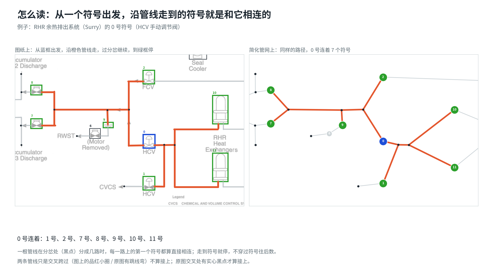

# Pipe connectivity: 5 verified pages

Each image below shows a drawing on the **left** (pipes drawn in colour, each symbol a numbered box) and the extracted pipe network on the **right** (coloured dot = symbol, small black dot = branch point, line = one pipe segment). The numbers match on both sides. The right side is the left side simplified: pipes straightened, text removed, same connections.

## How to read · 怎么读

Start from a symbol and follow the pipe. At a branch point (black dot) keep following every branch, and stop at the next symbol. The symbols you reach are the ones connected to it. Two pipes that only cross (no solid dot on the drawing) are **not** connected.

从一个符号出发沿管线走，遇到分岔（黑点）就沿每一路继续走，走到下一个符号停下；走到的这些符号就是和它相连的。两条管线只是交叉跨过（原图交叉处没有实心黑点）不算连通。

## How to check · 怎么核查

For each page, compare left and right:

1. **Every pipe on the drawing appears on the right**, between the same symbols. If a pipe is missing, a connection was lost. 图纸上的每一段管线，右边都有，而且连在相同的两个符号之间。少了就是漏连。
2. **No line on the right without a pipe on the drawing.** Otherwise there is an extra connection. 右边的每条线，图纸上都有对应的管线。多了就是错连。
3. **Crossings:** where two pipes cross on the drawing, check whether there is a solid dot. A dot means connected (a branch point on the right); no dot means not connected (the two lines on the right must not meet). 交叉处有实心黑点才算接上（右边是分岔点），没有就不能接在一起。
4. **Every symbol has a dot on the right**, and the numbers match. 每个符号在右边都有圆点，编号对得上。

To report an error, give the page and the symbol numbers, for example "RHR: 0 should not connect to 9". 发现问题请写明：哪一页、哪几个编号，例如"RHR：0 号不应连到 9 号"。

All 5 pages were cross-checked automatically against the human-verified symbols and pipe lines, and inspected visually; no errors were found. See the [main README](../README.md#connectivity-verified-pages) for the method. The same material as slides: [topology_5pages_verified.pptx](topology_5pages_verified.pptx).

## The 5 pages · 5 页

### 1. AFW Davis-Besse reliability analysis, p7 (Third Train Configuration) · AFW Davis-Besse 可靠性分析报告 p7

25 symbols · 32 pipe segments · 7 branch points · status: **verified**

Files: [data (json)](pseudo_AFW_%28DAVIS-BESSE%29%20AFW%20system%20Reliability%20Analysis_Final%20Report_p7.json) · [overlay on the drawing](pseudo_AFW_%28DAVIS-BESSE%29%20AFW%20system%20Reliability%20Analysis_Final%20Report_p7.jpg)

### 2. RHR, residual heat removal (Surry FSAR) · RHR 余热排出系统（Surry FSAR）

14 symbols · 40 pipe segments · 22 branch points · status: **verified**

Files: [data (json)](pseudo_RHR_%28Surry%29%20FSAR.json) · [overlay on the drawing](pseudo_RHR_%28Surry%29%20FSAR.jpg)

### 3. AFW, auxiliary feedwater (Seabrook, NUREG/CR-5500) · AFW 辅助给水系统（Seabrook）

47 symbols · 56 pipe segments · 8 branch points · status: **verified**

Files: [data (json)](pseudo_AFW%20%28Seabrook%29.json) · [overlay on the drawing](pseudo_AFW%20%28Seabrook%29.jpg)

### 4. AFW, auxiliary feedwater (San Onofre design review) · AFW 辅助给水系统（San Onofre）

60 symbols · 98 pipe segments · 28 branch points · status: **verified**

Files: [data (json)](pseudo_AFW_%28San%20Onofre%29%20AFW%20Design%20Review%20and%20Reliability%20Evaluation.json) · [overlay on the drawing](pseudo_AFW_%28San%20Onofre%29%20AFW%20Design%20Review%20and%20Reliability%20Evaluation.jpg)

### 5. CSS, containment spray (APR1400) · CSS 安全壳喷淋系统（APR1400）

72 symbols · 94 pipe segments · 15 branch points · status: **verified**

Files: [data (json)](pseudo_CSS%20%28APR1400%29.json) · [overlay on the drawing](pseudo_CSS%20%28APR1400%29.jpg)
