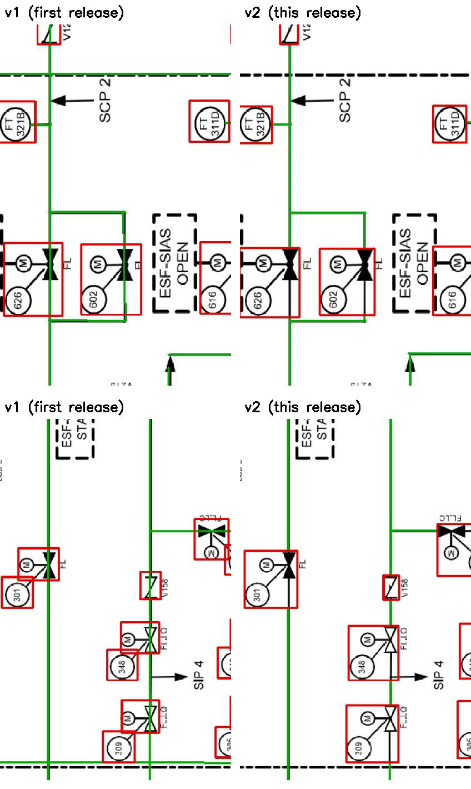

# Human-verified annotations, second release (v2)

Same 65 real nuclear P&ID pages as [`../verified_annotations/`](../verified_annotations/) (the first release, left unchanged),
re-optimized and verified again page by page:

- **Symbol boxes hug the symbol.** Each box was tightened to the ink of its symbol (no added margin). Pipe stubs, nearby
  text and dashed lines that the old box enclosed were removed. Parts of a symbol that the old box cut off (an actuator
  drawn across the edge, the tip of an off-page connector) were added.
- **Pipe lines stop at the symbol boxes.** Lines no longer run through symbols. Lines were also moved onto the pipe
  centerline, extended to the box edge, and short pipe pieces that had no line were added.
- **Text boxes hug the letters.** Each text box was shrunk to its letters. Where a letter touches a symbol stroke, that
  side keeps its old edge. Where OCR reads the tightened box worse than the old one, the old box is kept. The
  transcriptions were not changed.
- Every page was then checked by a human in the browser editor and saved.

*Left: first release. Right: this release. Red = symbol box, green = pipe line.*

## Numbers

| | v1 | v2 |
|---|---|---|
| Pages | 65 | 65 |
| Symbol boxes | 3522 | 3488 |
| Total symbol box area (px²) | 32.0 M | 27.5 M (-14%) |
| Pipe line segments | 5441 | 6306 |
| Line segments running into a symbol box | 1016 | 13 |
| Text boxes | 6064 | 6064 (median box area 76% of v1) |

The 13 remaining segments end a few pixels inside a box on pages edited by the reviewer (Turkey Point 5, Brain Wood 2,
South Texas 2, Instrument Air 2, ST. LUCIE 1, Davis-Besse reliability analysis 1). `stats.json` has these numbers for
every page.

## Files

- `labels/<page>.txt`: symbols, YOLO format `0 cx cy w h` (normalized, single class).
- `lines/<page>.json`: pipes, `{"solid": [[x1,y1,x2,y2],...], "dashed": []}` in image pixels.
- `text/<page>.json`: text lines, `{"name", "width", "height", "items": [{"id", "box": [x0,y0,x1,y1], "text", "rot"}]}`,
  boxes in image pixels. `id` matches the first release, `rot` as in the first release (`0`, `cw`, `ccw`, `180`).
- `overlay/<page>.jpg`: symbols (red) and pipes (green) drawn on the page.
- `text_overlay/<page>.jpg`: text boxes (blue) drawn on the page.
- `stats.json`: per page, v1 vs v2 counts (symbols, total box area, lines, lines into symbols, text box area ratio).
- `v1_vs_v2.jpg`: the comparison above.

The drawings themselves are the sheets of `datasets/yolo_pseudo_v2` (the same images as in the first release, e.g.
`../verified_annotations/topology_verified/images/` for the 5 connectivity pages).

## Labeling rules (v2)

- One box per symbol, tight around the symbol's ink.
- A valve together with its actuator (M, solenoid, diaphragm) and LO/LC mark is one box.
- A valve and the numbered tag circle drawn on a leader from it are one box (e.g. SCS2 (APR1400), RCS-POSRV (APR1400)).
  Instrument circles that stand on their own get their own box.
- A pump and its variable frequency drive (VFD) are one box (Power conversion system (NuScale)).
- Labelled equipment blocks (heat exchangers, coolers, chillers drawn as a rectangle with a name) are boxed
  (CCWS (APR1400)).
- A dashed frame drawn around several valves is not a symbol: each valve inside gets its own box (AFW (Haddam Neck)).
- Lines follow pipe centerlines and stop at the edge of a symbol box. A box that holds 3 or more other boxes (a tank with
  spargers inside) is not cut.
- Dashed and dash-dot lines are not labeled when they are signal lines or area / seismic boundaries. Pipes that carry
  flow but are drawn dashed or dash-dot **are** labeled: the ESW emergency supply on AFW (INL system study) and the
  pilot lines of the four POSRVs on RCS-POSRV (APR1400).
- No line is added where the drawing shows none (e.g. between the filter, coils and fan inside an HVAC unit housing).

## How it was made

1. Symbol boxes. Inside each verified box, ink was taken from the page (dark-pixel threshold relative to the
   background). Straight thin strokes crossing the box edge were removed as pipe stubs when a labeled pipe meets them.
   Pieces mostly outside the box, dashes of a dashed line passing by, and text inside the box but outside the symbol
   were removed too. The box grows only where a stroke of the symbol continues past the edge.
2. Lines. Each verified line was snapped to the pipe centerline and extended to the tightened box. It was then cut at
   the boxes, and corners and T-junctions were re-joined. Short unlabeled pipe pieces were added between boxes and
   lines (only along ink, never through text), and small gaps along ink were closed.
3. Text boxes. Each box was fitted to its letters (connected ink pieces lying at least 75% inside the old box; a letter
   that the old box edge cut by a few pixels was taken whole). Outlines
   around the letters (instrument circles, frames) and dashed signal lines were removed. A box was kept as before when
   PP-OCRv5 read the tightened crop worse than the old crop.
4. Automatic checks over all pages: lines inside symbol boxes, duplicate lines, lines off the drawn pipe, symbol boxes
   with empty margins, text boxes cutting letters; every finding was fixed or reviewed. Symbols that a detector found but
   no box covered were reviewed and the real misses were added. All changed boxes were inspected visually.
5. Human verification of every page in the browser editor (symbols and lines, then text), with the changes the
   reviewer asked for applied and re-checked.

## Connectivity

[`topology_verified/`](topology_verified/README.md) has the pipe connectivity of all 65 pages, built from these annotations and
verified: automatic checks against the symbols and pipe lines, a visual inspection of every connection by the builders, and a second,
independent inspection of the 50 pages added in this round, whose findings were fixed and re-checked. Remaining flags of the automatic
checks are explained per page. The connectivity files in `../verified_annotations/topology/` were built from the first release and are
not used here.

## Symbol classes

[`symbol_classes/`](symbol_classes/README.md) has a class and an actuator for every symbol box, plus the derived fault-tree
component type (MOV, AOV, CKV, MDP, ...). These are pre-labels, reviewed twice (the second time by independent reviewers); a human review of every row is in progress.

## Legend library

[`legend_library/`](legend_library/README.md) has the AP1000 and APR1400 P&ID legend PDFs, every legend entry extracted from them (symbol
image, section, printed description), and the files that tie each symbol box of the 65 pages to its legend entry.
