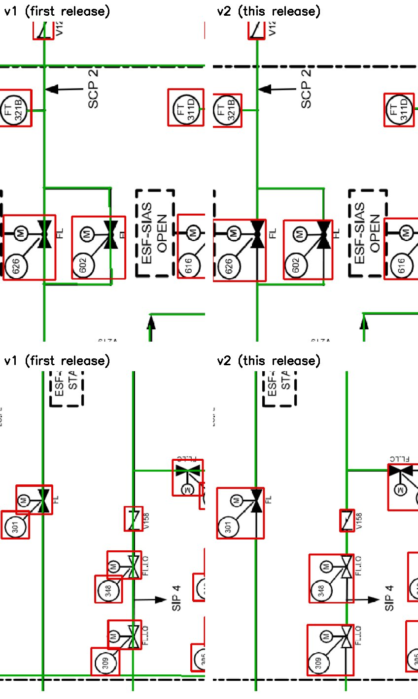

# Human-verified annotations, second release (v2)

Same 65 real nuclear P&ID pages as [`../verified_annotations/`](../verified_annotations/) (the first release, left unchanged),
re-optimized and verified again page by page:

- **Symbol boxes hug the symbol.** Each box was tightened to the ink of its symbol (no added margin). Pipe stubs, nearby
  text and dashed lines that the old box enclosed were removed. Parts of a symbol that the old box cut off (an actuator
  drawn across the edge, the tip of an off-page connector) were added.
- **Pipe lines stop at the symbol boxes.** Lines no longer run through symbols. Lines were also moved onto the pipe
  centerline, extended to the box edge, and short pipe pieces that had no line were added.
- **Text boxes hug the letters.** Each text box was shrunk to its letters. Where a letter touches a symbol stroke, that
  side keeps its old edge. Where OCR reads the tightened box worse than the old one, the old box is kept. The
  transcriptions were not changed.
- Every page was then checked by a human in the browser editor and saved.

*Left: first release. Right: this release. Red = symbol box, green = pipe line.*

## Numbers

| | v1 | v2 |
|---|---|---|
| Pages | 65 | 65 |
| Symbol boxes | 3522 | 3493 |
| Total symbol box area (px²) | 32.0 M | 27.5 M (-14%) |
| Pipe line segments | 5441 | 6389 (of them 50 dashed) |
| Line segments running into a symbol box | 1016 | 13 |
| Text boxes | 6064 | 6061 (median box area 76% of v1) |

The 13 remaining segments end a few pixels inside a box on pages edited by the reviewer (Turkey Point 5, Brain Wood 2,
South Texas 2, Instrument Air 2, ST. LUCIE 1, Davis-Besse reliability analysis 1). `stats.json` has these numbers for
every page.

## Files

- `labels/<page>.txt`: symbols, YOLO format `0 cx cy w h` (normalized, single class).
- `lines/<page>.json`: pipes, `{"solid": [[x1,y1,x2,y2],...], "dashed": [...]}` in image pixels; `dashed` holds the flow
  pipes drawn dashed or dotted.
- `text/<page>.json`: text lines, `{"name", "width", "height", "items": [{"id", "box": [x0,y0,x1,y1], "text", "rot"}]}`,
  boxes in image pixels. `id` matches the first release, `rot` as in the first release (`0`, `cw`, `ccw`, `180`).
- `overlay/<page>.jpg`: symbols (red) and pipes (green) drawn on the page.
- `text_overlay/<page>.jpg`: text boxes (blue) drawn on the page.
- `stats.json`: per page, v1 vs v2 counts (symbols, total box area, lines, lines into symbols, text box area ratio).
- `v1_vs_v2.jpg`: the comparison above.

The drawings themselves are the sheets of `datasets/yolo_pseudo_v2` (the same images as in the first release, e.g.
`../verified_annotations/topology_verified/images/` for the 5 connectivity pages).

## Labeling rules (v2)

- One box per symbol, tight around the symbol's ink.
- A valve together with its actuator (M, solenoid, diaphragm) is one box. Lock marks next to a valve (LO, LC, LO.FL,
  LC.FL, L.O., L.C.) are text, not part of the symbol: they get a text box, and the valve box is not extended to hold them.
- A valve and the numbered tag circle drawn on a leader from it are one box (e.g. SCS2 (APR1400), RCS-POSRV (APR1400)).
  Instrument circles that stand on their own get their own box.
- The pilot of a pilot-operated safety relief valve, the square marked P drawn above each POSRV together with the three
  short legs under it, is a symbol of its own (`OTHER`), not part of the valve box; the line from it to the valve and the
  pilot lines that continue below its legs are pipes (RCS-POSRV (APR1400)).
- A pump and its variable frequency drive (VFD) are one box (Power conversion system (NuScale)).
- Labelled equipment blocks (heat exchangers, coolers, chillers drawn as a rectangle with a name) are boxed
  (CCWS (APR1400)).
- A dashed frame drawn around several valves is not a symbol: each valve inside gets its own box (AFW (Haddam Neck)).
- Symbols drawn in a legend to explain the notation (e.g. the two valves next to the words NORMALLY OPEN and NORMALLY
  CLOSED on the Davis-Besse reliability analysis pages) are not symbols of the system: they get no box and no
  connection. The words of the legend are text.
- Lines follow pipe centerlines and stop at the edge of a symbol box. A box that holds 3 or more other boxes (a tank with
  spargers inside) is not cut.
- Dashed, dash-dot and dotted lines are not labeled when they are signal lines (e.g. from an ESF-SIAS START box or a
  control panel) or area / room / seismic / containment boundaries. Pipes that carry flow but are drawn dashed, dash-dot
  or dotted **are** labeled: the ESW emergency supply on AFW (INL system study), the pilot lines of the four POSRVs on
  RCS-POSRV (APR1400), the dotted CCW supply and return lines of the heat exchangers and the dotted lines to and from
  other systems (IRWST, CSS, DVI, external emergency injection) on SCS, SCS2 and CSS (APR1400).
- Marks drawn on a pipe are not symbols: code-class break marks (e.g. "1|2" with its leader), flow arrows, interface
  brackets. A containment penetration drawn as a box on the containment boundary **is** a symbol (PENETRATION).
- An equipment box ends at the outline of the equipment: the arrows, labels and CCW lines drawn next to a heat
  exchanger are outside its box.
- No line is added where the drawing shows none (e.g. between the filter, coils and fan inside an HVAC unit housing).
- Handwriting that cannot be read (e.g. initials in a revision block) gets a text box like any other text line; its
  transcription is `###`.

## How it was made

1. Symbol boxes. Inside each verified box, ink was taken from the page (dark-pixel threshold relative to the
   background). Straight thin strokes crossing the box edge were removed as pipe stubs when a labeled pipe meets them.
   Pieces mostly outside the box, dashes of a dashed line passing by, and text inside the box but outside the symbol
   were removed too. The box grows only where a stroke of the symbol continues past the edge.
2. Lines. Each verified line was snapped to the pipe centerline and extended to the tightened box. It was then cut at
   the boxes, and corners and T-junctions were re-joined. Short unlabeled pipe pieces were added between boxes and
   lines (only along ink, never through text), and small gaps along ink were closed.
3. Text boxes. Each box was fitted to its letters (connected ink pieces lying at least 75% inside the old box; a letter
   that the old box edge cut by a few pixels was taken whole). Outlines
   around the letters (instrument circles, frames) and dashed signal lines were removed. A box was kept as before when
   PP-OCRv5 read the tightened crop worse than the old crop.
4. Automatic checks over all pages: lines inside symbol boxes, duplicate lines, lines off the drawn pipe, symbol boxes
   with empty margins, text boxes cutting letters; every finding was fixed or reviewed. Symbols that a detector found but
   no box covered were reviewed and the real misses were added. All changed boxes were inspected visually.
5. Human verification of every page in the browser editor (symbols and lines, then text), with the changes the
   reviewer asked for applied and re-checked.

## Review fixes (November 2026)

An external review of the SCS (APR1400) page found boxes, lines and labels that did not follow these rules; the page
and the same kinds of problems on the other 64 pages were fixed: see [`review_2026_11/`](review_2026_11/README.md). On
19 November 2026 the 40 valve boxes that had been drawn around or into their LO/LC lock mark were moved in to the
valve, as the rules above say (SI, CSS, Instrument Air and SCS2 (APR1400), AFW (Vogtle), Davis-Besse reliability
analysis p2, p3, p6, p7 and p8). On 21 and 24 November 2026 the text layer of Davis-Besse reliability analysis p3 was
corrected after ALE's reviews of that page: its title and the JOB NO line of its title block, each one line on the
drawing, are one text line each; every text box holds the glyphs of its line and nothing else (101 boxes changed); two
misread numbers were corrected; three symbol boxes that held a neighbour were tightened. On 24 November 2026
Davis-Besse reliability analysis p5, another version of p9's drawing, was checked the same way after its self-test:
the two plain crossings of its FW459/FW460/FW448 valve station are not connected, as on p9; 20 symbol boxes were
fitted to the ink; every text box holds the glyphs of its line and nothing else (84 boxes changed), four misread
transcriptions were corrected and the JOB NO line of the title block is one text line.

## Connectivity

[`topology_verified/`](topology_verified/README.md) has the pipe connectivity of all 65 pages, built from these annotations and
verified: automatic checks against the symbols and pipe lines, a visual inspection of every connection by the builders, and a second,
independent inspection of the 50 pages added in this round, whose findings were fixed and re-checked. Remaining flags of the automatic
checks are explained per page. The connectivity files in `../verified_annotations/topology/` were built from the first release and are
not used here.

## Symbol classes

[`symbol_classes/`](symbol_classes/README.md) has a class and an actuator for every symbol box, plus the derived fault-tree
component type (MOV, AOV, CKV, MDP, ...). These are pre-labels, reviewed twice (the second time by independent reviewers); a human review of every row is in progress.

## Legend library

[`legend_library/`](legend_library/README.md) has the AP1000 and APR1400 P&ID legend PDFs, every legend entry extracted from them (symbol
image, section, printed description), and the files that tie each symbol box of the 65 pages to its legend entry.
