# Symbol classes (pre-labels, human review in progress)

**Status: pre-labels.** Every one of the 3488 symbol boxes of [`../labels/`](../labels/) has a class and an actuator,
labeled by eye page by page and checked a second time class by class. A human review of every row is in progress;
until it is done these labels are not verified. Rows marked `uncertain = yes` (52) are drawn ambiguously and have no
legend on their page; they are reviewed first.

**Start here: [index.md](index.md)**, one row per page with links to its overview and evidence images.
**To check the class definitions themselves**, see [Class reference](#class-reference) below: one picture per class
with the legend entries it follows.

## Class reference

One image per class, for reviewers who want to confirm that the categories are right. Each image shows the
AP1000 / APR1400 P&ID legend entries that the boxes of the class were tied to, with the PDF page, entry number and
printed description under each entry and the number of boxes citing it. These are the definitions the labels follow;
a class that maps to several entries (e.g. `VLV_GATE`: open and closed gate valve of both legends) lists all of them.

The 51 classes are in five groups: 13 valves and dampers, 23 equipment, 1 instrument, 9 electrical, 5 other.
46 of them occur in the 65 pages; the five that do not (`VLV_BALL`, `VLV_PLUG`, `VLV_NEEDLE`, `VLV_DIAPHRAGM`, `TRAP`)
are kept in the list so the scheme stays complete. Five classes (`BLOCK`, `ENGINE`, `OTHER`, `PRESSURIZER`,
`SUMP`) have no legend entry, and `OFFPAGE` has one for 46 of its 52 boxes; where there is none the image says so,
and the class rests on the drawing text (see the `note` column and the evidence tiles).

The legend PDFs are not in the repository; the entry images are cut from the evidence tiles in [`evidence/`](evidence/),
where every single box can be checked against its entry (see [index.md](index.md)). If a class is wrong, or two classes
should be merged or split, please say so as: class, what it should be, and, if it is about one symbol, page + box id.

All classes at a glance: the most-cited legend entry of each of the 41 classes that have one (frame colour = group).
The five classes without an instance and the five without a legend entry are not on this sheet.

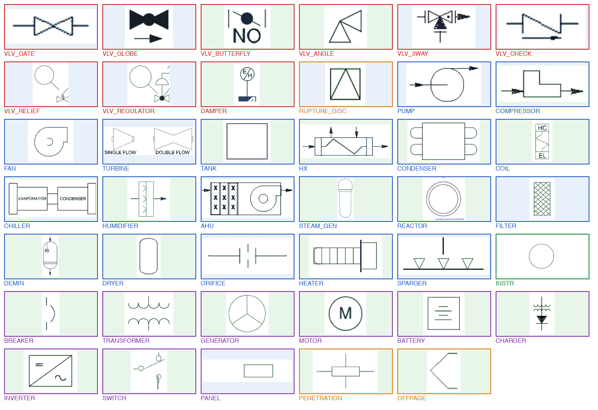

### Valves and dampers

| class | definition | boxes |
|---|---|---:|
| [`VLV_GATE`](#vlv_gate) | Gate valve / generic two-way valve (plain bowtie) | 1301 (25 uncertain) |
| [`VLV_GLOBE`](#vlv_globe) | Globe valve (bowtie with a dot at the waist) | 131 |
| [`VLV_BUTTERFLY`](#vlv_butterfly) | Butterfly valve (diagonal with a centre dot between two ticks) | 92 |
| [`VLV_BALL`](#vlv_ball) | Ball valve | 0 |
| [`VLV_PLUG`](#vlv_plug) | Plug valve | 0 |
| [`VLV_NEEDLE`](#vlv_needle) | Needle valve | 0 |
| [`VLV_DIAPHRAGM`](#vlv_diaphragm) | Diaphragm valve | 0 |
| [`VLV_ANGLE`](#vlv_angle) | Angle valve | 5 |
| [`VLV_3WAY`](#vlv_3way) | Three-way valve | 9 |
| [`VLV_CHECK`](#vlv_check) | Check valve (incl. stop-check, swing check) | 530 (8 uncertain) |
| [`VLV_RELIEF`](#vlv_relief) | Safety / relief valve (incl. pilot-operated) | 51 |
| [`VLV_REGULATOR`](#vlv_regulator) | Self-actuated pressure regulator | 2 |
| [`DAMPER`](#damper) | Damper (HVAC) | 73 |

#### VLV_GATE

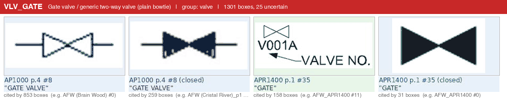

#### VLV_GLOBE

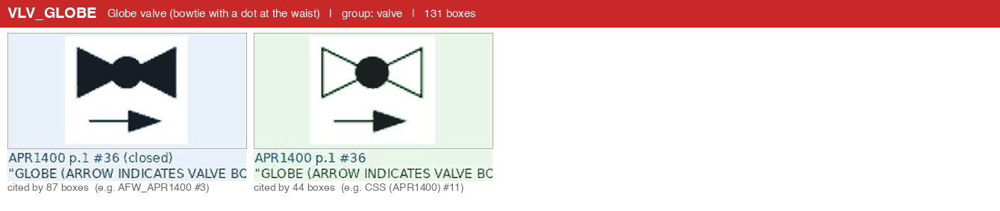

#### VLV_BUTTERFLY

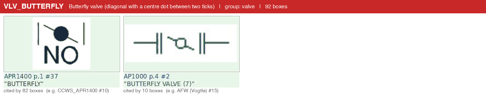

#### VLV_BALL

Ball valve. No instance in the 65 pages, so no reference image.

#### VLV_PLUG

Plug valve. No instance in the 65 pages, so no reference image.

#### VLV_NEEDLE

Needle valve. No instance in the 65 pages, so no reference image.

#### VLV_DIAPHRAGM

Diaphragm valve. No instance in the 65 pages, so no reference image.

#### VLV_ANGLE

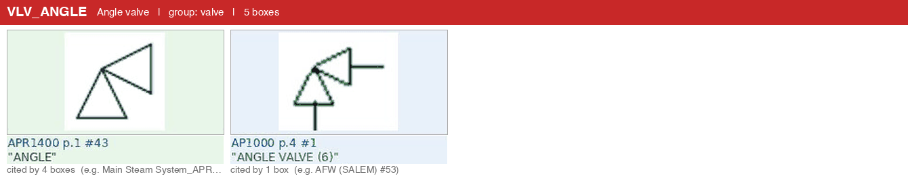

#### VLV_3WAY

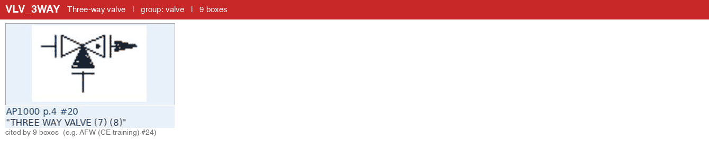

#### VLV_CHECK

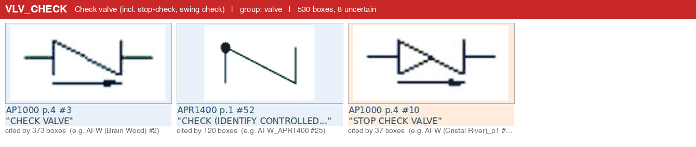

#### VLV_RELIEF

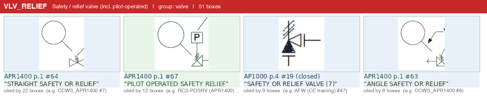

#### VLV_REGULATOR

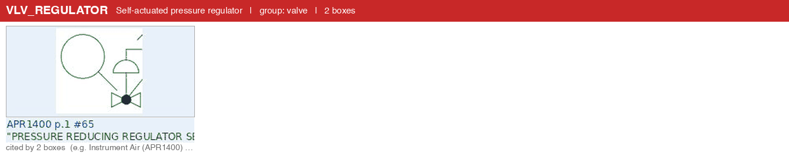

#### DAMPER

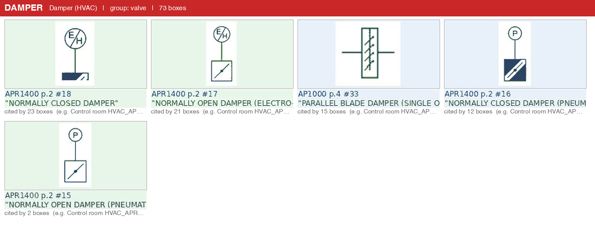

### Equipment

| class | definition | boxes |
|---|---|---:|
| [`PUMP`](#pump) | Pump | 148 |
| [`COMPRESSOR`](#compressor) | Compressor | 12 |
| [`FAN`](#fan) | Fan / blower | 48 |
| [`TURBINE`](#turbine) | Turbine (incl. turbine-generator) | 22 |
| [`TANK`](#tank) | Tank / vessel / accumulator | 76 |
| [`HX`](#hx) | Heat exchanger / cooler / feedwater heater | 124 |
| [`CONDENSER`](#condenser) | Condenser | 11 |
| [`COIL`](#coil) | Heating or cooling coil (HVAC) | 40 |
| [`CHILLER`](#chiller) | Chiller | 11 |
| [`HUMIDIFIER`](#humidifier) | Humidifier (HVAC) | 4 |
| [`AHU`](#ahu) | Air handling unit / cubicle cooler housing | 9 |
| [`STEAM_GEN`](#steam_gen) | Steam generator | 73 |
| [`REACTOR`](#reactor) | Reactor vessel | 1 |
| [`PRESSURIZER`](#pressurizer) | Pressurizer | 1 |
| [`FILTER`](#filter) | Filter / strainer / adsorber / separator | 109 |
| [`DEMIN`](#demin) | Demineralizer / ion exchanger | 10 |
| [`DRYER`](#dryer) | Air dryer | 5 |
| [`ORIFICE`](#orifice) | Orifice / flow element / venturi | 103 (10 uncertain) |
| [`HEATER`](#heater) | Electric heater | 4 |
| [`SPARGER`](#sparger) | Spray nozzle / sparger | 21 |
| [`SUMP`](#sump) | Sump | 1 |
| [`TRAP`](#trap) | Steam trap | 0 |
| [`ENGINE`](#engine) | Diesel engine / prime mover drawn on its own | 1 |

#### PUMP

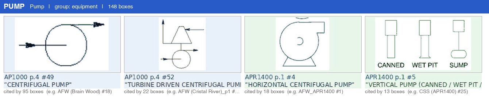

#### COMPRESSOR

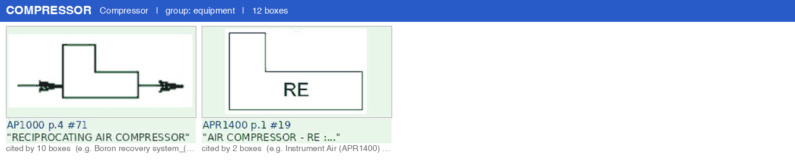

#### FAN

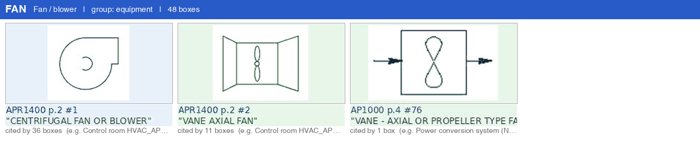

#### TURBINE

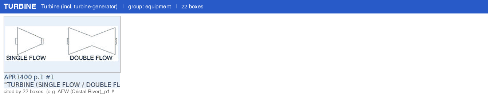

#### TANK

#### HX

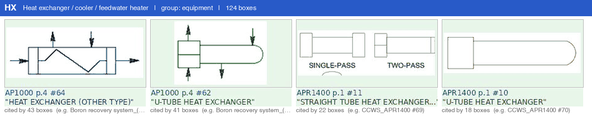

#### CONDENSER

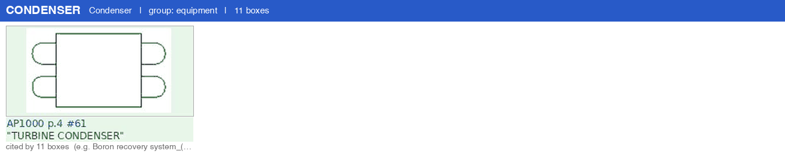

#### COIL

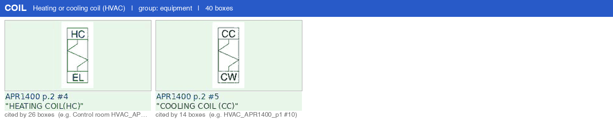

#### CHILLER

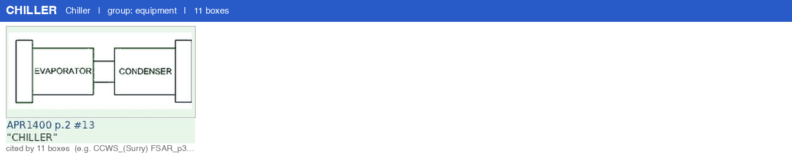

#### HUMIDIFIER

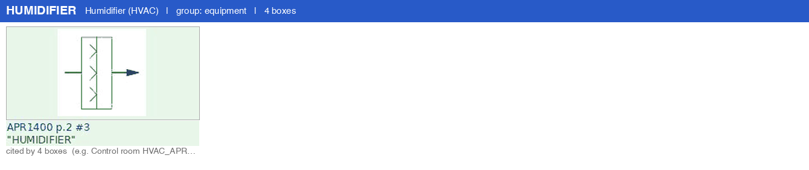

#### AHU

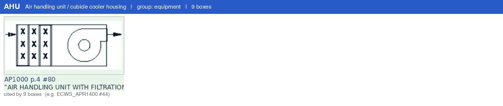

#### STEAM_GEN

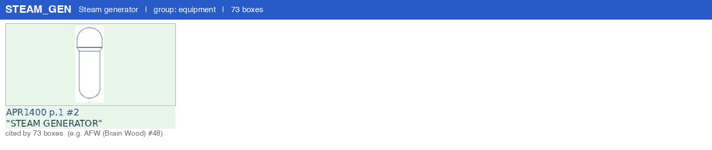

#### REACTOR

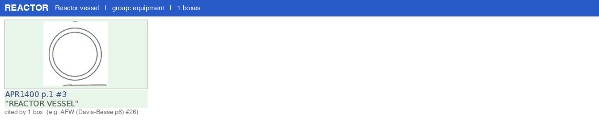

#### PRESSURIZER

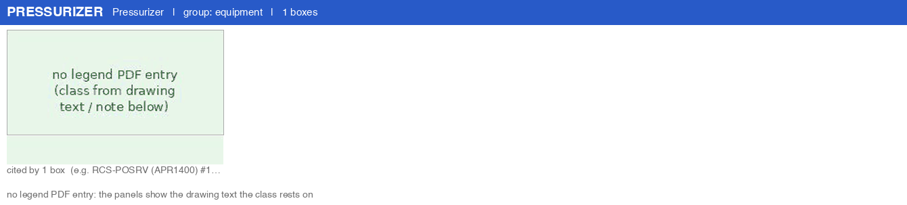

#### FILTER

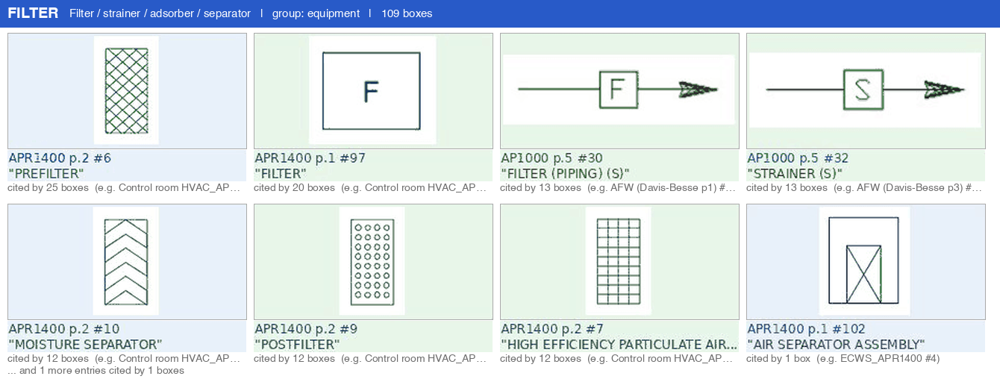

#### DEMIN

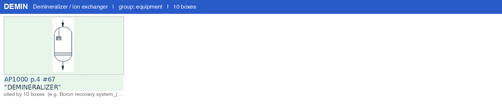

#### DRYER

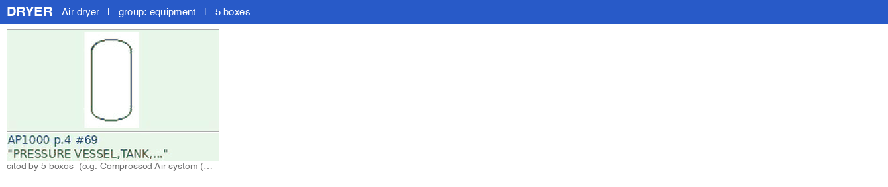

#### ORIFICE

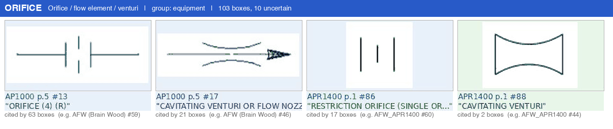

#### HEATER

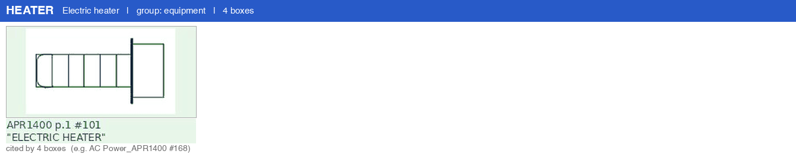

#### SPARGER

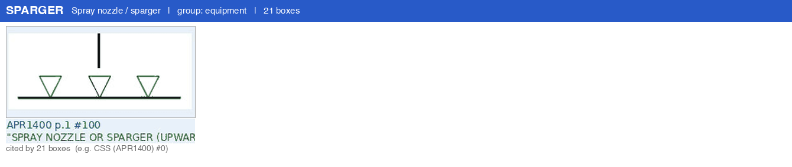

#### SUMP

#### TRAP

Steam trap. No instance in the 65 pages, so no reference image.

#### ENGINE

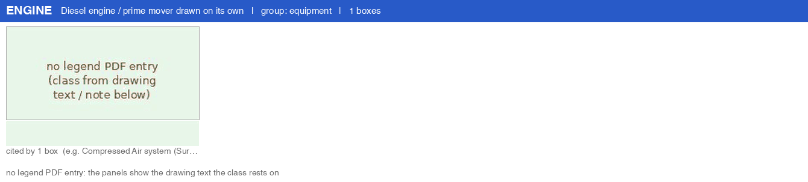

### Instruments

| class | definition | boxes |
|---|---|---:|
| [`INSTR`](#instr) | Instrument (bubble or box with a tag) | 78 |

#### INSTR

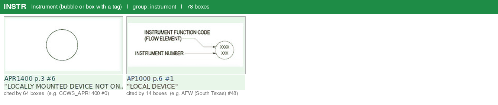

### Electrical

| class | definition | boxes |
|---|---|---:|
| [`BREAKER`](#breaker) | Circuit breaker | 181 |
| [`TRANSFORMER`](#transformer) | Transformer | 37 |
| [`GENERATOR`](#generator) | Generator (incl. diesel generator) | 10 |
| [`MOTOR`](#motor) | Motor drawn on its own | 17 |
| [`BATTERY`](#battery) | Battery | 3 |
| [`CHARGER`](#charger) | Battery charger / rectifier | 3 |
| [`INVERTER`](#inverter) | Inverter / UPS | 6 |
| [`SWITCH`](#switch) | Switch / disconnect / transfer switch | 5 |
| [`PANEL`](#panel) | Distribution panel / MCC / switchgear box | 7 |

#### BREAKER

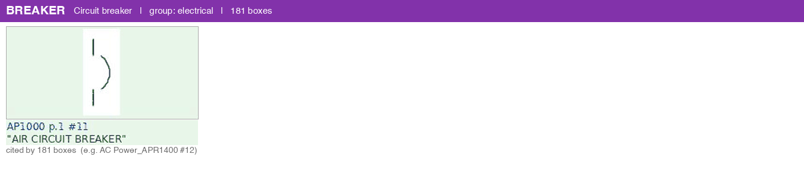

#### TRANSFORMER

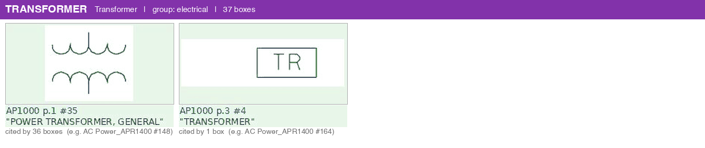

#### GENERATOR

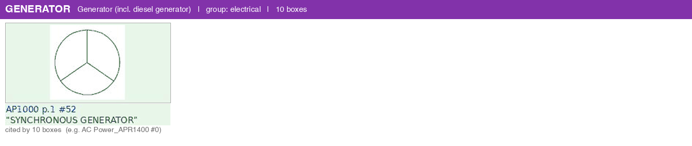

#### MOTOR

#### BATTERY

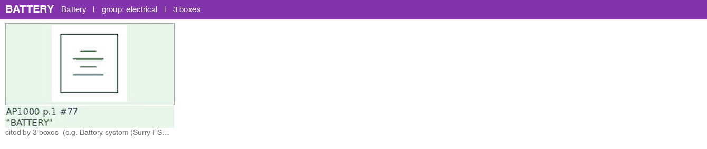

#### CHARGER

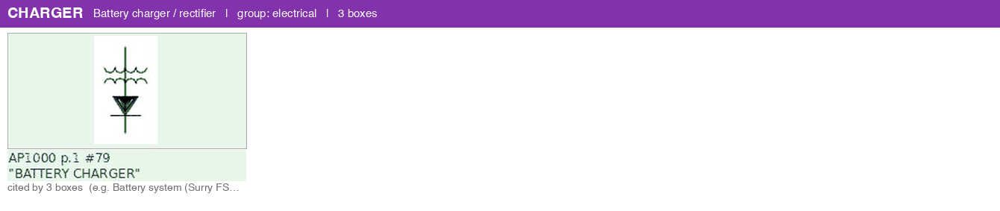

#### INVERTER

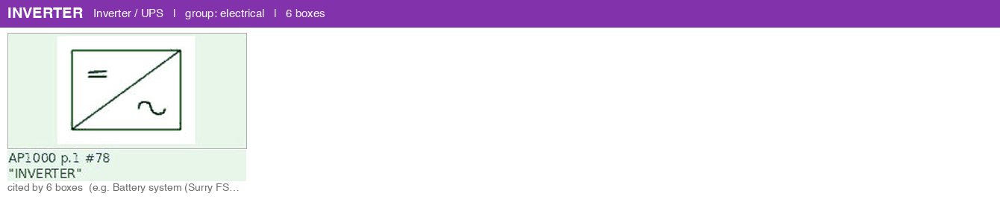

#### SWITCH

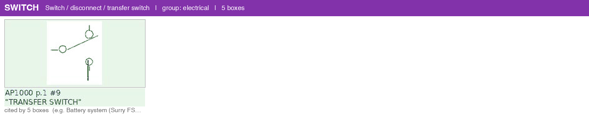

#### PANEL

### Other

| class | definition | boxes |
|---|---|---:|
| [`RUPTURE_DISC`](#rupture_disc) | Rupture disc | 2 |
| [`PENETRATION`](#penetration) | Containment penetration (box on the containment boundary, e.g. 'PC') | 17 |
| [`OFFPAGE`](#offpage) | Off-page connector / system interface | 52 |
| [`BLOCK`](#block) | Labelled equipment block (named by its text) | 18 |
| [`OTHER`](#other) | Other | 24 (9 uncertain) |

#### RUPTURE_DISC

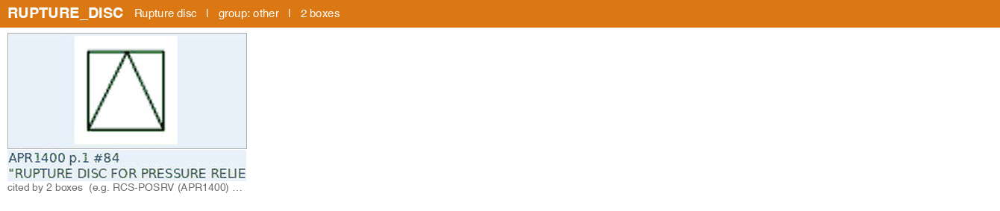

#### PENETRATION

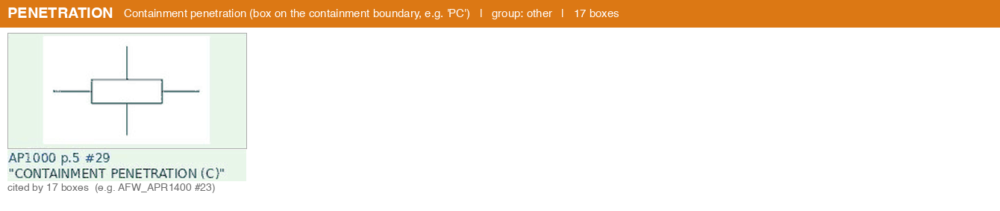

#### OFFPAGE

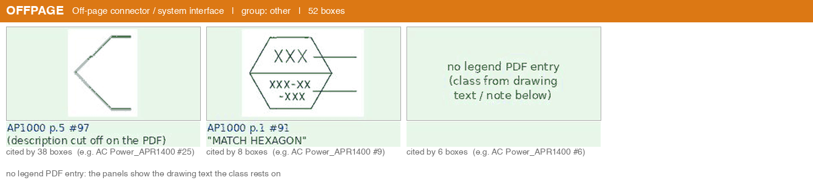

#### BLOCK

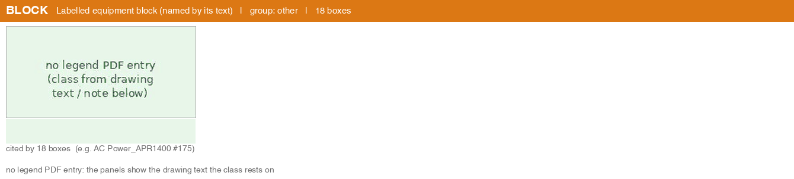

#### OTHER

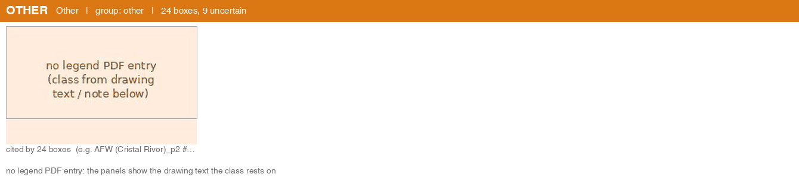

### Actuators

The actuator label of a valve, damper or pump follows the operator legend entries in the same way. `NONE` (no operator drawn) and `-` (not a valve, damper or pump) have no entry.

#### MOTOR (actuator)

Motor operator.

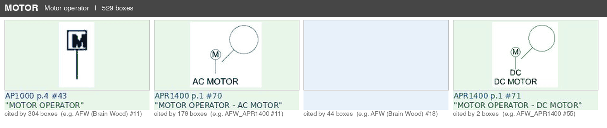

#### AIR (actuator)

Air / pneumatic operator (diaphragm or piston).

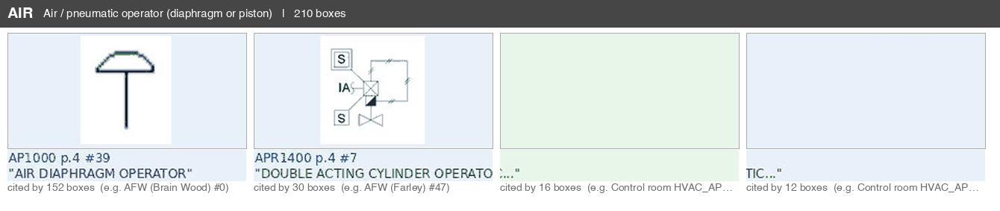

#### SOLENOID (actuator)

Solenoid operator.

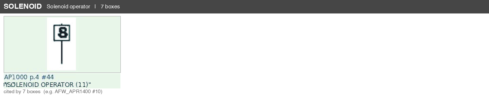

#### HYDRAULIC (actuator)

Hydraulic operator.

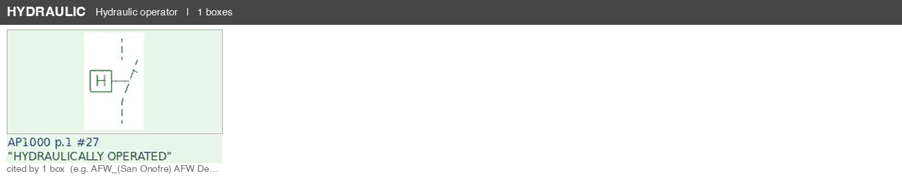

#### EH (actuator)

Electro-hydraulic operator.

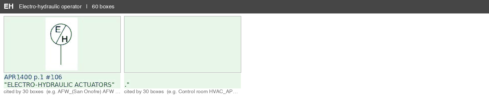

#### UNSPEC (actuator)

Operator drawn, type not identifiable.

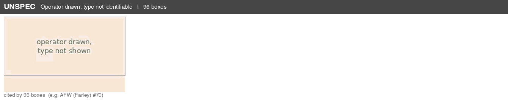

#### TURBINE (actuator)

Turbine driver (pumps).

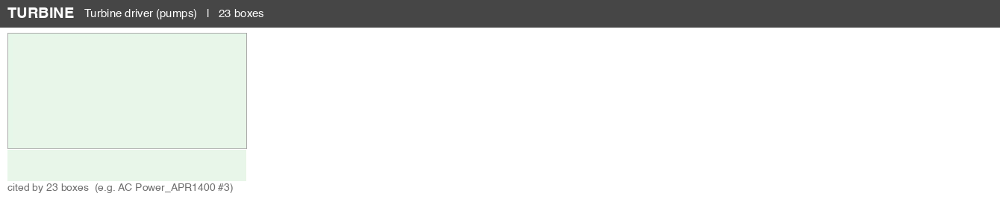

#### DIESEL (actuator)

Diesel / engine driver (pumps).

## Files

- `evidence/<page>[_<part>].png`: **where each label comes from**, one tile per symbol box (48 per image, so pages with more
  symbols have several parts; 106 images for the 65 pages). Each tile shows the symbol as drawn on the page, the entry of
  the AP1000 / APR1400 P&ID legend PDF it corresponds to (symbol image, PDF page and entry number, printed description), the
  legend entry of its operator for powered valves, and the evidence written out: the page's own legend, the drawing text
  inside or next to the box, source documents (NUREG/CR-4550, INL and Davis-Besse reports), and the labeler's note.
  The header colour gives the evidence level:
  - **A** (1651): the label is confirmed by the drawing itself (its own legend or text such as "MOV", "M", "DIESEL GEN.")
    or by a source document;
  - **B** (1785): the label rests on the symbol shape matching the legend PDF entry shown (or, for a symbol without a legend entry, on its drawn shape alone);
  - **C** (52): uncertain (`uncertain = yes`), check first.
  3437 of the 3488 boxes are tied to a legend PDF entry; the other 51 (BLOCK, ENGINE, OFFPAGE, OTHER, PRESSURIZER, SUMP) have no
  legend entry and rest on the drawing text and note shown in the tile.

- `overlay/<page>.jpg`: check image of each page. Every box is drawn on the drawing with its box id and a short class tag
  (colour = class group); the panel on the right lists every id with its class, actuator and fault-tree type. `*` = uncertain.
- `symbol_classes.csv`: one row per symbol box. Columns: `page`, `box_id` (line index in `../labels/<page>.txt`),
  `x0,y0,x1,y1` (box in image pixels), `class`, `actuator`, `ft_component_type`, `uncertain`, `note`.
- `symbol_classes.json`: the same, grouped by page.
- `class_reference/<CLASS>.png`, `class_reference/actuator_<ACTUATOR>.png`: the legend entries each class and actuator
  value is tied to, see [Class reference](#class-reference) above; `class_reference/overview.png`: one entry per class.
  Made by `make_class_reference.py` from the evidence images (run it again after editing `symbol_classes.csv`).
- `classes.csv`: the 51 classes with definitions and counts. `actuators.csv`: the 10 actuator values.
- `ft_component_types.csv`: how `class` + `actuator` map to a fault-tree component type.

## Independent review

All 3488 labels were reviewed a second time (November 2026) by four independent reviewers, each covering about 870 symbols with
the evidence images, the full-resolution crops, the page legends and the legend PDFs. Every proposed change was checked again on the
drawing before it was applied: 67 labels were corrected (mostly gate valves that are globe valves, a dot at the body centre on the APR1400
drawings; operators identified from the page legend; three-way valves; turbine-driven pumps drawn as a turbine only) and 56 of the
uncertain rows were resolved. 52 rows remain uncertain.

## Labeling scheme

Each symbol gets two labels:

1. **class**: the valve body or the kind of equipment (e.g. `VLV_GATE`, `VLV_GLOBE`, `VLV_CHECK`, `VLV_BUTTERFLY`,
   `VLV_RELIEF`, `DAMPER`, `PUMP`, `HX`, `TANK`, `FILTER`, `ORIFICE`, `INSTR`, `BREAKER`, `TRANSFORMER`, `OFFPAGE`, ...).
   Definitions follow the AP1000 and APR1400 P&ID legends and the legends printed on the drawings.
2. **actuator** (valves, dampers, pumps): `MOTOR` (M operator), `AIR` (diaphragm, dome or piston), `SOLENOID` (S),
   `HYDRAULIC`, `EH` (electro-hydraulic, E/H), `NONE` (no operator drawn: manual, check, self-acting), `UNSPEC`
   (an operator is drawn but its type cannot be identified), `TURBINE` / `DIESEL` / `MOTOR` (pump drivers); `-` = not applicable.

A valve and its actuator, lock mark and tag circle are one box (see the labeling rules in [`../README.md`](../README.md)),
so the actuator is a property of the valve box. A solid (black) body means normally closed; this is written in `note`.

`ft_component_type` is derived from class + actuator with the component codes of the Generic PWR SAPHIRE model
basic-event list: `MOV`, `AOV`, `SOV`, `HOV`, `XVM` (manual valve), `CKV`, `SRV`, `MDP`, `TDP`, `EDP`, `PMP`, `HTX`, `TNK`,
`SMP`, `STR`, `FAN`, `CHL`, `ORF`, `CRB`, `TFM`, `DGN`, `BAT`, `BCH`, `INV`, `PND`, `MOD`. It is empty where no standard code
applies (steam generators, instruments, off-page connectors, ...).

## Sources used to resolve ambiguous symbols

- The legend library in [`../legend_library/`](../legend_library/README.md) (both legend PDFs, every entry, and the legend entry of every symbol box).

- AP1000 and APR1400 P&ID legend sheets (962 legend entries).
- Legends printed on individual drawings (Surry FSAR figures, San Onofre, Davis-Besse, NuScale).
- NUREG/CR-4550 Vol. 3 (Surry) basic events, e.g. LPI-MOV-PG-1864A, for valve operator types on the Surry NUREG sketches.
- INL AFW system study and the Davis-Besse AFW reliability analysis, for valve operator types on their figures.
- NUREG/CR-5500 Vol. 1 (AFW reliability study), Table D-3, for the pump drivers of the AFW reference plants.
