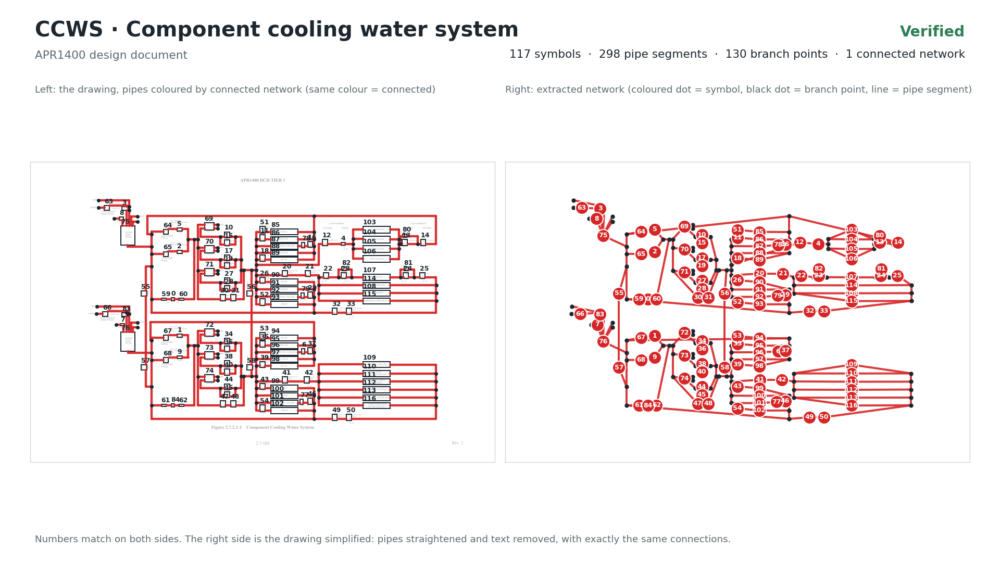
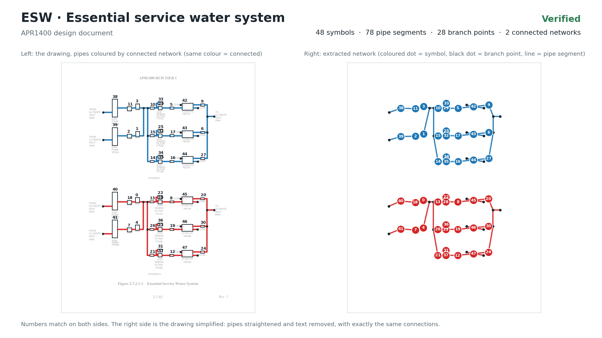
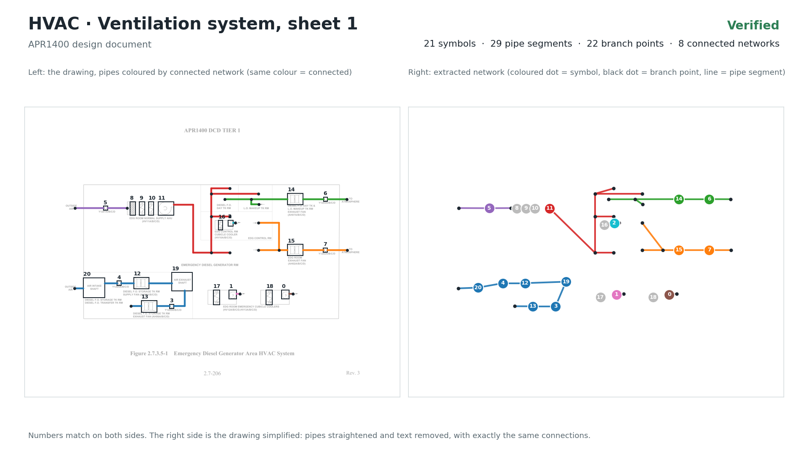
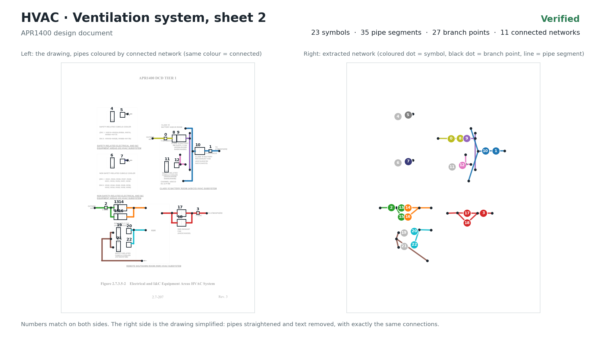
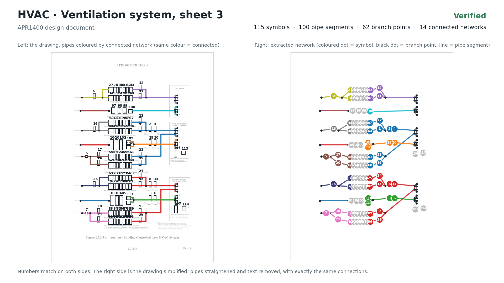
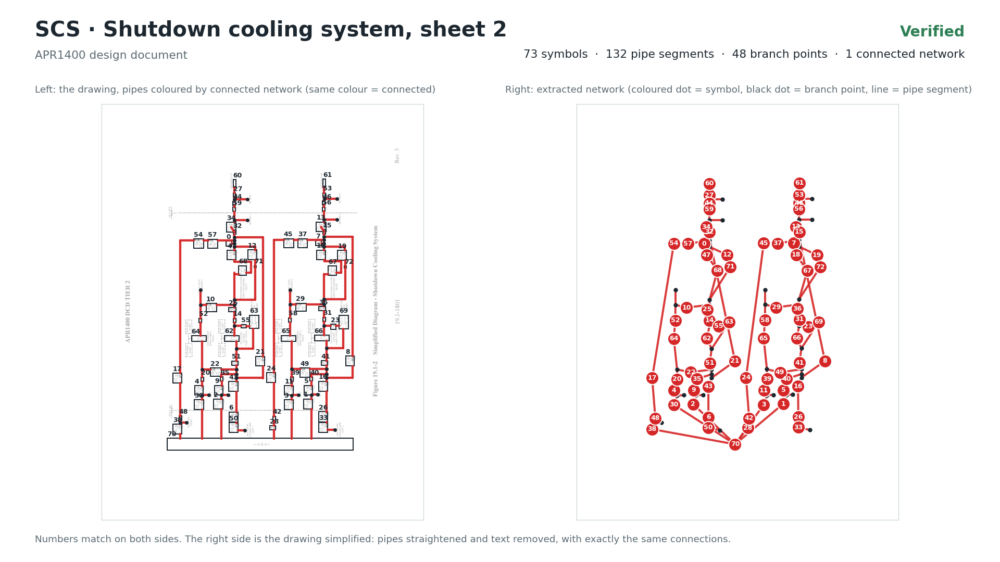

# 65 fully verified pages: symbols, pipe lines, text and connectivity (second release)

These 65 pages have all four annotation layers verified, on the second-release annotations of [`../`](../README.md) (tight symbol boxes, pipe lines that stop at the symbol boxes, tight text boxes, all checked and saved by a human). The pipe connectivity between the symbols was built from those annotations and verified against them: automatic checks plus a visual inspection of every connection (see below). Everything needed to use or re-check them is in this folder: the drawings, all four annotation layers, review images, the method, and code that rebuilds and checks the connectivity.

Fifteen pages were verified first: the five verified pages of the first release ([`../../verified_annotations/topology_verified/`](../../verified_annotations/topology_verified/README.md)), rebuilt on the new annotations, and ten new pages; on these all 7 checks pass with no flag. The other 50 pages were verified the same way; where a check raises a flag, the flag was inspected on the drawing and is an accepted exception, explained per page below (for example the internals of an HVAC unit, which are drawn without connecting ducts and therefore stay unconnected).

| Page | Symbols | Pipe lines | Text lines | Pipe segments | T junctions | Open pipe ends | Crossings | Check flags (accepted) | Data |
|---|---|---|---|---|---|---|---|---|---|
| Davis-Besse p7 | 25 | 32 | 69 | 32 | 7 | 0 | 0 | none | [drawing](images/pseudo_AFW_%28DAVIS-BESSE%29%20AFW%20system%20Reliability%20Analysis_Final%20Report_p7.png) · symbols [txt](symbols/pseudo_AFW_%28DAVIS-BESSE%29%20AFW%20system%20Reliability%20Analysis_Final%20Report_p7.txt) / [json](symbols/pseudo_AFW_%28DAVIS-BESSE%29%20AFW%20system%20Reliability%20Analysis_Final%20Report_p7.json) · [pipe lines](lines/pseudo_AFW_%28DAVIS-BESSE%29%20AFW%20system%20Reliability%20Analysis_Final%20Report_p7.json) · [text](text/pseudo_AFW_%28DAVIS-BESSE%29%20AFW%20system%20Reliability%20Analysis_Final%20Report_p7.json) · [connectivity](pseudo_AFW_%28DAVIS-BESSE%29%20AFW%20system%20Reliability%20Analysis_Final%20Report_p7.json) |
| RHR (Surry) | 14 | 50 | 46 | 42 | 15 | 9 | 1 | none | [drawing](images/pseudo_RHR_%28Surry%29%20FSAR.png) · symbols [txt](symbols/pseudo_RHR_%28Surry%29%20FSAR.txt) / [json](symbols/pseudo_RHR_%28Surry%29%20FSAR.json) · [pipe lines](lines/pseudo_RHR_%28Surry%29%20FSAR.json) · [text](text/pseudo_RHR_%28Surry%29%20FSAR.json) · [connectivity](pseudo_RHR_%28Surry%29%20FSAR.json) |
| AFW (Seabrook) | 47 | 65 | 37 | 56 | 6 | 2 | 0 | none | [drawing](images/pseudo_AFW%20%28Seabrook%29.png) · symbols [txt](symbols/pseudo_AFW%20%28Seabrook%29.txt) / [json](symbols/pseudo_AFW%20%28Seabrook%29.json) · [pipe lines](lines/pseudo_AFW%20%28Seabrook%29.json) · [text](text/pseudo_AFW%20%28Seabrook%29.json) · [connectivity](pseudo_AFW%20%28Seabrook%29.json) |
| AFW (San Onofre) | 60 | 93 | 108 | 92 | 17 | 9 | 1 | none | [drawing](images/pseudo_AFW_%28San%20Onofre%29%20AFW%20Design%20Review%20and%20Reliability%20Evaluation.png) · symbols [txt](symbols/pseudo_AFW_%28San%20Onofre%29%20AFW%20Design%20Review%20and%20Reliability%20Evaluation.txt) / [json](symbols/pseudo_AFW_%28San%20Onofre%29%20AFW%20Design%20Review%20and%20Reliability%20Evaluation.json) · [pipe lines](lines/pseudo_AFW_%28San%20Onofre%29%20AFW%20Design%20Review%20and%20Reliability%20Evaluation.json) · [text](text/pseudo_AFW_%28San%20Onofre%29%20AFW%20Design%20Review%20and%20Reliability%20Evaluation.json) · [connectivity](pseudo_AFW_%28San%20Onofre%29%20AFW%20Design%20Review%20and%20Reliability%20Evaluation.json) |
| CSS (APR1400) | 72 | 111 | 182 | 98 | 18 | 1 | 0 | none | [drawing](images/pseudo_CSS%20%28APR1400%29.png) · symbols [txt](symbols/pseudo_CSS%20%28APR1400%29.txt) / [json](symbols/pseudo_CSS%20%28APR1400%29.json) · [pipe lines](lines/pseudo_CSS%20%28APR1400%29.json) · [text](text/pseudo_CSS%20%28APR1400%29.json) · [connectivity](pseudo_CSS%20%28APR1400%29.json) |
| AFW (APR1400) | 75 | 153 | 145 | 132 | 31 | 13 | 5 | none | [drawing](images/pseudo_AFW_APR1400.png) · symbols [txt](symbols/pseudo_AFW_APR1400.txt) / [json](symbols/pseudo_AFW_APR1400.json) · [pipe lines](lines/pseudo_AFW_APR1400.json) · [text](text/pseudo_AFW_APR1400.json) · [connectivity](pseudo_AFW_APR1400.json) |
| Condensate and feedwater (APR1400) | 42 | 64 | 128 | 64 | 12 | 6 | 0 | none | [drawing](images/pseudo_Condensate%20and%20Feedwater%20system_APR1400.png) · symbols [txt](symbols/pseudo_Condensate%20and%20Feedwater%20system_APR1400.txt) / [json](symbols/pseudo_Condensate%20and%20Feedwater%20system_APR1400.json) · [pipe lines](lines/pseudo_Condensate%20and%20Feedwater%20system_APR1400.json) · [text](text/pseudo_Condensate%20and%20Feedwater%20system_APR1400.json) · [connectivity](pseudo_Condensate%20and%20Feedwater%20system_APR1400.json) |
| ECWS (APR1400) | 61 | 97 | 107 | 108 | 30 | 3 | 9 | none | [drawing](images/pseudo_ECWS_APR1400.png) · symbols [txt](symbols/pseudo_ECWS_APR1400.txt) / [json](symbols/pseudo_ECWS_APR1400.json) · [pipe lines](lines/pseudo_ECWS_APR1400.json) · [text](text/pseudo_ECWS_APR1400.json) · [connectivity](pseudo_ECWS_APR1400.json) |
| SCS (APR1400) | 22 | 37 | 93 | 39 | 12 | 3 | 0 | none | [drawing](images/pseudo_SCS_APR1400.png) · symbols [txt](symbols/pseudo_SCS_APR1400.txt) / [json](symbols/pseudo_SCS_APR1400.json) · [pipe lines](lines/pseudo_SCS_APR1400.json) · [text](text/pseudo_SCS_APR1400.json) · [connectivity](pseudo_SCS_APR1400.json) |
| SI (APR1400) | 93 | 139 | 222 | 152 | 37 | 13 | 3 | none | [drawing](images/pseudo_SI%20%28APR1400%29.png) · symbols [txt](symbols/pseudo_SI%20%28APR1400%29.txt) / [json](symbols/pseudo_SI%20%28APR1400%29.json) · [pipe lines](lines/pseudo_SI%20%28APR1400%29.json) · [text](text/pseudo_SI%20%28APR1400%29.json) · [connectivity](pseudo_SI%20%28APR1400%29.json) |
| AFW (INL system study) | 49 | 79 | 113 | 81 | 20 | 6 | 9 | none | [drawing](images/pseudo_AFW_INL_System%20Study.png) · symbols [txt](symbols/pseudo_AFW_INL_System%20Study.txt) / [json](symbols/pseudo_AFW_INL_System%20Study.json) · [pipe lines](lines/pseudo_AFW_INL_System%20Study.json) · [text](text/pseudo_AFW_INL_System%20Study.json) · [connectivity](pseudo_AFW_INL_System%20Study.json) |
| AFW (Haddam Neck) | 52 | 75 | 42 | 79 | 18 | 4 | 0 | none | [drawing](images/pseudo_AFW%20%28Haddam%20Neck%29.png) · symbols [txt](symbols/pseudo_AFW%20%28Haddam%20Neck%29.txt) / [json](symbols/pseudo_AFW%20%28Haddam%20Neck%29.json) · [pipe lines](lines/pseudo_AFW%20%28Haddam%20Neck%29.json) · [text](text/pseudo_AFW%20%28Haddam%20Neck%29.json) · [connectivity](pseudo_AFW%20%28Haddam%20Neck%29.json) |
| CCWS (Surry) | 19 | 58 | 52 | 76 | 35 | 11 | 3 | none | [drawing](images/pseudo_CCWS_%28Surry%29%20FSAR_p1.png) · symbols [txt](symbols/pseudo_CCWS_%28Surry%29%20FSAR_p1.txt) / [json](symbols/pseudo_CCWS_%28Surry%29%20FSAR_p1.json) · [pipe lines](lines/pseudo_CCWS_%28Surry%29%20FSAR_p1.json) · [text](text/pseudo_CCWS_%28Surry%29%20FSAR_p1.json) · [connectivity](pseudo_CCWS_%28Surry%29%20FSAR_p1.json) |
| CSS (Surry, NUREG/CR-4550) | 24 | 44 | 34 | 41 | 11 | 2 | 2 | none | [drawing](images/pseudo_CSS_NUREG-CR-4550%20Vol.3%20Part1%20Analysis%20of%20Core%20Damage%20Frequency_Surry%2C%20Unit%201%20In.png) · symbols [txt](symbols/pseudo_CSS_NUREG-CR-4550%20Vol.3%20Part1%20Analysis%20of%20Core%20Damage%20Frequency_Surry%2C%20Unit%201%20In.txt) / [json](symbols/pseudo_CSS_NUREG-CR-4550%20Vol.3%20Part1%20Analysis%20of%20Core%20Damage%20Frequency_Surry%2C%20Unit%201%20In.json) · [pipe lines](lines/pseudo_CSS_NUREG-CR-4550%20Vol.3%20Part1%20Analysis%20of%20Core%20Damage%20Frequency_Surry%2C%20Unit%201%20In.json) · [text](text/pseudo_CSS_NUREG-CR-4550%20Vol.3%20Part1%20Analysis%20of%20Core%20Damage%20Frequency_Surry%2C%20Unit%201%20In.json) · [connectivity](pseudo_CSS_NUREG-CR-4550%20Vol.3%20Part1%20Analysis%20of%20Core%20Damage%20Frequency_Surry%2C%20Unit%201%20In.json) |
| SI (Surry, NUREG/CR-4550) | 44 | 86 | 105 | 100 | 33 | 14 | 6 | none | [drawing](images/pseudo_SI%20%28Surry%29_NUREG-CR-4550%20Vol.3%20Part1%20Analysis%20of%20Core%20Damage%20Frequency_Surry%2C%20Un.png) · symbols [txt](symbols/pseudo_SI%20%28Surry%29_NUREG-CR-4550%20Vol.3%20Part1%20Analysis%20of%20Core%20Damage%20Frequency_Surry%2C%20Un.txt) / [json](symbols/pseudo_SI%20%28Surry%29_NUREG-CR-4550%20Vol.3%20Part1%20Analysis%20of%20Core%20Damage%20Frequency_Surry%2C%20Un.json) · [pipe lines](lines/pseudo_SI%20%28Surry%29_NUREG-CR-4550%20Vol.3%20Part1%20Analysis%20of%20Core%20Damage%20Frequency_Surry%2C%20Un.json) · [text](text/pseudo_SI%20%28Surry%29_NUREG-CR-4550%20Vol.3%20Part1%20Analysis%20of%20Core%20Damage%20Frequency_Surry%2C%20Un.json) · [connectivity](pseudo_SI%20%28Surry%29_NUREG-CR-4550%20Vol.3%20Part1%20Analysis%20of%20Core%20Damage%20Frequency_Surry%2C%20Un.json) |
| AC power system (APR1400) | 177 | 324 | 313 | 322 | 80 | 57 | 48 | coverage 1, junctions 18, crossings 15, dead_ends 15 | [drawing](images/pseudo_AC%20Power_APR1400.png) · symbols [txt](symbols/pseudo_AC%20Power_APR1400.txt) / [json](symbols/pseudo_AC%20Power_APR1400.json) · [pipe lines](lines/pseudo_AC%20Power_APR1400.json) · [text](text/pseudo_AC%20Power_APR1400.json) · [connectivity](pseudo_AC%20Power_APR1400.json) |
| AFW (Braidwood) | 67 | 101 | 36 | 89 | 15 | 0 | 8 | junctions 3, crossings 3 | [drawing](images/pseudo_AFW%20%28Brain%20Wood%29.png) · symbols [txt](symbols/pseudo_AFW%20%28Brain%20Wood%29.txt) / [json](symbols/pseudo_AFW%20%28Brain%20Wood%29.json) · [pipe lines](lines/pseudo_AFW%20%28Brain%20Wood%29.json) · [text](text/pseudo_AFW%20%28Brain%20Wood%29.json) · [connectivity](pseudo_AFW%20%28Brain%20Wood%29.json) |
| AFW (Crystal River, p1) | 36 | 68 | 34 | 60 | 16 | 2 | 3 | none | [drawing](images/pseudo_AFW%20%28Cristal%20River%29_p1.png) · symbols [txt](symbols/pseudo_AFW%20%28Cristal%20River%29_p1.txt) / [json](symbols/pseudo_AFW%20%28Cristal%20River%29_p1.json) · [pipe lines](lines/pseudo_AFW%20%28Cristal%20River%29_p1.json) · [text](text/pseudo_AFW%20%28Cristal%20River%29_p1.json) · [connectivity](pseudo_AFW%20%28Cristal%20River%29_p1.json) |
| AFW (Crystal River, p2) | 58 | 83 | 32 | 74 | 9 | 4 | 2 | none | [drawing](images/pseudo_AFW%20%28Cristal%20River%29_p2.png) · symbols [txt](symbols/pseudo_AFW%20%28Cristal%20River%29_p2.txt) / [json](symbols/pseudo_AFW%20%28Cristal%20River%29_p2.json) · [pipe lines](lines/pseudo_AFW%20%28Cristal%20River%29_p2.json) · [text](text/pseudo_AFW%20%28Cristal%20River%29_p2.json) · [connectivity](pseudo_AFW%20%28Cristal%20River%29_p2.json) |
| AFW (Davis-Besse) | 57 | 91 | 35 | 88 | 20 | 0 | 9 | none | [drawing](images/pseudo_AFW%20%28Davis%20-Besse%29.png) · symbols [txt](symbols/pseudo_AFW%20%28Davis%20-Besse%29.txt) / [json](symbols/pseudo_AFW%20%28Davis%20-Besse%29.json) · [pipe lines](lines/pseudo_AFW%20%28Davis%20-Besse%29.json) · [text](text/pseudo_AFW%20%28Davis%20-Besse%29.json) · [connectivity](pseudo_AFW%20%28Davis%20-Besse%29.json) |
| AFW (Farley) | 73 | 99 | 44 | 100 | 17 | 5 | 3 | none | [drawing](images/pseudo_AFW%20%28Farley%29.png) · symbols [txt](symbols/pseudo_AFW%20%28Farley%29.txt) / [json](symbols/pseudo_AFW%20%28Farley%29.json) · [pipe lines](lines/pseudo_AFW%20%28Farley%29.json) · [text](text/pseudo_AFW%20%28Farley%29.json) · [connectivity](pseudo_AFW%20%28Farley%29.json) |
| AFW (Salem) | 64 | 90 | 36 | 91 | 16 | 5 | 4 | junctions 1, crossings 1 | [drawing](images/pseudo_AFW%20%28SALEM%29.png) · symbols [txt](symbols/pseudo_AFW%20%28SALEM%29.txt) / [json](symbols/pseudo_AFW%20%28SALEM%29.json) · [pipe lines](lines/pseudo_AFW%20%28SALEM%29.json) · [text](text/pseudo_AFW%20%28SALEM%29.json) · [connectivity](pseudo_AFW%20%28SALEM%29.json) |
| AFW (St. Lucie) | 55 | 88 | 37 | 78 | 14 | 2 | 4 | none | [drawing](images/pseudo_AFW%20%28ST.%20LUCIE%29.png) · symbols [txt](symbols/pseudo_AFW%20%28ST.%20LUCIE%29.txt) / [json](symbols/pseudo_AFW%20%28ST.%20LUCIE%29.json) · [pipe lines](lines/pseudo_AFW%20%28ST.%20LUCIE%29.json) · [text](text/pseudo_AFW%20%28ST.%20LUCIE%29.json) · [connectivity](pseudo_AFW%20%28ST.%20LUCIE%29.json) |
| AFW (South Texas) | 60 | 93 | 48 | 96 | 23 | 1 | 12 | junctions 1, crossings 1 | [drawing](images/pseudo_AFW%20%28South%20Texas%29.png) · symbols [txt](symbols/pseudo_AFW%20%28South%20Texas%29.txt) / [json](symbols/pseudo_AFW%20%28South%20Texas%29.json) · [pipe lines](lines/pseudo_AFW%20%28South%20Texas%29.json) · [text](text/pseudo_AFW%20%28South%20Texas%29.json) · [connectivity](pseudo_AFW%20%28South%20Texas%29.json) |
| AFW (Turkey Point) | 174 | 275 | 76 | 247 | 47 | 12 | 19 | junctions 3, crossings 2 | [drawing](images/pseudo_AFW%20%28Turkey%20Point%29.png) · symbols [txt](symbols/pseudo_AFW%20%28Turkey%20Point%29.txt) / [json](symbols/pseudo_AFW%20%28Turkey%20Point%29.json) · [pipe lines](lines/pseudo_AFW%20%28Turkey%20Point%29.json) · [text](text/pseudo_AFW%20%28Turkey%20Point%29.json) · [connectivity](pseudo_AFW%20%28Turkey%20Point%29.json) |
| AFW (Vogtle) | 76 | 130 | 177 | 108 | 18 | 6 | 16 | isolated 1 | [drawing](images/pseudo_AFW%20%28Vogtle%29.png) · symbols [txt](symbols/pseudo_AFW%20%28Vogtle%29.txt) / [json](symbols/pseudo_AFW%20%28Vogtle%29.json) · [pipe lines](lines/pseudo_AFW%20%28Vogtle%29.json) · [text](text/pseudo_AFW%20%28Vogtle%29.json) · [connectivity](pseudo_AFW%20%28Vogtle%29.json) |
| AFW (Davis-Besse, p1) | 52 | 78 | 113 | 72 | 15 | 1 | 2 | junctions 1, crossings 1 | [drawing](images/pseudo_AFW_%28DAVIS-BESSE%29%20AFW%20system%20Reliability%20Analysis_Final%20Report_p1.png) · symbols [txt](symbols/pseudo_AFW_%28DAVIS-BESSE%29%20AFW%20system%20Reliability%20Analysis_Final%20Report_p1.txt) / [json](symbols/pseudo_AFW_%28DAVIS-BESSE%29%20AFW%20system%20Reliability%20Analysis_Final%20Report_p1.json) · [pipe lines](lines/pseudo_AFW_%28DAVIS-BESSE%29%20AFW%20system%20Reliability%20Analysis_Final%20Report_p1.json) · [text](text/pseudo_AFW_%28DAVIS-BESSE%29%20AFW%20system%20Reliability%20Analysis_Final%20Report_p1.json) · [connectivity](pseudo_AFW_%28DAVIS-BESSE%29%20AFW%20system%20Reliability%20Analysis_Final%20Report_p1.json) |
| AFW (Davis-Besse, p2) | 27 | 43 | 64 | 41 | 9 | 3 | 1 | none | [drawing](images/pseudo_AFW_%28DAVIS-BESSE%29%20AFW%20system%20Reliability%20Analysis_Final%20Report_p2.png) · symbols [txt](symbols/pseudo_AFW_%28DAVIS-BESSE%29%20AFW%20system%20Reliability%20Analysis_Final%20Report_p2.txt) / [json](symbols/pseudo_AFW_%28DAVIS-BESSE%29%20AFW%20system%20Reliability%20Analysis_Final%20Report_p2.json) · [pipe lines](lines/pseudo_AFW_%28DAVIS-BESSE%29%20AFW%20system%20Reliability%20Analysis_Final%20Report_p2.json) · [text](text/pseudo_AFW_%28DAVIS-BESSE%29%20AFW%20system%20Reliability%20Analysis_Final%20Report_p2.json) · [connectivity](pseudo_AFW_%28DAVIS-BESSE%29%20AFW%20system%20Reliability%20Analysis_Final%20Report_p2.json) |
| AFW (Davis-Besse, p3) | 54 | 75 | 134 | 75 | 15 | 1 | 2 | junctions 1, crossings 1 | [drawing](images/pseudo_AFW_%28DAVIS-BESSE%29%20AFW%20system%20Reliability%20Analysis_Final%20Report_p3.png) · symbols [txt](symbols/pseudo_AFW_%28DAVIS-BESSE%29%20AFW%20system%20Reliability%20Analysis_Final%20Report_p3.txt) / [json](symbols/pseudo_AFW_%28DAVIS-BESSE%29%20AFW%20system%20Reliability%20Analysis_Final%20Report_p3.json) · [pipe lines](lines/pseudo_AFW_%28DAVIS-BESSE%29%20AFW%20system%20Reliability%20Analysis_Final%20Report_p3.json) · [text](text/pseudo_AFW_%28DAVIS-BESSE%29%20AFW%20system%20Reliability%20Analysis_Final%20Report_p3.json) · [connectivity](pseudo_AFW_%28DAVIS-BESSE%29%20AFW%20system%20Reliability%20Analysis_Final%20Report_p3.json) |
| AFW (Davis-Besse, p4) | 26 | 50 | 75 | 43 | 10 | 6 | 1 | none | [drawing](images/pseudo_AFW_%28DAVIS-BESSE%29%20AFW%20system%20Reliability%20Analysis_Final%20Report_p4.png) · symbols [txt](symbols/pseudo_AFW_%28DAVIS-BESSE%29%20AFW%20system%20Reliability%20Analysis_Final%20Report_p4.txt) / [json](symbols/pseudo_AFW_%28DAVIS-BESSE%29%20AFW%20system%20Reliability%20Analysis_Final%20Report_p4.json) · [pipe lines](lines/pseudo_AFW_%28DAVIS-BESSE%29%20AFW%20system%20Reliability%20Analysis_Final%20Report_p4.json) · [text](text/pseudo_AFW_%28DAVIS-BESSE%29%20AFW%20system%20Reliability%20Analysis_Final%20Report_p4.json) · [connectivity](pseudo_AFW_%28DAVIS-BESSE%29%20AFW%20system%20Reliability%20Analysis_Final%20Report_p4.json) |
| AFW (Davis-Besse, p5) | 36 | 46 | 95 | 48 | 9 | 0 | 3 | junctions 2, crossings 2 | [drawing](images/pseudo_AFW_%28DAVIS-BESSE%29%20AFW%20system%20Reliability%20Analysis_Final%20Report_p5.png) · symbols [txt](symbols/pseudo_AFW_%28DAVIS-BESSE%29%20AFW%20system%20Reliability%20Analysis_Final%20Report_p5.txt) / [json](symbols/pseudo_AFW_%28DAVIS-BESSE%29%20AFW%20system%20Reliability%20Analysis_Final%20Report_p5.json) · [pipe lines](lines/pseudo_AFW_%28DAVIS-BESSE%29%20AFW%20system%20Reliability%20Analysis_Final%20Report_p5.json) · [text](text/pseudo_AFW_%28DAVIS-BESSE%29%20AFW%20system%20Reliability%20Analysis_Final%20Report_p5.json) · [connectivity](pseudo_AFW_%28DAVIS-BESSE%29%20AFW%20system%20Reliability%20Analysis_Final%20Report_p5.json) |
| AFW (Davis-Besse, p6) | 27 | 41 | 68 | 33 | 4 | 1 | 0 | none | [drawing](images/pseudo_AFW_%28DAVIS-BESSE%29%20AFW%20system%20Reliability%20Analysis_Final%20Report_p6.png) · symbols [txt](symbols/pseudo_AFW_%28DAVIS-BESSE%29%20AFW%20system%20Reliability%20Analysis_Final%20Report_p6.txt) / [json](symbols/pseudo_AFW_%28DAVIS-BESSE%29%20AFW%20system%20Reliability%20Analysis_Final%20Report_p6.json) · [pipe lines](lines/pseudo_AFW_%28DAVIS-BESSE%29%20AFW%20system%20Reliability%20Analysis_Final%20Report_p6.json) · [text](text/pseudo_AFW_%28DAVIS-BESSE%29%20AFW%20system%20Reliability%20Analysis_Final%20Report_p6.json) · [connectivity](pseudo_AFW_%28DAVIS-BESSE%29%20AFW%20system%20Reliability%20Analysis_Final%20Report_p6.json) |
| AFW (Davis-Besse, p8) | 54 | 82 | 136 | 76 | 15 | 1 | 2 | junctions 1, crossings 1 | [drawing](images/pseudo_AFW_%28DAVIS-BESSE%29%20AFW%20system%20Reliability%20Analysis_Final%20Report_p8.png) · symbols [txt](symbols/pseudo_AFW_%28DAVIS-BESSE%29%20AFW%20system%20Reliability%20Analysis_Final%20Report_p8.txt) / [json](symbols/pseudo_AFW_%28DAVIS-BESSE%29%20AFW%20system%20Reliability%20Analysis_Final%20Report_p8.json) · [pipe lines](lines/pseudo_AFW_%28DAVIS-BESSE%29%20AFW%20system%20Reliability%20Analysis_Final%20Report_p8.json) · [text](text/pseudo_AFW_%28DAVIS-BESSE%29%20AFW%20system%20Reliability%20Analysis_Final%20Report_p8.json) · [connectivity](pseudo_AFW_%28DAVIS-BESSE%29%20AFW%20system%20Reliability%20Analysis_Final%20Report_p8.json) |
| AFW (Davis-Besse, p9) | 37 | 48 | 99 | 49 | 9 | 0 | 3 | junctions 2, crossings 2 | [drawing](images/pseudo_AFW_%28DAVIS-BESSE%29%20AFW%20system%20Reliability%20Analysis_Final%20Report_p9.png) · symbols [txt](symbols/pseudo_AFW_%28DAVIS-BESSE%29%20AFW%20system%20Reliability%20Analysis_Final%20Report_p9.txt) / [json](symbols/pseudo_AFW_%28DAVIS-BESSE%29%20AFW%20system%20Reliability%20Analysis_Final%20Report_p9.json) · [pipe lines](lines/pseudo_AFW_%28DAVIS-BESSE%29%20AFW%20system%20Reliability%20Analysis_Final%20Report_p9.json) · [text](text/pseudo_AFW_%28DAVIS-BESSE%29%20AFW%20system%20Reliability%20Analysis_Final%20Report_p9.json) · [connectivity](pseudo_AFW_%28DAVIS-BESSE%29%20AFW%20system%20Reliability%20Analysis_Final%20Report_p9.json) |
| AFW (CE technology cross training R325C, ch. 11.5) | 76 | 143 | 72 | 141 | 39 | 6 | 4 | attached 3 | [drawing](images/pseudo_AFW_0520_R325C_CE%20Technology%20Cross%20Training%20R325C_Chapter%2011.5%20Auxiliary%20Feedwat.png) · symbols [txt](symbols/pseudo_AFW_0520_R325C_CE%20Technology%20Cross%20Training%20R325C_Chapter%2011.5%20Auxiliary%20Feedwat.txt) / [json](symbols/pseudo_AFW_0520_R325C_CE%20Technology%20Cross%20Training%20R325C_Chapter%2011.5%20Auxiliary%20Feedwat.json) · [pipe lines](lines/pseudo_AFW_0520_R325C_CE%20Technology%20Cross%20Training%20R325C_Chapter%2011.5%20Auxiliary%20Feedwat.json) · [text](text/pseudo_AFW_0520_R325C_CE%20Technology%20Cross%20Training%20R325C_Chapter%2011.5%20Auxiliary%20Feedwat.json) · [connectivity](pseudo_AFW_0520_R325C_CE%20Technology%20Cross%20Training%20R325C_Chapter%2011.5%20Auxiliary%20Feedwat.json) |
| DC (Surry) | 22 | 36 | 54 | 49 | 13 | 12 | 1 | none | [drawing](images/pseudo_Battery%20system_%28Surry%29%20FSAR.png) · symbols [txt](symbols/pseudo_Battery%20system_%28Surry%29%20FSAR.txt) / [json](symbols/pseudo_Battery%20system_%28Surry%29%20FSAR.json) · [pipe lines](lines/pseudo_Battery%20system_%28Surry%29%20FSAR.json) · [text](text/pseudo_Battery%20system_%28Surry%29%20FSAR.json) · [connectivity](pseudo_Battery%20system_%28Surry%29%20FSAR.json) |
| BRS (Surry, p1) | 25 | 81 | 77 | 71 | 22 | 12 | 2 | coverage 2, attached 1 | [drawing](images/pseudo_Boron%20recovery%20system_%28Surry%29%20FSAR_p1.png) · symbols [txt](symbols/pseudo_Boron%20recovery%20system_%28Surry%29%20FSAR_p1.txt) / [json](symbols/pseudo_Boron%20recovery%20system_%28Surry%29%20FSAR_p1.json) · [pipe lines](lines/pseudo_Boron%20recovery%20system_%28Surry%29%20FSAR_p1.json) · [text](text/pseudo_Boron%20recovery%20system_%28Surry%29%20FSAR_p1.json) · [connectivity](pseudo_Boron%20recovery%20system_%28Surry%29%20FSAR_p1.json) |
| BRS (Surry, p2) | 9 | 24 | 20 | 17 | 3 | 5 | 0 | none | [drawing](images/pseudo_Boron%20recovery%20system_%28Surry%29%20FSAR_p2.png) · symbols [txt](symbols/pseudo_Boron%20recovery%20system_%28Surry%29%20FSAR_p2.txt) / [json](symbols/pseudo_Boron%20recovery%20system_%28Surry%29%20FSAR_p2.json) · [pipe lines](lines/pseudo_Boron%20recovery%20system_%28Surry%29%20FSAR_p2.json) · [text](text/pseudo_Boron%20recovery%20system_%28Surry%29%20FSAR_p2.json) · [connectivity](pseudo_Boron%20recovery%20system_%28Surry%29%20FSAR_p2.json) |
| BRS (Surry, p3) | 30 | 82 | 36 | 81 | 26 | 18 | 3 | none | [drawing](images/pseudo_Boron%20recovery%20system_%28Surry%29%20FSAR_p3.png) · symbols [txt](symbols/pseudo_Boron%20recovery%20system_%28Surry%29%20FSAR_p3.txt) / [json](symbols/pseudo_Boron%20recovery%20system_%28Surry%29%20FSAR_p3.json) · [pipe lines](lines/pseudo_Boron%20recovery%20system_%28Surry%29%20FSAR_p3.json) · [text](text/pseudo_Boron%20recovery%20system_%28Surry%29%20FSAR_p3.json) · [connectivity](pseudo_Boron%20recovery%20system_%28Surry%29%20FSAR_p3.json) |
| BRS (Surry, p4) | 17 | 54 | 55 | 52 | 15 | 15 | 3 | coverage 3, attached 6, junctions 1, crossings 1 | [drawing](images/pseudo_Boron%20recovery%20system_%28Surry%29%20FSAR_p4.png) · symbols [txt](symbols/pseudo_Boron%20recovery%20system_%28Surry%29%20FSAR_p4.txt) / [json](symbols/pseudo_Boron%20recovery%20system_%28Surry%29%20FSAR_p4.json) · [pipe lines](lines/pseudo_Boron%20recovery%20system_%28Surry%29%20FSAR_p4.json) · [text](text/pseudo_Boron%20recovery%20system_%28Surry%29%20FSAR_p4.json) · [connectivity](pseudo_Boron%20recovery%20system_%28Surry%29%20FSAR_p4.json) |
| CCWS (Surry, p2) | 10 | 30 | 28 | 32 | 13 | 5 | 1 | attached 4 | [drawing](images/pseudo_CCWS_%28Surry%29%20FSAR_p2.png) · symbols [txt](symbols/pseudo_CCWS_%28Surry%29%20FSAR_p2.txt) / [json](symbols/pseudo_CCWS_%28Surry%29%20FSAR_p2.json) · [pipe lines](lines/pseudo_CCWS_%28Surry%29%20FSAR_p2.json) · [text](text/pseudo_CCWS_%28Surry%29%20FSAR_p2.json) · [connectivity](pseudo_CCWS_%28Surry%29%20FSAR_p2.json) |
| CCWS (Surry, p3) | 7 | 23 | 28 | 25 | 9 | 7 | 0 | none | [drawing](images/pseudo_CCWS_%28Surry%29%20FSAR_p3.png) · symbols [txt](symbols/pseudo_CCWS_%28Surry%29%20FSAR_p3.txt) / [json](symbols/pseudo_CCWS_%28Surry%29%20FSAR_p3.json) · [pipe lines](lines/pseudo_CCWS_%28Surry%29%20FSAR_p3.json) · [text](text/pseudo_CCWS_%28Surry%29%20FSAR_p3.json) · [connectivity](pseudo_CCWS_%28Surry%29%20FSAR_p3.json) |
| CCWS (Surry, p4) | 6 | 20 | 34 | 23 | 7 | 9 | 0 | dead_ends 2 | [drawing](images/pseudo_CCWS_%28Surry%29%20FSAR_p4.png) · symbols [txt](symbols/pseudo_CCWS_%28Surry%29%20FSAR_p4.txt) / [json](symbols/pseudo_CCWS_%28Surry%29%20FSAR_p4.json) · [pipe lines](lines/pseudo_CCWS_%28Surry%29%20FSAR_p4.json) · [text](text/pseudo_CCWS_%28Surry%29%20FSAR_p4.json) · [connectivity](pseudo_CCWS_%28Surry%29%20FSAR_p4.json) |
| CCWS (Surry, p5) | 11 | 50 | 21 | 35 | 15 | 1 | 0 | none | [drawing](images/pseudo_CCWS_%28Surry%29%20FSAR_p5.png) · symbols [txt](symbols/pseudo_CCWS_%28Surry%29%20FSAR_p5.txt) / [json](symbols/pseudo_CCWS_%28Surry%29%20FSAR_p5.json) · [pipe lines](lines/pseudo_CCWS_%28Surry%29%20FSAR_p5.json) · [text](text/pseudo_CCWS_%28Surry%29%20FSAR_p5.json) · [connectivity](pseudo_CCWS_%28Surry%29%20FSAR_p5.json) |
| CCWS (APR1400) | 117 | 283 | 322 | 298 | 103 | 22 | 4 | junctions 1, crossings 1, dead_ends 12 | [drawing](images/pseudo_CCWS_APR1400.png) · symbols [txt](symbols/pseudo_CCWS_APR1400.txt) / [json](symbols/pseudo_CCWS_APR1400.json) · [pipe lines](lines/pseudo_CCWS_APR1400.json) · [text](text/pseudo_CCWS_APR1400.json) · [connectivity](pseudo_CCWS_APR1400.json) |
| CCWS (Surry, NUREG/CR-4550) | 40 | 91 | 56 | 77 | 21 | 10 | 1 | coverage 1, attached 2 | [drawing](images/pseudo_CCWS_NUREG-CR-4550%20Vol.3%20Part1%20Analysis%20of%20Core%20Damage%20Frequency_Surry%2C%20Unit%201%20I.png) · symbols [txt](symbols/pseudo_CCWS_NUREG-CR-4550%20Vol.3%20Part1%20Analysis%20of%20Core%20Damage%20Frequency_Surry%2C%20Unit%201%20I.txt) / [json](symbols/pseudo_CCWS_NUREG-CR-4550%20Vol.3%20Part1%20Analysis%20of%20Core%20Damage%20Frequency_Surry%2C%20Unit%201%20I.json) · [pipe lines](lines/pseudo_CCWS_NUREG-CR-4550%20Vol.3%20Part1%20Analysis%20of%20Core%20Damage%20Frequency_Surry%2C%20Unit%201%20I.json) · [text](text/pseudo_CCWS_NUREG-CR-4550%20Vol.3%20Part1%20Analysis%20of%20Core%20Damage%20Frequency_Surry%2C%20Unit%201%20I.json) · [connectivity](pseudo_CCWS_NUREG-CR-4550%20Vol.3%20Part1%20Analysis%20of%20Core%20Damage%20Frequency_Surry%2C%20Unit%201%20I.json) |
| CPC (Surry, NUREG/CR-4550) | 91 | 159 | 145 | 142 | 30 | 8 | 4 | none | [drawing](images/pseudo_Charging%20pump%20cooling%20system_NUREG-CR-4550%20Vol.3%20Part1%20Analysis%20of%20Core%20Damage%20F.png) · symbols [txt](symbols/pseudo_Charging%20pump%20cooling%20system_NUREG-CR-4550%20Vol.3%20Part1%20Analysis%20of%20Core%20Damage%20F.txt) / [json](symbols/pseudo_Charging%20pump%20cooling%20system_NUREG-CR-4550%20Vol.3%20Part1%20Analysis%20of%20Core%20Damage%20F.json) · [pipe lines](lines/pseudo_Charging%20pump%20cooling%20system_NUREG-CR-4550%20Vol.3%20Part1%20Analysis%20of%20Core%20Damage%20F.json) · [text](text/pseudo_Charging%20pump%20cooling%20system_NUREG-CR-4550%20Vol.3%20Part1%20Analysis%20of%20Core%20Damage%20F.json) · [connectivity](pseudo_Charging%20pump%20cooling%20system_NUREG-CR-4550%20Vol.3%20Part1%20Analysis%20of%20Core%20Damage%20F.json) |
| CA (Surry) | 37 | 68 | 61 | 59 | 13 | 5 | 5 | none | [drawing](images/pseudo_Compressed%20Air%20system_%28Surry%29%20FSAR.png) · symbols [txt](symbols/pseudo_Compressed%20Air%20system_%28Surry%29%20FSAR.txt) / [json](symbols/pseudo_Compressed%20Air%20system_%28Surry%29%20FSAR.json) · [pipe lines](lines/pseudo_Compressed%20Air%20system_%28Surry%29%20FSAR.json) · [text](text/pseudo_Compressed%20Air%20system_%28Surry%29%20FSAR.json) · [connectivity](pseudo_Compressed%20Air%20system_%28Surry%29%20FSAR.json) |
| Control room HVAC (APR1400) | 87 | 142 | 150 | 128 | 46 | 12 | 4 | isolated 24 | [drawing](images/pseudo_Control%20room%20HVAC_APR1400.png) · symbols [txt](symbols/pseudo_Control%20room%20HVAC_APR1400.txt) / [json](symbols/pseudo_Control%20room%20HVAC_APR1400.json) · [pipe lines](lines/pseudo_Control%20room%20HVAC_APR1400.json) · [text](text/pseudo_Control%20room%20HVAC_APR1400.json) · [connectivity](pseudo_Control%20room%20HVAC_APR1400.json) |
| EPS (Surry, NUREG/CR-4550, p1) | 71 | 153 | 79 | 126 | 27 | 15 | 11 | coverage 2, junctions 2, crossings 2 | [drawing](images/pseudo_EPS_NUREG-CR-4550%20Vol.3%20Part1%20Analysis%20of%20Core%20Damage%20Frequency_Surry%2C%20Unit%201%20In_p1.png) · symbols [txt](symbols/pseudo_EPS_NUREG-CR-4550%20Vol.3%20Part1%20Analysis%20of%20Core%20Damage%20Frequency_Surry%2C%20Unit%201%20In_p1.txt) / [json](symbols/pseudo_EPS_NUREG-CR-4550%20Vol.3%20Part1%20Analysis%20of%20Core%20Damage%20Frequency_Surry%2C%20Unit%201%20In_p1.json) · [pipe lines](lines/pseudo_EPS_NUREG-CR-4550%20Vol.3%20Part1%20Analysis%20of%20Core%20Damage%20Frequency_Surry%2C%20Unit%201%20In_p1.json) · [text](text/pseudo_EPS_NUREG-CR-4550%20Vol.3%20Part1%20Analysis%20of%20Core%20Damage%20Frequency_Surry%2C%20Unit%201%20In_p1.json) · [connectivity](pseudo_EPS_NUREG-CR-4550%20Vol.3%20Part1%20Analysis%20of%20Core%20Damage%20Frequency_Surry%2C%20Unit%201%20In_p1.json) |
| EPS (Surry, NUREG/CR-4550, p2) | 11 | 25 | 25 | 26 | 7 | 8 | 0 | none | [drawing](images/pseudo_EPS_NUREG-CR-4550%20Vol.3%20Part1%20Analysis%20of%20Core%20Damage%20Frequency_Surry%2C%20Unit%201%20In_p2.png) · symbols [txt](symbols/pseudo_EPS_NUREG-CR-4550%20Vol.3%20Part1%20Analysis%20of%20Core%20Damage%20Frequency_Surry%2C%20Unit%201%20In_p2.txt) / [json](symbols/pseudo_EPS_NUREG-CR-4550%20Vol.3%20Part1%20Analysis%20of%20Core%20Damage%20Frequency_Surry%2C%20Unit%201%20In_p2.json) · [pipe lines](lines/pseudo_EPS_NUREG-CR-4550%20Vol.3%20Part1%20Analysis%20of%20Core%20Damage%20Frequency_Surry%2C%20Unit%201%20In_p2.json) · [text](text/pseudo_EPS_NUREG-CR-4550%20Vol.3%20Part1%20Analysis%20of%20Core%20Damage%20Frequency_Surry%2C%20Unit%201%20In_p2.json) · [connectivity](pseudo_EPS_NUREG-CR-4550%20Vol.3%20Part1%20Analysis%20of%20Core%20Damage%20Frequency_Surry%2C%20Unit%201%20In_p2.json) |
| ESW (APR1400) | 48 | 100 | 114 | 78 | 10 | 18 | 0 | coverage 18, attached 6 | [drawing](images/pseudo_ESW_APR1400.png) · symbols [txt](symbols/pseudo_ESW_APR1400.txt) / [json](symbols/pseudo_ESW_APR1400.json) · [pipe lines](lines/pseudo_ESW_APR1400.json) · [text](text/pseudo_ESW_APR1400.json) · [connectivity](pseudo_ESW_APR1400.json) |
| FW (Surry) | 90 | 190 | 74 | 187 | 57 | 11 | 27 | junctions 6, crossings 6 | [drawing](images/pseudo_Feedwater%20system_%28Surry%29%20FSAR.png) · symbols [txt](symbols/pseudo_Feedwater%20system_%28Surry%29%20FSAR.txt) / [json](symbols/pseudo_Feedwater%20system_%28Surry%29%20FSAR.json) · [pipe lines](lines/pseudo_Feedwater%20system_%28Surry%29%20FSAR.json) · [text](text/pseudo_Feedwater%20system_%28Surry%29%20FSAR.json) · [connectivity](pseudo_Feedwater%20system_%28Surry%29%20FSAR.json) |
| HVAC (APR1400, sheet 1) | 21 | 27 | 56 | 29 | 5 | 17 | 0 | isolated 6 | [drawing](images/pseudo_HVAC_APR1400_p1.png) · symbols [txt](symbols/pseudo_HVAC_APR1400_p1.txt) / [json](symbols/pseudo_HVAC_APR1400_p1.json) · [pipe lines](lines/pseudo_HVAC_APR1400_p1.json) · [text](text/pseudo_HVAC_APR1400_p1.json) · [connectivity](pseudo_HVAC_APR1400_p1.json) |
| HVAC (APR1400, sheet 2) | 23 | 40 | 65 | 35 | 9 | 18 | 0 | isolated 5 | [drawing](images/pseudo_HVAC_APR1400_p2.png) · symbols [txt](symbols/pseudo_HVAC_APR1400_p2.txt) / [json](symbols/pseudo_HVAC_APR1400_p2.json) · [pipe lines](lines/pseudo_HVAC_APR1400_p2.json) · [text](text/pseudo_HVAC_APR1400_p2.json) · [connectivity](pseudo_HVAC_APR1400_p2.json) |
| HVAC (APR1400, sheet 3) | 115 | 103 | 163 | 100 | 27 | 35 | 5 | isolated 63, junctions 5, crossings 3 | [drawing](images/pseudo_HVAC_APR1400_p3.png) · symbols [txt](symbols/pseudo_HVAC_APR1400_p3.txt) / [json](symbols/pseudo_HVAC_APR1400_p3.json) · [pipe lines](lines/pseudo_HVAC_APR1400_p3.json) · [text](text/pseudo_HVAC_APR1400_p3.json) · [connectivity](pseudo_HVAC_APR1400_p3.json) |
| IA (APR1400) | 72 | 88 | 125 | 92 | 17 | 0 | 0 | isolated 3 | [drawing](images/pseudo_Instrument%20Air%20%28APR1400%29.png) · symbols [txt](symbols/pseudo_Instrument%20Air%20%28APR1400%29.txt) / [json](symbols/pseudo_Instrument%20Air%20%28APR1400%29.json) · [pipe lines](lines/pseudo_Instrument%20Air%20%28APR1400%29.json) · [text](text/pseudo_Instrument%20Air%20%28APR1400%29.json) · [connectivity](pseudo_Instrument%20Air%20%28APR1400%29.json) |
| LPI / LPR (Surry, NUREG/CR-4550) | 42 | 71 | 103 | 86 | 24 | 15 | 10 | junctions 1, crossings 1, dead_ends 3 | [drawing](images/pseudo_LPI-LPR_NUREG-CR-4550%20Vol.3%20Part1%20Analysis%20of%20Core%20Damage%20Frequency_Surry%2C%20Unit%20.png) · symbols [txt](symbols/pseudo_LPI-LPR_NUREG-CR-4550%20Vol.3%20Part1%20Analysis%20of%20Core%20Damage%20Frequency_Surry%2C%20Unit%20.txt) / [json](symbols/pseudo_LPI-LPR_NUREG-CR-4550%20Vol.3%20Part1%20Analysis%20of%20Core%20Damage%20Frequency_Surry%2C%20Unit%20.json) · [pipe lines](lines/pseudo_LPI-LPR_NUREG-CR-4550%20Vol.3%20Part1%20Analysis%20of%20Core%20Damage%20Frequency_Surry%2C%20Unit%20.json) · [text](text/pseudo_LPI-LPR_NUREG-CR-4550%20Vol.3%20Part1%20Analysis%20of%20Core%20Damage%20Frequency_Surry%2C%20Unit%20.json) · [connectivity](pseudo_LPI-LPR_NUREG-CR-4550%20Vol.3%20Part1%20Analysis%20of%20Core%20Damage%20Frequency_Surry%2C%20Unit%20.json) |
| MSS (APR1400) | 66 | 166 | 228 | 175 | 58 | 44 | 0 | none | [drawing](images/pseudo_Main%20Steam%20System_APR1400.png) · symbols [txt](symbols/pseudo_Main%20Steam%20System_APR1400.txt) / [json](symbols/pseudo_Main%20Steam%20System_APR1400.json) · [pipe lines](lines/pseudo_Main%20Steam%20System_APR1400.json) · [text](text/pseudo_Main%20Steam%20System_APR1400.json) · [connectivity](pseudo_Main%20Steam%20System_APR1400.json) |
| MSS (Surry) | 8 | 29 | 57 | 25 | 8 | 9 | 1 | none | [drawing](images/pseudo_Main%20Steam%20system_%28Surry%29%20FSAR.png) · symbols [txt](symbols/pseudo_Main%20Steam%20system_%28Surry%29%20FSAR.txt) / [json](symbols/pseudo_Main%20Steam%20system_%28Surry%29%20FSAR.json) · [pipe lines](lines/pseudo_Main%20Steam%20system_%28Surry%29%20FSAR.json) · [text](text/pseudo_Main%20Steam%20system_%28Surry%29%20FSAR.json) · [connectivity](pseudo_Main%20Steam%20system_%28Surry%29%20FSAR.json) |
| PCS (NuScale) | 42 | 127 | 122 | 94 | 27 | 11 | 8 | coverage 3, attached 2, dead_ends 2 | [drawing](images/pseudo_Power%20conversion%20system%20%28NuScale%29.png) · symbols [txt](symbols/pseudo_Power%20conversion%20system%20%28NuScale%29.txt) / [json](symbols/pseudo_Power%20conversion%20system%20%28NuScale%29.json) · [pipe lines](lines/pseudo_Power%20conversion%20system%20%28NuScale%29.json) · [text](text/pseudo_Power%20conversion%20system%20%28NuScale%29.json) · [connectivity](pseudo_Power%20conversion%20system%20%28NuScale%29.json) |
| RCS (APR1400) | 107 | 237 | 203 | 186 | 45 | 0 | 25 | attached 4, isolated 2 | [drawing](images/pseudo_RCS-POSRV%20%28APR1400%29.png) · symbols [txt](symbols/pseudo_RCS-POSRV%20%28APR1400%29.txt) / [json](symbols/pseudo_RCS-POSRV%20%28APR1400%29.json) · [pipe lines](lines/pseudo_RCS-POSRV%20%28APR1400%29.json) · [text](text/pseudo_RCS-POSRV%20%28APR1400%29.json) · [connectivity](pseudo_RCS-POSRV%20%28APR1400%29.json) |
| SCS (APR1400, sheet 2) | 73 | 110 | 214 | 132 | 35 | 13 | 0 | attached 2 | [drawing](images/pseudo_SCS2_APR1400.png) · symbols [txt](symbols/pseudo_SCS2_APR1400.txt) / [json](symbols/pseudo_SCS2_APR1400.json) · [pipe lines](lines/pseudo_SCS2_APR1400.json) · [text](text/pseudo_SCS2_APR1400.json) · [connectivity](pseudo_SCS2_APR1400.json) |
| SWS (Surry) | 65 | 154 | 67 | 151 | 50 | 5 | 16 | coverage 3, junctions 1, crossings 1 | [drawing](images/pseudo_SWS_%28Surry%29%20FSAR.png) · symbols [txt](symbols/pseudo_SWS_%28Surry%29%20FSAR.txt) / [json](symbols/pseudo_SWS_%28Surry%29%20FSAR.json) · [pipe lines](lines/pseudo_SWS_%28Surry%29%20FSAR.json) · [text](text/pseudo_SWS_%28Surry%29%20FSAR.json) · [connectivity](pseudo_SWS_%28Surry%29%20FSAR.json) |
| SPCS (GE-Hitachi ABWR DCD Tier 1) | 140 | 312 | 75 | 281 | 55 | 18 | 45 | coverage 19, attached 23, junctions 9, crossings 12 | [drawing](images/pseudo_Steam%20and%20Power%20Conversion%20System_GE-Hitachi%20ABWR%20Design%20Control%20Document%20Tier%201.png) · symbols [txt](symbols/pseudo_Steam%20and%20Power%20Conversion%20System_GE-Hitachi%20ABWR%20Design%20Control%20Document%20Tier%201.txt) / [json](symbols/pseudo_Steam%20and%20Power%20Conversion%20System_GE-Hitachi%20ABWR%20Design%20Control%20Document%20Tier%201.json) · [pipe lines](lines/pseudo_Steam%20and%20Power%20Conversion%20System_GE-Hitachi%20ABWR%20Design%20Control%20Document%20Tier%201.json) · [text](text/pseudo_Steam%20and%20Power%20Conversion%20System_GE-Hitachi%20ABWR%20Design%20Control%20Document%20Tier%201.json) · [connectivity](pseudo_Steam%20and%20Power%20Conversion%20System_GE-Hitachi%20ABWR%20Design%20Control%20Document%20Tier%201.json) |
| **Total** | **3488** | **6306** | **6064** | **6015** | **1499** | **587** | **361** | | |


## Contents

| Path | Content |
|---|---|
| `images/<page>.png` | The drawing at its original resolution. All coordinates below are pixels in this image. |
| `symbols/<page>.txt` | Symbol boxes, YOLO format `0 cx cy w h` (normalized, single class). The line number (from 0) is the symbol id. |
| `symbols/<page>.json` | The same boxes in pixels: `{"name", "width", "height", "symbols": [{"id", "bbox": [x0, y0, x1, y1]}]}`. These ids are the ones used in the connectivity files. |
| `lines/<page>.json` | Pipe lines, `{"solid": [[x1, y1, x2, y2], ...], "dashed": []}`. |
| `text/<page>.json` | Text, one box per line of text: `{"name", "width", "height", "items": [{"id", "box": [x0, y0, x1, y1], "text", "rot"}]}`. |
| `<page>.json` | Connectivity: which symbols are connected by pipes (format below). |
| `shaft_links.json` | Links that are drive shafts, not pipes: per page, the symbol pairs (driver, driven machine) joined by a drawn shaft, e.g. a turbine and the pump it drives. |
| `manual_edits.json` | Every change made by hand during the connectivity review, on top of the symbol and pipe annotations (see "Manual edits"). |
| `overlays/<page>_symbols_lines.jpg` | Symbols (red, with id) and pipe lines (green; pieces added in the connectivity review in blue) drawn on the drawing. |
| `overlays/<page>_text.jpg` | Left: the drawing with the text boxes. Right: the transcribed text placed in the same boxes, so the two sides can be compared word by word. |
| `<page>.jpg` | Connections drawn on the drawing, one colour per connection (link). |
| `<page>_explained.png` | The drawing next to the extracted pipe network, with matching numbers (see "How to read"). |
| `how_to_read.png` | How to read the explained images. |
| `code/` | Code that rebuilds the connectivity from the annotations and runs the checks (see "Reproduce"). |

The symbol, line and text files are identical to `../labels`, `../lines` and `../text` for these pages.

### Connectivity format

- `symbols`: `{"id", "bbox"}`, the same ids and boxes as `symbols/<page>.json`.
- `junctions`: points where pipes meet or end without a symbol: T junctions (3 pipes meet) and open pipe ends (a pipe that leaves the drawing or ends without a symbol). Corners are not nodes. Format `{"id": "J0", "xy": [x, y]}`.
- `links`: one pipe segment between two nodes, `{"source", "target", "path"}`. Source and target are a symbol id (number) or a junction id (`J...`); `path` is the pipe geometry as a list of `[x1, y1, x2, y2]` pieces.
- `neighbors`: for each symbol, the symbols reachable from it along pipes and through junctions, without passing through another symbol. This is the "which symbol connects to which" answer.
- `crossings`: places where two pipes cross in the middle of both, with `connected` true only when a filled dot is drawn there.
- `status`: `verified`; `status_note` says how; `notes` lists the accepted exceptions of the automatic checks on this page.

## How connectivity is built

The same algorithm as in the first release ([`code/topo.py`](code/topo.py), function `build`, on top of [`code/pnid_graph_upstream.py`](code/pnid_graph_upstream.py)); its steps are described in the [first-release README](../../verified_annotations/topology_verified/README.md#how-connectivity-is-built). In short: the hand-drawn pipe lines are cleaned up (collinear pieces merged, hop-overs bridged, pipe ends extended onto a pipe when ink connects them, short unlabeled pipes traced from symbol boxes along ink), line ends within 12 px are snapped into corners, T junctions and X crossings, an X crossing is connected only when a filled dot is drawn, symbols are attached where pipes run through or end at their boxes, and the graph is simplified so that every link runs from a symbol or junction to the next one.

With the second-release annotations the pipe lines stop at the symbol boxes, so a line end touching a box edge attaches the pipe to that symbol.

## Manual edits

[`manual_edits.json`](manual_edits.json) records every change made by hand during the connectivity review, per page:

- `added_lines`: pipe pieces that are drawn on the page but missing from the line annotations.
- `removed_lines`: annotated lines that are not pipes.
- `crossing_decisions`: crossings decided by hand ("connected" true or false).
- `cuts`: a point where the algorithm joined two pipes that the drawing does not join; the link through it is removed.
- `unlinks`: `[symbol, x, y]`, a link the algorithm made between two symbols whose boxes touch, with no pipe between them.
- `fine_regions` / `fine_tol`: regions where two branch points are very close; line ends are snapped within `fine_tol` px instead of 12 px.

The edits of each page and the reasons for them are listed with the page at the end of this file.

## How the pages were verified

1. **Automatic checks** against this page's human-verified symbols and pipe lines ([`code/check_connectivity.py`](code/check_connectivity.py)):
   1. coverage: every verified pipe line, outside symbol boxes, is covered by connections for at least 80% of its length;
   2. on pipe: every connection, outside symbol boxes, runs on verified pipe lines for at least 90% of its length;
   3. attached: every verified pipe end that stops at a symbol box has a connection at that symbol;
   4. isolated: every symbol has at least one connection;
   5. junctions: no junction joins 4 or more pipes without a drawn dot;
   6. crossings: every crossing decision agrees with the drawing (dot = connected);
   7. dead ends: no pipe stops within 25 px of another pipe without joining it.
2. **Visual inspection** of every connection: each page was viewed in tiles (drawing next to the extracted connections), every open pipe end and every crossing was looked at on the drawing, and links that run through symbol boxes or are very short were checked one by one. Pipes drawn on the page but not labeled, and labeled lines that are not pipes, were fixed with the manual edits.
3. **Drive shafts.** A shaft drawn as a line between a driver (turbine, motor, diesel engine) and the machine it drives (pump, compressor, generator) is kept as a link, because it tells which turbine drives which pump; these links are listed in [`shaft_links.json`](shaft_links.json) so they can be told apart from pipes.
4. **Accepted exceptions.** A flag that remains after the review was inspected on the drawing and is correct as built. The usual cases:
   - *isolated*: components inside an HVAC unit housing (filter, coil, fan) are drawn without ducts between them and are not connected (no line is added where the drawing shows none); motors drawn beside the machine they drive; operator or flow-arrow symbols with no pipe drawn to them.
   - *junctions / crossings*: a 4-way junction drawn without a dot where the drawing clearly joins the pipes (a pump discharge into a header, a manifold); the reason is given per page.
   - *dead ends*: pipes that leave the drawing (to another system or sheet) next to another pipe.
   - *coverage / attached*: two separate pipes drawn between the same two symbols; the connectivity format keeps one link per pair of nodes.

Result: on the first 15 pages all 7 checks pass with no flags; on the other pages every remaining flag is an accepted exception listed in the page's `notes` and below.

## Judgment calls

Places where the drawing is ambiguous and a decision had to be made. Each is explained so it can be re-checked:

- **AC power system (APR1400)**: (1831,634-650) breaker 59 fed from the 1M Y winding: the lead is drawn with a 16 px gap; connected by inference (59 has no other source)
- **AFW (Turkey Point)**: (568,2053): plain cross without a hop, kept NOT connected although the page marks non-connections with hops: connecting it would merge steam headers 1 and 2, which the drawing keeps separate everywhere else (each header fed by its own SG riser through a check valve); judged a missing hop.
- **AFW (Davis-Besse, p8)**: (1184,1374) plain cross without dot judged connected (hop convention on the page + recirc lines need the CST outlet); the first release had the same
- **CCWS (APR1400)**: (4433..4455, y 1356/1444/1529): the return lines of CENTRAL CHILLER (114), GAS STRIPPER (108) and CHARGING PUMP MFHX (115) stop 22 px short of the return line from V302 in the drawing; joined (otherwise these three heat loads have no return).
- **Control room HVAC (APR1400)**: boxes 20 and 26 (x 2749-2790, y 806-894, damper Y0016D): box 20 duplicates the damper body inside box 26, so the graph shows 23 - 20 - 26 in series. Label fix suggested: delete box 20 (then a rebuild gives 23 - 26).
- **LPI / LPR (Surry, NUREG/CR-4550)**: (2216,939-972) 6"-SI-50 riser to 6"-SI-48 line: hidden under the label text, joined (stub visible, hot-leg 3 must be fed)

## Symbol box issues found during the review

The connectivity review found a few places where the human-verified symbol boxes themselves could be improved. The boxes were left as
verified; the connectivity is built on them as they are:

- AFW (Vogtle): boxes 64 and 56 are the valve bodies inside boxes 70 and 67 (the same motor-operated valves), so each of these valves
  appears as two nodes in series; box 72 is the motor operator of butterfly valve 55, boxed separately.
- Control room HVAC (APR1400): box 20 duplicates the damper body inside box 26 (see the judgment calls).
- AFW (Davis-Besse reliability analysis, p1): the check valve AF15 below AF9 (38) has no box; the link 38-7 passes through it.
- AFW (Farley): box 68 is a flow arrow, not a component. SCS (APR1400): box 21 is the code-class boundary mark "1|2".

## Reproduce

Requirements: Python 3, `numpy`, `opencv-python`. From this folder:

```
python code/build_connectivity.py --check   # rebuilds every connectivity file from images/, symbols/, lines/ and manual_edits.json
python code/check_connectivity.py           # runs the 7 checks above
```

`build_connectivity.py --check` writes `rebuilt/<page>.json` and reports, for each page, that it is identical to the published `<page>.json` (symbols, junctions, links, neighbors and crossings). `check_connectivity.py` reports the flags of each page; they are the accepted exceptions listed below (none on the first 15 pages).

## How to read the explained images


The drawing is on the **left** (pipes drawn in colour, each symbol a numbered box) and the extracted pipe network on the **right** (coloured dot = symbol, small black dot = junction, line = one pipe segment). The numbers match on both sides. Pipes of the same colour belong to the same connected network.

Start from a symbol and follow the pipe. At a junction (black dot), follow every branch, and stop at the next symbol. The symbols you reach are the ones connected to it. Two pipes that only cross (no solid dot on the drawing) are **not** connected.

To report an error, give the page and the symbol numbers, for example "SCS (APR1400): 9 should not connect to 20".

## The 65 pages

### 1. AFW · Davis-Besse reliability analysis, p7 (Third Train Configuration)

25 symbols · 32 pipe lines · 69 text lines · 32 pipe segments · 7 T junctions · 0 open pipe ends · status: **verified**


- Data: [drawing](images/pseudo_AFW_%28DAVIS-BESSE%29%20AFW%20system%20Reliability%20Analysis_Final%20Report_p7.png) · symbols [txt](symbols/pseudo_AFW_%28DAVIS-BESSE%29%20AFW%20system%20Reliability%20Analysis_Final%20Report_p7.txt) / [json](symbols/pseudo_AFW_%28DAVIS-BESSE%29%20AFW%20system%20Reliability%20Analysis_Final%20Report_p7.json) · [pipe lines](lines/pseudo_AFW_%28DAVIS-BESSE%29%20AFW%20system%20Reliability%20Analysis_Final%20Report_p7.json) · [text](text/pseudo_AFW_%28DAVIS-BESSE%29%20AFW%20system%20Reliability%20Analysis_Final%20Report_p7.json) · [connectivity](pseudo_AFW_%28DAVIS-BESSE%29%20AFW%20system%20Reliability%20Analysis_Final%20Report_p7.json)
- Images: [symbols + pipe lines](overlays/pseudo_AFW_%28DAVIS-BESSE%29%20AFW%20system%20Reliability%20Analysis_Final%20Report_p7_symbols_lines.jpg) · [text](overlays/pseudo_AFW_%28DAVIS-BESSE%29%20AFW%20system%20Reliability%20Analysis_Final%20Report_p7_text.jpg) · [connections on the drawing](pseudo_AFW_%28DAVIS-BESSE%29%20AFW%20system%20Reliability%20Analysis_Final%20Report_p7.jpg) · [explained connectivity](pseudo_AFW_%28DAVIS-BESSE%29%20AFW%20system%20Reliability%20Analysis_Final%20Report_p7_explained.png)
- Manual edits: none.

### 2. RHR · Residual heat removal system (Surry FSAR)

14 symbols · 50 pipe lines · 46 text lines · 42 pipe segments · 15 T junctions · 9 open pipe ends · status: **verified**


- Data: [drawing](images/pseudo_RHR_%28Surry%29%20FSAR.png) · symbols [txt](symbols/pseudo_RHR_%28Surry%29%20FSAR.txt) / [json](symbols/pseudo_RHR_%28Surry%29%20FSAR.json) · [pipe lines](lines/pseudo_RHR_%28Surry%29%20FSAR.json) · [text](text/pseudo_RHR_%28Surry%29%20FSAR.json) · [connectivity](pseudo_RHR_%28Surry%29%20FSAR.json)
- Images: [symbols + pipe lines](overlays/pseudo_RHR_%28Surry%29%20FSAR_symbols_lines.jpg) · [text](overlays/pseudo_RHR_%28Surry%29%20FSAR_text.jpg) · [connections on the drawing](pseudo_RHR_%28Surry%29%20FSAR.jpg) · [explained connectivity](pseudo_RHR_%28Surry%29%20FSAR_explained.png)
- Manual edits: 1 crossing decision, 1 cut.
  (1917, 666): plain crossing without a dot (as in the first release). (815, 782): the labeled Loop A hot leg line runs 26 px past the bracket it starts at; that overshoot is cut, so the bracket is a T and not a 4-way junction.

### 3. AFW · Auxiliary feedwater system (Seabrook Station · NUREG/CR-5500)

47 symbols · 65 pipe lines · 37 text lines · 56 pipe segments · 6 T junctions · 2 open pipe ends · status: **verified**


- Data: [drawing](images/pseudo_AFW%20%28Seabrook%29.png) · symbols [txt](symbols/pseudo_AFW%20%28Seabrook%29.txt) / [json](symbols/pseudo_AFW%20%28Seabrook%29.json) · [pipe lines](lines/pseudo_AFW%20%28Seabrook%29.json) · [text](text/pseudo_AFW%20%28Seabrook%29.json) · [connectivity](pseudo_AFW%20%28Seabrook%29.json)
- Images: [symbols + pipe lines](overlays/pseudo_AFW%20%28Seabrook%29_symbols_lines.jpg) · [text](overlays/pseudo_AFW%20%28Seabrook%29_text.jpg) · [connections on the drawing](pseudo_AFW%20%28Seabrook%29.jpg) · [explained connectivity](pseudo_AFW%20%28Seabrook%29_explained.png)
- Manual edits: none.

### 4. AFW · Auxiliary feedwater system (San Onofre design review report)

60 symbols · 93 pipe lines · 108 text lines · 92 pipe segments · 17 T junctions · 9 open pipe ends · status: **verified**


- Data: [drawing](images/pseudo_AFW_%28San%20Onofre%29%20AFW%20Design%20Review%20and%20Reliability%20Evaluation.png) · symbols [txt](symbols/pseudo_AFW_%28San%20Onofre%29%20AFW%20Design%20Review%20and%20Reliability%20Evaluation.txt) / [json](symbols/pseudo_AFW_%28San%20Onofre%29%20AFW%20Design%20Review%20and%20Reliability%20Evaluation.json) · [pipe lines](lines/pseudo_AFW_%28San%20Onofre%29%20AFW%20Design%20Review%20and%20Reliability%20Evaluation.json) · [text](text/pseudo_AFW_%28San%20Onofre%29%20AFW%20Design%20Review%20and%20Reliability%20Evaluation.json) · [connectivity](pseudo_AFW_%28San%20Onofre%29%20AFW%20Design%20Review%20and%20Reliability%20Evaluation.json)
- Images: [symbols + pipe lines](overlays/pseudo_AFW_%28San%20Onofre%29%20AFW%20Design%20Review%20and%20Reliability%20Evaluation_symbols_lines.jpg) · [text](overlays/pseudo_AFW_%28San%20Onofre%29%20AFW%20Design%20Review%20and%20Reliability%20Evaluation_text.jpg) · [connections on the drawing](pseudo_AFW_%28San%20Onofre%29%20AFW%20Design%20Review%20and%20Reliability%20Evaluation.jpg) · [explained connectivity](pseudo_AFW_%28San%20Onofre%29%20AFW%20Design%20Review%20and%20Reliability%20Evaluation_explained.png)
- Manual edits: none.

### 5. CSS · Containment spray system (APR1400 design document)

72 symbols · 111 pipe lines · 182 text lines · 98 pipe segments · 18 T junctions · 1 open pipe ends · status: **verified**


- Data: [drawing](images/pseudo_CSS%20%28APR1400%29.png) · symbols [txt](symbols/pseudo_CSS%20%28APR1400%29.txt) / [json](symbols/pseudo_CSS%20%28APR1400%29.json) · [pipe lines](lines/pseudo_CSS%20%28APR1400%29.json) · [text](text/pseudo_CSS%20%28APR1400%29.json) · [connectivity](pseudo_CSS%20%28APR1400%29.json)
- Images: [symbols + pipe lines](overlays/pseudo_CSS%20%28APR1400%29_symbols_lines.jpg) · [text](overlays/pseudo_CSS%20%28APR1400%29_text.jpg) · [connections on the drawing](pseudo_CSS%20%28APR1400%29.jpg) · [explained connectivity](pseudo_CSS%20%28APR1400%29_explained.png)
- Manual edits: 1 unlink.
  Flow transmitter 71 (FT 345D) was joined to valve 44 because their boxes touch; both sit on the riser, with no pipe between them.

### 6. AFW · Auxiliary feedwater system (APR1400 design document)

75 symbols · 153 pipe lines · 145 text lines · 132 pipe segments · 31 T junctions · 13 open pipe ends · status: **verified**


- Data: [drawing](images/pseudo_AFW_APR1400.png) · symbols [txt](symbols/pseudo_AFW_APR1400.txt) / [json](symbols/pseudo_AFW_APR1400.json) · [pipe lines](lines/pseudo_AFW_APR1400.json) · [text](text/pseudo_AFW_APR1400.json) · [connectivity](pseudo_AFW_APR1400.json)
- Images: [symbols + pipe lines](overlays/pseudo_AFW_APR1400_symbols_lines.jpg) · [text](overlays/pseudo_AFW_APR1400_text.jpg) · [connections on the drawing](pseudo_AFW_APR1400.jpg) · [explained connectivity](pseudo_AFW_APR1400_explained.png)
- Manual edits: 10 removed lines, 5 crossing decisions.
  The removed lines are the dotted containment boundary, labeled as pipe: its vertical part at x = 2224 and its horizontal parts at y = 705 and y = 1527 between the containment penetrations (PC) of the steam generator lines. The same lines were cut in the first-release review. The 5 crossings are plain crossings (decided in the first-release review).

### 7. CFS · Condensate and feedwater system (APR1400 design document)

42 symbols · 64 pipe lines · 128 text lines · 64 pipe segments · 12 T junctions · 6 open pipe ends · status: **verified**


- Data: [drawing](images/pseudo_Condensate%20and%20Feedwater%20system_APR1400.png) · symbols [txt](symbols/pseudo_Condensate%20and%20Feedwater%20system_APR1400.txt) / [json](symbols/pseudo_Condensate%20and%20Feedwater%20system_APR1400.json) · [pipe lines](lines/pseudo_Condensate%20and%20Feedwater%20system_APR1400.json) · [text](text/pseudo_Condensate%20and%20Feedwater%20system_APR1400.json) · [connectivity](pseudo_Condensate%20and%20Feedwater%20system_APR1400.json)
- Images: [symbols + pipe lines](overlays/pseudo_Condensate%20and%20Feedwater%20system_APR1400_symbols_lines.jpg) · [text](overlays/pseudo_Condensate%20and%20Feedwater%20system_APR1400_text.jpg) · [connections on the drawing](pseudo_Condensate%20and%20Feedwater%20system_APR1400.jpg) · [explained connectivity](pseudo_Condensate%20and%20Feedwater%20system_APR1400_explained.png)
- Manual edits: none.

### 8. ECWS · Essential chilled water system (APR1400 design document)

61 symbols · 97 pipe lines · 107 text lines · 108 pipe segments · 30 T junctions · 3 open pipe ends · status: **verified**


- Data: [drawing](images/pseudo_ECWS_APR1400.png) · symbols [txt](symbols/pseudo_ECWS_APR1400.txt) / [json](symbols/pseudo_ECWS_APR1400.json) · [pipe lines](lines/pseudo_ECWS_APR1400.json) · [text](text/pseudo_ECWS_APR1400.json) · [connectivity](pseudo_ECWS_APR1400.json)
- Images: [symbols + pipe lines](overlays/pseudo_ECWS_APR1400_symbols_lines.jpg) · [text](overlays/pseudo_ECWS_APR1400_text.jpg) · [connections on the drawing](pseudo_ECWS_APR1400.jpg) · [explained connectivity](pseudo_ECWS_APR1400_explained.png)
- Manual edits: none.

### 9. SCS · Shutdown cooling system (APR1400 design document)

22 symbols · 37 pipe lines · 93 text lines · 39 pipe segments · 12 T junctions · 3 open pipe ends · status: **verified**


- Data: [drawing](images/pseudo_SCS_APR1400.png) · symbols [txt](symbols/pseudo_SCS_APR1400.txt) / [json](symbols/pseudo_SCS_APR1400.json) · [pipe lines](lines/pseudo_SCS_APR1400.json) · [text](text/pseudo_SCS_APR1400.json) · [connectivity](pseudo_SCS_APR1400.json)
- Images: [symbols + pipe lines](overlays/pseudo_SCS_APR1400_symbols_lines.jpg) · [text](overlays/pseudo_SCS_APR1400_text.jpg) · [connections on the drawing](pseudo_SCS_APR1400.jpg) · [explained connectivity](pseudo_SCS_APR1400_explained.png)
- Manual edits: 1 added line, 1 fine region.
  The pipe through the containment penetration between SI-653 and SI-655 (an unboxed square) was not labeled. Two T junctions 11 px apart on the header (to SI-340 and to the miniflow heat exchanger) are kept apart.

### 10. SIS · Safety injection system (APR1400 design document)

93 symbols · 139 pipe lines · 222 text lines · 152 pipe segments · 37 T junctions · 13 open pipe ends · status: **verified**


- Data: [drawing](images/pseudo_SI%20%28APR1400%29.png) · symbols [txt](symbols/pseudo_SI%20%28APR1400%29.txt) / [json](symbols/pseudo_SI%20%28APR1400%29.json) · [pipe lines](lines/pseudo_SI%20%28APR1400%29.json) · [text](text/pseudo_SI%20%28APR1400%29.json) · [connectivity](pseudo_SI%20%28APR1400%29.json)
- Images: [symbols + pipe lines](overlays/pseudo_SI%20%28APR1400%29_symbols_lines.jpg) · [text](overlays/pseudo_SI%20%28APR1400%29_text.jpg) · [connections on the drawing](pseudo_SI%20%28APR1400%29.jpg) · [explained connectivity](pseudo_SI%20%28APR1400%29_explained.png)
- Manual edits: 9 added lines, 1 removed line.
  Added: the branch to the reactor cavity, the outlet of valve 92 to its junction (9 px), the branches from SCP 1 / SCP 2 and to SCP / CSP 1 and 2, and the pipe between V957 and V523 on the shutdown line, all drawn but not labeled. Removed: a piece of the AB/RCB boundary (dash-dot) labeled as pipe.

### 11. AFW · Simplified auxiliary feedwater system (INL system study)

49 symbols · 79 pipe lines · 113 text lines · 81 pipe segments · 20 T junctions · 6 open pipe ends · status: **verified**


- Data: [drawing](images/pseudo_AFW_INL_System%20Study.png) · symbols [txt](symbols/pseudo_AFW_INL_System%20Study.txt) / [json](symbols/pseudo_AFW_INL_System%20Study.json) · [pipe lines](lines/pseudo_AFW_INL_System%20Study.json) · [text](text/pseudo_AFW_INL_System%20Study.json) · [connectivity](pseudo_AFW_INL_System%20Study.json)
- Images: [symbols + pipe lines](overlays/pseudo_AFW_INL_System%20Study_symbols_lines.jpg) · [text](overlays/pseudo_AFW_INL_System%20Study_text.jpg) · [connections on the drawing](pseudo_AFW_INL_System%20Study.jpg) · [explained connectivity](pseudo_AFW_INL_System%20Study_explained.png)
- Manual edits: none.

### 12. AFW · Auxiliary feedwater system (Haddam Neck)

52 symbols · 75 pipe lines · 42 text lines · 79 pipe segments · 18 T junctions · 4 open pipe ends · status: **verified**


- Data: [drawing](images/pseudo_AFW%20%28Haddam%20Neck%29.png) · symbols [txt](symbols/pseudo_AFW%20%28Haddam%20Neck%29.txt) / [json](symbols/pseudo_AFW%20%28Haddam%20Neck%29.json) · [pipe lines](lines/pseudo_AFW%20%28Haddam%20Neck%29.json) · [text](text/pseudo_AFW%20%28Haddam%20Neck%29.json) · [connectivity](pseudo_AFW%20%28Haddam%20Neck%29.json)
- Images: [symbols + pipe lines](overlays/pseudo_AFW%20%28Haddam%20Neck%29_symbols_lines.jpg) · [text](overlays/pseudo_AFW%20%28Haddam%20Neck%29_text.jpg) · [connections on the drawing](pseudo_AFW%20%28Haddam%20Neck%29.jpg) · [explained connectivity](pseudo_AFW%20%28Haddam%20Neck%29_explained.png)
- Manual edits: 4 added lines, 1 removed line.
  Added: the steam supply from SG 1&2 / SG 3&4 to the two turbine pump steam valves (TD-A, TD-B), drawn but not labeled. Removed: the edge of the scanned page, labeled as a line.

### 13. CCWS · Component cooling water system (Surry FSAR)

19 symbols · 58 pipe lines · 52 text lines · 76 pipe segments · 35 T junctions · 11 open pipe ends · status: **verified**


- Data: [drawing](images/pseudo_CCWS_%28Surry%29%20FSAR_p1.png) · symbols [txt](symbols/pseudo_CCWS_%28Surry%29%20FSAR_p1.txt) / [json](symbols/pseudo_CCWS_%28Surry%29%20FSAR_p1.json) · [pipe lines](lines/pseudo_CCWS_%28Surry%29%20FSAR_p1.json) · [text](text/pseudo_CCWS_%28Surry%29%20FSAR_p1.json) · [connectivity](pseudo_CCWS_%28Surry%29%20FSAR_p1.json)
- Images: [symbols + pipe lines](overlays/pseudo_CCWS_%28Surry%29%20FSAR_p1_symbols_lines.jpg) · [text](overlays/pseudo_CCWS_%28Surry%29%20FSAR_p1_text.jpg) · [connections on the drawing](pseudo_CCWS_%28Surry%29%20FSAR_p1.jpg) · [explained connectivity](pseudo_CCWS_%28Surry%29%20FSAR_p1_explained.png)
- Manual edits: none.

### 14. CSS · Containment spray system (Surry · NUREG/CR-4550 Vol. 3)

24 symbols · 44 pipe lines · 34 text lines · 41 pipe segments · 11 T junctions · 2 open pipe ends · status: **verified**


- Data: [drawing](images/pseudo_CSS_NUREG-CR-4550%20Vol.3%20Part1%20Analysis%20of%20Core%20Damage%20Frequency_Surry%2C%20Unit%201%20In.png) · symbols [txt](symbols/pseudo_CSS_NUREG-CR-4550%20Vol.3%20Part1%20Analysis%20of%20Core%20Damage%20Frequency_Surry%2C%20Unit%201%20In.txt) / [json](symbols/pseudo_CSS_NUREG-CR-4550%20Vol.3%20Part1%20Analysis%20of%20Core%20Damage%20Frequency_Surry%2C%20Unit%201%20In.json) · [pipe lines](lines/pseudo_CSS_NUREG-CR-4550%20Vol.3%20Part1%20Analysis%20of%20Core%20Damage%20Frequency_Surry%2C%20Unit%201%20In.json) · [text](text/pseudo_CSS_NUREG-CR-4550%20Vol.3%20Part1%20Analysis%20of%20Core%20Damage%20Frequency_Surry%2C%20Unit%201%20In.json) · [connectivity](pseudo_CSS_NUREG-CR-4550%20Vol.3%20Part1%20Analysis%20of%20Core%20Damage%20Frequency_Surry%2C%20Unit%201%20In.json)
- Images: [symbols + pipe lines](overlays/pseudo_CSS_NUREG-CR-4550%20Vol.3%20Part1%20Analysis%20of%20Core%20Damage%20Frequency_Surry%2C%20Unit%201%20In_symbols_lines.jpg) · [text](overlays/pseudo_CSS_NUREG-CR-4550%20Vol.3%20Part1%20Analysis%20of%20Core%20Damage%20Frequency_Surry%2C%20Unit%201%20In_text.jpg) · [connections on the drawing](pseudo_CSS_NUREG-CR-4550%20Vol.3%20Part1%20Analysis%20of%20Core%20Damage%20Frequency_Surry%2C%20Unit%201%20In.jpg) · [explained connectivity](pseudo_CSS_NUREG-CR-4550%20Vol.3%20Part1%20Analysis%20of%20Core%20Damage%20Frequency_Surry%2C%20Unit%201%20In_explained.png)
- Manual edits: 2 crossing decisions.
  Plain crossings (decided in the first-release review).

### 15. SIS · Safety injection system (Surry · NUREG/CR-4550 Vol. 3)

44 symbols · 86 pipe lines · 105 text lines · 100 pipe segments · 33 T junctions · 14 open pipe ends · status: **verified**


- Data: [drawing](images/pseudo_SI%20%28Surry%29_NUREG-CR-4550%20Vol.3%20Part1%20Analysis%20of%20Core%20Damage%20Frequency_Surry%2C%20Un.png) · symbols [txt](symbols/pseudo_SI%20%28Surry%29_NUREG-CR-4550%20Vol.3%20Part1%20Analysis%20of%20Core%20Damage%20Frequency_Surry%2C%20Un.txt) / [json](symbols/pseudo_SI%20%28Surry%29_NUREG-CR-4550%20Vol.3%20Part1%20Analysis%20of%20Core%20Damage%20Frequency_Surry%2C%20Un.json) · [pipe lines](lines/pseudo_SI%20%28Surry%29_NUREG-CR-4550%20Vol.3%20Part1%20Analysis%20of%20Core%20Damage%20Frequency_Surry%2C%20Un.json) · [text](text/pseudo_SI%20%28Surry%29_NUREG-CR-4550%20Vol.3%20Part1%20Analysis%20of%20Core%20Damage%20Frequency_Surry%2C%20Un.json) · [connectivity](pseudo_SI%20%28Surry%29_NUREG-CR-4550%20Vol.3%20Part1%20Analysis%20of%20Core%20Damage%20Frequency_Surry%2C%20Un.json)
- Images: [symbols + pipe lines](overlays/pseudo_SI%20%28Surry%29_NUREG-CR-4550%20Vol.3%20Part1%20Analysis%20of%20Core%20Damage%20Frequency_Surry%2C%20Un_symbols_lines.jpg) · [text](overlays/pseudo_SI%20%28Surry%29_NUREG-CR-4550%20Vol.3%20Part1%20Analysis%20of%20Core%20Damage%20Frequency_Surry%2C%20Un_text.jpg) · [connections on the drawing](pseudo_SI%20%28Surry%29_NUREG-CR-4550%20Vol.3%20Part1%20Analysis%20of%20Core%20Damage%20Frequency_Surry%2C%20Un.jpg) · [explained connectivity](pseudo_SI%20%28Surry%29_NUREG-CR-4550%20Vol.3%20Part1%20Analysis%20of%20Core%20Damage%20Frequency_Surry%2C%20Un_explained.png)
- Manual edits: 6 crossing decisions.
  Plain crossings of the pump discharge headers with the risers to the MOVs (decided in the first-release review).

### 16. AC power system (APR1400 design document)

177 symbols · 324 pipe lines · 313 text lines · 322 pipe segments · 80 T junctions · 57 open pipe ends · status: **verified**


- Data: [drawing](images/pseudo_AC%20Power_APR1400.png) · symbols [txt](symbols/pseudo_AC%20Power_APR1400.txt) / [json](symbols/pseudo_AC%20Power_APR1400.json) · [pipe lines](lines/pseudo_AC%20Power_APR1400.json) · [text](text/pseudo_AC%20Power_APR1400.json) · [connectivity](pseudo_AC%20Power_APR1400.json)
- Images: [symbols + pipe lines](overlays/pseudo_AC%20Power_APR1400_symbols_lines.jpg) · [text](overlays/pseudo_AC%20Power_APR1400_text.jpg) · [connections on the drawing](pseudo_AC%20Power_APR1400.jpg) · [explained connectivity](pseudo_AC%20Power_APR1400_explained.png)
- Manual edits: 2 added lines, 15 crossing decisions.
  - tol 4 + vec_regions [1050,470,3720,766] and [870,1660,4190,1918] (PDF vector geometry) for the two transformer bus-duct bundles; with the raster lines the ~10 px spaced ducts merged and 27 symbols got wrong feeders
  - verified: every 13.8 kV / 4.16 kV bus gets one feeder from its unit aux transformer (1M/1N) and one from its standby transformer (2M/2N); all 33 bundle crossings have a line break on the drawing -> not connected
  - add [1830,612,1830,652]: unit aux xfmr 1M Y-winding lead to breaker 59 (lead drawn with a 16 px gap)
  - 15 bus 4-way taps with drawn dots set connected (were judged not connected: incoming feeder bypassed the bus straight into the outgoing breaker)
  - the first release cut [2465,2645] and 18 the first release adds not carried over (no longer needed with v2 lines)
- Accepted check flags:
  - coverage: MCC 1D bus left overhang stub (3456-3482, 2646), dead-end bus end, not a connection
  - junctions 18: 15 dotted bus taps (thick bus defeats the automatic dot test; dots checked by eye) + 3 transformer Y-winding lead points inside the transformer boxes (164, 165/167 windings feed 3-4 leads from one point)
  - crossings 15: the same 15 bus taps, connected (drawn dots): (1890,2150) (3597,2150) (3231,2150) (1463,977) (1887,985) (2099,985) (1128,977) (3314,980) (2432,985) (4101,2150) (1471,2147) (2819,2513) (1887,1339) (2986,1338) (948,2147)
  - dead_ends 15: bus bar overhang ends beyond the last tap

### 17. AFW · Auxiliary feedwater system (Braidwood)

67 symbols · 101 pipe lines · 36 text lines · 89 pipe segments · 15 T junctions · 0 open pipe ends · status: **verified**


- Data: [drawing](images/pseudo_AFW%20%28Brain%20Wood%29.png) · symbols [txt](symbols/pseudo_AFW%20%28Brain%20Wood%29.txt) / [json](symbols/pseudo_AFW%20%28Brain%20Wood%29.json) · [pipe lines](lines/pseudo_AFW%20%28Brain%20Wood%29.json) · [text](text/pseudo_AFW%20%28Brain%20Wood%29.json) · [connectivity](pseudo_AFW%20%28Brain%20Wood%29.json)
- Images: [symbols + pipe lines](overlays/pseudo_AFW%20%28Brain%20Wood%29_symbols_lines.jpg) · [text](overlays/pseudo_AFW%20%28Brain%20Wood%29_text.jpg) · [connections on the drawing](pseudo_AFW%20%28Brain%20Wood%29.jpg) · [explained connectivity](pseudo_AFW%20%28Brain%20Wood%29_explained.png)
- Manual edits: 2 added lines, 1 removed line, 5 crossing decisions, 1 fine region.
  - venturi 61 line at x=1562.6 does not join the header at y=1873: crossing set not connected, line split fixed (drop 1, add 2), fine snapping tol 3 in [1500,1840,1630,1900]
  - crossing (1328,768) not connected, (1328,656) connected
- Accepted check flags:
  - junctions/crossings: manifold/arrow 4-ways without a dot at (1168,1698), (1328,656), (1435,1873), judged connected

### 18. AFW · Auxiliary feedwater system, p1 (Crystal River)

36 symbols · 68 pipe lines · 34 text lines · 60 pipe segments · 16 T junctions · 2 open pipe ends · status: **verified**


- Data: [drawing](images/pseudo_AFW%20%28Cristal%20River%29_p1.png) · symbols [txt](symbols/pseudo_AFW%20%28Cristal%20River%29_p1.txt) / [json](symbols/pseudo_AFW%20%28Cristal%20River%29_p1.json) · [pipe lines](lines/pseudo_AFW%20%28Cristal%20River%29_p1.json) · [text](text/pseudo_AFW%20%28Cristal%20River%29_p1.json) · [connectivity](pseudo_AFW%20%28Cristal%20River%29_p1.json)
- Images: [symbols + pipe lines](overlays/pseudo_AFW%20%28Cristal%20River%29_p1_symbols_lines.jpg) · [text](overlays/pseudo_AFW%20%28Cristal%20River%29_p1_text.jpg) · [connections on the drawing](pseudo_AFW%20%28Cristal%20River%29_p1.jpg) · [explained connectivity](pseudo_AFW%20%28Cristal%20River%29_p1_explained.png)
- Manual edits: 1 added line, 3 crossing decisions.
  - the AFW recirculation line to the CST crosses the hotwell suction line (1658,2125) and the suction header (1658,2323) with hops: set not connected (were joined)
- Accepted check flags:
  - shaft link 33-34 (TD turbine - pump, horizontal line on the common axis): kept by the coordinator rule (drive shafts drawn as a line stay as links, listed separately as shaft links); the turbine steam connections (J14 in, J15 exhaust) are unchanged.

### 19. AFW · Auxiliary feedwater system, p2 (Crystal River)

58 symbols · 83 pipe lines · 32 text lines · 74 pipe segments · 9 T junctions · 4 open pipe ends · status: **verified**


- Data: [drawing](images/pseudo_AFW%20%28Cristal%20River%29_p2.png) · symbols [txt](symbols/pseudo_AFW%20%28Cristal%20River%29_p2.txt) / [json](symbols/pseudo_AFW%20%28Cristal%20River%29_p2.json) · [pipe lines](lines/pseudo_AFW%20%28Cristal%20River%29_p2.json) · [text](text/pseudo_AFW%20%28Cristal%20River%29_p2.json) · [connectivity](pseudo_AFW%20%28Cristal%20River%29_p2.json)
- Images: [symbols + pipe lines](overlays/pseudo_AFW%20%28Cristal%20River%29_p2_symbols_lines.jpg) · [text](overlays/pseudo_AFW%20%28Cristal%20River%29_p2_text.jpg) · [connections on the drawing](pseudo_AFW%20%28Cristal%20River%29_p2.jpg) · [explained connectivity](pseudo_AFW%20%28Cristal%20River%29_p2_explained.png)
- Manual edits: 3 added lines, 3 removed lines, 1 crossing decision, 1 fine region.
  - three parallel discharge headers 15-21 px apart (y 1517, 1532, 1553): small snapping there so the MD header (1532) and the TD header (1553) are not merged
  - the line down to the MD/SG valves hops over the 1553 header and joins the 1532 (MD) header: line extended to it, crossing not connected
  - corner of the TD header to TD/SG-12 (1757,1553): the labelled lines overshot the corner by 5-9 px (would read as a 4-way junction); trimmed to the corner

### 20. AFW · Auxiliary feedwater system (Davis-Besse)

57 symbols · 91 pipe lines · 35 text lines · 88 pipe segments · 20 T junctions · 0 open pipe ends · status: **verified**


- Data: [drawing](images/pseudo_AFW%20%28Davis%20-Besse%29.png) · symbols [txt](symbols/pseudo_AFW%20%28Davis%20-Besse%29.txt) / [json](symbols/pseudo_AFW%20%28Davis%20-Besse%29.json) · [pipe lines](lines/pseudo_AFW%20%28Davis%20-Besse%29.json) · [text](text/pseudo_AFW%20%28Davis%20-Besse%29.json) · [connectivity](pseudo_AFW%20%28Davis%20-Besse%29.json)
- Images: [symbols + pipe lines](overlays/pseudo_AFW%20%28Davis%20-Besse%29_symbols_lines.jpg) · [text](overlays/pseudo_AFW%20%28Davis%20-Besse%29_text.jpg) · [connections on the drawing](pseudo_AFW%20%28Davis%20-Besse%29.jpg) · [explained connectivity](pseudo_AFW%20%28Davis%20-Besse%29_explained.png)
- Manual edits: 4 added lines, 5 removed lines, 13 crossing decisions, 4 cuts.
  - removed a labelled line that is the edge of the scanned page (x=2373, full height)
  - the TD1 / TD2 steam supply lines cross the two feedwater headers with hops: 4 crossings set not connected (were joined), and the hop at (1137,741) between the two steam supply valves
  - TD1 steam supply branch (valves 10/34) joins the TD1 line at a corner: set connected and cut the two overshoot stubs; cut stubs at (971,341) and (1330,1082)
  - valve 4 -> valve 56 passes the pump discharge header with a hop: the traced hop legs were replaced by one straight line (crossing not connected)
  - removed a duplicate 16 px stub under valve 38; added the corner piece from the TD2 steam line into turbine 54; added the shaft between TD1 pump 50 and turbine 53 (as drawn for TD2)
  - 4 crossing decisions of the first release carried over

### 21. AFW · Auxiliary feedwater system (Farley)

73 symbols · 99 pipe lines · 44 text lines · 100 pipe segments · 17 T junctions · 5 open pipe ends · status: **verified**


- Data: [drawing](images/pseudo_AFW%20%28Farley%29.png) · symbols [txt](symbols/pseudo_AFW%20%28Farley%29.txt) / [json](symbols/pseudo_AFW%20%28Farley%29.json) · [pipe lines](lines/pseudo_AFW%20%28Farley%29.json) · [text](text/pseudo_AFW%20%28Farley%29.json) · [connectivity](pseudo_AFW%20%28Farley%29.json)
- Images: [symbols + pipe lines](overlays/pseudo_AFW%20%28Farley%29_symbols_lines.jpg) · [text](overlays/pseudo_AFW%20%28Farley%29_text.jpg) · [connections on the drawing](pseudo_AFW%20%28Farley%29.jpg) · [explained connectivity](pseudo_AFW%20%28Farley%29_explained.png)
- Manual edits: 8 added lines, 3 removed lines, 3 crossing decisions, 2 fine regions.
  - the TD pump header (y 1331) crosses the MD/SGB and MD/SGC lines without connecting (first-release human decision); the MD lines are given as continuous pipes from valve to valve, crossings not connected
  - 68 is a flow arrow on the steam line, not a component: isolated by rule
- Accepted check flags:
  - crossing (1538,1836) kept NOT connected although it is a plain cross with no dot and no hop (this drawing marks non-connections with hops, e.g. at (941,1331)/(1425,1332)): it is the TD pump discharge riser from check valve 56 crossing the TD turbine steam line 3/18 -> 38, and joining them would connect the turbine steam supply to the pump discharge, which is physically impossible
  - crossings (941,1331) and (1425,1332) not connected: the TD pump header hops over the MD/SGB and MD/SGC lines (first-release human decision, confirmed by audit 1)

### 22. AFW · Auxiliary feedwater system (Salem)

64 symbols · 90 pipe lines · 36 text lines · 91 pipe segments · 16 T junctions · 5 open pipe ends · status: **verified**


- Data: [drawing](images/pseudo_AFW%20%28SALEM%29.png) · symbols [txt](symbols/pseudo_AFW%20%28SALEM%29.txt) / [json](symbols/pseudo_AFW%20%28SALEM%29.json) · [pipe lines](lines/pseudo_AFW%20%28SALEM%29.json) · [text](text/pseudo_AFW%20%28SALEM%29.json) · [connectivity](pseudo_AFW%20%28SALEM%29.json)
- Images: [symbols + pipe lines](overlays/pseudo_AFW%20%28SALEM%29_symbols_lines.jpg) · [text](overlays/pseudo_AFW%20%28SALEM%29_text.jpg) · [connections on the drawing](pseudo_AFW%20%28SALEM%29.jpg) · [explained connectivity](pseudo_AFW%20%28SALEM%29_explained.png)
- Manual edits: 2 removed lines, 1 crossing decision, 2 cuts.
  - crossing (1287,1441) connected
- Accepted check flags:
  - junctions/crossings: manifold 4-way at (1288,1444) without a dot, judged connected

### 23. AFW · Auxiliary feedwater system (St. Lucie)

55 symbols · 88 pipe lines · 37 text lines · 78 pipe segments · 14 T junctions · 2 open pipe ends · status: **verified**


- Data: [drawing](images/pseudo_AFW%20%28ST.%20LUCIE%29.png) · symbols [txt](symbols/pseudo_AFW%20%28ST.%20LUCIE%29.txt) / [json](symbols/pseudo_AFW%20%28ST.%20LUCIE%29.json) · [pipe lines](lines/pseudo_AFW%20%28ST.%20LUCIE%29.json) · [text](text/pseudo_AFW%20%28ST.%20LUCIE%29.json) · [connectivity](pseudo_AFW%20%28ST.%20LUCIE%29.json)
- Images: [symbols + pipe lines](overlays/pseudo_AFW%20%28ST.%20LUCIE%29_symbols_lines.jpg) · [text](overlays/pseudo_AFW%20%28ST.%20LUCIE%29_text.jpg) · [connections on the drawing](pseudo_AFW%20%28ST.%20LUCIE%29.jpg) · [explained connectivity](pseudo_AFW%20%28ST.%20LUCIE%29_explained.png)
- Manual edits: 4 crossing decisions.
  - 4 hop crossings set not connected: (1287,2075) (1410,1173) (1408,1728) (1640,1728)

### 24. AFW · Auxiliary feedwater system (South Texas)

60 symbols · 93 pipe lines · 48 text lines · 96 pipe segments · 23 T junctions · 1 open pipe ends · status: **verified**


- Data: [drawing](images/pseudo_AFW%20%28South%20Texas%29.png) · symbols [txt](symbols/pseudo_AFW%20%28South%20Texas%29.txt) / [json](symbols/pseudo_AFW%20%28South%20Texas%29.json) · [pipe lines](lines/pseudo_AFW%20%28South%20Texas%29.json) · [text](text/pseudo_AFW%20%28South%20Texas%29.json) · [connectivity](pseudo_AFW%20%28South%20Texas%29.json)
- Images: [symbols + pipe lines](overlays/pseudo_AFW%20%28South%20Texas%29_symbols_lines.jpg) · [text](overlays/pseudo_AFW%20%28South%20Texas%29_text.jpg) · [connections on the drawing](pseudo_AFW%20%28South%20Texas%29.jpg) · [explained connectivity](pseudo_AFW%20%28South%20Texas%29_explained.png)
- Manual edits: 1 added line, 9 crossing decisions, 1 cut.
  - 8 hop crossings set not connected (bump ink was read as a dot): (967,1216) (991,2414) (1435,1216) (1458,2409) (1937,2405) (1262,2610) (1708,1216) (1708,1272)
  - cut (1870,1203): 15 px overshoot stub
  - add [1398,797,1412,797]: flow instrument 48 to nozzle 46 (solid line on the drawing)
- Accepted check flags:
  - (1259,2411): plain crossing kept connected per the the first release decision (other crossings on this page are drawn with hops) - confirmed by audit 2: the header is the recirc return to the AFST and MD11 Recirc joins it like the TD/MD12/MD13 recirc lines

### 25. AFW · Auxiliary feedwater system (Turkey Point)

174 symbols · 275 pipe lines · 76 text lines · 247 pipe segments · 47 T junctions · 12 open pipe ends · status: **verified**


- Data: [drawing](images/pseudo_AFW%20%28Turkey%20Point%29.png) · symbols [txt](symbols/pseudo_AFW%20%28Turkey%20Point%29.txt) / [json](symbols/pseudo_AFW%20%28Turkey%20Point%29.json) · [pipe lines](lines/pseudo_AFW%20%28Turkey%20Point%29.json) · [text](text/pseudo_AFW%20%28Turkey%20Point%29.json) · [connectivity](pseudo_AFW%20%28Turkey%20Point%29.json)
- Images: [symbols + pipe lines](overlays/pseudo_AFW%20%28Turkey%20Point%29_symbols_lines.jpg) · [text](overlays/pseudo_AFW%20%28Turkey%20Point%29_text.jpg) · [connections on the drawing](pseudo_AFW%20%28Turkey%20Point%29.jpg) · [explained connectivity](pseudo_AFW%20%28Turkey%20Point%29_explained.png)
- Manual edits: 9 added lines, 9 removed lines, 23 crossing decisions, 2 fine regions.
  - crossing decisions: 15 hop/plain crossings in the closely spaced header bands (y~880-1020 and y~2050-2100) set not connected; 3 manifold 4-ways set connected
  - 9 verified lines dropped and 5 added in the header bands (corner joins, overshoots that touched the parallel header)
  - finer snapping (tol 8) in regions [400,900,1860,1030] and [480,2040,2070,2135] so parallel headers are not merged
- Accepted check flags:
  - junctions/crossings: manifold 4-ways without a drawn dot, judged connected (pump discharge into header with branch below): (566,1647), (1211,1657), (1726.5,1653)

### 26. AFW · Auxiliary feedwater system (Vogtle)

76 symbols · 130 pipe lines · 177 text lines · 108 pipe segments · 18 T junctions · 6 open pipe ends · status: **verified**


- Data: [drawing](images/pseudo_AFW%20%28Vogtle%29.png) · symbols [txt](symbols/pseudo_AFW%20%28Vogtle%29.txt) / [json](symbols/pseudo_AFW%20%28Vogtle%29.json) · [pipe lines](lines/pseudo_AFW%20%28Vogtle%29.json) · [text](text/pseudo_AFW%20%28Vogtle%29.json) · [connectivity](pseudo_AFW%20%28Vogtle%29.json)
- Images: [symbols + pipe lines](overlays/pseudo_AFW%20%28Vogtle%29_symbols_lines.jpg) · [text](overlays/pseudo_AFW%20%28Vogtle%29_text.jpg) · [connections on the drawing](pseudo_AFW%20%28Vogtle%29.jpg) · [explained connectivity](pseudo_AFW%20%28Vogtle%29_explained.png)
- Manual edits: 8 added lines, 7 removed lines, 5 crossing decisions.
  - crossings (1253.7,1973.9), (1591,2017.1), (1518,2402.8), (1518,2478.1), (1674,2475) not connected
  - 6 lines dropped / 7 added: corner joins and overshoot trims
  - recirc line from LO valve 026 (sym 39) extended to its T on the Train C suction line at (960,1766); the TDAFW pump box 75 overlaps the T by 6 px, so 39-45 link was missing
- Accepted check flags:
  - isolated: symbol 72 (operator symbol, no pipe drawn to it)
  - remaining differences to the first release are nested boxes only (70 contains 64, 67 contains 56): same paths

### 27. AFW · Davis-Besse reliability analysis, p1 (Davis-Besse AFW reliability analysis)

52 symbols · 78 pipe lines · 113 text lines · 72 pipe segments · 15 T junctions · 1 open pipe ends · status: **verified**


- Data: [drawing](images/pseudo_AFW_%28DAVIS-BESSE%29%20AFW%20system%20Reliability%20Analysis_Final%20Report_p1.png) · symbols [txt](symbols/pseudo_AFW_%28DAVIS-BESSE%29%20AFW%20system%20Reliability%20Analysis_Final%20Report_p1.txt) / [json](symbols/pseudo_AFW_%28DAVIS-BESSE%29%20AFW%20system%20Reliability%20Analysis_Final%20Report_p1.json) · [pipe lines](lines/pseudo_AFW_%28DAVIS-BESSE%29%20AFW%20system%20Reliability%20Analysis_Final%20Report_p1.json) · [text](text/pseudo_AFW_%28DAVIS-BESSE%29%20AFW%20system%20Reliability%20Analysis_Final%20Report_p1.json) · [connectivity](pseudo_AFW_%28DAVIS-BESSE%29%20AFW%20system%20Reliability%20Analysis_Final%20Report_p1.json)
- Images: [symbols + pipe lines](overlays/pseudo_AFW_%28DAVIS-BESSE%29%20AFW%20system%20Reliability%20Analysis_Final%20Report_p1_symbols_lines.jpg) · [text](overlays/pseudo_AFW_%28DAVIS-BESSE%29%20AFW%20system%20Reliability%20Analysis_Final%20Report_p1_text.jpg) · [connections on the drawing](pseudo_AFW_%28DAVIS-BESSE%29%20AFW%20system%20Reliability%20Analysis_Final%20Report_p1.jpg) · [explained connectivity](pseudo_AFW_%28DAVIS-BESSE%29%20AFW%20system%20Reliability%20Analysis_Final%20Report_p1_explained.png)
- Manual edits: 1 crossing decision.
  - crossing at (1190,1378) set connected (the first release decision): the AF-17 / AF18 recirculation lines join the line to the CST
- Accepted check flags:
  - junctions/crossings: the 4-way junction at (1190,1378) has no dot; this hand-drawn sketch draws no junction dots and the recirculation lines must reach the CST

### 28. AFW · Davis-Besse reliability analysis, p2 (Davis-Besse AFW reliability analysis)

27 symbols · 43 pipe lines · 64 text lines · 41 pipe segments · 9 T junctions · 3 open pipe ends · status: **verified**


- Data: [drawing](images/pseudo_AFW_%28DAVIS-BESSE%29%20AFW%20system%20Reliability%20Analysis_Final%20Report_p2.png) · symbols [txt](symbols/pseudo_AFW_%28DAVIS-BESSE%29%20AFW%20system%20Reliability%20Analysis_Final%20Report_p2.txt) / [json](symbols/pseudo_AFW_%28DAVIS-BESSE%29%20AFW%20system%20Reliability%20Analysis_Final%20Report_p2.json) · [pipe lines](lines/pseudo_AFW_%28DAVIS-BESSE%29%20AFW%20system%20Reliability%20Analysis_Final%20Report_p2.json) · [text](text/pseudo_AFW_%28DAVIS-BESSE%29%20AFW%20system%20Reliability%20Analysis_Final%20Report_p2.json) · [connectivity](pseudo_AFW_%28DAVIS-BESSE%29%20AFW%20system%20Reliability%20Analysis_Final%20Report_p2.json)
- Images: [symbols + pipe lines](overlays/pseudo_AFW_%28DAVIS-BESSE%29%20AFW%20system%20Reliability%20Analysis_Final%20Report_p2_symbols_lines.jpg) · [text](overlays/pseudo_AFW_%28DAVIS-BESSE%29%20AFW%20system%20Reliability%20Analysis_Final%20Report_p2_text.jpg) · [connections on the drawing](pseudo_AFW_%28DAVIS-BESSE%29%20AFW%20system%20Reliability%20Analysis_Final%20Report_p2.jpg) · [explained connectivity](pseudo_AFW_%28DAVIS-BESSE%29%20AFW%20system%20Reliability%20Analysis_Final%20Report_p2_explained.png)
- Manual edits: 1 added line, 1 crossing decision.
  - crossing (1701.6,1236.2) not connected (X crossover)
  - add [2571,2095,2571,2140]: check valve MS-132 (2) joined to turbine AFPT-2 (25), overlapping boxes, line drawn

### 29. AFW · Davis-Besse reliability analysis, p3 (Davis-Besse AFW reliability analysis)

54 symbols · 75 pipe lines · 134 text lines · 75 pipe segments · 15 T junctions · 1 open pipe ends · status: **verified**


- Data: [drawing](images/pseudo_AFW_%28DAVIS-BESSE%29%20AFW%20system%20Reliability%20Analysis_Final%20Report_p3.png) · symbols [txt](symbols/pseudo_AFW_%28DAVIS-BESSE%29%20AFW%20system%20Reliability%20Analysis_Final%20Report_p3.txt) / [json](symbols/pseudo_AFW_%28DAVIS-BESSE%29%20AFW%20system%20Reliability%20Analysis_Final%20Report_p3.json) · [pipe lines](lines/pseudo_AFW_%28DAVIS-BESSE%29%20AFW%20system%20Reliability%20Analysis_Final%20Report_p3.json) · [text](text/pseudo_AFW_%28DAVIS-BESSE%29%20AFW%20system%20Reliability%20Analysis_Final%20Report_p3.json) · [connectivity](pseudo_AFW_%28DAVIS-BESSE%29%20AFW%20system%20Reliability%20Analysis_Final%20Report_p3.json)
- Images: [symbols + pipe lines](overlays/pseudo_AFW_%28DAVIS-BESSE%29%20AFW%20system%20Reliability%20Analysis_Final%20Report_p3_symbols_lines.jpg) · [text](overlays/pseudo_AFW_%28DAVIS-BESSE%29%20AFW%20system%20Reliability%20Analysis_Final%20Report_p3_text.jpg) · [connections on the drawing](pseudo_AFW_%28DAVIS-BESSE%29%20AFW%20system%20Reliability%20Analysis_Final%20Report_p3.jpg) · [explained connectivity](pseudo_AFW_%28DAVIS-BESSE%29%20AFW%20system%20Reliability%20Analysis_Final%20Report_p3_explained.png)
- Manual edits: 3 added lines, 3 removed lines, 1 crossing decision, 1 unlink.
  - the AF-30 branch starts at the corner (1482,1257); the labelled line ran on to the AF-15 box and joined AF-15 to it, which the drawing does not show: line replaced by the part from the corner
  - the AF-23 -> AF-27 pipe turns its corner (1482,1540) inside the AF-16 box (51), which made AF-16 look connected to it; AF-16 is not on that pipe. The pipe from the AF-23 tee (1482,1431) to AF-27 is given as one added segment drawn diagonally (shortcut around the AF-16 box), the vertical part above the tee is kept
  - unlinked a traced ink stub that joined AF-16 to the AF-23 tee (the vertical pipe ink passes over the AF-16 box)
  - this drawing marks non-connected crossings with a hop (AF-3871 at (1905,1537)); the plain crossing of the 'To CBT' line with the AF-17/AF-18 recirculation line (1259,1431) is a 4-way junction without a dot: otherwise both pump recirculation lines would lead nowhere
- Accepted check flags:
  - junctions 1 (J13) + crossings 1 at (1259,1431): 'To CBT' line and the AF-17/AF-18 recirculation line, 4-way without a dot; this drawing marks non-connected crossings with hops

### 30. AFW · Davis-Besse reliability analysis, p4 (Davis-Besse AFW reliability analysis)

26 symbols · 50 pipe lines · 75 text lines · 43 pipe segments · 10 T junctions · 6 open pipe ends · status: **verified**


- Data: [drawing](images/pseudo_AFW_%28DAVIS-BESSE%29%20AFW%20system%20Reliability%20Analysis_Final%20Report_p4.png) · symbols [txt](symbols/pseudo_AFW_%28DAVIS-BESSE%29%20AFW%20system%20Reliability%20Analysis_Final%20Report_p4.txt) / [json](symbols/pseudo_AFW_%28DAVIS-BESSE%29%20AFW%20system%20Reliability%20Analysis_Final%20Report_p4.json) · [pipe lines](lines/pseudo_AFW_%28DAVIS-BESSE%29%20AFW%20system%20Reliability%20Analysis_Final%20Report_p4.json) · [text](text/pseudo_AFW_%28DAVIS-BESSE%29%20AFW%20system%20Reliability%20Analysis_Final%20Report_p4.json) · [connectivity](pseudo_AFW_%28DAVIS-BESSE%29%20AFW%20system%20Reliability%20Analysis_Final%20Report_p4.json)
- Images: [symbols + pipe lines](overlays/pseudo_AFW_%28DAVIS-BESSE%29%20AFW%20system%20Reliability%20Analysis_Final%20Report_p4_symbols_lines.jpg) · [text](overlays/pseudo_AFW_%28DAVIS-BESSE%29%20AFW%20system%20Reliability%20Analysis_Final%20Report_p4_text.jpg) · [connections on the drawing](pseudo_AFW_%28DAVIS-BESSE%29%20AFW%20system%20Reliability%20Analysis_Final%20Report_p4.jpg) · [explained connectivity](pseudo_AFW_%28DAVIS-BESSE%29%20AFW%20system%20Reliability%20Analysis_Final%20Report_p4_explained.png)
- Manual edits: 1 crossing decision.
  - crossing (1736.7,1239) not connected (two diagonals)
- Accepted check flags:
  - open stubs J12 (2371,2195), J13 (1116,2185) are drawn dead legs above a T

### 31. AFW · Davis-Besse reliability analysis, p5 (Davis-Besse AFW reliability analysis)

36 symbols · 46 pipe lines · 95 text lines · 48 pipe segments · 9 T junctions · 0 open pipe ends · status: **verified**


- Data: [drawing](images/pseudo_AFW_%28DAVIS-BESSE%29%20AFW%20system%20Reliability%20Analysis_Final%20Report_p5.png) · symbols [txt](symbols/pseudo_AFW_%28DAVIS-BESSE%29%20AFW%20system%20Reliability%20Analysis_Final%20Report_p5.txt) / [json](symbols/pseudo_AFW_%28DAVIS-BESSE%29%20AFW%20system%20Reliability%20Analysis_Final%20Report_p5.json) · [pipe lines](lines/pseudo_AFW_%28DAVIS-BESSE%29%20AFW%20system%20Reliability%20Analysis_Final%20Report_p5.json) · [text](text/pseudo_AFW_%28DAVIS-BESSE%29%20AFW%20system%20Reliability%20Analysis_Final%20Report_p5.json) · [connectivity](pseudo_AFW_%28DAVIS-BESSE%29%20AFW%20system%20Reliability%20Analysis_Final%20Report_p5.json)
- Images: [symbols + pipe lines](overlays/pseudo_AFW_%28DAVIS-BESSE%29%20AFW%20system%20Reliability%20Analysis_Final%20Report_p5_symbols_lines.jpg) · [text](overlays/pseudo_AFW_%28DAVIS-BESSE%29%20AFW%20system%20Reliability%20Analysis_Final%20Report_p5_text.jpg) · [connections on the drawing](pseudo_AFW_%28DAVIS-BESSE%29%20AFW%20system%20Reliability%20Analysis_Final%20Report_p5.jpg) · [explained connectivity](pseudo_AFW_%28DAVIS-BESSE%29%20AFW%20system%20Reliability%20Analysis_Final%20Report_p5_explained.png)
- Manual edits: 3 crossing decisions.
  - this drawing marks non-connected crossings with a hop (592,2101); the two plain crossings of the FW450/FW440 bypass loop with the FW460 line (1272,882), (1270,1104) are 4-way junctions without a dot (otherwise the bypass valves would form a loop connected to nothing) - same decision as the first release
  - 15-31 and 16-29 are series joins between boxes 5 px apart (short pipe between them)
- Accepted check flags:
  - junctions 2 + crossings 2 at (1272,882), (1270,1104): the FW450/FW440 bypass loop meets the FW460 line, 4-way without a dot (the drawing marks non-connected crossings with hops, e.g. (592,2101))

### 32. AFW · Davis-Besse reliability analysis, p6 (Davis-Besse AFW reliability analysis)

27 symbols · 41 pipe lines · 68 text lines · 33 pipe segments · 4 T junctions · 1 open pipe ends · status: **verified**


- Data: [drawing](images/pseudo_AFW_%28DAVIS-BESSE%29%20AFW%20system%20Reliability%20Analysis_Final%20Report_p6.png) · symbols [txt](symbols/pseudo_AFW_%28DAVIS-BESSE%29%20AFW%20system%20Reliability%20Analysis_Final%20Report_p6.txt) / [json](symbols/pseudo_AFW_%28DAVIS-BESSE%29%20AFW%20system%20Reliability%20Analysis_Final%20Report_p6.json) · [pipe lines](lines/pseudo_AFW_%28DAVIS-BESSE%29%20AFW%20system%20Reliability%20Analysis_Final%20Report_p6.json) · [text](text/pseudo_AFW_%28DAVIS-BESSE%29%20AFW%20system%20Reliability%20Analysis_Final%20Report_p6.json) · [connectivity](pseudo_AFW_%28DAVIS-BESSE%29%20AFW%20system%20Reliability%20Analysis_Final%20Report_p6.json)
- Images: [symbols + pipe lines](overlays/pseudo_AFW_%28DAVIS-BESSE%29%20AFW%20system%20Reliability%20Analysis_Final%20Report_p6_symbols_lines.jpg) · [text](overlays/pseudo_AFW_%28DAVIS-BESSE%29%20AFW%20system%20Reliability%20Analysis_Final%20Report_p6_text.jpg) · [connections on the drawing](pseudo_AFW_%28DAVIS-BESSE%29%20AFW%20system%20Reliability%20Analysis_Final%20Report_p6.jpg) · [explained connectivity](pseudo_AFW_%28DAVIS-BESSE%29%20AFW%20system%20Reliability%20Analysis_Final%20Report_p6_explained.png)
- Manual edits: none.

### 33. AFW · Davis-Besse reliability analysis, p8 (Davis-Besse AFW reliability analysis)

54 symbols · 82 pipe lines · 136 text lines · 76 pipe segments · 15 T junctions · 1 open pipe ends · status: **verified**


- Data: [drawing](images/pseudo_AFW_%28DAVIS-BESSE%29%20AFW%20system%20Reliability%20Analysis_Final%20Report_p8.png) · symbols [txt](symbols/pseudo_AFW_%28DAVIS-BESSE%29%20AFW%20system%20Reliability%20Analysis_Final%20Report_p8.txt) / [json](symbols/pseudo_AFW_%28DAVIS-BESSE%29%20AFW%20system%20Reliability%20Analysis_Final%20Report_p8.json) · [pipe lines](lines/pseudo_AFW_%28DAVIS-BESSE%29%20AFW%20system%20Reliability%20Analysis_Final%20Report_p8.json) · [text](text/pseudo_AFW_%28DAVIS-BESSE%29%20AFW%20system%20Reliability%20Analysis_Final%20Report_p8.json) · [connectivity](pseudo_AFW_%28DAVIS-BESSE%29%20AFW%20system%20Reliability%20Analysis_Final%20Report_p8.json)
- Images: [symbols + pipe lines](overlays/pseudo_AFW_%28DAVIS-BESSE%29%20AFW%20system%20Reliability%20Analysis_Final%20Report_p8_symbols_lines.jpg) · [text](overlays/pseudo_AFW_%28DAVIS-BESSE%29%20AFW%20system%20Reliability%20Analysis_Final%20Report_p8_text.jpg) · [connections on the drawing](pseudo_AFW_%28DAVIS-BESSE%29%20AFW%20system%20Reliability%20Analysis_Final%20Report_p8.jpg) · [explained connectivity](pseudo_AFW_%28DAVIS-BESSE%29%20AFW%20system%20Reliability%20Analysis_Final%20Report_p8_explained.png)
- Manual edits: 1 crossing decision.
  - crossing (1184,1374), TO CST line x vertical joining the AF-17 and AF18 recirc lines, set connected: this page draws non-connected crossings as hops (e.g. (1843,1484)), and the two locked-open recirc lines have no other outlet
- Accepted check flags:
  - junctions/crossings: (1184,1374) connected without a dot (see fixes)
  - open end at the TO CST arrow (1112,1374): off-page destination
  - differences to the first release: the first release had one box for AF9+AF15 (v2 33, 53); ST-201 (48) to AFP-1 (49) link now present

### 34. AFW · Davis-Besse reliability analysis, p9 (Davis-Besse AFW reliability analysis)

37 symbols · 48 pipe lines · 99 text lines · 49 pipe segments · 9 T junctions · 0 open pipe ends · status: **verified**


- Data: [drawing](images/pseudo_AFW_%28DAVIS-BESSE%29%20AFW%20system%20Reliability%20Analysis_Final%20Report_p9.png) · symbols [txt](symbols/pseudo_AFW_%28DAVIS-BESSE%29%20AFW%20system%20Reliability%20Analysis_Final%20Report_p9.txt) / [json](symbols/pseudo_AFW_%28DAVIS-BESSE%29%20AFW%20system%20Reliability%20Analysis_Final%20Report_p9.json) · [pipe lines](lines/pseudo_AFW_%28DAVIS-BESSE%29%20AFW%20system%20Reliability%20Analysis_Final%20Report_p9.json) · [text](text/pseudo_AFW_%28DAVIS-BESSE%29%20AFW%20system%20Reliability%20Analysis_Final%20Report_p9.json) · [connectivity](pseudo_AFW_%28DAVIS-BESSE%29%20AFW%20system%20Reliability%20Analysis_Final%20Report_p9.json)
- Images: [symbols + pipe lines](overlays/pseudo_AFW_%28DAVIS-BESSE%29%20AFW%20system%20Reliability%20Analysis_Final%20Report_p9_symbols_lines.jpg) · [text](overlays/pseudo_AFW_%28DAVIS-BESSE%29%20AFW%20system%20Reliability%20Analysis_Final%20Report_p9_text.jpg) · [connections on the drawing](pseudo_AFW_%28DAVIS-BESSE%29%20AFW%20system%20Reliability%20Analysis_Final%20Report_p9.jpg) · [explained connectivity](pseudo_AFW_%28DAVIS-BESSE%29%20AFW%20system%20Reliability%20Analysis_Final%20Report_p9_explained.png)
- Manual edits: 4 added lines, 4 removed lines, 3 crossing decisions.
  - valves 32/33 (valve+operator boxes) put in series: entry lines trimmed 6-7 px short of the box
  - crossing (1266,564) not connected (hop)
  - crossings (2257,1258) and (2484,1260) set connected
- Accepted check flags:
  - (2257,1258) and (2484,1260): 4-way junctions of the FW459/FW460/FW448 parallel-valve station, drawn as plain crosses in the hand sketch; connected (otherwise the two bypass loops are cut off from the main line)

### 35. AFW · Auxiliary feedwater system (CE technology cross training R325C, ch. 11.5)

76 symbols · 143 pipe lines · 72 text lines · 141 pipe segments · 39 T junctions · 6 open pipe ends · status: **verified**


- Data: [drawing](images/pseudo_AFW_0520_R325C_CE%20Technology%20Cross%20Training%20R325C_Chapter%2011.5%20Auxiliary%20Feedwat.png) · symbols [txt](symbols/pseudo_AFW_0520_R325C_CE%20Technology%20Cross%20Training%20R325C_Chapter%2011.5%20Auxiliary%20Feedwat.txt) / [json](symbols/pseudo_AFW_0520_R325C_CE%20Technology%20Cross%20Training%20R325C_Chapter%2011.5%20Auxiliary%20Feedwat.json) · [pipe lines](lines/pseudo_AFW_0520_R325C_CE%20Technology%20Cross%20Training%20R325C_Chapter%2011.5%20Auxiliary%20Feedwat.json) · [text](text/pseudo_AFW_0520_R325C_CE%20Technology%20Cross%20Training%20R325C_Chapter%2011.5%20Auxiliary%20Feedwat.json) · [connectivity](pseudo_AFW_0520_R325C_CE%20Technology%20Cross%20Training%20R325C_Chapter%2011.5%20Auxiliary%20Feedwat.json)
- Images: [symbols + pipe lines](overlays/pseudo_AFW_0520_R325C_CE%20Technology%20Cross%20Training%20R325C_Chapter%2011.5%20Auxiliary%20Feedwat_symbols_lines.jpg) · [text](overlays/pseudo_AFW_0520_R325C_CE%20Technology%20Cross%20Training%20R325C_Chapter%2011.5%20Auxiliary%20Feedwat_text.jpg) · [connections on the drawing](pseudo_AFW_0520_R325C_CE%20Technology%20Cross%20Training%20R325C_Chapter%2011.5%20Auxiliary%20Feedwat.jpg) · [explained connectivity](pseudo_AFW_0520_R325C_CE%20Technology%20Cross%20Training%20R325C_Chapter%2011.5%20Auxiliary%20Feedwat_explained.png)
- Manual edits: 4 added lines, 3 removed lines, 7 crossing decisions, 1 unlink.
  - AFW pumps 11 (69) and 12 (70): the suction/discharge header was joined straight through the tall pump box, making the valves on both sides direct neighbours; the left header piece now ends 7 px before the box so each pump sits in series on its header
  - the vertical line at x=1671 is drawn broken where it passes the steam header at y=805 (line-break crossing): bridged and set not connected (was split into two dead ends)
  - 5 crossing decisions of the first release carried over
  - Coordinator check of pumps 69/70 (tall boxes, pass-through rule): both are in series (inlet junction at y=377/868 left, outlet at the right), already fixed by trimming the inlet line 7 px outside the box; no further change.
- Accepted check flags:
  - attached: the thin bearing-cooling lines leave each pump box twice to the same junction (y=439 and y=617 for pump 11, y=932 and y=1109 for pump 12); the graph keeps one link per pair, so the second line is not a separate link
  - orifices 58/59, 61/62 and check valves 44, 45 overlap the boxes they are drawn on; those links are drawn between box centres (check valve 57 removed from this exception by audit 1: it is a branch on the pump 71 suction line, not in series with the pump)
  - attached (1486,1502) [57]: the top end of the line down to valve 2 lies 6 px beside box 57 because box 57 covers the suction line; that end is the suction tee J37, and 57 joins the line at its own tee J44 (1454,1506)
  - open pipe ends at text: UNIT 2, UNIT 2 AFW SYSTEM, PLANT FIRE MAIN, UNIT 1/2 CONDENSATE SYSTEM

### 36. DC · Battery system (Surry FSAR)

22 symbols · 36 pipe lines · 54 text lines · 49 pipe segments · 13 T junctions · 12 open pipe ends · status: **verified**


- Data: [drawing](images/pseudo_Battery%20system_%28Surry%29%20FSAR.png) · symbols [txt](symbols/pseudo_Battery%20system_%28Surry%29%20FSAR.txt) / [json](symbols/pseudo_Battery%20system_%28Surry%29%20FSAR.json) · [pipe lines](lines/pseudo_Battery%20system_%28Surry%29%20FSAR.json) · [text](text/pseudo_Battery%20system_%28Surry%29%20FSAR.json) · [connectivity](pseudo_Battery%20system_%28Surry%29%20FSAR.json)
- Images: [symbols + pipe lines](overlays/pseudo_Battery%20system_%28Surry%29%20FSAR_symbols_lines.jpg) · [text](overlays/pseudo_Battery%20system_%28Surry%29%20FSAR_text.jpg) · [connections on the drawing](pseudo_Battery%20system_%28Surry%29%20FSAR.jpg) · [explained connectivity](pseudo_Battery%20system_%28Surry%29%20FSAR_explained.png)
- Manual edits: 6 added lines.
  - adds [1543,1814,1543,1829] [1560,1863,1605,1863]: breaker 19 inside panel 8 (1P) connected

### 37. BRS · Boron recovery system, p1 (Surry FSAR)

25 symbols · 81 pipe lines · 77 text lines · 71 pipe segments · 22 T junctions · 12 open pipe ends · status: **verified**


- Data: [drawing](images/pseudo_Boron%20recovery%20system_%28Surry%29%20FSAR_p1.png) · symbols [txt](symbols/pseudo_Boron%20recovery%20system_%28Surry%29%20FSAR_p1.txt) / [json](symbols/pseudo_Boron%20recovery%20system_%28Surry%29%20FSAR_p1.json) · [pipe lines](lines/pseudo_Boron%20recovery%20system_%28Surry%29%20FSAR_p1.json) · [text](text/pseudo_Boron%20recovery%20system_%28Surry%29%20FSAR_p1.json) · [connectivity](pseudo_Boron%20recovery%20system_%28Surry%29%20FSAR_p1.json)
- Images: [symbols + pipe lines](overlays/pseudo_Boron%20recovery%20system_%28Surry%29%20FSAR_p1_symbols_lines.jpg) · [text](overlays/pseudo_Boron%20recovery%20system_%28Surry%29%20FSAR_p1_text.jpg) · [connections on the drawing](pseudo_Boron%20recovery%20system_%28Surry%29%20FSAR_p1.jpg) · [explained connectivity](pseudo_Boron%20recovery%20system_%28Surry%29%20FSAR_p1_explained.png)
- Manual edits: 1 added line.
  - added: the 'From Stripper Surge Tank Drain' pipe (drawn, not labelled)
  - accepted: the Stripper Feed Stream Heaters box (22) has two outlet legs to the same branch point; the graph keeps one link per node pair, so the second leg [2002..2205,1480]/[2202,1394..1479] shows as not covered
- Accepted check flags:
  - coverage 2 + attached 1: the Stripper Feed Stream Heaters box (22) has two outlet legs to the same branch point; the graph keeps one link per node pair, so the second leg shows as not covered

### 38. BRS · Boron recovery system, p2 (Surry FSAR)

9 symbols · 24 pipe lines · 20 text lines · 17 pipe segments · 3 T junctions · 5 open pipe ends · status: **verified**


- Data: [drawing](images/pseudo_Boron%20recovery%20system_%28Surry%29%20FSAR_p2.png) · symbols [txt](symbols/pseudo_Boron%20recovery%20system_%28Surry%29%20FSAR_p2.txt) / [json](symbols/pseudo_Boron%20recovery%20system_%28Surry%29%20FSAR_p2.json) · [pipe lines](lines/pseudo_Boron%20recovery%20system_%28Surry%29%20FSAR_p2.json) · [text](text/pseudo_Boron%20recovery%20system_%28Surry%29%20FSAR_p2.json) · [connectivity](pseudo_Boron%20recovery%20system_%28Surry%29%20FSAR_p2.json)
- Images: [symbols + pipe lines](overlays/pseudo_Boron%20recovery%20system_%28Surry%29%20FSAR_p2_symbols_lines.jpg) · [text](overlays/pseudo_Boron%20recovery%20system_%28Surry%29%20FSAR_p2_text.jpg) · [connections on the drawing](pseudo_Boron%20recovery%20system_%28Surry%29%20FSAR_p2.jpg) · [explained connectivity](pseudo_Boron%20recovery%20system_%28Surry%29%20FSAR_p2_explained.png)
- Manual edits: none.

### 39. BRS · Boron recovery system, p3 (Surry FSAR)

30 symbols · 82 pipe lines · 36 text lines · 81 pipe segments · 26 T junctions · 18 open pipe ends · status: **verified**


- Data: [drawing](images/pseudo_Boron%20recovery%20system_%28Surry%29%20FSAR_p3.png) · symbols [txt](symbols/pseudo_Boron%20recovery%20system_%28Surry%29%20FSAR_p3.txt) / [json](symbols/pseudo_Boron%20recovery%20system_%28Surry%29%20FSAR_p3.json) · [pipe lines](lines/pseudo_Boron%20recovery%20system_%28Surry%29%20FSAR_p3.json) · [text](text/pseudo_Boron%20recovery%20system_%28Surry%29%20FSAR_p3.json) · [connectivity](pseudo_Boron%20recovery%20system_%28Surry%29%20FSAR_p3.json)
- Images: [symbols + pipe lines](overlays/pseudo_Boron%20recovery%20system_%28Surry%29%20FSAR_p3_symbols_lines.jpg) · [text](overlays/pseudo_Boron%20recovery%20system_%28Surry%29%20FSAR_p3_text.jpg) · [connections on the drawing](pseudo_Boron%20recovery%20system_%28Surry%29%20FSAR_p3.jpg) · [explained connectivity](pseudo_Boron%20recovery%20system_%28Surry%29%20FSAR_p3_explained.png)
- Manual edits: 2 added lines, 3 crossing decisions.
  - crossing (1151,1120) not connected (hop)

### 40. BRS · Boron recovery system, p4 (Surry FSAR)

17 symbols · 54 pipe lines · 55 text lines · 52 pipe segments · 15 T junctions · 15 open pipe ends · status: **verified**


- Data: [drawing](images/pseudo_Boron%20recovery%20system_%28Surry%29%20FSAR_p4.png) · symbols [txt](symbols/pseudo_Boron%20recovery%20system_%28Surry%29%20FSAR_p4.txt) / [json](symbols/pseudo_Boron%20recovery%20system_%28Surry%29%20FSAR_p4.json) · [pipe lines](lines/pseudo_Boron%20recovery%20system_%28Surry%29%20FSAR_p4.json) · [text](text/pseudo_Boron%20recovery%20system_%28Surry%29%20FSAR_p4.json) · [connectivity](pseudo_Boron%20recovery%20system_%28Surry%29%20FSAR_p4.json)
- Images: [symbols + pipe lines](overlays/pseudo_Boron%20recovery%20system_%28Surry%29%20FSAR_p4_symbols_lines.jpg) · [text](overlays/pseudo_Boron%20recovery%20system_%28Surry%29%20FSAR_p4_text.jpg) · [connections on the drawing](pseudo_Boron%20recovery%20system_%28Surry%29%20FSAR_p4.jpg) · [explained connectivity](pseudo_Boron%20recovery%20system_%28Surry%29%20FSAR_p4_explained.png)
- Manual edits: 1 added line, 2 crossing decisions.
  - crossing at (1749,1437) connected (the first release decision): the outlet lines of the three boron recovery tanks join one header to the evaporator feed pumps
- Accepted check flags:
  - coverage/attached: each tank heater (11, 12, 13) is joined to its tank (8, 9, 10) by two parallel pipes; the graph keeps one link per symbol pair, so the second pipe of each pair is not a separate link (connectivity unchanged)
  - junctions/crossings: the 4-way junction at (1749,1437) has no dot; the three tank outlets must join to reach the pumps

### 41. CCWS · Component cooling water system, p2 (Surry FSAR)

10 symbols · 30 pipe lines · 28 text lines · 32 pipe segments · 13 T junctions · 5 open pipe ends · status: **verified**


- Data: [drawing](images/pseudo_CCWS_%28Surry%29%20FSAR_p2.png) · symbols [txt](symbols/pseudo_CCWS_%28Surry%29%20FSAR_p2.txt) / [json](symbols/pseudo_CCWS_%28Surry%29%20FSAR_p2.json) · [pipe lines](lines/pseudo_CCWS_%28Surry%29%20FSAR_p2.json) · [text](text/pseudo_CCWS_%28Surry%29%20FSAR_p2.json) · [connectivity](pseudo_CCWS_%28Surry%29%20FSAR_p2.json)
- Images: [symbols + pipe lines](overlays/pseudo_CCWS_%28Surry%29%20FSAR_p2_symbols_lines.jpg) · [text](overlays/pseudo_CCWS_%28Surry%29%20FSAR_p2_text.jpg) · [connections on the drawing](pseudo_CCWS_%28Surry%29%20FSAR_p2.jpg) · [explained connectivity](pseudo_CCWS_%28Surry%29%20FSAR_p2_explained.png)
- Manual edits: 1 added line.
  - cooler 8 set pass-through: the bottom bypass line passes under the cooler's chilled-water pipes without connecting
  - added the 19 px corner [1640,2041]-[1640,2060] of the bypass line
- Accepted check flags:
  - attached: the two ends of the bypass line at the edges of cooler 8 (1484,2060) and (1583,2059) pass through the box (pass-through), not into the cooler
  - attached: the two ends of the top bypass line at the edges of cooler 7 (1480,672) and (1579,672) pass through the box (pass-through), not into the cooler

### 42. CCWS · Component cooling water system, p3 (Surry FSAR)

7 symbols · 23 pipe lines · 28 text lines · 25 pipe segments · 9 T junctions · 7 open pipe ends · status: **verified**


- Data: [drawing](images/pseudo_CCWS_%28Surry%29%20FSAR_p3.png) · symbols [txt](symbols/pseudo_CCWS_%28Surry%29%20FSAR_p3.txt) / [json](symbols/pseudo_CCWS_%28Surry%29%20FSAR_p3.json) · [pipe lines](lines/pseudo_CCWS_%28Surry%29%20FSAR_p3.json) · [text](text/pseudo_CCWS_%28Surry%29%20FSAR_p3.json) · [connectivity](pseudo_CCWS_%28Surry%29%20FSAR_p3.json)
- Images: [symbols + pipe lines](overlays/pseudo_CCWS_%28Surry%29%20FSAR_p3_symbols_lines.jpg) · [text](overlays/pseudo_CCWS_%28Surry%29%20FSAR_p3_text.jpg) · [connections on the drawing](pseudo_CCWS_%28Surry%29%20FSAR_p3.jpg) · [explained connectivity](pseudo_CCWS_%28Surry%29%20FSAR_p3_explained.png)
- Manual edits: none.
  - none needed (all checks pass, every connection inspected)

### 43. CCWS · Component cooling water system, p4 (Surry FSAR)

6 symbols · 20 pipe lines · 34 text lines · 23 pipe segments · 7 T junctions · 9 open pipe ends · status: **verified**


- Data: [drawing](images/pseudo_CCWS_%28Surry%29%20FSAR_p4.png) · symbols [txt](symbols/pseudo_CCWS_%28Surry%29%20FSAR_p4.txt) / [json](symbols/pseudo_CCWS_%28Surry%29%20FSAR_p4.json) · [pipe lines](lines/pseudo_CCWS_%28Surry%29%20FSAR_p4.json) · [text](text/pseudo_CCWS_%28Surry%29%20FSAR_p4.json) · [connectivity](pseudo_CCWS_%28Surry%29%20FSAR_p4.json)
- Images: [symbols + pipe lines](overlays/pseudo_CCWS_%28Surry%29%20FSAR_p4_symbols_lines.jpg) · [text](overlays/pseudo_CCWS_%28Surry%29%20FSAR_p4_text.jpg) · [connections on the drawing](pseudo_CCWS_%28Surry%29%20FSAR_p4.jpg) · [explained connectivity](pseudo_CCWS_%28Surry%29%20FSAR_p4_explained.png)
- Manual edits: 6 added lines.
- Accepted check flags:
  - dead_ends J10, J11: the two parallel CC pipes of primary shield wall cooler 3 (15 px apart) are both open ends. On the drawing they continue down over the neutron shield tank (4) drawing to the COMPONENT COOLING arrows, which lie inside the tank box; they are cut 33 px above the tank box so that the builder cannot attach them to 4 (any line end inside or within 30 px of a box is attached to it).

### 44. CCWS · Component cooling water system, p5 (Surry FSAR)

11 symbols · 50 pipe lines · 21 text lines · 35 pipe segments · 15 T junctions · 1 open pipe ends · status: **verified**


- Data: [drawing](images/pseudo_CCWS_%28Surry%29%20FSAR_p5.png) · symbols [txt](symbols/pseudo_CCWS_%28Surry%29%20FSAR_p5.txt) / [json](symbols/pseudo_CCWS_%28Surry%29%20FSAR_p5.json) · [pipe lines](lines/pseudo_CCWS_%28Surry%29%20FSAR_p5.json) · [text](text/pseudo_CCWS_%28Surry%29%20FSAR_p5.json) · [connectivity](pseudo_CCWS_%28Surry%29%20FSAR_p5.json)
- Images: [symbols + pipe lines](overlays/pseudo_CCWS_%28Surry%29%20FSAR_p5_symbols_lines.jpg) · [text](overlays/pseudo_CCWS_%28Surry%29%20FSAR_p5_text.jpg) · [connections on the drawing](pseudo_CCWS_%28Surry%29%20FSAR_p5.jpg) · [explained connectivity](pseudo_CCWS_%28Surry%29%20FSAR_p5_explained.png)
- Manual edits: none.
  - none needed (all checks pass, every connection inspected)

### 45. CCWS · Component cooling water system (APR1400 design document)

117 symbols · 283 pipe lines · 322 text lines · 298 pipe segments · 103 T junctions · 22 open pipe ends · status: **verified**



- Data: [drawing](images/pseudo_CCWS_APR1400.png) · symbols [txt](symbols/pseudo_CCWS_APR1400.txt) / [json](symbols/pseudo_CCWS_APR1400.json) · [pipe lines](lines/pseudo_CCWS_APR1400.json) · [text](text/pseudo_CCWS_APR1400.json) · [connectivity](pseudo_CCWS_APR1400.json)
- Images: [symbols + pipe lines](overlays/pseudo_CCWS_APR1400_symbols_lines.jpg) · [text](overlays/pseudo_CCWS_APR1400_text.jpg) · [connections on the drawing](pseudo_CCWS_APR1400.jpg) · [explained connectivity](pseudo_CCWS_APR1400_explained.png)
- Manual edits: 4 added lines, 4 crossing decisions, 5 cuts, 1 unlink.
  - Cuts: the rotated tags 'V011' and 'V012' between the makeup valves 3/83 and the parallel vertical line at x=1090 were traced as pipe stubs and joined the valves to that line; the drawing shows no connection. unlink_sym removes the duplicate link that the cut stub left at V012 (it made a triangle 83-J129-J130).
  - Adds: the return lines of CENTRAL CHILLER, GAS STRIPPER and CHARGING PUMP MFHX (upper loop) stop 22 px short of the return line from V302; they are joined to it (the bottom loop's returns touch it). Judgment call, listed as unsure in the report.
  - Crossing 3167,2414 connected: V146 feeds the vertical supply header of the six lower heat loads (4-way junction, no dot). The other three crossings are pipes crossing without connection.
- Accepted check flags:
  - junctions 1 + crossings 1 at (3166,2413): V146 feeds the vertical supply header of the six lower heat loads; 4-way junction drawn without a dot (otherwise the header has no supply)
  - dead_ends 12: the ESW-side stubs of the six CCW HX (HE01A..HE03B), two per HX, open ends to the ESW system

### 46. CCWS · Component cooling water system (Surry · NUREG/CR-4550 Vol. 3)

40 symbols · 91 pipe lines · 56 text lines · 77 pipe segments · 21 T junctions · 10 open pipe ends · status: **verified**


- Data: [drawing](images/pseudo_CCWS_NUREG-CR-4550%20Vol.3%20Part1%20Analysis%20of%20Core%20Damage%20Frequency_Surry%2C%20Unit%201%20I.png) · symbols [txt](symbols/pseudo_CCWS_NUREG-CR-4550%20Vol.3%20Part1%20Analysis%20of%20Core%20Damage%20Frequency_Surry%2C%20Unit%201%20I.txt) / [json](symbols/pseudo_CCWS_NUREG-CR-4550%20Vol.3%20Part1%20Analysis%20of%20Core%20Damage%20Frequency_Surry%2C%20Unit%201%20I.json) · [pipe lines](lines/pseudo_CCWS_NUREG-CR-4550%20Vol.3%20Part1%20Analysis%20of%20Core%20Damage%20Frequency_Surry%2C%20Unit%201%20I.json) · [text](text/pseudo_CCWS_NUREG-CR-4550%20Vol.3%20Part1%20Analysis%20of%20Core%20Damage%20Frequency_Surry%2C%20Unit%201%20I.json) · [connectivity](pseudo_CCWS_NUREG-CR-4550%20Vol.3%20Part1%20Analysis%20of%20Core%20Damage%20Frequency_Surry%2C%20Unit%201%20I.json)
- Images: [symbols + pipe lines](overlays/pseudo_CCWS_NUREG-CR-4550%20Vol.3%20Part1%20Analysis%20of%20Core%20Damage%20Frequency_Surry%2C%20Unit%201%20I_symbols_lines.jpg) · [text](overlays/pseudo_CCWS_NUREG-CR-4550%20Vol.3%20Part1%20Analysis%20of%20Core%20Damage%20Frequency_Surry%2C%20Unit%201%20I_text.jpg) · [connections on the drawing](pseudo_CCWS_NUREG-CR-4550%20Vol.3%20Part1%20Analysis%20of%20Core%20Damage%20Frequency_Surry%2C%20Unit%201%20I.jpg) · [explained connectivity](pseudo_CCWS_NUREG-CR-4550%20Vol.3%20Part1%20Analysis%20of%20Core%20Damage%20Frequency_Surry%2C%20Unit%201%20I_explained.png)
- Manual edits: 3 added lines, 16 removed lines, 6 crossing decisions.
  - removed 16 labelled lines that are the containment outline (dome and walls), not pipes
  - added the short connections RCP #1/#2/#3 (32, 33, 28) to their coolers (39, 36, 34)
- Accepted check flags:
  - coverage/attached: heat exchangers 1-CC-E-1A (37) and 1-CC-E-1B (38) are joined by two parallel service-water pipes; the graph keeps one link per symbol pair, so the second pipe is not a separate link
  - open pipe ends at text: UNIT 2 CROSSTIE, SWS, RHR PUMP A/B / HEAT EXCHANGER A/B (labelled ends, no symbol box)

### 47. CPC · Charging pump cooling system (Surry · NUREG/CR-4550 Vol. 3)

91 symbols · 159 pipe lines · 145 text lines · 142 pipe segments · 30 T junctions · 8 open pipe ends · status: **verified**


- Data: [drawing](images/pseudo_Charging%20pump%20cooling%20system_NUREG-CR-4550%20Vol.3%20Part1%20Analysis%20of%20Core%20Damage%20F.png) · symbols [txt](symbols/pseudo_Charging%20pump%20cooling%20system_NUREG-CR-4550%20Vol.3%20Part1%20Analysis%20of%20Core%20Damage%20F.txt) / [json](symbols/pseudo_Charging%20pump%20cooling%20system_NUREG-CR-4550%20Vol.3%20Part1%20Analysis%20of%20Core%20Damage%20F.json) · [pipe lines](lines/pseudo_Charging%20pump%20cooling%20system_NUREG-CR-4550%20Vol.3%20Part1%20Analysis%20of%20Core%20Damage%20F.json) · [text](text/pseudo_Charging%20pump%20cooling%20system_NUREG-CR-4550%20Vol.3%20Part1%20Analysis%20of%20Core%20Damage%20F.json) · [connectivity](pseudo_Charging%20pump%20cooling%20system_NUREG-CR-4550%20Vol.3%20Part1%20Analysis%20of%20Core%20Damage%20F.json)
- Images: [symbols + pipe lines](overlays/pseudo_Charging%20pump%20cooling%20system_NUREG-CR-4550%20Vol.3%20Part1%20Analysis%20of%20Core%20Damage%20F_symbols_lines.jpg) · [text](overlays/pseudo_Charging%20pump%20cooling%20system_NUREG-CR-4550%20Vol.3%20Part1%20Analysis%20of%20Core%20Damage%20F_text.jpg) · [connections on the drawing](pseudo_Charging%20pump%20cooling%20system_NUREG-CR-4550%20Vol.3%20Part1%20Analysis%20of%20Core%20Damage%20F.jpg) · [explained connectivity](pseudo_Charging%20pump%20cooling%20system_NUREG-CR-4550%20Vol.3%20Part1%20Analysis%20of%20Core%20Damage%20F_explained.png)
- Manual edits: 4 removed lines, 4 crossing decisions.
  - 4 page-frame lines dropped (not pipes)
  - crossings (1724,924), (1968,1514), (1720,1544) not connected; (1720,1742) connected

### 48. CA · Compressed air system (Surry FSAR)

37 symbols · 68 pipe lines · 61 text lines · 59 pipe segments · 13 T junctions · 5 open pipe ends · status: **verified**


- Data: [drawing](images/pseudo_Compressed%20Air%20system_%28Surry%29%20FSAR.png) · symbols [txt](symbols/pseudo_Compressed%20Air%20system_%28Surry%29%20FSAR.txt) / [json](symbols/pseudo_Compressed%20Air%20system_%28Surry%29%20FSAR.json) · [pipe lines](lines/pseudo_Compressed%20Air%20system_%28Surry%29%20FSAR.json) · [text](text/pseudo_Compressed%20Air%20system_%28Surry%29%20FSAR.json) · [connectivity](pseudo_Compressed%20Air%20system_%28Surry%29%20FSAR.json)
- Images: [symbols + pipe lines](overlays/pseudo_Compressed%20Air%20system_%28Surry%29%20FSAR_symbols_lines.jpg) · [text](overlays/pseudo_Compressed%20Air%20system_%28Surry%29%20FSAR_text.jpg) · [connections on the drawing](pseudo_Compressed%20Air%20system_%28Surry%29%20FSAR.jpg) · [explained connectivity](pseudo_Compressed%20Air%20system_%28Surry%29%20FSAR_explained.png)
- Manual edits: 3 added lines, 1 crossing decision, 1 fine region.
  - the Unit 2 service air receiver outlet line passes the vertical header at (1972,1614), which hops over it (not connected); the box of check valve 14 starts 10 px past the hop, so small snapping is used there
  - 17, 18, 19 are the motors of the three service air compressors, drawn apart from them (driven by a shaft, no pipe): isolated by rule

### 49. HVAC · Control room HVAC system (APR1400 design document)

87 symbols · 142 pipe lines · 150 text lines · 128 pipe segments · 46 T junctions · 12 open pipe ends · status: **verified**


- Data: [drawing](images/pseudo_Control%20room%20HVAC_APR1400.png) · symbols [txt](symbols/pseudo_Control%20room%20HVAC_APR1400.txt) / [json](symbols/pseudo_Control%20room%20HVAC_APR1400.json) · [pipe lines](lines/pseudo_Control%20room%20HVAC_APR1400.json) · [text](text/pseudo_Control%20room%20HVAC_APR1400.json) · [connectivity](pseudo_Control%20room%20HVAC_APR1400.json)
- Images: [symbols + pipe lines](overlays/pseudo_Control%20room%20HVAC_APR1400_symbols_lines.jpg) · [text](overlays/pseudo_Control%20room%20HVAC_APR1400_text.jpg) · [connections on the drawing](pseudo_Control%20room%20HVAC_APR1400.jpg) · [explained connectivity](pseudo_Control%20room%20HVAC_APR1400_explained.png)
- Manual edits: 8 added lines, 9 removed lines, 1 unlink.
  - Drop: the CONTROL ROOM ENVELOPE rectangle (room boundary, not a duct; labeling rule: area/room boundaries are not lines). The supply ducts that cross its top wall end inside the room at the T/arrow outlet; the return ducts start at the T openings.
  - Drop: bottom outlines of the two double-line HVAC CONCRETE TUNNELs (same duct as the top outline, left end open) and the 13 px end pieces below the tunnel outlets; overshoot of the HV01B outlet riser past its corner at y=1123 trimmed.
  - Adds: the thin grey stalks of the four radiation monitors R (33, 34 left tunnel; 30, 29 right tunnel) to the tunnel; they are drawn like the XS stalks, which are labelled.
  - unlink_sym: the walk rule linked fan 44 to the last filter 63 inside EMERGENCY MAKEUP ACU (AU01A); unit internals stay unconnected (labeling rule).
- Accepted check flags:
  - isolated 24: components inside the four supply AHUs (HV01A-D) and the two emergency makeup ACUs (AU01A/B) (labeling rule: unit internals stay unconnected); the AHU inlet ducts end at the housing wall

### 50. EPS · Electric power system, p1 (Surry · NUREG/CR-4550 Vol. 3)

71 symbols · 153 pipe lines · 79 text lines · 126 pipe segments · 27 T junctions · 15 open pipe ends · status: **verified**


- Data: [drawing](images/pseudo_EPS_NUREG-CR-4550%20Vol.3%20Part1%20Analysis%20of%20Core%20Damage%20Frequency_Surry%2C%20Unit%201%20In_p1.png) · symbols [txt](symbols/pseudo_EPS_NUREG-CR-4550%20Vol.3%20Part1%20Analysis%20of%20Core%20Damage%20Frequency_Surry%2C%20Unit%201%20In_p1.txt) / [json](symbols/pseudo_EPS_NUREG-CR-4550%20Vol.3%20Part1%20Analysis%20of%20Core%20Damage%20Frequency_Surry%2C%20Unit%201%20In_p1.json) · [pipe lines](lines/pseudo_EPS_NUREG-CR-4550%20Vol.3%20Part1%20Analysis%20of%20Core%20Damage%20Frequency_Surry%2C%20Unit%201%20In_p1.json) · [text](text/pseudo_EPS_NUREG-CR-4550%20Vol.3%20Part1%20Analysis%20of%20Core%20Damage%20Frequency_Surry%2C%20Unit%201%20In_p1.json) · [connectivity](pseudo_EPS_NUREG-CR-4550%20Vol.3%20Part1%20Analysis%20of%20Core%20Damage%20Frequency_Surry%2C%20Unit%201%20In_p1.json)
- Images: [symbols + pipe lines](overlays/pseudo_EPS_NUREG-CR-4550%20Vol.3%20Part1%20Analysis%20of%20Core%20Damage%20Frequency_Surry%2C%20Unit%201%20In_p1_symbols_lines.jpg) · [text](overlays/pseudo_EPS_NUREG-CR-4550%20Vol.3%20Part1%20Analysis%20of%20Core%20Damage%20Frequency_Surry%2C%20Unit%201%20In_p1_text.jpg) · [connections on the drawing](pseudo_EPS_NUREG-CR-4550%20Vol.3%20Part1%20Analysis%20of%20Core%20Damage%20Frequency_Surry%2C%20Unit%201%20In_p1.jpg) · [explained connectivity](pseudo_EPS_NUREG-CR-4550%20Vol.3%20Part1%20Analysis%20of%20Core%20Damage%20Frequency_Surry%2C%20Unit%201%20In_p1_explained.png)
- Manual edits: 5 added lines, 15 removed lines, 3 crossing decisions, 5 cuts, 1 unlink.
  - breaker 3: removed the hop stub that tied it to the first horizontal bus (drop [1354.5,674,1355.2,712] + cut (1354,695)); it now lands only on the dotted bus
  - buses 1H/1J: dropped the duplicate full-length bus lines so incomers 9/10 and outgoing breakers 17/15 tap the bus (before 9->17 and 10->15 bypassed the bus)
  - breaker 46 lead: vertical overshoot dropped, now a tap off the 57-61 line at (1746,1450)
  - feeder overshoot into breaker 60 trimmed at MCC 1H1-1 bus; earlier: feeder overshoot through bus '1-1' into breaker 62 trimmed, bus overhang stub dropped
  - crossings (1334,766) true, (1671,766) false; UPS cross-feeds (709,1993) (1537,1993) not connected
- Accepted check flags:
  - coverage (1589-1618,1091): STUB bus overhang under breaker 14 (dead end)
  - junction at (1333,766): breaker 3's lead (dot at x=1353, after hopping two buses) and breaker 9's T (x=1333) on the same bus merged into one node; crossing decision true as in the first release
  - (1838,1869): feeder from breaker 61 lands on MCC 1J1-2 bus and continues to FE9BK (65); plain 4-way, no hop, the bus has no other feed -> connected
  - coverage (1377-1423,1094): left overhang of the 1H STUB bus next to DG1 (23); a dead end, left unlinked on purpose so it does not join DG1 (same as the overhang under breaker 14 on the 1J STUB).
  - MCC 1H1-2 / 1J1-2 buses: breakers FE9AJ (68) / FE9BJ (67) sit in series on the bus line (J20-68-J13, J10-67-J0) instead of tapping it at x~835 / ~1659: the dead-end left bus overhang ends ~20 px from the breaker box with continuous bus ink, which the builder reads as 'pipe turns into a nearby valve'. Cosmetic only (J20/J10 are dead ends, neighbour sets are identical); no edit key removes it without deleting the drawn overhang or adding a non-drawn line, so it is left as is (audit 2, low).

### 51. EPS · Electric power system, p2 (Surry · NUREG/CR-4550 Vol. 3)

11 symbols · 25 pipe lines · 25 text lines · 26 pipe segments · 7 T junctions · 8 open pipe ends · status: **verified**


- Data: [drawing](images/pseudo_EPS_NUREG-CR-4550%20Vol.3%20Part1%20Analysis%20of%20Core%20Damage%20Frequency_Surry%2C%20Unit%201%20In_p2.png) · symbols [txt](symbols/pseudo_EPS_NUREG-CR-4550%20Vol.3%20Part1%20Analysis%20of%20Core%20Damage%20Frequency_Surry%2C%20Unit%201%20In_p2.txt) / [json](symbols/pseudo_EPS_NUREG-CR-4550%20Vol.3%20Part1%20Analysis%20of%20Core%20Damage%20Frequency_Surry%2C%20Unit%201%20In_p2.json) · [pipe lines](lines/pseudo_EPS_NUREG-CR-4550%20Vol.3%20Part1%20Analysis%20of%20Core%20Damage%20Frequency_Surry%2C%20Unit%201%20In_p2.json) · [text](text/pseudo_EPS_NUREG-CR-4550%20Vol.3%20Part1%20Analysis%20of%20Core%20Damage%20Frequency_Surry%2C%20Unit%201%20In_p2.json) · [connectivity](pseudo_EPS_NUREG-CR-4550%20Vol.3%20Part1%20Analysis%20of%20Core%20Damage%20Frequency_Surry%2C%20Unit%201%20In_p2.json)
- Images: [symbols + pipe lines](overlays/pseudo_EPS_NUREG-CR-4550%20Vol.3%20Part1%20Analysis%20of%20Core%20Damage%20Frequency_Surry%2C%20Unit%201%20In_p2_symbols_lines.jpg) · [text](overlays/pseudo_EPS_NUREG-CR-4550%20Vol.3%20Part1%20Analysis%20of%20Core%20Damage%20Frequency_Surry%2C%20Unit%201%20In_p2_text.jpg) · [connections on the drawing](pseudo_EPS_NUREG-CR-4550%20Vol.3%20Part1%20Analysis%20of%20Core%20Damage%20Frequency_Surry%2C%20Unit%201%20In_p2.jpg) · [explained connectivity](pseudo_EPS_NUREG-CR-4550%20Vol.3%20Part1%20Analysis%20of%20Core%20Damage%20Frequency_Surry%2C%20Unit%201%20In_p2_explained.png)
- Manual edits: 1 added line, 5 removed lines.
  - dropped: the UPS 1B1 enclosure rectangle (4 sides) and the scanned page edge; they are not feeders
- Accepted check flags:
  - electrical one-line: buses are the pipes

### 52. ESW · Essential service water system (APR1400 design document)

48 symbols · 100 pipe lines · 114 text lines · 78 pipe segments · 10 T junctions · 18 open pipe ends · status: **verified**



- Data: [drawing](images/pseudo_ESW_APR1400.png) · symbols [txt](symbols/pseudo_ESW_APR1400.txt) / [json](symbols/pseudo_ESW_APR1400.json) · [pipe lines](lines/pseudo_ESW_APR1400.json) · [text](text/pseudo_ESW_APR1400.json) · [connectivity](pseudo_ESW_APR1400.json)
- Images: [symbols + pipe lines](overlays/pseudo_ESW_APR1400_symbols_lines.jpg) · [text](overlays/pseudo_ESW_APR1400_text.jpg) · [connections on the drawing](pseudo_ESW_APR1400.jpg) · [explained connectivity](pseudo_ESW_APR1400_explained.png)
- Manual edits: 6 added lines, 1 fine region.
  - fine_regions [1240,580,1370,610] tol 4: top PDIT tap snapped to the pipe instead of the filter
- Accepted check flags:
  - coverage 18 + attached 6: the right-hand PDIT taps of the six filters run into the filter body; the graph keeps one link per symbol pair, so the duplicate tap lines are not separate links

### 53. FW · Feedwater system (Surry FSAR)

90 symbols · 190 pipe lines · 74 text lines · 187 pipe segments · 57 T junctions · 11 open pipe ends · status: **verified**


- Data: [drawing](images/pseudo_Feedwater%20system_%28Surry%29%20FSAR.png) · symbols [txt](symbols/pseudo_Feedwater%20system_%28Surry%29%20FSAR.txt) / [json](symbols/pseudo_Feedwater%20system_%28Surry%29%20FSAR.json) · [pipe lines](lines/pseudo_Feedwater%20system_%28Surry%29%20FSAR.json) · [text](text/pseudo_Feedwater%20system_%28Surry%29%20FSAR.json) · [connectivity](pseudo_Feedwater%20system_%28Surry%29%20FSAR.json)
- Images: [symbols + pipe lines](overlays/pseudo_Feedwater%20system_%28Surry%29%20FSAR_symbols_lines.jpg) · [text](overlays/pseudo_Feedwater%20system_%28Surry%29%20FSAR_text.jpg) · [connections on the drawing](pseudo_Feedwater%20system_%28Surry%29%20FSAR.jpg) · [explained connectivity](pseudo_Feedwater%20system_%28Surry%29%20FSAR_explained.png)
- Manual edits: 8 added lines, 8 removed lines, 14 crossing decisions, 3 cuts, 3 fine regions.
  - hop crossings set not connected (incl. (1346,819) (1015,1632) (1203,1632) (1411,2016) (1776,1526) (2582,877)); the first release crossing decisions kept
  - fine_regions (tol 3) at [1755,1510,1790,1540] [2565,862,2595,892] [2565,1058,2595,1088]: line ends 5-7 px from a hopping pipe became false T junctions
  - corner overshoots drop/add (2037-2064,974-986), (1791-2067,586), (2388-2658,1280), riser into check valve 43 ends at the header, header extended to valve 43
  - cut (1100,978): spurious bridge across a blank gap
  - cuts (1876,642) and (1916,784): control valves 50/3 were auto-joined in series to their bypass valves 53/54 (overlapping boxes, no line on the drawing)
  - crossing (1756,878) set connected (HP heater outlet / train header)
- Accepted check flags:
  - junctions/crossings 6: plain crossings (no hop) on this hop-convention drawing judged connected: (1555,1485) (1411,1880) (1227,1852) (1227,2066) (1040,1824) as in the first release, and (1756,878) HP heater outlet into the A/B/C train header (otherwise trains A and C have no feed)

### 54. HVAC · Ventilation system, sheet 1 (APR1400 design document)

21 symbols · 27 pipe lines · 56 text lines · 29 pipe segments · 5 T junctions · 17 open pipe ends · status: **verified**



- Data: [drawing](images/pseudo_HVAC_APR1400_p1.png) · symbols [txt](symbols/pseudo_HVAC_APR1400_p1.txt) / [json](symbols/pseudo_HVAC_APR1400_p1.json) · [pipe lines](lines/pseudo_HVAC_APR1400_p1.json) · [text](text/pseudo_HVAC_APR1400_p1.json) · [connectivity](pseudo_HVAC_APR1400_p1.json)
- Images: [symbols + pipe lines](overlays/pseudo_HVAC_APR1400_p1_symbols_lines.jpg) · [text](overlays/pseudo_HVAC_APR1400_p1_text.jpg) · [connections on the drawing](pseudo_HVAC_APR1400_p1.jpg) · [explained connectivity](pseudo_HVAC_APR1400_p1_explained.png)
- Manual edits: 3 added lines.
- Accepted check flags:
  - isolated 8, 9, 10 (filter and coils inside the AHU HV11 housing) and 16, 17, 18 (coils of the three cubicle coolers inside their housings): no line drawn (labeling rule, HVAC internals unconnected); the cubicle cooler fans 0, 1, 2 are no longer isolated (discharge stubs, see fixes_audit)
  - differences to the first release: the first release chained 5-8-9-10-11 through the AHU housing; new boxes 19 (air exhaust shaft) and 20 (air intake shaft) are linked 20-4-12-19-3-13

### 55. HVAC · Ventilation system, sheet 2 (APR1400 design document)

23 symbols · 40 pipe lines · 65 text lines · 35 pipe segments · 9 T junctions · 18 open pipe ends · status: **verified**



- Data: [drawing](images/pseudo_HVAC_APR1400_p2.png) · symbols [txt](symbols/pseudo_HVAC_APR1400_p2.txt) / [json](symbols/pseudo_HVAC_APR1400_p2.json) · [pipe lines](lines/pseudo_HVAC_APR1400_p2.json) · [text](text/pseudo_HVAC_APR1400_p2.json) · [connectivity](pseudo_HVAC_APR1400_p2.json)
- Images: [symbols + pipe lines](overlays/pseudo_HVAC_APR1400_p2_symbols_lines.jpg) · [text](overlays/pseudo_HVAC_APR1400_p2_text.jpg) · [connections on the drawing](pseudo_HVAC_APR1400_p2.jpg) · [explained connectivity](pseudo_HVAC_APR1400_p2_explained.png)
- Manual edits: 2 removed lines, 3 unlinks.
  - removed 2 labelled lines that are the thin outline of the battery-room cubicle cooler housing (top edge and a 14 px piece to fan 12), not ducts
  - Removed the 3 links that the adjacent-box rule made between a filter and its fan (8-9, 13-14, 15-16): unit internals with no line drawn (labeling rule: no line where the drawing shows none); coordinator request.
- Accepted check flags:
  - isolated: cooling coils 4, 6, 11, 19, 21 sit inside their cubicle-cooler housings with no duct drawn to them (rule: no line where the drawing shows none)

### 56. HVAC · Ventilation system, sheet 3 (APR1400 design document)

115 symbols · 103 pipe lines · 163 text lines · 100 pipe segments · 27 T junctions · 35 open pipe ends · status: **verified**



- Data: [drawing](images/pseudo_HVAC_APR1400_p3.png) · symbols [txt](symbols/pseudo_HVAC_APR1400_p3.txt) / [json](symbols/pseudo_HVAC_APR1400_p3.json) · [pipe lines](lines/pseudo_HVAC_APR1400_p3.json) · [text](text/pseudo_HVAC_APR1400_p3.json) · [connectivity](pseudo_HVAC_APR1400_p3.json)
- Images: [symbols + pipe lines](overlays/pseudo_HVAC_APR1400_p3_symbols_lines.jpg) · [text](overlays/pseudo_HVAC_APR1400_p3_text.jpg) · [connections on the drawing](pseudo_HVAC_APR1400_p3.jpg) · [explained connectivity](pseudo_HVAC_APR1400_p3_explained.png)
- Manual edits: 5 crossing decisions, 34 unlinks.
  - unlink_sym: the shared 'adjacent symbols in series' walk linked abutting components inside the HVAC unit housings (fan, filters, coils). The labeling ruled that unit internals stay unconnected (no line is drawn between them), so these 34 links are removed; each unit keeps its duct links at the fan (outlet) and at the last component (inlet).
  - Crossings 1946,1230 and 1946,2159: the exhaust duct from the dampers enters the exhaust comb of Aux. Bldg. controlled area I / II at the same height as a comb branch (4-way, ducts drawn without dots) -> connected, like the HELB comb at 1946,713. 1727,1448 and 1727,2325: the supply line is broken where the exhaust riser crosses -> not connected.
- Accepted check flags:
  - isolated 63: components inside the 10 ACU/AHU housings (filters, coils, internal fans) and the two safety-related cubicle coolers (106/107, 113/114), no duct drawn to them (labeling rule: unit internals stay unconnected)
  - junctions 5 + crossings 3 at x=1946: duct distribution combs of HELB area and Aux. Bldg. controlled areas I/II; the incoming duct meets the comb at a branch height, 4-way without a dot

### 57. IA · Instrument air system (APR1400 design document)

72 symbols · 88 pipe lines · 125 text lines · 92 pipe segments · 17 T junctions · 0 open pipe ends · status: **verified**


- Data: [drawing](images/pseudo_Instrument%20Air%20%28APR1400%29.png) · symbols [txt](symbols/pseudo_Instrument%20Air%20%28APR1400%29.txt) / [json](symbols/pseudo_Instrument%20Air%20%28APR1400%29.json) · [pipe lines](lines/pseudo_Instrument%20Air%20%28APR1400%29.json) · [text](text/pseudo_Instrument%20Air%20%28APR1400%29.json) · [connectivity](pseudo_Instrument%20Air%20%28APR1400%29.json)
- Images: [symbols + pipe lines](overlays/pseudo_Instrument%20Air%20%28APR1400%29_symbols_lines.jpg) · [text](overlays/pseudo_Instrument%20Air%20%28APR1400%29_text.jpg) · [connections on the drawing](pseudo_Instrument%20Air%20%28APR1400%29.jpg) · [explained connectivity](pseudo_Instrument%20Air%20%28APR1400%29_explained.png)
- Manual edits: 1 added line, 1 removed line.
  - added the 16 px pipe between the closed loop surge tank TK03 (57) and valve V2216 (44)
- Accepted check flags:
  - isolated: solenoid pilot valves 61 and 65 sit on the instrument-air signal line (IA, pneumatic signal hatching) to the operators of valves 005/006, not on a pipe
  - pressure regulators 62, 63 overlap the box of the valve below them (V1035, V1028); the series link is drawn between the box centres
  - isolated 58: CLCS control panel LP06; its only line, to circulating pump PP03 (2), is a fine-dotted control/power cable (same dots as the panel outline), not a pipe (audit 2).

### 58. LPI / LPR · Low pressure injection and recirculation (Surry · NUREG/CR-4550 Vol. 3)

42 symbols · 71 pipe lines · 103 text lines · 86 pipe segments · 24 T junctions · 15 open pipe ends · status: **verified**


- Data: [drawing](images/pseudo_LPI-LPR_NUREG-CR-4550%20Vol.3%20Part1%20Analysis%20of%20Core%20Damage%20Frequency_Surry%2C%20Unit%20.png) · symbols [txt](symbols/pseudo_LPI-LPR_NUREG-CR-4550%20Vol.3%20Part1%20Analysis%20of%20Core%20Damage%20Frequency_Surry%2C%20Unit%20.txt) / [json](symbols/pseudo_LPI-LPR_NUREG-CR-4550%20Vol.3%20Part1%20Analysis%20of%20Core%20Damage%20Frequency_Surry%2C%20Unit%20.json) · [pipe lines](lines/pseudo_LPI-LPR_NUREG-CR-4550%20Vol.3%20Part1%20Analysis%20of%20Core%20Damage%20Frequency_Surry%2C%20Unit%20.json) · [text](text/pseudo_LPI-LPR_NUREG-CR-4550%20Vol.3%20Part1%20Analysis%20of%20Core%20Damage%20Frequency_Surry%2C%20Unit%20.json) · [connectivity](pseudo_LPI-LPR_NUREG-CR-4550%20Vol.3%20Part1%20Analysis%20of%20Core%20Damage%20Frequency_Surry%2C%20Unit%20.json)
- Images: [symbols + pipe lines](overlays/pseudo_LPI-LPR_NUREG-CR-4550%20Vol.3%20Part1%20Analysis%20of%20Core%20Damage%20Frequency_Surry%2C%20Unit%20_symbols_lines.jpg) · [text](overlays/pseudo_LPI-LPR_NUREG-CR-4550%20Vol.3%20Part1%20Analysis%20of%20Core%20Damage%20Frequency_Surry%2C%20Unit%20_text.jpg) · [connections on the drawing](pseudo_LPI-LPR_NUREG-CR-4550%20Vol.3%20Part1%20Analysis%20of%20Core%20Damage%20Frequency_Surry%2C%20Unit%20.jpg) · [explained connectivity](pseudo_LPI-LPR_NUREG-CR-4550%20Vol.3%20Part1%20Analysis%20of%20Core%20Damage%20Frequency_Surry%2C%20Unit%20_explained.png)
- Manual edits: 3 added lines, 6 crossing decisions.
  - crossing (2105,1179) set not connected: the 1890A/1890B hot-leg cross-connect (dots at (2183,972) and (2105,1365)) crosses the 1890C line with no dot (build had joined them)
  - 6"-SI-50 riser at x=2216 joined to the 6"-SI-48 line (added 2216,939-972): the line label is written over the riser, the riser stub is visible under the label
  - result now identical to the first release neighbours
- Accepted check flags:
  - junctions/crossings: (2213,1179) 6"-SI-152 line into the CV241/242/243 manifold, 4-way without a dot, judged connected
  - dead ends J27 (2377,1051), J33 (2357,1063), J36 (2336,1063): the three FROM HPI off-page arrows (open ends close to each other)

### 59. MSS · Main steam system (APR1400 design document)

66 symbols · 166 pipe lines · 228 text lines · 175 pipe segments · 58 T junctions · 44 open pipe ends · status: **verified**


- Data: [drawing](images/pseudo_Main%20Steam%20System_APR1400.png) · symbols [txt](symbols/pseudo_Main%20Steam%20System_APR1400.txt) / [json](symbols/pseudo_Main%20Steam%20System_APR1400.json) · [pipe lines](lines/pseudo_Main%20Steam%20System_APR1400.json) · [text](text/pseudo_Main%20Steam%20System_APR1400.json) · [connectivity](pseudo_Main%20Steam%20System_APR1400.json)
- Images: [symbols + pipe lines](overlays/pseudo_Main%20Steam%20System_APR1400_symbols_lines.jpg) · [text](overlays/pseudo_Main%20Steam%20System_APR1400_text.jpg) · [connections on the drawing](pseudo_Main%20Steam%20System_APR1400.jpg) · [explained connectivity](pseudo_Main%20Steam%20System_APR1400_explained.png)
- Manual edits: 57 added lines, 60 removed lines.
  - MSSV and MSADV discharge stubs: each valve's outlet is a short pipe turning up to an arrow (open to atmosphere), 7 px beside the next valve's box, so the tool joined neighbouring valves through them. These vent stubs lead to no other component and are left out (each valve keeps its inlet connection to the main steam line)
  - MSIVs 47/48/49, drain valves 44/45/46 and turbine stop valves 63/64 are tall boxes (actuator above) in series on horizontal pipes. The shared bus-breaker pass-through rule joined the two pipe parts through the box and hung the valve on it as a side tap. The pipe ends at these boxes are trimmed to 6 px outside the box so each valve stays in series.
  - Added the unlabelled outlet pipe of turbine stop valve 5 to the 'TO HP T' arrow (drawn like the outlets of 63/64/65).

### 60. MSS · Main steam system (Surry FSAR)

8 symbols · 29 pipe lines · 57 text lines · 25 pipe segments · 8 T junctions · 9 open pipe ends · status: **verified**


- Data: [drawing](images/pseudo_Main%20Steam%20system_%28Surry%29%20FSAR.png) · symbols [txt](symbols/pseudo_Main%20Steam%20system_%28Surry%29%20FSAR.txt) / [json](symbols/pseudo_Main%20Steam%20system_%28Surry%29%20FSAR.json) · [pipe lines](lines/pseudo_Main%20Steam%20system_%28Surry%29%20FSAR.json) · [text](text/pseudo_Main%20Steam%20system_%28Surry%29%20FSAR.json) · [connectivity](pseudo_Main%20Steam%20system_%28Surry%29%20FSAR.json)
- Images: [symbols + pipe lines](overlays/pseudo_Main%20Steam%20system_%28Surry%29%20FSAR_symbols_lines.jpg) · [text](overlays/pseudo_Main%20Steam%20system_%28Surry%29%20FSAR_text.jpg) · [connections on the drawing](pseudo_Main%20Steam%20system_%28Surry%29%20FSAR.jpg) · [explained connectivity](pseudo_Main%20Steam%20system_%28Surry%29%20FSAR_explained.png)
- Manual edits: 1 added line, 2 removed lines, 1 crossing decision.
  - vertical at x=2427.5 split at y=1275-1293 joined into one line (981-1366); crossing (2427.5,1275) not connected (hop)

### 61. PCS · Power conversion system (NuScale design document)

42 symbols · 127 pipe lines · 122 text lines · 94 pipe segments · 27 T junctions · 11 open pipe ends · status: **verified**


- Data: [drawing](images/pseudo_Power%20conversion%20system%20%28NuScale%29.png) · symbols [txt](symbols/pseudo_Power%20conversion%20system%20%28NuScale%29.txt) / [json](symbols/pseudo_Power%20conversion%20system%20%28NuScale%29.json) · [pipe lines](lines/pseudo_Power%20conversion%20system%20%28NuScale%29.json) · [text](text/pseudo_Power%20conversion%20system%20%28NuScale%29.json) · [connectivity](pseudo_Power%20conversion%20system%20%28NuScale%29.json)
- Images: [symbols + pipe lines](overlays/pseudo_Power%20conversion%20system%20%28NuScale%29_symbols_lines.jpg) · [text](overlays/pseudo_Power%20conversion%20system%20%28NuScale%29_text.jpg) · [connections on the drawing](pseudo_Power%20conversion%20system%20%28NuScale%29.jpg) · [explained connectivity](pseudo_Power%20conversion%20system%20%28NuScale%29_explained.png)
- Manual edits: 4 added lines, 2 removed lines, 2 crossing decisions, 2 cuts.
  - this page draws crossings as a gap in one line: bridged the gap of condensate line x=2867 (1765-1830) and LP-heater extraction line x=3008 (1773-1821) across the drain header y=1802, both crossings not connected (before: dead ends J7, J8, J14)
  - vent line to 'To Atm' extended into its arrowhead (3707,1506 -> 1492): the build had snapped the short open end onto the line below and lost the vent
- Accepted check flags:
  - dead end J31 (3199,1815): 'From HP Heater' off-page source; it crosses the IP-heater drain header with a gap (not connected)
  - dead end J32 (3089,2222): 'To Cond' off-page end
  - coverage/attached: IP heater 36 and LP heater 37 are joined by two separate pipes (drain 36->37 and feedwater 37->36); the graph holds one link per symbol pair, so the second pipe (3224,2092)-(3224,2023)-(3335,2023)-(3335,1960) has no own link; neighbours are correct

### 62. RCS · Pilot-operated safety relief valves (APR1400 design document)

107 symbols · 237 pipe lines · 203 text lines · 186 pipe segments · 45 T junctions · 0 open pipe ends · status: **verified**


- Data: [drawing](images/pseudo_RCS-POSRV%20%28APR1400%29.png) · symbols [txt](symbols/pseudo_RCS-POSRV%20%28APR1400%29.txt) / [json](symbols/pseudo_RCS-POSRV%20%28APR1400%29.json) · [pipe lines](lines/pseudo_RCS-POSRV%20%28APR1400%29.json) · [text](text/pseudo_RCS-POSRV%20%28APR1400%29.json) · [connectivity](pseudo_RCS-POSRV%20%28APR1400%29.json)
- Images: [symbols + pipe lines](overlays/pseudo_RCS-POSRV%20%28APR1400%29_symbols_lines.jpg) · [text](overlays/pseudo_RCS-POSRV%20%28APR1400%29_text.jpg) · [connections on the drawing](pseudo_RCS-POSRV%20%28APR1400%29.jpg) · [explained connectivity](pseudo_RCS-POSRV%20%28APR1400%29_explained.png)
- Manual edits: 47 added lines, 40 removed lines, 8 crossing decisions, 4 cuts, 6 fine regions.
  - Dropped the 14 dotted IPS position-indication lines of V310-V317 (signal lines with arrows to IPS, not pipes).
  - Pilot-valve P boxes 51-54: their three dash-dot legs run 10 px apart and were merged into one junction; fine regions (tol 4) keep each leg separate, so each P box connects to its three pilot branches (e.g. 51 -> 16 / 17 / 19) and to the POSRV actuator.
  - Lines that pass under a valve box to the next valve were attached to the wrong valve (e.g. line y=1351 to 137 instead of 307; 137-307 and 307-306 links): 8 such lines re-routed around the box (drop + add), so they reach 307/306/305/304/303/302/301/300; group-1 right pilot leg re-routed under POSRV box 47 so it reaches valve 136 directly, not through 47.
  - POSRV discharge nozzle drawn as a double line: discharge header joined across the nozzle top (4 adds); right nozzle wall (traced stub) cut so the TE 106-109 lines are 3-way T junctions on the header instead of 4-way junctions / crossings into the POSRV.
  - Group-4 jogged line across the pilot legs replaced by one straight line; crossings (634,2647) and (644,2647) set not connected (no dot; legs pass).
  - Spray line extended from the pressurizer outline to the spray nozzle 14 (drawn on the drawing): cold legs/V244 -> 14 -> pressurizer 100.
  - SZ09 sparger line: 15 px drafting gap at its corner with the SZ07-SZ09 header closed (SZ09 was a dead end; it belongs to the SZ07-SZ09 group fed at y=1065).
  - Stacked instrument bubbles TE102-TE101 (70-71) and LT110A/B/C (80-81-82) linked by manual adds. The other 8 stacks on this page (62-63-64, 65-66-67, 68-69, 72-73-74, 75-76-77, 78-79, 55-56-57, 58-59) were linked by the builder's automatic 'adjacent symbols in series' walk along their incoming tap line - there are no drawn short lines between the bubbles (the bubbles touch / share the tap). TE101 and LT110A are fed from the side, so the walk missed the bubble stacked above/below; the adds make the page consistent.
- Accepted check flags:
  - isolated 12, 13: hatched symbols drawn on the pressurizer shell (manway / heater), no pipe drawn.
  - attached (594,1138) at TE109 box 83 and (588,1571) at TE108 box 84: T junctions on the discharge header 6-8 px below the bubbles; the bubbles connect by their own lines.
  - attached (631,1496) at TE108 box 84 (x2): corner of the group-1 left pilot leg passes 7 px above the bubble; not connected on the drawing.
  - SZ09 (sparger 97): 15 px drafting gap between the SZ09 line (y=1005) and the SZ07-SZ09 header (x=1475) closed - CONFIRMED by audit 2 (in the other three sparger groups the top sparger line forms the header corner; otherwise SZ09 would be a pipe from nowhere).
  - Stacked bubbles 70-71 and 80-81-82 linked (no drawn line; the bubbles touch on a shared tap) - CONFIRMED by audit 2, consistent with the 8 stacks the automatic adjacent-series walk linked.
  - crossings (1087,1598), (1087,2034), (1087,2473) NOT connected: the POSRV inlet lines of groups 2-4 cross the POSRV discharge header x=1087 as plain '+' (no gap, unlike group 1 at (1087,1177), where the header has a gap). On this gap-convention drawing the strict rule would read them as connected, but that would tie the pressurizer -> POSRV inlet lines straight to the discharge header and bypass all four POSRVs; group 1 shows the intended non-connection. Set by the 'crossings' edits; CONFIRMED by audit 2.

### 63. SCS · Shutdown cooling system, sheet 2 (APR1400 design document)

73 symbols · 110 pipe lines · 214 text lines · 132 pipe segments · 35 T junctions · 13 open pipe ends · status: **verified**



- Data: [drawing](images/pseudo_SCS2_APR1400.png) · symbols [txt](symbols/pseudo_SCS2_APR1400.txt) / [json](symbols/pseudo_SCS2_APR1400.json) · [pipe lines](lines/pseudo_SCS2_APR1400.json) · [text](text/pseudo_SCS2_APR1400.json) · [connectivity](pseudo_SCS2_APR1400.json)
- Images: [symbols + pipe lines](overlays/pseudo_SCS2_APR1400_symbols_lines.jpg) · [text](overlays/pseudo_SCS2_APR1400_text.jpg) · [connections on the drawing](pseudo_SCS2_APR1400.jpg) · [explained connectivity](pseudo_SCS2_APR1400_explained.png)
- Manual edits: 9 added lines, 2 removed lines.
  - dropped 2 dashed signal lines labelled as pipes (between ESF-SIAS/ESF-CSAS START boxes, x=690 and x=1662)
  - added the 'SHUTDOWN COOLING LINE LOOP 1/2' inlet lines (drawn, not labelled) to valves 50 and 33
- Accepted check flags:
  - attached (950,2145): pipe corner beside the tag circle merged into valve 22's box; valve 22 itself is connected

### 64. SWS · Service water system (Surry FSAR)

65 symbols · 154 pipe lines · 67 text lines · 151 pipe segments · 50 T junctions · 5 open pipe ends · status: **verified**


- Data: [drawing](images/pseudo_SWS_%28Surry%29%20FSAR.png) · symbols [txt](symbols/pseudo_SWS_%28Surry%29%20FSAR.txt) / [json](symbols/pseudo_SWS_%28Surry%29%20FSAR.json) · [pipe lines](lines/pseudo_SWS_%28Surry%29%20FSAR.json) · [text](text/pseudo_SWS_%28Surry%29%20FSAR.json) · [connectivity](pseudo_SWS_%28Surry%29%20FSAR.json)
- Images: [symbols + pipe lines](overlays/pseudo_SWS_%28Surry%29%20FSAR_symbols_lines.jpg) · [text](overlays/pseudo_SWS_%28Surry%29%20FSAR_text.jpg) · [connections on the drawing](pseudo_SWS_%28Surry%29%20FSAR.jpg) · [explained connectivity](pseudo_SWS_%28Surry%29%20FSAR_explained.png)
- Manual edits: 5 added lines, 4 removed lines, 15 crossing decisions.
  - condenser boxes 50 (Unit 1) and 51 (Unit 2): the outer waterbox lines were joined straight through the box (it is elongated like a breaker on a bus), making the inlet and outlet valves direct neighbours; their bottom stubs now end 8 px before the box so every waterbox valve connects to the condenser
  - added the unlabelled 108 px pipe from the outlet of RS HX valve 26 down to the header (traced on ink)
  - 15 crossing decisions of the first release carried over
- Accepted check flags:
  - junctions/crossings: the 4-way at (2635,1533) has no dot; it is connected (first-release human decision): the header feeds the TB SW pumps 57/58 and the RWMU pump 43, which have no other supply
  - coverage: two capped stubs at (2496-2512, 894) and (2496-2512, 962) and the drain stub below the MER 5 valves (1765, 1769-1796) end at caps / a drain mark, no component
  - high level intakes 52, 53 sit on the intake canal 55 (overlapping boxes); linked as adjacent boxes

### 65. SPCS · Steam and power conversion system (GE-Hitachi ABWR DCD Tier 1)

140 symbols · 312 pipe lines · 75 text lines · 281 pipe segments · 55 T junctions · 18 open pipe ends · status: **verified**


- Data: [drawing](images/pseudo_Steam%20and%20Power%20Conversion%20System_GE-Hitachi%20ABWR%20Design%20Control%20Document%20Tier%201.png) · symbols [txt](symbols/pseudo_Steam%20and%20Power%20Conversion%20System_GE-Hitachi%20ABWR%20Design%20Control%20Document%20Tier%201.txt) / [json](symbols/pseudo_Steam%20and%20Power%20Conversion%20System_GE-Hitachi%20ABWR%20Design%20Control%20Document%20Tier%201.json) · [pipe lines](lines/pseudo_Steam%20and%20Power%20Conversion%20System_GE-Hitachi%20ABWR%20Design%20Control%20Document%20Tier%201.json) · [text](text/pseudo_Steam%20and%20Power%20Conversion%20System_GE-Hitachi%20ABWR%20Design%20Control%20Document%20Tier%201.json) · [connectivity](pseudo_Steam%20and%20Power%20Conversion%20System_GE-Hitachi%20ABWR%20Design%20Control%20Document%20Tier%201.json)
- Images: [symbols + pipe lines](overlays/pseudo_Steam%20and%20Power%20Conversion%20System_GE-Hitachi%20ABWR%20Design%20Control%20Document%20Tier%201_symbols_lines.jpg) · [text](overlays/pseudo_Steam%20and%20Power%20Conversion%20System_GE-Hitachi%20ABWR%20Design%20Control%20Document%20Tier%201_text.jpg) · [connections on the drawing](pseudo_Steam%20and%20Power%20Conversion%20System_GE-Hitachi%20ABWR%20Design%20Control%20Document%20Tier%201.jpg) · [explained connectivity](pseudo_Steam%20and%20Power%20Conversion%20System_GE-Hitachi%20ABWR%20Design%20Control%20Document%20Tier%201_explained.png)
- Manual edits: 17 added lines, 14 removed lines, 50 crossing decisions, 10 cuts, 2 fine regions.
  - HP turbine 120: the bus-breaker pass-through rule joined the exhaust line (to the MS) and the extraction line below straight through the turbine box, cutting the turbine off; top line trimmed to 6 px outside the box, so 120 connects to MS 123 and to valves 10/12.
  - LP heater trains L/I/H: drain lines 3L->2L, 3I->2I, 3H->2H had their corner on (or merged into) the extraction line to 4x; corners moved to where drawn (15 px past it), crossings set not connected; the missing 59 px vertical from 3L down to its drain line added.
  - Lines 3x -> 4x: stopped at the 4x->3x drain riser and were joined to it (the riser became a branch into 4x); extended to the heater (L, H) / missing 56 px piece added (I); the 3 crossings with the riser set not connected (gap on the drawing).
  - Extraction lines to 4I/4H crossing the 2x->3x line: 2 crossings set not connected (were 4-way junctions).
  - 7 automatic bridges cut where two separate line ends face each other across a vertical line (1L loop / 3I line, 4x outlet / 1x inlet x3, 1I loop / 3H line x2); 1H loop line shortened to its corner (it overshot onto the exhaust vertical x=2847); arrowhead stub at 2H dropped.
  - Drain line y=1407 (4I -> C.W. valve 129) passes 10 px under the corner of the 1L condensate supply and crosses it with a gap: was merged with it; made one straight line, finer snapping there.
  - C.W. valve lines 128/129/130 cross the LP exhaust vertical x=1515 (gaps on the drawing): were joined as 4-ways; set not connected.
  - Polisher outlet header (x=909) and filter inlet header (x=931): automatic links between them at y=1717, 1787, 1934 cut (no line on the drawing); they connect only through the main line at y=1861.
  - Crossings set connected where the drawing shows a plain '+' (on this drawing a crossing that does not connect is drawn with a gap): (1159.5,1861.5) filter outlet header with the main condensate line; (1382,1193) heater drain pump discharge riser with the drain-forward line into the feedwater header.
  - 37 crossing decisions of the first release kept
- Accepted check flags:
  - junctions/crossings: 9 4-way junctions without a dot at (407,1861), (658,1861), (680,1861), (909,1861), (931,1861), (1159,1861), (1182,1861), (1335,1193), (1382,1193): this drawing draws no junction dots; 7 are first-release human decisions.
  - crossings (1570,1198), (2014,1198), (2458,1197): not connected (gap on the drawing); the check's dot test sees the filled arrowhead next to the crossing.
  - coverage/attached: two different pipes join the same pair of symbols (3x->2x drain and 2x->3x line, 3x->4x line and 4x->3x drain riser, 6A->5A and 6E->5B drains beside the feedwater line, two hotwell drains of the HP condenser); the graph keeps one link per pair (19 coverage, 13 attached).
  - attached: condensate lines pass through the LP/IP/HP condenser drawings (pass-through boxes 136-138), 6 ends; the line corner 8 px above condensate pump motor 116 is not connected to it.
  - LP/IP/HP condensers 136-138 abut and are linked as adjacent boxes (circulating water drawn through them in series).
  - crossings (1159.5,1861.5) and (1382,1193) connected from the drawing convention (plain '+' without a gap on a drawing that marks every non-connection with a gap) - CONFIRMED by audit 2 (without them the filter bank / both heater drain pumps would be cut off).
  - attached (2844,681) and (2848,682) at GEN 125: corner of the LP3 exhaust line 5 px below the GEN box; NOT connected (white gap on the drawing, audit 2).
  - shaft links (coordinator rule: drive shafts drawn as a line stay as links, listed separately as shaft links): 120-121, 121-139, 139-122, 122-125 (turbine-generator train on y~639).
