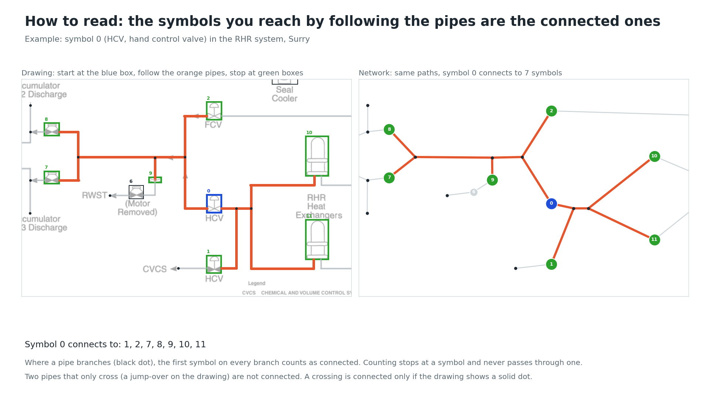
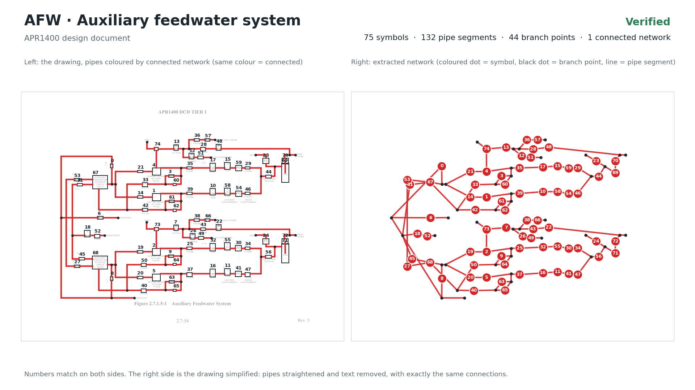
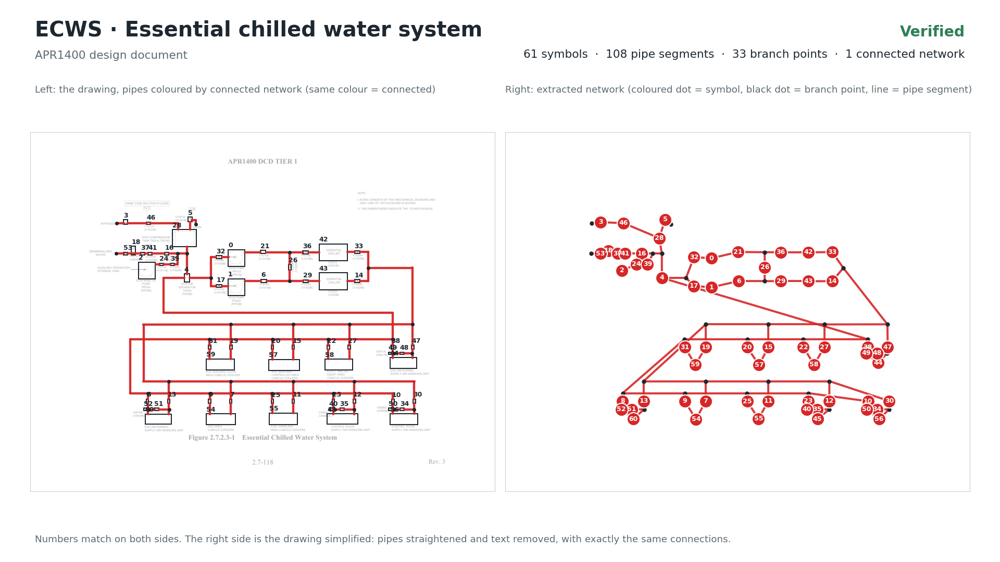
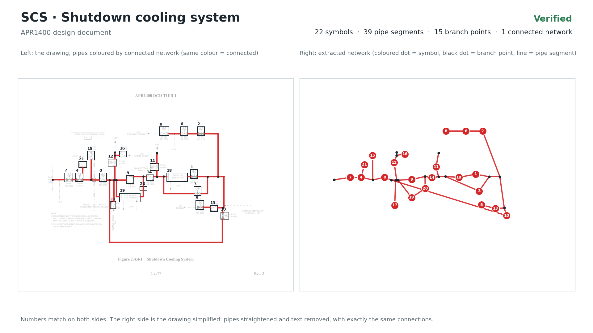

# Fifteen fully verified pages: symbols, pipe lines, text and connectivity (second release)

These 15 pages have all four annotation layers verified, on the second-release annotations of [`../`](../README.md) (tight symbol boxes, pipe lines that stop at the symbol boxes, tight text boxes, all checked and saved by a human). The pipe connectivity between the symbols was built from those annotations and verified against them: automatic checks plus a visual inspection of every connection (see below). Everything needed to use or re-check them is in this folder: the drawings, all four annotation layers, review images, the method, and code that rebuilds and checks the connectivity.

The first five pages are the five verified pages of the first release ([`../../verified_annotations/topology_verified/`](../../verified_annotations/topology_verified/README.md)), rebuilt on the new annotations; ten pages are new.

| Page | Symbols | Pipe lines | Text lines | Pipe segments | T junctions | Open pipe ends | Crossings | Data |
|---|---|---|---|---|---|---|---|---|
| Davis-Besse p7 | 25 | 32 | 69 | 32 | 7 | 0 | 0 | [drawing](images/pseudo_AFW_%28DAVIS-BESSE%29%20AFW%20system%20Reliability%20Analysis_Final%20Report_p7.png) · symbols [txt](symbols/pseudo_AFW_%28DAVIS-BESSE%29%20AFW%20system%20Reliability%20Analysis_Final%20Report_p7.txt) / [json](symbols/pseudo_AFW_%28DAVIS-BESSE%29%20AFW%20system%20Reliability%20Analysis_Final%20Report_p7.json) · [pipe lines](lines/pseudo_AFW_%28DAVIS-BESSE%29%20AFW%20system%20Reliability%20Analysis_Final%20Report_p7.json) · [text](text/pseudo_AFW_%28DAVIS-BESSE%29%20AFW%20system%20Reliability%20Analysis_Final%20Report_p7.json) · [connectivity](pseudo_AFW_%28DAVIS-BESSE%29%20AFW%20system%20Reliability%20Analysis_Final%20Report_p7.json) |
| RHR (Surry) | 14 | 50 | 46 | 42 | 15 | 9 | 1 | [drawing](images/pseudo_RHR_%28Surry%29%20FSAR.png) · symbols [txt](symbols/pseudo_RHR_%28Surry%29%20FSAR.txt) / [json](symbols/pseudo_RHR_%28Surry%29%20FSAR.json) · [pipe lines](lines/pseudo_RHR_%28Surry%29%20FSAR.json) · [text](text/pseudo_RHR_%28Surry%29%20FSAR.json) · [connectivity](pseudo_RHR_%28Surry%29%20FSAR.json) |
| AFW (Seabrook) | 47 | 65 | 37 | 56 | 6 | 2 | 0 | [drawing](images/pseudo_AFW%20%28Seabrook%29.png) · symbols [txt](symbols/pseudo_AFW%20%28Seabrook%29.txt) / [json](symbols/pseudo_AFW%20%28Seabrook%29.json) · [pipe lines](lines/pseudo_AFW%20%28Seabrook%29.json) · [text](text/pseudo_AFW%20%28Seabrook%29.json) · [connectivity](pseudo_AFW%20%28Seabrook%29.json) |
| AFW (San Onofre) | 60 | 93 | 108 | 92 | 17 | 9 | 1 | [drawing](images/pseudo_AFW_%28San%20Onofre%29%20AFW%20Design%20Review%20and%20Reliability%20Evaluation.png) · symbols [txt](symbols/pseudo_AFW_%28San%20Onofre%29%20AFW%20Design%20Review%20and%20Reliability%20Evaluation.txt) / [json](symbols/pseudo_AFW_%28San%20Onofre%29%20AFW%20Design%20Review%20and%20Reliability%20Evaluation.json) · [pipe lines](lines/pseudo_AFW_%28San%20Onofre%29%20AFW%20Design%20Review%20and%20Reliability%20Evaluation.json) · [text](text/pseudo_AFW_%28San%20Onofre%29%20AFW%20Design%20Review%20and%20Reliability%20Evaluation.json) · [connectivity](pseudo_AFW_%28San%20Onofre%29%20AFW%20Design%20Review%20and%20Reliability%20Evaluation.json) |
| CSS (APR1400) | 72 | 111 | 182 | 98 | 18 | 1 | 0 | [drawing](images/pseudo_CSS%20%28APR1400%29.png) · symbols [txt](symbols/pseudo_CSS%20%28APR1400%29.txt) / [json](symbols/pseudo_CSS%20%28APR1400%29.json) · [pipe lines](lines/pseudo_CSS%20%28APR1400%29.json) · [text](text/pseudo_CSS%20%28APR1400%29.json) · [connectivity](pseudo_CSS%20%28APR1400%29.json) |
| AFW (APR1400) | 75 | 153 | 145 | 132 | 31 | 13 | 5 | [drawing](images/pseudo_AFW_APR1400.png) · symbols [txt](symbols/pseudo_AFW_APR1400.txt) / [json](symbols/pseudo_AFW_APR1400.json) · [pipe lines](lines/pseudo_AFW_APR1400.json) · [text](text/pseudo_AFW_APR1400.json) · [connectivity](pseudo_AFW_APR1400.json) |
| Condensate and feedwater (APR1400) | 42 | 64 | 128 | 64 | 12 | 6 | 0 | [drawing](images/pseudo_Condensate%20and%20Feedwater%20system_APR1400.png) · symbols [txt](symbols/pseudo_Condensate%20and%20Feedwater%20system_APR1400.txt) / [json](symbols/pseudo_Condensate%20and%20Feedwater%20system_APR1400.json) · [pipe lines](lines/pseudo_Condensate%20and%20Feedwater%20system_APR1400.json) · [text](text/pseudo_Condensate%20and%20Feedwater%20system_APR1400.json) · [connectivity](pseudo_Condensate%20and%20Feedwater%20system_APR1400.json) |
| ECWS (APR1400) | 61 | 97 | 107 | 108 | 30 | 3 | 9 | [drawing](images/pseudo_ECWS_APR1400.png) · symbols [txt](symbols/pseudo_ECWS_APR1400.txt) / [json](symbols/pseudo_ECWS_APR1400.json) · [pipe lines](lines/pseudo_ECWS_APR1400.json) · [text](text/pseudo_ECWS_APR1400.json) · [connectivity](pseudo_ECWS_APR1400.json) |
| SCS (APR1400) | 22 | 37 | 93 | 39 | 12 | 3 | 0 | [drawing](images/pseudo_SCS_APR1400.png) · symbols [txt](symbols/pseudo_SCS_APR1400.txt) / [json](symbols/pseudo_SCS_APR1400.json) · [pipe lines](lines/pseudo_SCS_APR1400.json) · [text](text/pseudo_SCS_APR1400.json) · [connectivity](pseudo_SCS_APR1400.json) |
| SI (APR1400) | 93 | 139 | 222 | 152 | 37 | 13 | 3 | [drawing](images/pseudo_SI%20%28APR1400%29.png) · symbols [txt](symbols/pseudo_SI%20%28APR1400%29.txt) / [json](symbols/pseudo_SI%20%28APR1400%29.json) · [pipe lines](lines/pseudo_SI%20%28APR1400%29.json) · [text](text/pseudo_SI%20%28APR1400%29.json) · [connectivity](pseudo_SI%20%28APR1400%29.json) |
| AFW (INL system study) | 49 | 79 | 113 | 81 | 20 | 6 | 9 | [drawing](images/pseudo_AFW_INL_System%20Study.png) · symbols [txt](symbols/pseudo_AFW_INL_System%20Study.txt) / [json](symbols/pseudo_AFW_INL_System%20Study.json) · [pipe lines](lines/pseudo_AFW_INL_System%20Study.json) · [text](text/pseudo_AFW_INL_System%20Study.json) · [connectivity](pseudo_AFW_INL_System%20Study.json) |
| AFW (Haddam Neck) | 52 | 75 | 42 | 79 | 18 | 4 | 0 | [drawing](images/pseudo_AFW%20%28Haddam%20Neck%29.png) · symbols [txt](symbols/pseudo_AFW%20%28Haddam%20Neck%29.txt) / [json](symbols/pseudo_AFW%20%28Haddam%20Neck%29.json) · [pipe lines](lines/pseudo_AFW%20%28Haddam%20Neck%29.json) · [text](text/pseudo_AFW%20%28Haddam%20Neck%29.json) · [connectivity](pseudo_AFW%20%28Haddam%20Neck%29.json) |
| CCWS (Surry) | 19 | 58 | 52 | 76 | 35 | 11 | 3 | [drawing](images/pseudo_CCWS_%28Surry%29%20FSAR_p1.png) · symbols [txt](symbols/pseudo_CCWS_%28Surry%29%20FSAR_p1.txt) / [json](symbols/pseudo_CCWS_%28Surry%29%20FSAR_p1.json) · [pipe lines](lines/pseudo_CCWS_%28Surry%29%20FSAR_p1.json) · [text](text/pseudo_CCWS_%28Surry%29%20FSAR_p1.json) · [connectivity](pseudo_CCWS_%28Surry%29%20FSAR_p1.json) |
| CSS (Surry, NUREG/CR-4550) | 24 | 44 | 34 | 41 | 11 | 2 | 2 | [drawing](images/pseudo_CSS_NUREG-CR-4550%20Vol.3%20Part1%20Analysis%20of%20Core%20Damage%20Frequency_Surry%2C%20Unit%201%20In.png) · symbols [txt](symbols/pseudo_CSS_NUREG-CR-4550%20Vol.3%20Part1%20Analysis%20of%20Core%20Damage%20Frequency_Surry%2C%20Unit%201%20In.txt) / [json](symbols/pseudo_CSS_NUREG-CR-4550%20Vol.3%20Part1%20Analysis%20of%20Core%20Damage%20Frequency_Surry%2C%20Unit%201%20In.json) · [pipe lines](lines/pseudo_CSS_NUREG-CR-4550%20Vol.3%20Part1%20Analysis%20of%20Core%20Damage%20Frequency_Surry%2C%20Unit%201%20In.json) · [text](text/pseudo_CSS_NUREG-CR-4550%20Vol.3%20Part1%20Analysis%20of%20Core%20Damage%20Frequency_Surry%2C%20Unit%201%20In.json) · [connectivity](pseudo_CSS_NUREG-CR-4550%20Vol.3%20Part1%20Analysis%20of%20Core%20Damage%20Frequency_Surry%2C%20Unit%201%20In.json) |
| SI (Surry, NUREG/CR-4550) | 44 | 86 | 105 | 100 | 33 | 14 | 6 | [drawing](images/pseudo_SI%20%28Surry%29_NUREG-CR-4550%20Vol.3%20Part1%20Analysis%20of%20Core%20Damage%20Frequency_Surry%2C%20Un.png) · symbols [txt](symbols/pseudo_SI%20%28Surry%29_NUREG-CR-4550%20Vol.3%20Part1%20Analysis%20of%20Core%20Damage%20Frequency_Surry%2C%20Un.txt) / [json](symbols/pseudo_SI%20%28Surry%29_NUREG-CR-4550%20Vol.3%20Part1%20Analysis%20of%20Core%20Damage%20Frequency_Surry%2C%20Un.json) · [pipe lines](lines/pseudo_SI%20%28Surry%29_NUREG-CR-4550%20Vol.3%20Part1%20Analysis%20of%20Core%20Damage%20Frequency_Surry%2C%20Un.json) · [text](text/pseudo_SI%20%28Surry%29_NUREG-CR-4550%20Vol.3%20Part1%20Analysis%20of%20Core%20Damage%20Frequency_Surry%2C%20Un.json) · [connectivity](pseudo_SI%20%28Surry%29_NUREG-CR-4550%20Vol.3%20Part1%20Analysis%20of%20Core%20Damage%20Frequency_Surry%2C%20Un.json) |
| **Total** | **699** | **1183** | **1483** | **1192** | **302** | **96** | **39** | |

Review images for each page:

| Page | Images |
|---|---|
| Davis-Besse p7 | [symbols + pipe lines](overlays/pseudo_AFW_%28DAVIS-BESSE%29%20AFW%20system%20Reliability%20Analysis_Final%20Report_p7_symbols_lines.jpg) · [text](overlays/pseudo_AFW_%28DAVIS-BESSE%29%20AFW%20system%20Reliability%20Analysis_Final%20Report_p7_text.jpg) · [connections on the drawing](pseudo_AFW_%28DAVIS-BESSE%29%20AFW%20system%20Reliability%20Analysis_Final%20Report_p7.jpg) · [explained connectivity](pseudo_AFW_%28DAVIS-BESSE%29%20AFW%20system%20Reliability%20Analysis_Final%20Report_p7_explained.png) |
| RHR (Surry) | [symbols + pipe lines](overlays/pseudo_RHR_%28Surry%29%20FSAR_symbols_lines.jpg) · [text](overlays/pseudo_RHR_%28Surry%29%20FSAR_text.jpg) · [connections on the drawing](pseudo_RHR_%28Surry%29%20FSAR.jpg) · [explained connectivity](pseudo_RHR_%28Surry%29%20FSAR_explained.png) |
| AFW (Seabrook) | [symbols + pipe lines](overlays/pseudo_AFW%20%28Seabrook%29_symbols_lines.jpg) · [text](overlays/pseudo_AFW%20%28Seabrook%29_text.jpg) · [connections on the drawing](pseudo_AFW%20%28Seabrook%29.jpg) · [explained connectivity](pseudo_AFW%20%28Seabrook%29_explained.png) |
| AFW (San Onofre) | [symbols + pipe lines](overlays/pseudo_AFW_%28San%20Onofre%29%20AFW%20Design%20Review%20and%20Reliability%20Evaluation_symbols_lines.jpg) · [text](overlays/pseudo_AFW_%28San%20Onofre%29%20AFW%20Design%20Review%20and%20Reliability%20Evaluation_text.jpg) · [connections on the drawing](pseudo_AFW_%28San%20Onofre%29%20AFW%20Design%20Review%20and%20Reliability%20Evaluation.jpg) · [explained connectivity](pseudo_AFW_%28San%20Onofre%29%20AFW%20Design%20Review%20and%20Reliability%20Evaluation_explained.png) |
| CSS (APR1400) | [symbols + pipe lines](overlays/pseudo_CSS%20%28APR1400%29_symbols_lines.jpg) · [text](overlays/pseudo_CSS%20%28APR1400%29_text.jpg) · [connections on the drawing](pseudo_CSS%20%28APR1400%29.jpg) · [explained connectivity](pseudo_CSS%20%28APR1400%29_explained.png) |
| AFW (APR1400) | [symbols + pipe lines](overlays/pseudo_AFW_APR1400_symbols_lines.jpg) · [text](overlays/pseudo_AFW_APR1400_text.jpg) · [connections on the drawing](pseudo_AFW_APR1400.jpg) · [explained connectivity](pseudo_AFW_APR1400_explained.png) |
| Condensate and feedwater (APR1400) | [symbols + pipe lines](overlays/pseudo_Condensate%20and%20Feedwater%20system_APR1400_symbols_lines.jpg) · [text](overlays/pseudo_Condensate%20and%20Feedwater%20system_APR1400_text.jpg) · [connections on the drawing](pseudo_Condensate%20and%20Feedwater%20system_APR1400.jpg) · [explained connectivity](pseudo_Condensate%20and%20Feedwater%20system_APR1400_explained.png) |
| ECWS (APR1400) | [symbols + pipe lines](overlays/pseudo_ECWS_APR1400_symbols_lines.jpg) · [text](overlays/pseudo_ECWS_APR1400_text.jpg) · [connections on the drawing](pseudo_ECWS_APR1400.jpg) · [explained connectivity](pseudo_ECWS_APR1400_explained.png) |
| SCS (APR1400) | [symbols + pipe lines](overlays/pseudo_SCS_APR1400_symbols_lines.jpg) · [text](overlays/pseudo_SCS_APR1400_text.jpg) · [connections on the drawing](pseudo_SCS_APR1400.jpg) · [explained connectivity](pseudo_SCS_APR1400_explained.png) |
| SI (APR1400) | [symbols + pipe lines](overlays/pseudo_SI%20%28APR1400%29_symbols_lines.jpg) · [text](overlays/pseudo_SI%20%28APR1400%29_text.jpg) · [connections on the drawing](pseudo_SI%20%28APR1400%29.jpg) · [explained connectivity](pseudo_SI%20%28APR1400%29_explained.png) |
| AFW (INL system study) | [symbols + pipe lines](overlays/pseudo_AFW_INL_System%20Study_symbols_lines.jpg) · [text](overlays/pseudo_AFW_INL_System%20Study_text.jpg) · [connections on the drawing](pseudo_AFW_INL_System%20Study.jpg) · [explained connectivity](pseudo_AFW_INL_System%20Study_explained.png) |
| AFW (Haddam Neck) | [symbols + pipe lines](overlays/pseudo_AFW%20%28Haddam%20Neck%29_symbols_lines.jpg) · [text](overlays/pseudo_AFW%20%28Haddam%20Neck%29_text.jpg) · [connections on the drawing](pseudo_AFW%20%28Haddam%20Neck%29.jpg) · [explained connectivity](pseudo_AFW%20%28Haddam%20Neck%29_explained.png) |
| CCWS (Surry) | [symbols + pipe lines](overlays/pseudo_CCWS_%28Surry%29%20FSAR_p1_symbols_lines.jpg) · [text](overlays/pseudo_CCWS_%28Surry%29%20FSAR_p1_text.jpg) · [connections on the drawing](pseudo_CCWS_%28Surry%29%20FSAR_p1.jpg) · [explained connectivity](pseudo_CCWS_%28Surry%29%20FSAR_p1_explained.png) |
| CSS (Surry, NUREG/CR-4550) | [symbols + pipe lines](overlays/pseudo_CSS_NUREG-CR-4550%20Vol.3%20Part1%20Analysis%20of%20Core%20Damage%20Frequency_Surry%2C%20Unit%201%20In_symbols_lines.jpg) · [text](overlays/pseudo_CSS_NUREG-CR-4550%20Vol.3%20Part1%20Analysis%20of%20Core%20Damage%20Frequency_Surry%2C%20Unit%201%20In_text.jpg) · [connections on the drawing](pseudo_CSS_NUREG-CR-4550%20Vol.3%20Part1%20Analysis%20of%20Core%20Damage%20Frequency_Surry%2C%20Unit%201%20In.jpg) · [explained connectivity](pseudo_CSS_NUREG-CR-4550%20Vol.3%20Part1%20Analysis%20of%20Core%20Damage%20Frequency_Surry%2C%20Unit%201%20In_explained.png) |
| SI (Surry, NUREG/CR-4550) | [symbols + pipe lines](overlays/pseudo_SI%20%28Surry%29_NUREG-CR-4550%20Vol.3%20Part1%20Analysis%20of%20Core%20Damage%20Frequency_Surry%2C%20Un_symbols_lines.jpg) · [text](overlays/pseudo_SI%20%28Surry%29_NUREG-CR-4550%20Vol.3%20Part1%20Analysis%20of%20Core%20Damage%20Frequency_Surry%2C%20Un_text.jpg) · [connections on the drawing](pseudo_SI%20%28Surry%29_NUREG-CR-4550%20Vol.3%20Part1%20Analysis%20of%20Core%20Damage%20Frequency_Surry%2C%20Un.jpg) · [explained connectivity](pseudo_SI%20%28Surry%29_NUREG-CR-4550%20Vol.3%20Part1%20Analysis%20of%20Core%20Damage%20Frequency_Surry%2C%20Un_explained.png) |

## Contents

| Path | Content |
|---|---|
| `images/<page>.png` | The drawing at its original resolution. All coordinates below are pixels in this image. |
| `symbols/<page>.txt` | Symbol boxes, YOLO format `0 cx cy w h` (normalized, single class). The line number (from 0) is the symbol id. |
| `symbols/<page>.json` | The same boxes in pixels: `{"name", "width", "height", "symbols": [{"id", "bbox": [x0, y0, x1, y1]}]}`. These ids are the ones used in the connectivity files. |
| `lines/<page>.json` | Pipe lines, `{"solid": [[x1, y1, x2, y2], ...], "dashed": []}`. |
| `text/<page>.json` | Text, one box per line of text: `{"name", "width", "height", "items": [{"id", "box": [x0, y0, x1, y1], "text", "rot"}]}`. |
| `<page>.json` | Connectivity: which symbols are connected by pipes (format below). |
| `manual_edits.json` | Every change made by hand during the connectivity review, on top of the symbol and pipe annotations (see "Manual edits"). |
| `overlays/<page>_symbols_lines.jpg` | Symbols (red, with id) and pipe lines (green; pieces added in the connectivity review in blue) drawn on the drawing. |
| `overlays/<page>_text.jpg` | Left: the drawing with the text boxes. Right: the transcribed text placed in the same boxes, so the two sides can be compared word by word. |
| `<page>.jpg` | Connections drawn on the drawing, one colour per connection (link). |
| `<page>_explained.png` | The drawing next to the extracted pipe network, with matching numbers (see "How to read"). |
| `how_to_read.png` | How to read the explained images. |
| `code/` | Code that rebuilds the connectivity from the annotations and runs the checks (see "Reproduce"). |

The symbol, line and text files are identical to `../labels`, `../lines` and `../text` for these pages.

### Connectivity format

- `symbols`: `{"id", "bbox"}`, the same ids and boxes as `symbols/<page>.json`.
- `junctions`: points where pipes meet or end without a symbol: T junctions (3 pipes meet) and open pipe ends (a pipe that leaves the drawing or ends without a symbol). Corners are not nodes. Format `{"id": "J0", "xy": [x, y]}`.
- `links`: one pipe segment between two nodes, `{"source", "target", "path"}`. Source and target are a symbol id (number) or a junction id (`J...`); `path` is the pipe geometry as a list of `[x1, y1, x2, y2]` pieces.
- `neighbors`: for each symbol, the symbols reachable from it along pipes and through junctions, without passing through another symbol. This is the "which symbol connects to which" answer.
- `crossings`: places where two pipes cross in the middle of both, with `connected` true only when a filled dot is drawn there.
- `status`: `verified`; `status_note` says how.

## How connectivity is built

The same algorithm as in the first release ([`code/topo.py`](code/topo.py), function `build`, on top of [`code/pnid_graph_upstream.py`](code/pnid_graph_upstream.py)); its steps are described in the [first-release README](../../verified_annotations/topology_verified/README.md#how-connectivity-is-built). In short: the hand-drawn pipe lines are cleaned up (collinear pieces merged, hop-overs bridged, pipe ends extended onto a pipe when ink connects them, short unlabeled pipes traced from symbol boxes along ink), line ends within 12 px are snapped into corners, T junctions and X crossings, an X crossing is connected only when a filled dot is drawn, symbols are attached where pipes run through or end at their boxes, and the graph is simplified so that every link runs from a symbol or junction to the next one.

With the second-release annotations the pipe lines stop at the symbol boxes, so a line end touching a box edge attaches the pipe to that symbol.

## Manual edits

[`manual_edits.json`](manual_edits.json) records every change made by hand during the connectivity review, per page:

- `added_lines`: pipe pieces that are drawn on the page but missing from the line annotations.
- `removed_lines`: annotated lines that are not pipes.
- `crossing_decisions`: crossings decided by hand ("connected" true or false).
- `cuts`: a point where the algorithm joined two pipes that the drawing does not join; the link through it is removed.
- `unlinks`: `[symbol, x, y]`, a link the algorithm made between two symbols whose boxes touch, with no pipe between them.
- `fine_regions` / `fine_tol`: regions where two branch points are very close; line ends are snapped within `fine_tol` px instead of 12 px.

Per page:

| Page | Edits | Why |
|---|---|---|
| RHR (Surry) | 1 crossing decision, 1 cut | (1917, 666): plain crossing without a dot (as in the first release). (815, 782): the labeled Loop A hot leg line runs 26 px past the bracket it starts at; that overshoot is cut, so the bracket is a T and not a 4-way junction. |
| CSS (APR1400) | 1 unlink | Flow transmitter 71 (FT 345D) was joined to valve 44 because their boxes touch; both sit on the riser, with no pipe between them. |
| AFW (APR1400) | 10 removed lines, 5 crossing decisions | The removed lines are the dotted containment boundary, labeled as pipe: its vertical part at x = 2224 and its horizontal parts at y = 705 and y = 1527 between the containment penetrations (PC) of the steam generator lines. The same lines were cut in the first-release review. The 5 crossings are plain crossings (decided in the first-release review). |
| SCS (APR1400) | 1 added line, 1 fine region | The pipe through the containment penetration between SI-653 and SI-655 (an unboxed square) was not labeled. Two T junctions 11 px apart on the header (to SI-340 and to the miniflow heat exchanger) are kept apart. |
| SI (APR1400) | 9 added lines, 1 removed line | Added: the branch to the reactor cavity, the outlet of valve 92 to its junction (9 px), the branches from SCP 1 / SCP 2 and to SCP / CSP 1 and 2, and the pipe between V957 and V523 on the shutdown line, all drawn but not labeled. Removed: a piece of the AB/RCB boundary (dash-dot) labeled as pipe. |
| AFW (Haddam Neck) | 4 added lines, 1 removed line | Added: the steam supply from SG 1&2 / SG 3&4 to the two turbine pump steam valves (TD-A, TD-B), drawn but not labeled. Removed: the edge of the scanned page, labeled as a line. |
| CSS (Surry, NUREG/CR-4550) | 2 crossing decisions | Plain crossings (decided in the first-release review). |
| SI (Surry, NUREG/CR-4550) | 6 crossing decisions | Plain crossings of the pump discharge headers with the risers to the MOVs (decided in the first-release review). |

No edits were needed on the other 7 pages.

Compared with the first release, two of the five pages changed: on CSS (APR1400) the flow transmitters are now taps on the heat exchanger outlet risers (connected to the valves above and below them), and on AFW (San Onofre) flow transmitter 29 is connected only to the orifice 59 it sits on. Both match the drawings. The other three pages have exactly the same connections.

## How the 15 pages were verified

1. **Automatic checks** against this page's human-verified symbols and pipe lines ([`code/check_connectivity.py`](code/check_connectivity.py)):
   1. coverage: every verified pipe line, outside symbol boxes, is covered by connections for at least 80% of its length;
   2. on pipe: every connection, outside symbol boxes, runs on verified pipe lines for at least 90% of its length;
   3. attached: every verified pipe end that stops at a symbol box has a connection at that symbol;
   4. isolated: every symbol has at least one connection;
   5. junctions: no junction joins 4 or more pipes without a drawn dot;
   6. crossings: every crossing decision agrees with the drawing (dot = connected);
   7. dead ends: no pipe stops within 25 px of another pipe without joining it.
2. **Visual inspection** of every connection: each page was viewed in tiles (drawing next to the extracted connections), every open pipe end and every crossing was looked at on the drawing, and links that run through symbol boxes or are very short were checked one by one. Pipes drawn on the page but not labeled, and labeled lines that are not pipes, were fixed with the manual edits above.
Result: all 7 checks pass on all 15 pages with no flags, and no wrong or missing connection was found in the visual inspection.

## Reproduce

Requirements: Python 3, `numpy`, `opencv-python`. From this folder:

```
python code/build_connectivity.py --check   # rebuilds the 15 connectivity files from images/, symbols/, lines/ and manual_edits.json
python code/check_connectivity.py           # runs the 7 checks above
```

`build_connectivity.py --check` writes `rebuilt/<page>.json` and reports, for each page, that it is identical to the published `<page>.json` (symbols, junctions, links, neighbors and crossings). `check_connectivity.py` reports "all checks passed" for every page.

## How to read the explained images



The drawing is on the **left** (pipes drawn in colour, each symbol a numbered box) and the extracted pipe network on the **right** (coloured dot = symbol, small black dot = junction, line = one pipe segment). The numbers match on both sides. Pipes of the same colour belong to the same connected network.

Start from a symbol and follow the pipe. At a junction (black dot), follow every branch, and stop at the next symbol. The symbols you reach are the ones connected to it. Two pipes that only cross (no solid dot on the drawing) are **not** connected.

To report an error, give the page and the symbol numbers, for example "SCS (APR1400): 9 should not connect to 20".

## The 15 pages

### 1. AFW · Davis-Besse reliability analysis, p7 (Third Train Configuration)

25 symbols · 32 pipe lines · 69 text lines · 32 pipe segments · 7 T junctions · 0 open pipe ends · status: **verified**


- Data: [drawing](images/pseudo_AFW_%28DAVIS-BESSE%29%20AFW%20system%20Reliability%20Analysis_Final%20Report_p7.png) · symbols [txt](symbols/pseudo_AFW_%28DAVIS-BESSE%29%20AFW%20system%20Reliability%20Analysis_Final%20Report_p7.txt) / [json](symbols/pseudo_AFW_%28DAVIS-BESSE%29%20AFW%20system%20Reliability%20Analysis_Final%20Report_p7.json) · [pipe lines](lines/pseudo_AFW_%28DAVIS-BESSE%29%20AFW%20system%20Reliability%20Analysis_Final%20Report_p7.json) · [text](text/pseudo_AFW_%28DAVIS-BESSE%29%20AFW%20system%20Reliability%20Analysis_Final%20Report_p7.json) · [connectivity](pseudo_AFW_%28DAVIS-BESSE%29%20AFW%20system%20Reliability%20Analysis_Final%20Report_p7.json)
- Images: [symbols + pipe lines](overlays/pseudo_AFW_%28DAVIS-BESSE%29%20AFW%20system%20Reliability%20Analysis_Final%20Report_p7_symbols_lines.jpg) · [text](overlays/pseudo_AFW_%28DAVIS-BESSE%29%20AFW%20system%20Reliability%20Analysis_Final%20Report_p7_text.jpg) · [connections on the drawing](pseudo_AFW_%28DAVIS-BESSE%29%20AFW%20system%20Reliability%20Analysis_Final%20Report_p7.jpg) · [explained connectivity](pseudo_AFW_%28DAVIS-BESSE%29%20AFW%20system%20Reliability%20Analysis_Final%20Report_p7_explained.png)

### 2. RHR · Residual heat removal system (Surry FSAR)

14 symbols · 50 pipe lines · 46 text lines · 42 pipe segments · 15 T junctions · 9 open pipe ends · status: **verified**


- Data: [drawing](images/pseudo_RHR_%28Surry%29%20FSAR.png) · symbols [txt](symbols/pseudo_RHR_%28Surry%29%20FSAR.txt) / [json](symbols/pseudo_RHR_%28Surry%29%20FSAR.json) · [pipe lines](lines/pseudo_RHR_%28Surry%29%20FSAR.json) · [text](text/pseudo_RHR_%28Surry%29%20FSAR.json) · [connectivity](pseudo_RHR_%28Surry%29%20FSAR.json)
- Images: [symbols + pipe lines](overlays/pseudo_RHR_%28Surry%29%20FSAR_symbols_lines.jpg) · [text](overlays/pseudo_RHR_%28Surry%29%20FSAR_text.jpg) · [connections on the drawing](pseudo_RHR_%28Surry%29%20FSAR.jpg) · [explained connectivity](pseudo_RHR_%28Surry%29%20FSAR_explained.png)

### 3. AFW · Auxiliary feedwater system (Seabrook Station · NUREG/CR-5500)

47 symbols · 65 pipe lines · 37 text lines · 56 pipe segments · 6 T junctions · 2 open pipe ends · status: **verified**


- Data: [drawing](images/pseudo_AFW%20%28Seabrook%29.png) · symbols [txt](symbols/pseudo_AFW%20%28Seabrook%29.txt) / [json](symbols/pseudo_AFW%20%28Seabrook%29.json) · [pipe lines](lines/pseudo_AFW%20%28Seabrook%29.json) · [text](text/pseudo_AFW%20%28Seabrook%29.json) · [connectivity](pseudo_AFW%20%28Seabrook%29.json)
- Images: [symbols + pipe lines](overlays/pseudo_AFW%20%28Seabrook%29_symbols_lines.jpg) · [text](overlays/pseudo_AFW%20%28Seabrook%29_text.jpg) · [connections on the drawing](pseudo_AFW%20%28Seabrook%29.jpg) · [explained connectivity](pseudo_AFW%20%28Seabrook%29_explained.png)

### 4. AFW · Auxiliary feedwater system (San Onofre design review report)

60 symbols · 93 pipe lines · 108 text lines · 92 pipe segments · 17 T junctions · 9 open pipe ends · status: **verified**


- Data: [drawing](images/pseudo_AFW_%28San%20Onofre%29%20AFW%20Design%20Review%20and%20Reliability%20Evaluation.png) · symbols [txt](symbols/pseudo_AFW_%28San%20Onofre%29%20AFW%20Design%20Review%20and%20Reliability%20Evaluation.txt) / [json](symbols/pseudo_AFW_%28San%20Onofre%29%20AFW%20Design%20Review%20and%20Reliability%20Evaluation.json) · [pipe lines](lines/pseudo_AFW_%28San%20Onofre%29%20AFW%20Design%20Review%20and%20Reliability%20Evaluation.json) · [text](text/pseudo_AFW_%28San%20Onofre%29%20AFW%20Design%20Review%20and%20Reliability%20Evaluation.json) · [connectivity](pseudo_AFW_%28San%20Onofre%29%20AFW%20Design%20Review%20and%20Reliability%20Evaluation.json)
- Images: [symbols + pipe lines](overlays/pseudo_AFW_%28San%20Onofre%29%20AFW%20Design%20Review%20and%20Reliability%20Evaluation_symbols_lines.jpg) · [text](overlays/pseudo_AFW_%28San%20Onofre%29%20AFW%20Design%20Review%20and%20Reliability%20Evaluation_text.jpg) · [connections on the drawing](pseudo_AFW_%28San%20Onofre%29%20AFW%20Design%20Review%20and%20Reliability%20Evaluation.jpg) · [explained connectivity](pseudo_AFW_%28San%20Onofre%29%20AFW%20Design%20Review%20and%20Reliability%20Evaluation_explained.png)

### 5. CSS · Containment spray system (APR1400 design document)

72 symbols · 111 pipe lines · 182 text lines · 98 pipe segments · 18 T junctions · 1 open pipe ends · status: **verified**


- Data: [drawing](images/pseudo_CSS%20%28APR1400%29.png) · symbols [txt](symbols/pseudo_CSS%20%28APR1400%29.txt) / [json](symbols/pseudo_CSS%20%28APR1400%29.json) · [pipe lines](lines/pseudo_CSS%20%28APR1400%29.json) · [text](text/pseudo_CSS%20%28APR1400%29.json) · [connectivity](pseudo_CSS%20%28APR1400%29.json)
- Images: [symbols + pipe lines](overlays/pseudo_CSS%20%28APR1400%29_symbols_lines.jpg) · [text](overlays/pseudo_CSS%20%28APR1400%29_text.jpg) · [connections on the drawing](pseudo_CSS%20%28APR1400%29.jpg) · [explained connectivity](pseudo_CSS%20%28APR1400%29_explained.png)

### 6. AFW · Auxiliary feedwater system (APR1400 design document)

75 symbols · 153 pipe lines · 145 text lines · 132 pipe segments · 31 T junctions · 13 open pipe ends · status: **verified**



- Data: [drawing](images/pseudo_AFW_APR1400.png) · symbols [txt](symbols/pseudo_AFW_APR1400.txt) / [json](symbols/pseudo_AFW_APR1400.json) · [pipe lines](lines/pseudo_AFW_APR1400.json) · [text](text/pseudo_AFW_APR1400.json) · [connectivity](pseudo_AFW_APR1400.json)
- Images: [symbols + pipe lines](overlays/pseudo_AFW_APR1400_symbols_lines.jpg) · [text](overlays/pseudo_AFW_APR1400_text.jpg) · [connections on the drawing](pseudo_AFW_APR1400.jpg) · [explained connectivity](pseudo_AFW_APR1400_explained.png)

### 7. CFS · Condensate and feedwater system (APR1400 design document)

42 symbols · 64 pipe lines · 128 text lines · 64 pipe segments · 12 T junctions · 6 open pipe ends · status: **verified**


- Data: [drawing](images/pseudo_Condensate%20and%20Feedwater%20system_APR1400.png) · symbols [txt](symbols/pseudo_Condensate%20and%20Feedwater%20system_APR1400.txt) / [json](symbols/pseudo_Condensate%20and%20Feedwater%20system_APR1400.json) · [pipe lines](lines/pseudo_Condensate%20and%20Feedwater%20system_APR1400.json) · [text](text/pseudo_Condensate%20and%20Feedwater%20system_APR1400.json) · [connectivity](pseudo_Condensate%20and%20Feedwater%20system_APR1400.json)
- Images: [symbols + pipe lines](overlays/pseudo_Condensate%20and%20Feedwater%20system_APR1400_symbols_lines.jpg) · [text](overlays/pseudo_Condensate%20and%20Feedwater%20system_APR1400_text.jpg) · [connections on the drawing](pseudo_Condensate%20and%20Feedwater%20system_APR1400.jpg) · [explained connectivity](pseudo_Condensate%20and%20Feedwater%20system_APR1400_explained.png)

### 8. ECWS · Essential chilled water system (APR1400 design document)

61 symbols · 97 pipe lines · 107 text lines · 108 pipe segments · 30 T junctions · 3 open pipe ends · status: **verified**



- Data: [drawing](images/pseudo_ECWS_APR1400.png) · symbols [txt](symbols/pseudo_ECWS_APR1400.txt) / [json](symbols/pseudo_ECWS_APR1400.json) · [pipe lines](lines/pseudo_ECWS_APR1400.json) · [text](text/pseudo_ECWS_APR1400.json) · [connectivity](pseudo_ECWS_APR1400.json)
- Images: [symbols + pipe lines](overlays/pseudo_ECWS_APR1400_symbols_lines.jpg) · [text](overlays/pseudo_ECWS_APR1400_text.jpg) · [connections on the drawing](pseudo_ECWS_APR1400.jpg) · [explained connectivity](pseudo_ECWS_APR1400_explained.png)

### 9. SCS · Shutdown cooling system (APR1400 design document)

22 symbols · 37 pipe lines · 93 text lines · 39 pipe segments · 12 T junctions · 3 open pipe ends · status: **verified**



- Data: [drawing](images/pseudo_SCS_APR1400.png) · symbols [txt](symbols/pseudo_SCS_APR1400.txt) / [json](symbols/pseudo_SCS_APR1400.json) · [pipe lines](lines/pseudo_SCS_APR1400.json) · [text](text/pseudo_SCS_APR1400.json) · [connectivity](pseudo_SCS_APR1400.json)
- Images: [symbols + pipe lines](overlays/pseudo_SCS_APR1400_symbols_lines.jpg) · [text](overlays/pseudo_SCS_APR1400_text.jpg) · [connections on the drawing](pseudo_SCS_APR1400.jpg) · [explained connectivity](pseudo_SCS_APR1400_explained.png)

### 10. SIS · Safety injection system (APR1400 design document)

93 symbols · 139 pipe lines · 222 text lines · 152 pipe segments · 37 T junctions · 13 open pipe ends · status: **verified**


- Data: [drawing](images/pseudo_SI%20%28APR1400%29.png) · symbols [txt](symbols/pseudo_SI%20%28APR1400%29.txt) / [json](symbols/pseudo_SI%20%28APR1400%29.json) · [pipe lines](lines/pseudo_SI%20%28APR1400%29.json) · [text](text/pseudo_SI%20%28APR1400%29.json) · [connectivity](pseudo_SI%20%28APR1400%29.json)
- Images: [symbols + pipe lines](overlays/pseudo_SI%20%28APR1400%29_symbols_lines.jpg) · [text](overlays/pseudo_SI%20%28APR1400%29_text.jpg) · [connections on the drawing](pseudo_SI%20%28APR1400%29.jpg) · [explained connectivity](pseudo_SI%20%28APR1400%29_explained.png)

### 11. AFW · Simplified auxiliary feedwater system (INL system study)

49 symbols · 79 pipe lines · 113 text lines · 81 pipe segments · 20 T junctions · 6 open pipe ends · status: **verified**


- Data: [drawing](images/pseudo_AFW_INL_System%20Study.png) · symbols [txt](symbols/pseudo_AFW_INL_System%20Study.txt) / [json](symbols/pseudo_AFW_INL_System%20Study.json) · [pipe lines](lines/pseudo_AFW_INL_System%20Study.json) · [text](text/pseudo_AFW_INL_System%20Study.json) · [connectivity](pseudo_AFW_INL_System%20Study.json)
- Images: [symbols + pipe lines](overlays/pseudo_AFW_INL_System%20Study_symbols_lines.jpg) · [text](overlays/pseudo_AFW_INL_System%20Study_text.jpg) · [connections on the drawing](pseudo_AFW_INL_System%20Study.jpg) · [explained connectivity](pseudo_AFW_INL_System%20Study_explained.png)

### 12. AFW · Auxiliary feedwater system (Haddam Neck)

52 symbols · 75 pipe lines · 42 text lines · 79 pipe segments · 18 T junctions · 4 open pipe ends · status: **verified**


- Data: [drawing](images/pseudo_AFW%20%28Haddam%20Neck%29.png) · symbols [txt](symbols/pseudo_AFW%20%28Haddam%20Neck%29.txt) / [json](symbols/pseudo_AFW%20%28Haddam%20Neck%29.json) · [pipe lines](lines/pseudo_AFW%20%28Haddam%20Neck%29.json) · [text](text/pseudo_AFW%20%28Haddam%20Neck%29.json) · [connectivity](pseudo_AFW%20%28Haddam%20Neck%29.json)
- Images: [symbols + pipe lines](overlays/pseudo_AFW%20%28Haddam%20Neck%29_symbols_lines.jpg) · [text](overlays/pseudo_AFW%20%28Haddam%20Neck%29_text.jpg) · [connections on the drawing](pseudo_AFW%20%28Haddam%20Neck%29.jpg) · [explained connectivity](pseudo_AFW%20%28Haddam%20Neck%29_explained.png)

### 13. CCWS · Component cooling water system (Surry FSAR)

19 symbols · 58 pipe lines · 52 text lines · 76 pipe segments · 35 T junctions · 11 open pipe ends · status: **verified**


- Data: [drawing](images/pseudo_CCWS_%28Surry%29%20FSAR_p1.png) · symbols [txt](symbols/pseudo_CCWS_%28Surry%29%20FSAR_p1.txt) / [json](symbols/pseudo_CCWS_%28Surry%29%20FSAR_p1.json) · [pipe lines](lines/pseudo_CCWS_%28Surry%29%20FSAR_p1.json) · [text](text/pseudo_CCWS_%28Surry%29%20FSAR_p1.json) · [connectivity](pseudo_CCWS_%28Surry%29%20FSAR_p1.json)
- Images: [symbols + pipe lines](overlays/pseudo_CCWS_%28Surry%29%20FSAR_p1_symbols_lines.jpg) · [text](overlays/pseudo_CCWS_%28Surry%29%20FSAR_p1_text.jpg) · [connections on the drawing](pseudo_CCWS_%28Surry%29%20FSAR_p1.jpg) · [explained connectivity](pseudo_CCWS_%28Surry%29%20FSAR_p1_explained.png)

### 14. CSS · Containment spray system (Surry · NUREG/CR-4550 Vol. 3)

24 symbols · 44 pipe lines · 34 text lines · 41 pipe segments · 11 T junctions · 2 open pipe ends · status: **verified**


- Data: [drawing](images/pseudo_CSS_NUREG-CR-4550%20Vol.3%20Part1%20Analysis%20of%20Core%20Damage%20Frequency_Surry%2C%20Unit%201%20In.png) · symbols [txt](symbols/pseudo_CSS_NUREG-CR-4550%20Vol.3%20Part1%20Analysis%20of%20Core%20Damage%20Frequency_Surry%2C%20Unit%201%20In.txt) / [json](symbols/pseudo_CSS_NUREG-CR-4550%20Vol.3%20Part1%20Analysis%20of%20Core%20Damage%20Frequency_Surry%2C%20Unit%201%20In.json) · [pipe lines](lines/pseudo_CSS_NUREG-CR-4550%20Vol.3%20Part1%20Analysis%20of%20Core%20Damage%20Frequency_Surry%2C%20Unit%201%20In.json) · [text](text/pseudo_CSS_NUREG-CR-4550%20Vol.3%20Part1%20Analysis%20of%20Core%20Damage%20Frequency_Surry%2C%20Unit%201%20In.json) · [connectivity](pseudo_CSS_NUREG-CR-4550%20Vol.3%20Part1%20Analysis%20of%20Core%20Damage%20Frequency_Surry%2C%20Unit%201%20In.json)
- Images: [symbols + pipe lines](overlays/pseudo_CSS_NUREG-CR-4550%20Vol.3%20Part1%20Analysis%20of%20Core%20Damage%20Frequency_Surry%2C%20Unit%201%20In_symbols_lines.jpg) · [text](overlays/pseudo_CSS_NUREG-CR-4550%20Vol.3%20Part1%20Analysis%20of%20Core%20Damage%20Frequency_Surry%2C%20Unit%201%20In_text.jpg) · [connections on the drawing](pseudo_CSS_NUREG-CR-4550%20Vol.3%20Part1%20Analysis%20of%20Core%20Damage%20Frequency_Surry%2C%20Unit%201%20In.jpg) · [explained connectivity](pseudo_CSS_NUREG-CR-4550%20Vol.3%20Part1%20Analysis%20of%20Core%20Damage%20Frequency_Surry%2C%20Unit%201%20In_explained.png)

### 15. SIS · Safety injection system (Surry · NUREG/CR-4550 Vol. 3)

44 symbols · 86 pipe lines · 105 text lines · 100 pipe segments · 33 T junctions · 14 open pipe ends · status: **verified**


- Data: [drawing](images/pseudo_SI%20%28Surry%29_NUREG-CR-4550%20Vol.3%20Part1%20Analysis%20of%20Core%20Damage%20Frequency_Surry%2C%20Un.png) · symbols [txt](symbols/pseudo_SI%20%28Surry%29_NUREG-CR-4550%20Vol.3%20Part1%20Analysis%20of%20Core%20Damage%20Frequency_Surry%2C%20Un.txt) / [json](symbols/pseudo_SI%20%28Surry%29_NUREG-CR-4550%20Vol.3%20Part1%20Analysis%20of%20Core%20Damage%20Frequency_Surry%2C%20Un.json) · [pipe lines](lines/pseudo_SI%20%28Surry%29_NUREG-CR-4550%20Vol.3%20Part1%20Analysis%20of%20Core%20Damage%20Frequency_Surry%2C%20Un.json) · [text](text/pseudo_SI%20%28Surry%29_NUREG-CR-4550%20Vol.3%20Part1%20Analysis%20of%20Core%20Damage%20Frequency_Surry%2C%20Un.json) · [connectivity](pseudo_SI%20%28Surry%29_NUREG-CR-4550%20Vol.3%20Part1%20Analysis%20of%20Core%20Damage%20Frequency_Surry%2C%20Un.json)
- Images: [symbols + pipe lines](overlays/pseudo_SI%20%28Surry%29_NUREG-CR-4550%20Vol.3%20Part1%20Analysis%20of%20Core%20Damage%20Frequency_Surry%2C%20Un_symbols_lines.jpg) · [text](overlays/pseudo_SI%20%28Surry%29_NUREG-CR-4550%20Vol.3%20Part1%20Analysis%20of%20Core%20Damage%20Frequency_Surry%2C%20Un_text.jpg) · [connections on the drawing](pseudo_SI%20%28Surry%29_NUREG-CR-4550%20Vol.3%20Part1%20Analysis%20of%20Core%20Damage%20Frequency_Surry%2C%20Un.jpg) · [explained connectivity](pseudo_SI%20%28Surry%29_NUREG-CR-4550%20Vol.3%20Part1%20Analysis%20of%20Core%20Damage%20Frequency_Surry%2C%20Un_explained.png)
