# Symbol classes

A class for every one of the 3483 symbol boxes of [`../labels/`](../labels/) (same boxes, same ids), with the
operator of valves, dampers and pumps, the normal position of valves and dampers, the fault-tree component type, and
whether the component is typically modeled in a PRA.

**Status: in review.** The classes were labeled by eye page by page, checked class by class and by independent
reviewers, and then refined to the classes below. The 479 boxes that need a person's
decision are listed in `review.xlsx` ([Review](#review)); 52 rows are
marked `uncertain = yes` (drawn ambiguously, no legend on their page).

**Start here: [index.md](index.md)**, one overview image per page with every box, its id and its class.
**To check the classes themselves**, see [Classes](#classes) below: one picture per class with the legend symbols it
stands for.

## Classes

63 classes in five groups; 56 occur on the 65 pages, the others are kept so
the scheme stays complete. A component gets its own class when the AP1000 / APR1400 P&ID legends draw it with its own
symbol. `legend symbol` = no: the legends have no symbol for it (the class rests on the drawing text). `modeled in PRA`
= no: extracted, but typically not modeled in a PRA; these are screened out when the fault trees are built.

One image per class shows the legend symbols the class stands for, each with its PDF page, entry number and printed
description and the number of boxes on the 65 pages tied to it (the symbols tied to boxes come first; open and closed
variants are separate symbols). A class with no legend symbol shows examples as drawn on the pages instead.

All classes at a glance: the most-cited legend symbol of each of the 57 classes that have one (frame colour = group).

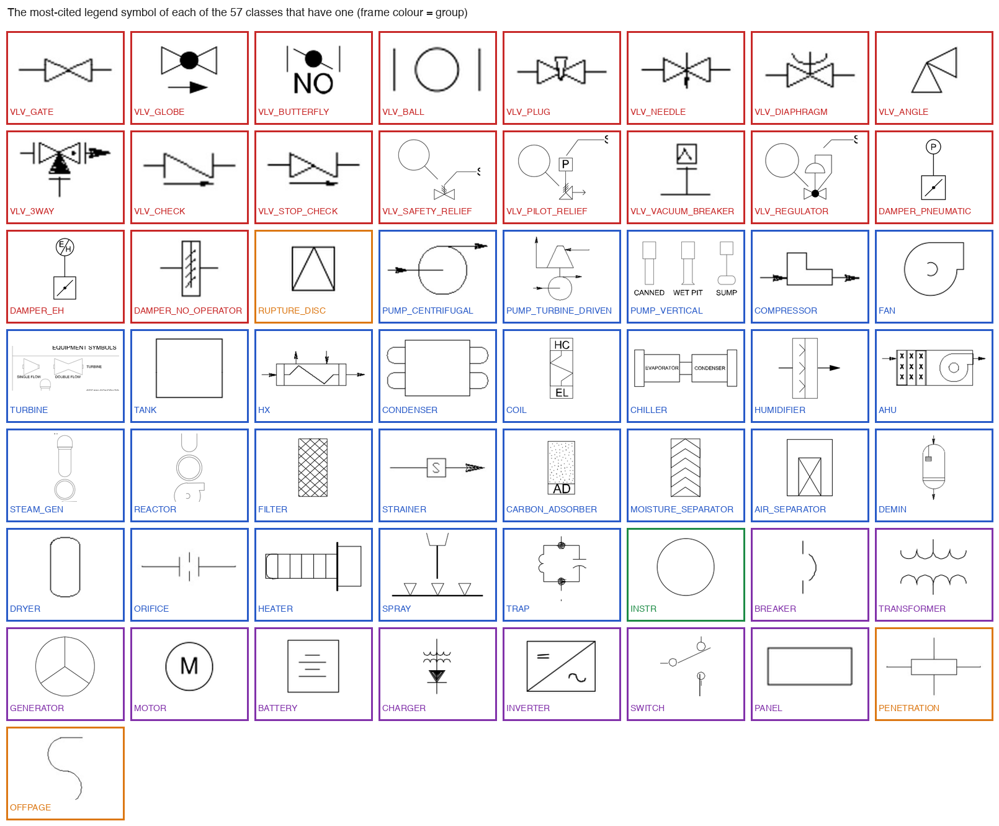

### Valves and dampers

| class | definition | legend symbol | modeled in PRA | boxes |
|---|---|---|---|---:|
| [`VLV_GATE`](#vlv_gate) | Gate valve / generic two-way valve (plain bowtie) | yes | yes | 1298 (25 uncertain) |
| [`VLV_GLOBE`](#vlv_globe) | Globe valve (bowtie with a dot at the waist) | yes | yes | 132 |
| [`VLV_BUTTERFLY`](#vlv_butterfly) | Butterfly valve | yes | yes | 92 |
| [`VLV_BALL`](#vlv_ball) | Ball valve | yes | yes | 0 |
| [`VLV_PLUG`](#vlv_plug) | Plug valve | yes | yes | 0 |
| [`VLV_NEEDLE`](#vlv_needle) | Needle valve | yes | yes | 0 |
| [`VLV_DIAPHRAGM`](#vlv_diaphragm) | Diaphragm valve | yes | yes | 0 |
| [`VLV_ANGLE`](#vlv_angle) | Angle valve | yes | yes | 5 |
| [`VLV_3WAY`](#vlv_3way) | Three-way / four-way valve | yes | yes | 9 |
| [`VLV_CHECK`](#vlv_check) | Check valve (swing, tilting disc, non-return) | yes | yes | 494 (4 uncertain) |
| [`VLV_STOP_CHECK`](#vlv_stop_check) | Stop-check valve (check valve with a stem, manual or powered) | yes | yes | 37 (4 uncertain) |
| [`VLV_SAFETY_RELIEF`](#vlv_safety_relief) | Spring safety or relief valve (the symbol does not tell safety from relief; the tag does) | yes | yes | 39 |
| [`VLV_PILOT_RELIEF`](#vlv_pilot_relief) | Pilot-operated safety relief valve and its pilot (POSRV, PORV) | yes | yes | 12 |
| [`VLV_VACUUM_BREAKER`](#vlv_vacuum_breaker) | Vacuum breaker / vacuum relief valve | yes | yes | 0 |
| [`VLV_REGULATOR`](#vlv_regulator) | Self-actuated pressure regulator | yes | yes | 2 |
| [`DAMPER_MOTOR`](#damper_motor) | Motor-operated damper (any system) | yes | yes | 0 |
| [`DAMPER_PNEUMATIC`](#damper_pneumatic) | Pneumatic (air) operated damper (any system) | yes | yes | 27 |
| [`DAMPER_EH`](#damper_eh) | Electro-hydraulic operated damper (any system) | yes | yes | 30 |
| [`DAMPER_NO_OPERATOR`](#damper_no_operator) | Damper with no operator drawn (parallel blade, gravity, fire damper, ...) | yes | yes | 15 |

#### VLV_GATE

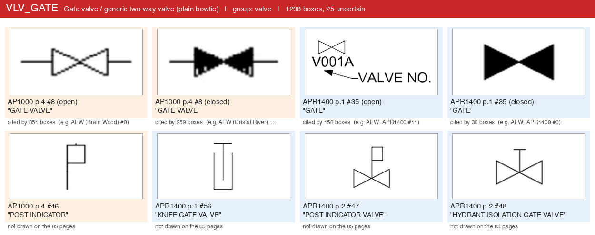

#### VLV_GLOBE

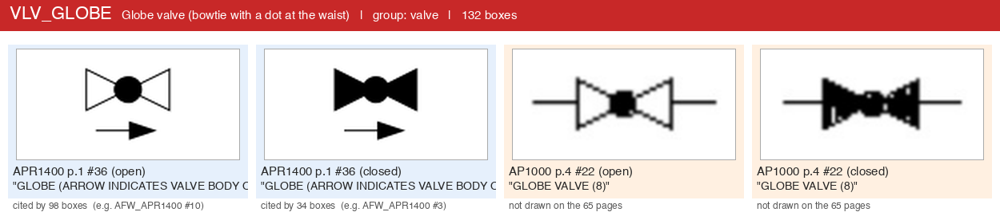

#### VLV_BUTTERFLY

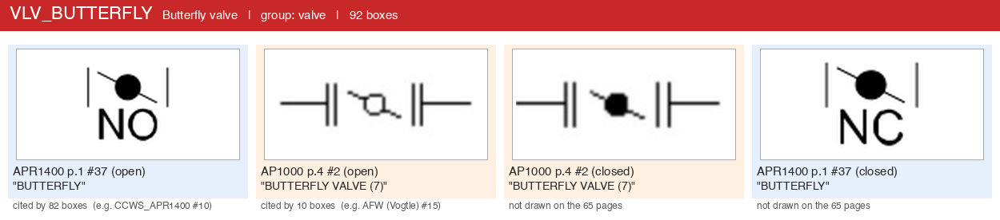

#### VLV_BALL

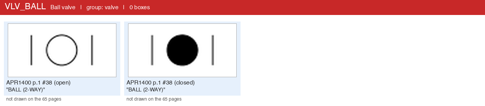

#### VLV_PLUG

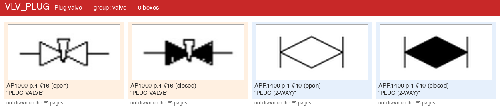

#### VLV_NEEDLE

#### VLV_DIAPHRAGM

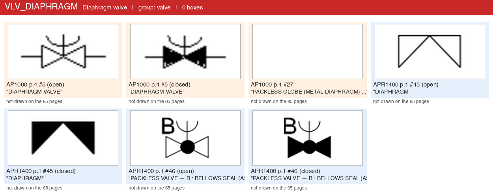

#### VLV_ANGLE

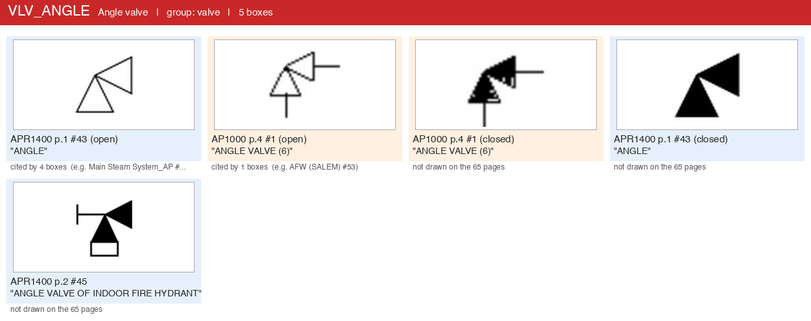

#### VLV_3WAY

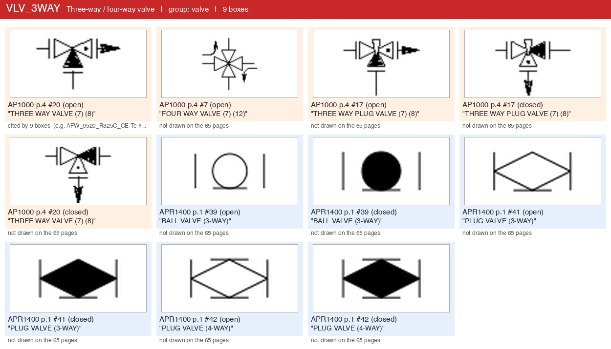

#### VLV_CHECK

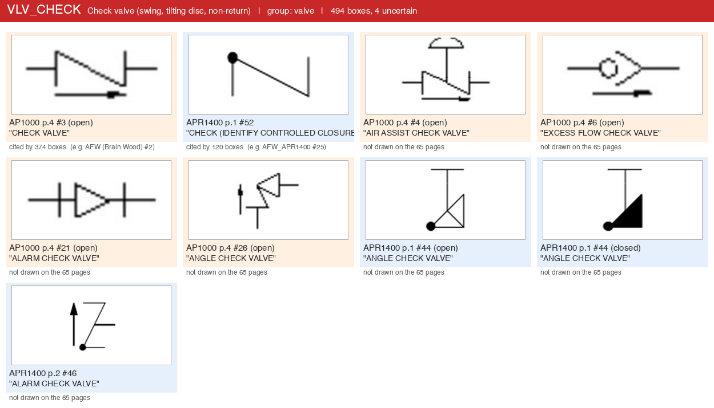

#### VLV_STOP_CHECK

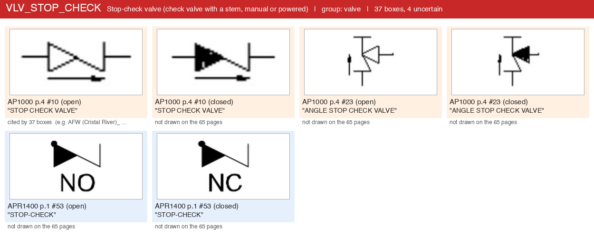

#### VLV_SAFETY_RELIEF

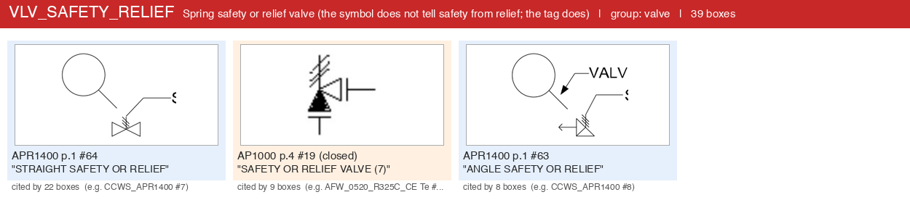

#### VLV_PILOT_RELIEF

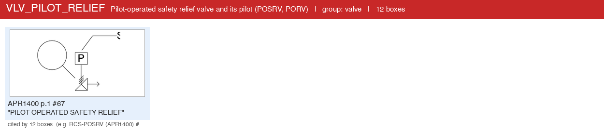

#### VLV_VACUUM_BREAKER

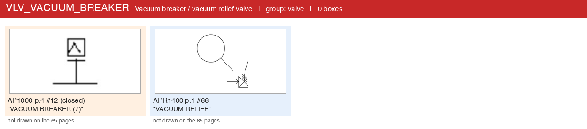

#### VLV_REGULATOR

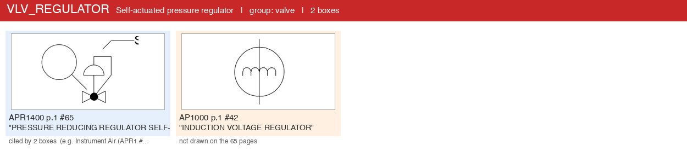

#### DAMPER_MOTOR

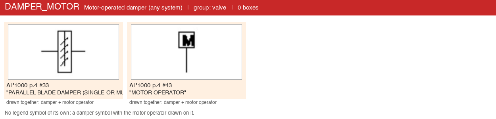

#### DAMPER_PNEUMATIC

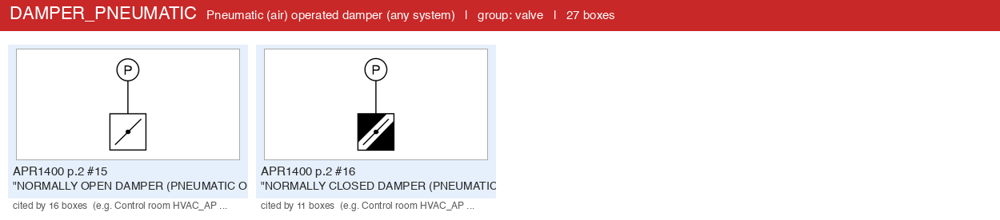

#### DAMPER_EH

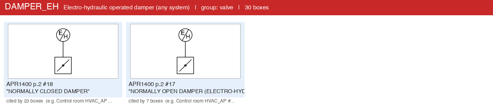

#### DAMPER_NO_OPERATOR

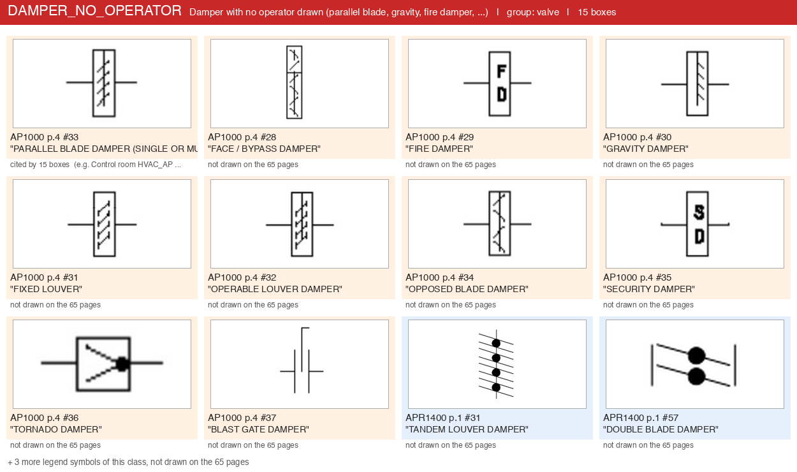

### Equipment

| class | definition | legend symbol | modeled in PRA | boxes |
|---|---|---|---|---:|
| [`PUMP_CENTRIFUGAL`](#pump_centrifugal) | Centrifugal pump (incl. horizontal centrifugal); the driver is the actuator | yes | yes | 113 |
| [`PUMP_TURBINE_DRIVEN`](#pump_turbine_driven) | Turbine-driven pump | yes | yes | 22 |
| [`PUMP_VERTICAL`](#pump_vertical) | Vertical pump (canned / wet pit / sump) | yes | yes | 13 |
| [`COMPRESSOR`](#compressor) | Compressor | yes | yes | 12 |
| [`FAN`](#fan) | Fan / blower | yes | yes | 48 |
| [`TURBINE`](#turbine) | Turbine (incl. turbine-generator) | yes | yes | 22 |
| [`TANK`](#tank) | Tank / vessel / accumulator | yes | yes | 76 |
| [`HX`](#hx) | Heat exchanger / cooler / feedwater heater | yes | yes | 124 |
| [`CONDENSER`](#condenser) | Condenser | yes | yes | 11 |
| [`COIL`](#coil) | Heating or cooling coil (HVAC) | yes | no | 40 |
| [`CHILLER`](#chiller) | Chiller | yes | yes | 11 |
| [`HUMIDIFIER`](#humidifier) | Humidifier (HVAC) | yes | yes | 4 |
| [`AHU`](#ahu) | Air handling unit / cubicle cooler housing | yes | yes | 9 |
| [`STEAM_GEN`](#steam_gen) | Steam generator | yes | no | 73 |
| [`REACTOR`](#reactor) | Reactor vessel | yes | no | 1 |
| [`PRESSURIZER`](#pressurizer) | Pressurizer | no | no | 1 |
| [`FILTER`](#filter) | Filter (piping filter, prefilter, postfilter, HEPA filter) | yes | yes | 68 |
| [`STRAINER`](#strainer) | Strainer (basket, Y-type, mesh) | yes | yes | 16 |
| [`CARBON_ADSORBER`](#carbon_adsorber) | Carbon (charcoal) adsorber | yes | yes | 12 |
| [`MOISTURE_SEPARATOR`](#moisture_separator) | Moisture separator | yes | yes | 12 |
| [`AIR_SEPARATOR`](#air_separator) | Air separator assembly | yes | yes | 1 |
| [`DEMIN`](#demin) | Demineralizer / ion exchanger | yes | yes | 10 |
| [`DRYER`](#dryer) | Air dryer | yes | yes | 5 |
| [`ORIFICE`](#orifice) | Orifice / flow element / venturi | yes | no | 103 (10 uncertain) |
| [`HEATER`](#heater) | Electric heater | yes | yes | 4 |
| [`SPRAY`](#spray) | Spray: spray nozzle, spray header, sparger | yes | yes | 21 |
| [`SUMP`](#sump) | Sump | no | yes | 1 |
| [`TRAP`](#trap) | Steam trap | yes | no | 0 |
| [`ENGINE`](#engine) | Diesel engine / prime mover drawn on its own | no | no | 1 |

#### PUMP_CENTRIFUGAL

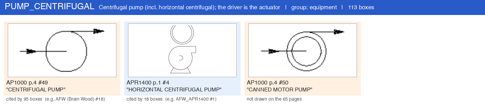

#### PUMP_TURBINE_DRIVEN

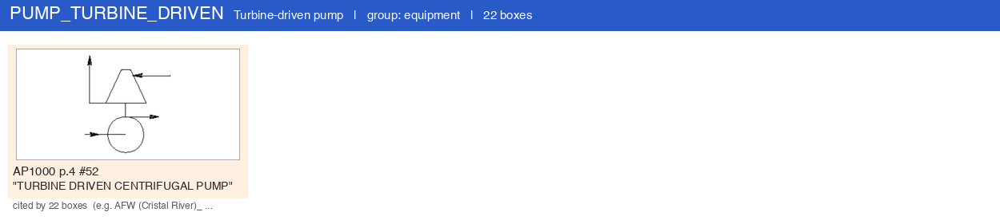

#### PUMP_VERTICAL

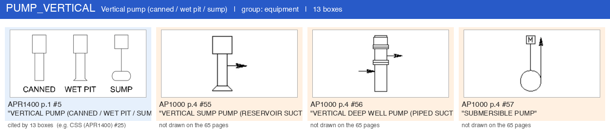

#### COMPRESSOR

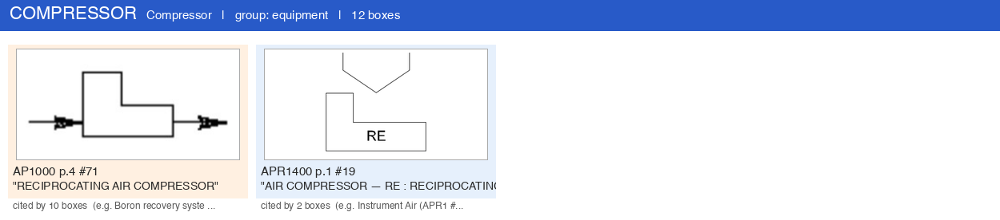

#### FAN

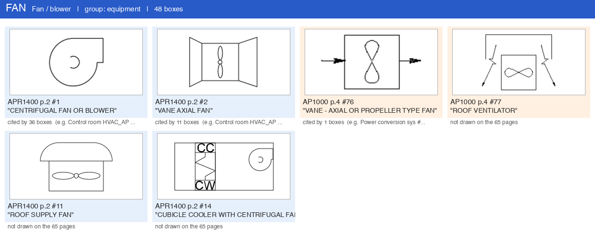

#### TURBINE

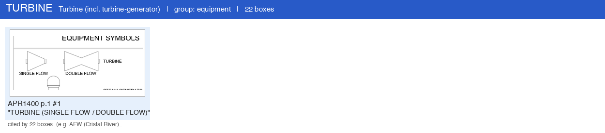

#### TANK

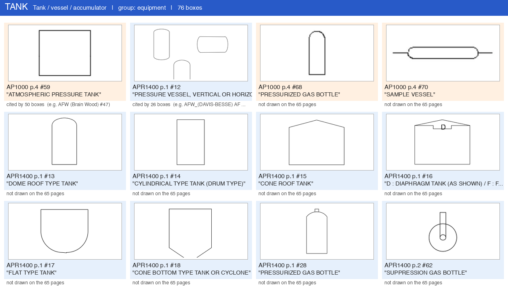

#### HX

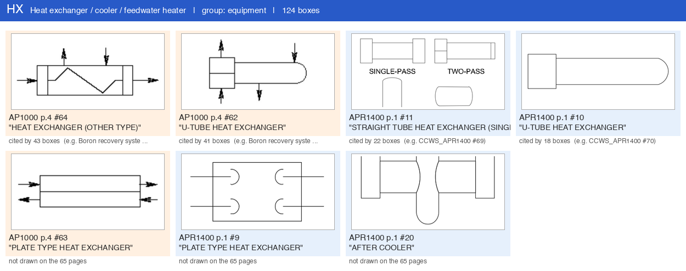

#### CONDENSER

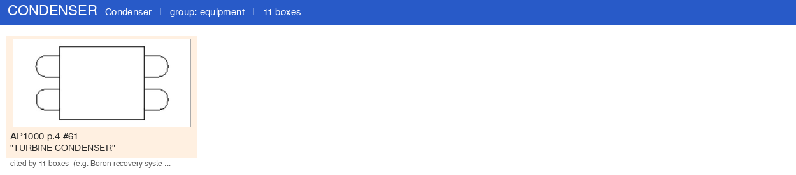

#### COIL

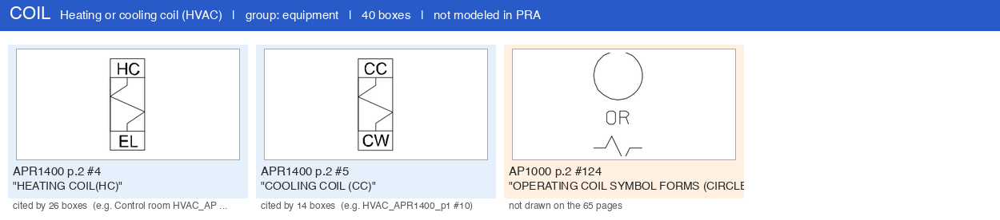

#### CHILLER

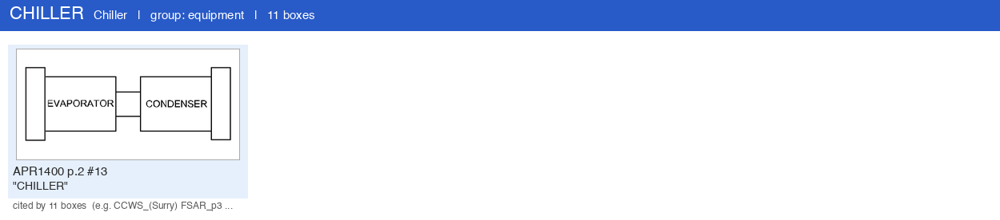

#### HUMIDIFIER

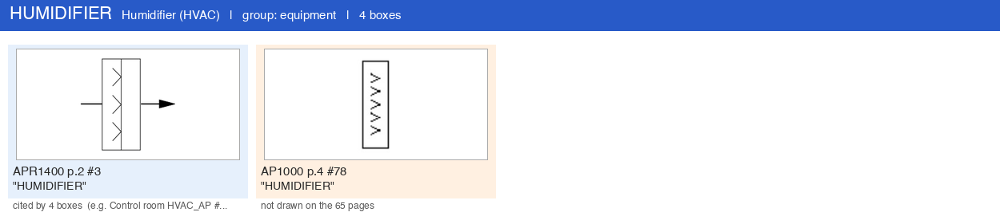

#### AHU

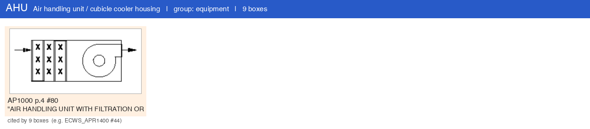

#### STEAM_GEN

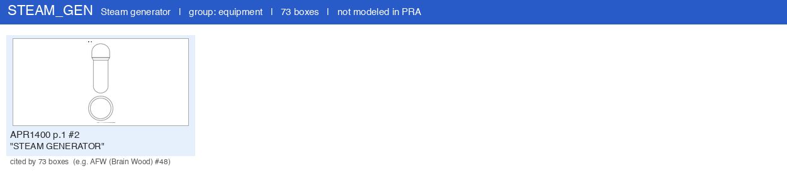

#### REACTOR

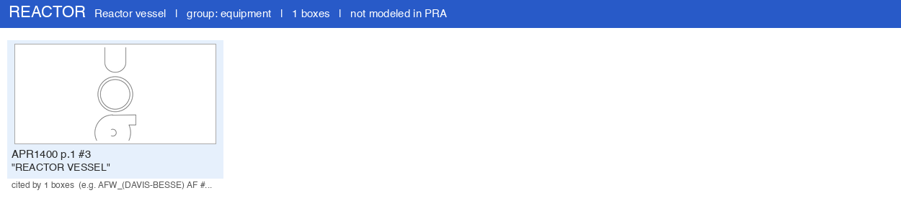

#### PRESSURIZER

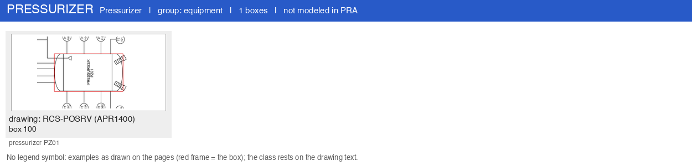

#### FILTER

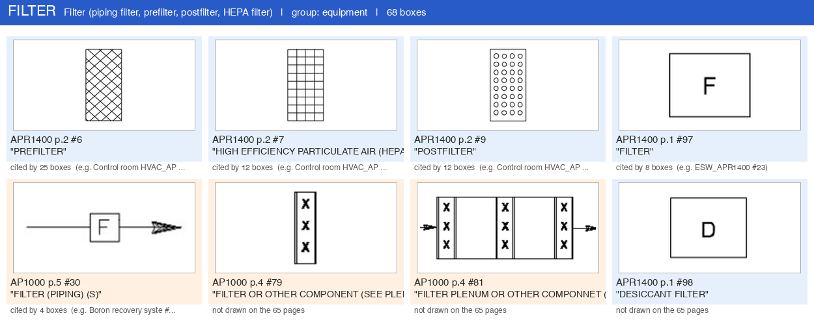

#### STRAINER

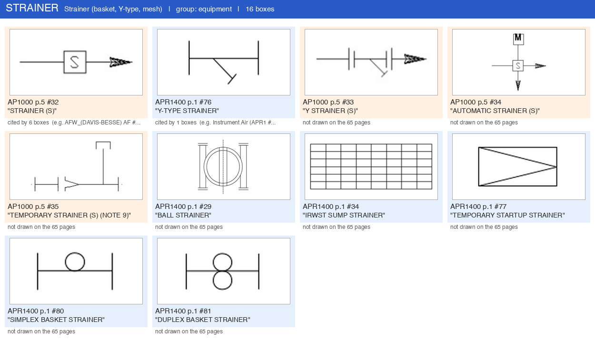

#### CARBON_ADSORBER

#### MOISTURE_SEPARATOR

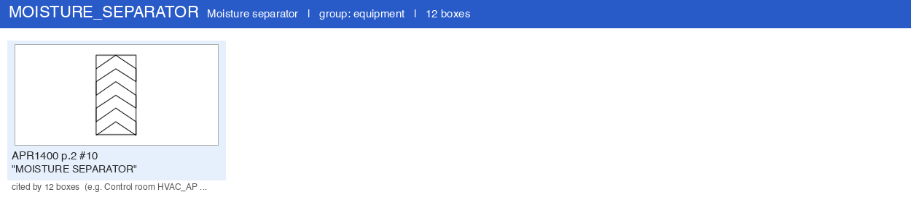

#### AIR_SEPARATOR

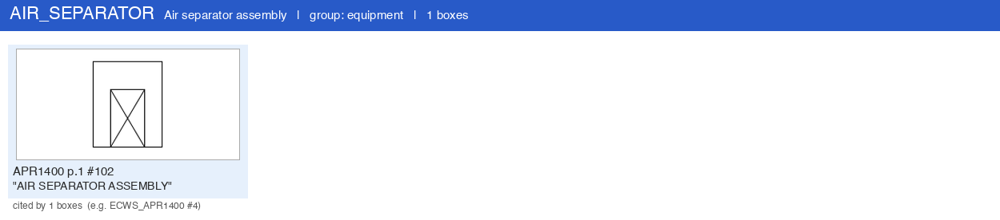

#### DEMIN

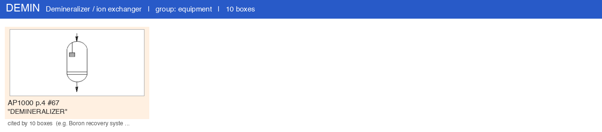

#### DRYER

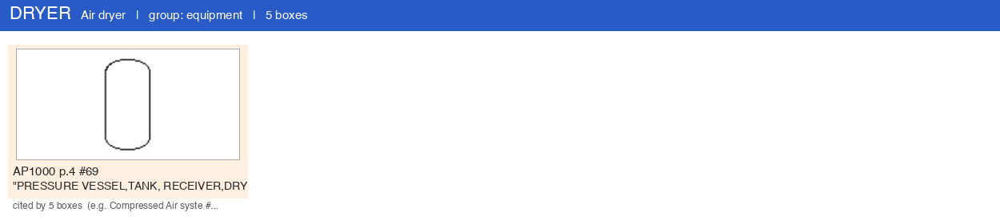

#### ORIFICE

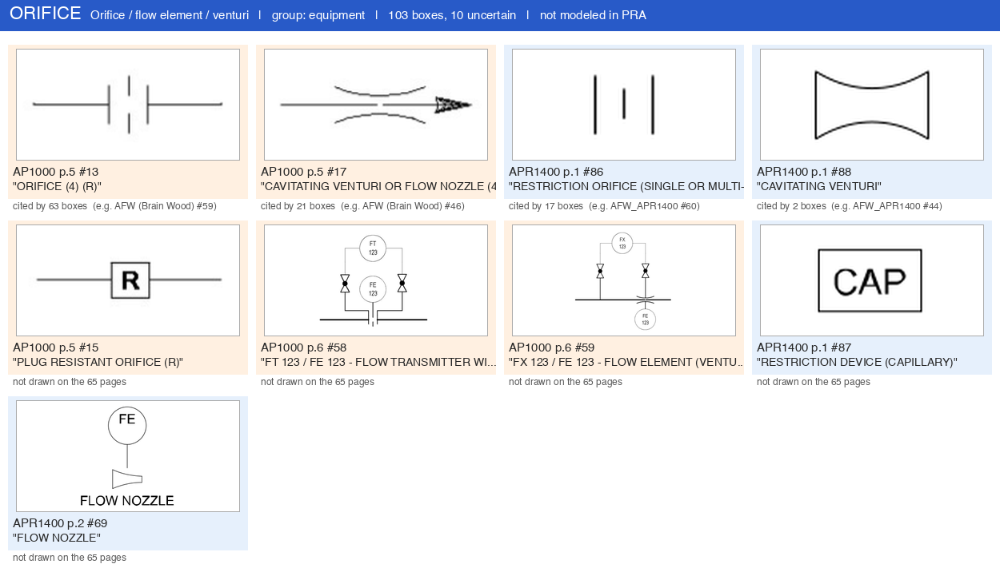

#### HEATER

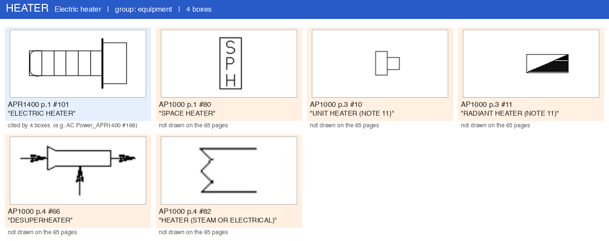

#### SPRAY

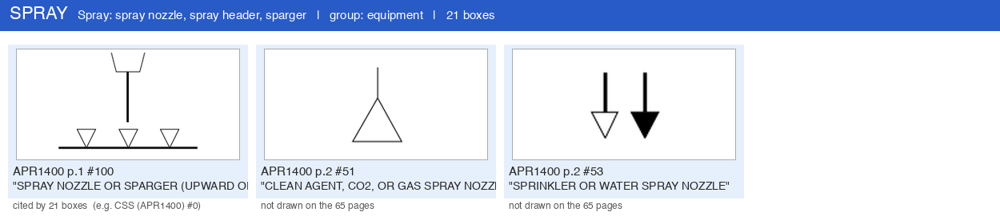

#### SUMP

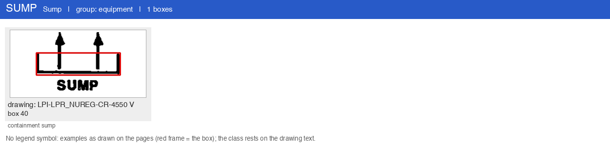

#### TRAP

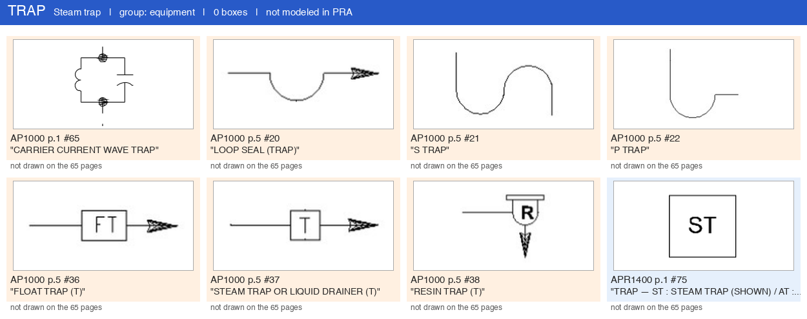

#### ENGINE

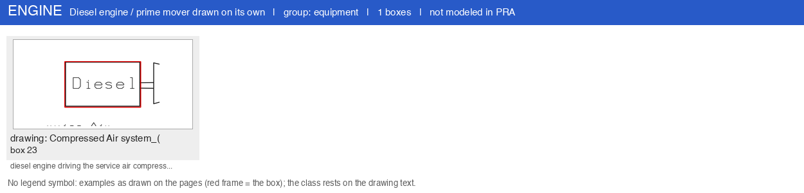

### Instruments

| class | definition | legend symbol | modeled in PRA | boxes |
|---|---|---|---|---:|
| [`INSTR`](#instr) | Instrument (bubble or box with a tag) | yes | no | 78 |

#### INSTR

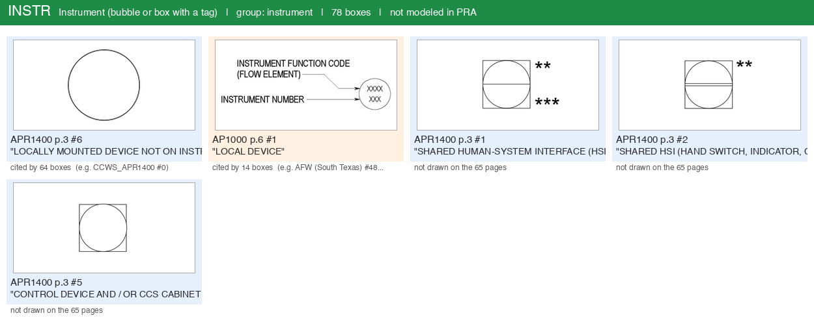

### Electrical

| class | definition | legend symbol | modeled in PRA | boxes |
|---|---|---|---|---:|
| [`BREAKER`](#breaker) | Circuit breaker | yes | yes | 181 |
| [`TRANSFORMER`](#transformer) | Transformer | yes | yes | 37 |
| [`GENERATOR`](#generator) | Generator (incl. diesel generator) | yes | no | 10 |
| [`MOTOR`](#motor) | Motor drawn on its own | yes | yes | 17 |
| [`BATTERY`](#battery) | Battery | yes | yes | 3 |
| [`CHARGER`](#charger) | Battery charger / rectifier | yes | yes | 3 |
| [`INVERTER`](#inverter) | Inverter / UPS | yes | yes | 6 |
| [`SWITCH`](#switch) | Switch / disconnect / transfer switch | yes | yes | 5 |
| [`PANEL`](#panel) | Distribution panel / MCC / switchgear box | yes | yes | 7 |

#### BREAKER

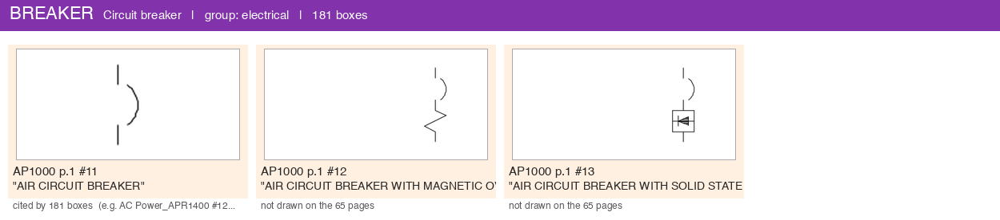

#### TRANSFORMER

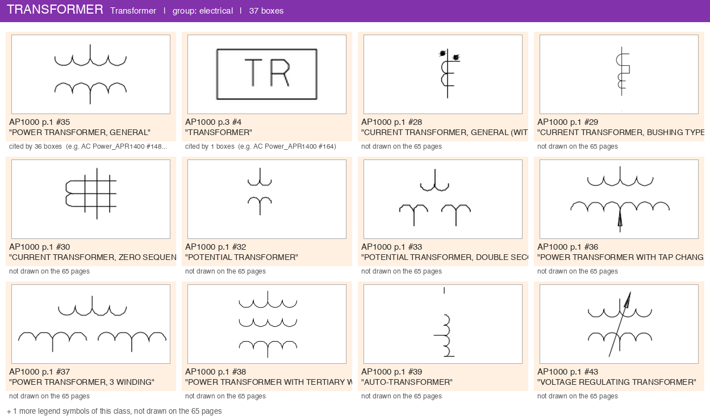

#### GENERATOR

#### MOTOR

#### BATTERY

#### CHARGER

#### INVERTER

#### SWITCH

#### PANEL

### Other

| class | definition | legend symbol | modeled in PRA | boxes |
|---|---|---|---|---:|
| [`RUPTURE_DISC`](#rupture_disc) | Rupture disc | yes | no | 2 |
| [`PENETRATION`](#penetration) | Containment penetration (box on the containment boundary, e.g. 'PC') | yes | no | 18 |
| [`OFFPAGE`](#offpage) | Off-page connector / system interface | yes | no | 52 |
| [`BLOCK`](#block) | Labelled equipment block (named by its text) | no | no | 18 |
| [`OTHER`](#other) | Other | no | no | 20 (9 uncertain) |

#### RUPTURE_DISC

#### PENETRATION

#### OFFPAGE

#### BLOCK

#### OTHER

## Actuators

The operator of valves and dampers and the driver of pumps (`-` for all other classes). A valve keeps one class per body
symbol and its operator is the actuator, so the fault-tree type follows from class + actuator. Each image shows the
operator symbols of the legends tied to the boxes with this actuator; a driver without an operator symbol (turbine,
diesel) and `UNSPEC` show examples as drawn. `NONE` (no operator drawn) and `-` have no image.

| actuator | definition | boxes |
|---|---|---:|
| `NONE` | No operator drawn and none named on the drawing (manual / check / self-acting valve, pump whose driver is not shown) | 1496 |
| `MOTOR` | Motor operator or motor driver, drawn (M) or named on the drawing (e.g. MOTOR DRIVEN, MD, an MOV / MDP tag) | 527 |
| `AIR` | Air / pneumatic operator (diaphragm or piston) | 209 |
| `SOLENOID` | Solenoid operator | 7 |
| `HYDRAULIC` | Hydraulic operator | 1 |
| `EH` | Electro-hydraulic operator | 60 |
| `UNSPEC` | Operator drawn, type neither identifiable from the symbol nor named on the drawing | 16 |
| `TURBINE` | Turbine driver (pumps), drawn or named on the drawing (e.g. TURBINE DRIVEN, TD) | 23 |
| `DIESEL` | Diesel / engine driver (pumps), drawn or named on the drawing | 8 |
| `-` | Not applicable (not a valve, damper or pump) | 1136 |

#### MOTOR (actuator)

#### AIR (actuator)

#### SOLENOID (actuator)

#### HYDRAULIC (actuator)

#### EH (actuator)

#### UNSPEC (actuator)

#### TURBINE (actuator)

#### DIESEL (actuator)

## Per-box columns

`symbol_classes.csv` (one row per box; `symbol_classes.json`: the same, grouped by page):

| column | content |
|---|---|
| `page`, `box_id` | the page and the box id (line number in `../labels/<page>.txt`) |
| `x0`, `y0`, `x1`, `y1` | the box in image pixels |
| `class`, `actuator` | see above |
| `normal_position` | valves with a stem and dampers: `open`, `closed`, `not shown` (a damper with no position symbol), `unknown` (half-filled body); `n/a` for check, relief and other self-acting valves and all other classes |
| `locked` | `LO` / `LC` where the drawing marks the valve locked open / closed |
| `ft_component_type` | fault-tree component type from class + actuator (`ft_component_types.csv`); empty where there is none yet |
| `pra_modeled` | `yes` / `no`, from the class |
| `uncertain` | `yes` where the symbol is drawn ambiguously and its page has no legend |
| `class_evidence`, `position_evidence` | where the class and the position come from: the labelers' note, the actuator label, the class label, or the automatic legend match |
| `review` | the review sheet(s) the box is on |
| `legend_entry` | the legend entry the box is tied to (`../legend_library/`) |
| `note` | the labelers' note |

Counts: normal position `open` 1269, `closed` 357, `not shown` 15, `unknown` 4; locked `LO` 155, `LC` 20; `pra_modeled = no` 417.

## How the class is decided

1. The labelers' note: "stop-check", "pilot" / "POSRV", "vacuum", "turbine-driven", "vertical", "strainer", "moisture
   separator", "air separator", "adsorber", ... decide the finer class.
2. The actuator label: dampers are classed by their operator (`DAMPER_MOTOR`, `DAMPER_PNEUMATIC`, `DAMPER_EH`,
   `DAMPER_NO_OPERATOR`), a pump with a turbine driver is `PUMP_TURBINE_DRIVEN`.
3. Only where the note says nothing: the legend entry the box was tied to (chosen automatically by image similarity
   among the legend symbols of its kind). Every box whose class rests on this alone is on a review sheet.

The normal position comes from the note ("normally closed", "solid body", "stippled", "LC", "LO", "normally open"), else
from the open / closed symbol of the legend entry (filled body = closed); a hollow body with no other evidence is `open`.
Every `closed` and `unknown` box is on a review sheet.

Fault-tree types: valves MOV, AOV, SOV, HOV (electro-hydraulic and hydraulic), XVM (manual), CKV (check and manual
stop-check), SRV (safety or relief: the symbol does not tell them apart, the tag does), PORV (pilot-operated), VBV (vacuum
breaker); pumps MDP, TDP, EDP (diesel), PMP (driver not shown); dampers MOD (motor), PND (pneumatic); FLT (filter), STR
(strainer). `DAMPER_EH`, `DAMPER_NO_OPERATOR`, `CARBON_ADSORBER`, `MOISTURE_SEPARATOR`, `AIR_SEPARATOR` and the classes
without a fault-tree role have no type.

## Review

`review.xlsx`: a README sheet, the class list, and one sheet per decision, every row with a crop of the box on its
drawing (red frame = the box), the proposal and empty columns for the decision:

| sheet | boxes | decision |
|---|---:|---|
| `fan_or_pump` | 48 | fans and pumps can share the circular symbol on HVAC drawings: fan, or which pump |
| `normal_position` | 361 | the normally closed valves and dampers, and the ones whose position could not be read |
| `auto_split` | 9 | the class rests only on the automatic legend match |
| `other` | 20 | boxes of class `OTHER`: a class where one fits |
| `uncertain` | 52 | the rows marked uncertain |

The decisions will be applied to `symbol_classes.csv` and the files of this folder rebuilt.

## Files

- `classes.csv` (class, definition, group, legend_png, pra_modeled, count), `classes.txt` (the class names in the order
  of the class index), `actuators.csv`, `ft_component_types.csv` (class|actuator -> fault-tree type).
- `symbol_classes.csv` / `.json`: one row per box (above).
- `labels/<page>.txt`: YOLO labels `class cx cy w h` with the class index of `classes.txt` (same boxes and order as
  `../labels/<page>.txt`).
- `class_reference/<CLASS>.png`, `class_reference/actuator_<ACTUATOR>.png`, `class_reference/overview.png`: the images of
  [Classes](#classes) and [Actuators](#actuators).
- `overlay/<page>.jpg`, `index.md`: one overview per page.
- `review.xlsx`: the review workbook.
- `code/`: `derive_classes.py` (the classes, normal positions and the files above from the earlier class labels and the
  legend links), `update_legend_classes.py` (the classes in `../legend_library/derived/`), `make_class_reference.py`
  (`class_reference/`), `render_overlays.py` (`overlay/`, `index.md`), `make_review.py` (`review.xlsx`).
